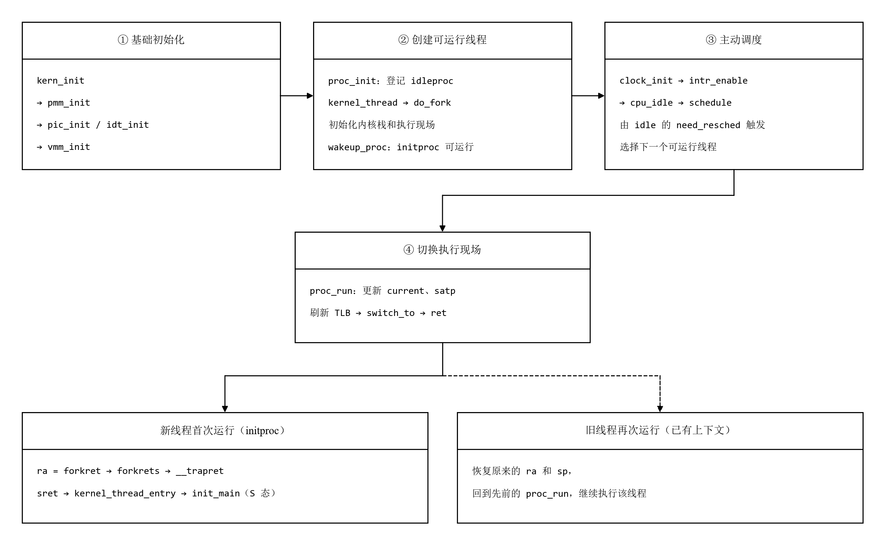
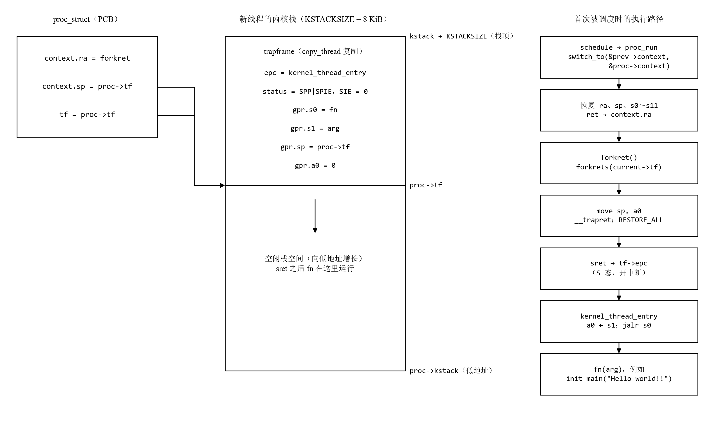
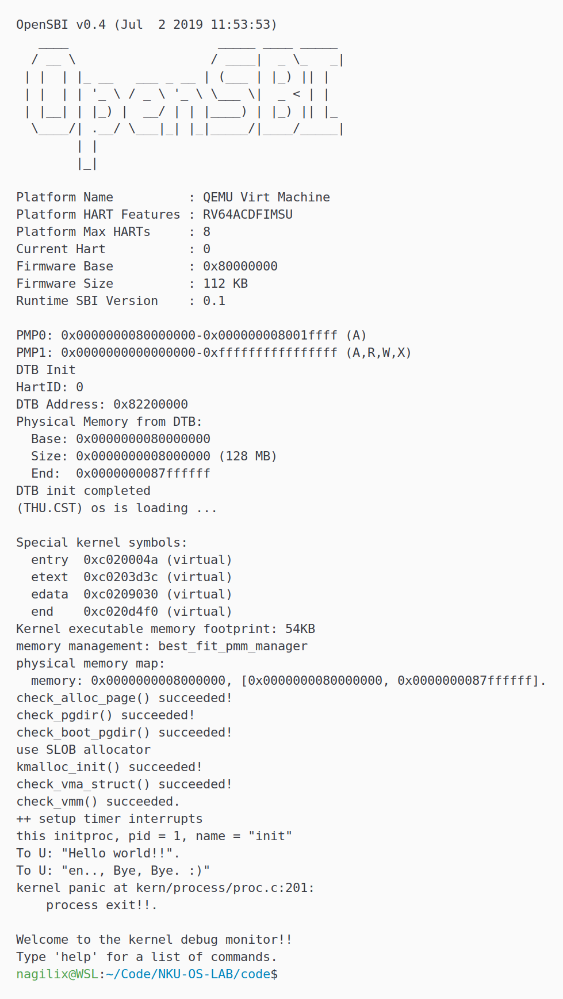
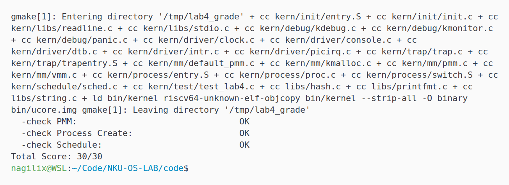

# <center>操作系统 lab4 实验报告</center>

<h5 align="center">实验名称：进程管理  完成日期：2026-11-20</h5 align="center">
<h5 align="center">小组成员：2411264-张远、2414099-李云鹏、2413074-刘昀皓</h5 align="center">


# 小组分工

| 成员 | 负责的练习/模块/代码/报告 |
|------|----------------|
| 2411264-张远 | 环境与框架、功能模块二（进程创建及初始化）、功能模块三（进程调度）、报告集成与最终评测 |
| 2414099-李云鹏 | 功能模块一（虚拟内存页操作）、实验整体逻辑分析、对操作系统的理解 |
| 2413074-刘昀皓 | Challenge（开关中断机制、get_pte 与分页模式）、实验目的、实验环境、测试与验证、AI 协作开发的经验 |


# 一、实验目的

1. **理解并掌握虚拟内存管理的组织方式与多级页表维护机制**：
   - 理解在 Sv39 三级页表框架下，`page_insert()` 与 `page_remove()` 如何联动维护页表项内容、物理页引用计数（`struct Page.ref`）与 TLB 状态（`sfence.vma` / `tlb_invalidate()`）三者的一致性；
   - 理解虚拟内存描述结构（`mm_struct`、`vma_struct`）与多级页表按需建立、权限更新和幂等撤销的基本组织方式。

2. **掌握内核线程的创建、初始化与生命周期管理过程**：
   - 理解进程控制块 `struct proc_struct` 的关键字段（状态 `state`、`pid`、内核栈 `kstack`、上下文 `context`、中断帧 `tf`、页目录基址 `pgdir` 及链表/哈希表挂接关系）；
   - 掌握 0 号空闲线程 `idleproc` 复用启动现场的初始化过程，以及通过 `kernel_thread()`、`do_fork()`、`copy_thread()`、`setup_kstack()` 创建 1 号内核线程 `initproc` 并构造首次运行链路的完整机理。

3. **掌握内核线程的上下文切换与基本调度过程**：
   - 理解 `cpu_idle()` 主动让出 CPU、`schedule()` 在 `proc_list` 中按 FIFO/轮转策略选取 `PROC_RUNNABLE` 线程、`proc_run()` 在关中断临界区内切换 `current` 与 `satp` 页表的完整协调流程；
   - 深入理解 `switch_to()` 保存与恢复被调用者保存寄存器（`ra`、`sp`、`s0`-`s11`）以及经由 `forkret -> forkrets -> __trapret` 跳转至 `kernel_thread_entry` 启动新线程的底层控制流转换。

4. **持续深化契约化 AI 协同内核工程实践**：
   - 继续实践“四段式提示词 + `.handoff/` 异步看板 + 端到端评测注入”的团队协作范式，在功能拆分、边界约束与跨成员模块集成中提升代码正确率与文档可追溯性。


# 二、实验环境

## 软件与运行环境

| 成员 | 宿主系统 | QEMU 版本 | 交叉编译工具链 | 调试器版本 |
| :--- | :--- | :--- | :--- | :--- |
| 2411264-张远 | WSL2 Ubuntu 24.04 | 4.1.1（OpenSBI v0.4） | riscv64-unknown-elf-gcc 15.1.0 | riscv64-unknown-elf-gdb 16.3 |
| 2414099-李云鹏 | WSL2 Ubuntu 22.04 | 4.1.1（OpenSBI v0.4） | SiFive riscv64-unknown-elf-gcc 10.2.0 | riscv64-unknown-elf-gdb 10.1 |
| 2413074-刘昀皓 | WSL2 Ubuntu 24.04 | 4.1.1（OpenSBI v0.4） | riscv64-unknown-elf-gcc 15.1.0 | riscv64-unknown-elf-gdb 16.3 |

## AI 工具与底层模型

全组继续采用多工具、多模型的异构 Agent 协作模式，各成员分工与工具链配置如下：

| 成员 | 负责任务 | AI 编程工具 | 底层模型 | 备注 / 特殊配置 |
| :--- | :--- | :--- | :--- | :--- |
| 2411264-张远 | T0, T2, T3, T6 | Claude Code | Claude Opus 5.5 | 环境集成、进程创建与调度实现、报告集成 |
| 2414099-李云鹏 | T1, T4 | Codex | gpt-6.1-sol | 虚拟内存页操作、整体逻辑与 OS 原理对照 |
| 2413074-刘昀皓 | T5 | Antigravity | Gemini 4 Argon / Gemini 4 Neon / Gemini 4 Hydrogen | Challenge 剖析、公共章节撰写与测试验证 |


# 三、实验整体逻辑分析

## 2.1 本章节的逻辑主线

**Lab4 的核心任务**是建立内核线程的调度基础：将启动栈上的初始执行流封装为 `idleproc`，创建首个新线程 `initproc`，并完成 CPU 使用权的移交。三大模块分别落实了**页表映射维护**、**可运行实体构造**与**执行现场切换**。其中，线程创建仅代表其进入就绪队列、获得调度资格；直至调度器将其选中并完成栈与入口的切换，线程方才真正开始执行。


<p align="center">图 1　Lab4 启动、线程创建与首次调度流程</p>

## 2.2 功能的逐步实现

1. **先建立内存和中断基础**。`kern_entry` 已装入启动页表，进入 `kern_init()` 后，`pmm_init()` 初始化物理页管理，并通过自检函数验证页表的增删逻辑。模块一的 `page_insert()` 与 `page_remove()` 负责更新 PTE、维护物理页引用计数并使旧的地址翻译失效。`pic_init()` 在本版本中为空实现，中断向量由 `idt_init()` 将 `stvec` 指向 `__alltraps`；随后 `vmm_init()` 执行 VMA 自检。新线程通过物理页分配器申请内核栈，并沿用既有的内核映射，并非为每个线程通过 `page_insert()` 单独新建栈映射或独立页表。
2. **准备执行现场，使线程具备调度资格**。`proc_init()` 将当前执行流登记为使用启动栈的 PID 0（`idleproc`），使 `current` 指向它并设置 `need_resched` 标志。接着通过 `kernel_thread(init_main, ...)` 构造初始 `trapframe`，将函数入口与参数分别放入 `s0` 与 `s1`，并令 `epc` 指向 `kernel_thread_entry`。`do_fork()` 分配 PCB 与内核栈，本实验中的 `copy_mm()` 暂不复制地址空间；`copy_thread()` 将 `trapframe` 放置于新栈顶，并将 `context.ra` 和 `context.sp` 分别设为 `forkret` 及其对应的栈帧地址。在完成 PID 分配、链表与哈希表登记后，通过 `wakeup_proc()` 将新线程置为 `PROC_RUNNABLE`，随后 `proc_init()` 将其登记为 `initproc`（PID 1）。
3. **择优运行并执行上下文切换**。`proc_init()` 返回后，`kern_init()` 依次调用 `clock_init()`、`intr_enable()`，随后进入 `cpu_idle()`。首次 `schedule()` 由 `idleproc` 初始化时设置的 `need_resched` 触发，而非等待时钟中断到来。`schedule()` 清除当前线程的调度请求，从环形链表 `proc_list` 中搜寻下一个可运行线程；从 `idle` 出发时从表头哨兵之后开始检索，若未找到则回退至 `idle` 兜底。仅当选中的线程与 `current` 不同时才调用 `proc_run()`；后者在关中断的临界区内更新 `current`、写入 `satp` 寄存器、刷新 TLB，并调用 `switch_to()` 保存旧线程的 `ra`、`sp` 及 `s0`～`s11` 寄存器，同时恢复新线程对应的寄存器上下文。
4. **新线程首次启动与旧线程恢复分流**。`switch_to()` 的 `ret` 指令跳转至恢复出的 `ra`。对于首次运行的 `initproc`，其执行流为 `forkret` $\rightarrow$ `forkrets` $\rightarrow$ `__trapret`，最终通过 `sret` 返回至 `kernel_thread_entry`，并在 S 态下执行 `init_main(arg)`。而对于经历过切换并再次被调度的老线程，其 `ra` 为此前调用 `switch_to()` 时的返回地址，因此会直接从自身的 `proc_run()` 后续代码继续执行，不再经过 `forkret` 路径。`init_main()` 返回后将进入 `do_exit()`，不过在 Lab4 中 `do_exit()` 仍为 `panic` 占位，尚未实现完整的正常退出与资源回收逻辑。


# 四、实验内容与实现

## 功能模块一：虚拟内存页操作

**负责人：** 2414099-李云鹏（lyp）

### 模块功能描述

**需要实现的函数：**

```c
int page_insert(pde_t *pgdir, struct Page *page, uintptr_t la, uint32_t perm);
void page_remove(pde_t *pgdir, uintptr_t la);
```

本模块在 `kern/mm/pmm.c` 中实现页映射的建立与撤销。修改映射时，除了更新页表项，还要调整物理页的引用计数，并使对应的 TLB 缓存失效。内核的 `check_pgdir()` 和 `check_boot_pgdir()` 会调用这两个函数检查页表操作。

`page_insert` 先调用 `get_pte(pgdir, la, 1)` 查找末级页表项，缺少页表时由 `get_pte` 分配。如果返回 `NULL`，函数直接返回 `-E_NO_MEM`，不改动待映射物理页的引用计数。取得页表项后，先增加新页的引用计数，再根据原映射分别处理：

| 原映射状态 | 处理方式 |
|---|---|
| 无有效映射 | 建立新映射，新页引用计数增加 1 |
| 已映射到同一物理页 | 减去刚增加的引用，保留原映射关系，只更新权限 |
| 已映射到另一物理页 | 调用 `page_remove` 撤销旧映射；旧页引用计数归零时释放旧页 |

同页重复插入时，不能先删除旧映射再建立新映射，否则该页可能因引用计数暂时归零而被释放。因此，这里先增加引用，再在同页分支中抵消。处理完原映射后，用 `pte_create(page2ppn(page), perm)` 写入新页表项，调用 `tlb_invalidate` 使对应地址的 TLB 缓存失效，最后返回 0。新权限由传入的 `perm` 决定，不保留旧权限位；`PTE_V` 由 `pte_create` 添加。

`page_remove` 使用 `get_pte(pgdir, la, 0)` 查找页表项，不分配新页表。如果存在有效映射，就先保存原物理页，再清零页表项、使对应 TLB 缓存失效，最后减少物理页的引用计数，归零时释放该页。这样可以避免物理页释放后仍被旧映射访问。若地址原本没有映射，函数直接返回，因此重复删除也不会再次减少引用计数。仍有其他引用的物理页不会被释放，中间页表也不在此处回收。

### 最终提示词

````markdown
本文件按已完成的接口设计和验证结果整理，用于复现实验功能。

## 建立、更新与撤销页映射

[PROMPT]

任务：在 lab4 的 `code/kern/mm/pmm.c` 中实现 `page_insert` 与 `page_remove`，为现有 Sv39 页表提供物理页映射维护。直接修改真实文件，保留框架及现有学习注释，将本模块标记写为 `//LAB4 function1 2414099`。仿照 `get_pte` 的函数说明格式，补充中文功能描述、parameter 参数说明和 return value 返回值说明。复用现有接口，不改评测脚本及测试函数。输出实现、处理分支的说明和实际验证结果。

[RELY]

以下摘自框架导入提交 `a7043b3`，省略注释；不引用本任务实现。`get_pte` 定位末级页表项，`create` 为真时可分配中间页表，分配失败返回 `NULL`；`page_ref_inc/dec` 返回修改后的引用计数；`pte_create` 自动设置 `PTE_V`。使用框架已有的 `tlb_invalidate` 刷新对应地址的 TLB。

`code/kern/mm/memlayout.h`：

```c
typedef uintptr_t pte_t;
typedef uintptr_t pde_t;
struct Page {
    int ref;
    uint_t flags;
    unsigned int property;
    list_entry_t page_link;
    list_entry_t pra_page_link;
    uintptr_t pra_vaddr;
};
```

`code/kern/mm/pmm.h` 中相关声明与宏：

```c
extern struct Page *pages;
extern pde_t *boot_pgdir_va;
struct Page *alloc_pages(size_t n);
void free_pages(struct Page *base, size_t n);
#define alloc_page() alloc_pages(1)
#define free_page(page) free_pages(page, 1)
pte_t *get_pte(pde_t *pgdir, uintptr_t la, bool create);
void page_remove(pde_t *pgdir, uintptr_t la);
int page_insert(pde_t *pgdir, struct Page *page, uintptr_t la, uint32_t perm);
void tlb_invalidate(pde_t *pgdir, uintptr_t la);
```

`code/kern/mm/pmm.h` 中相关内联接口（节选）：

```c
static inline ppn_t
page2ppn(struct Page *page)
{
    return page - pages + nbase;
}
static inline struct Page *
pte2page(pte_t pte)
{
    if (!(pte & PTE_V))
    {
        panic("pte2page called with invalid pte");
    }
    return pa2page(PTE_ADDR(pte));
}
static inline int
page_ref_inc(struct Page *page)
{
    page->ref += 1;
    return page->ref;
}
static inline int
page_ref_dec(struct Page *page)
{
    page->ref -= 1;
    return page->ref;
}
static inline pte_t pte_create(uintptr_t ppn, int type)
{
    return (ppn << PTE_PPN_SHIFT) | PTE_V | type;
}
```

`code/kern/mm/mmu.h` 和 `code/libs/error.h` 中权限位与错误码：

```c
#define PTE_V     0x001
#define PTE_R     0x002
#define PTE_W     0x004
#define PTE_U     0x010
#define E_NO_MEM            4
```

[GUARANTEE]

```c
int page_insert(pde_t *pgdir, struct Page *page, uintptr_t la, uint32_t perm);
void page_remove(pde_t *pgdir, uintptr_t la);
```

[SPECIFICATION]

`page_insert`：

- Pre-Condition：`pgdir` 是有效根页表；`page` 是已分配、可由框架管理的物理页；已有映射引用计数一致；`perm` 是调用者给出的权限组合；沿用框架单核执行条件与普通页映射约定。
- Post-Condition：成功返回 0，目标虚拟页映射到 `page`，末级 PTE 使用 `pte_create(page2ppn(page), perm)` 构造，引用计数与有效映射一致，更新后使对应 TLB 失效；定位 PTE 失败返回 `-E_NO_MEM`，不增减目标页引用、不改旧数据映射。
- Case 1：目标未映射，新增一次引用并写入 PTE。
- Case 2：目标已映射同一物理页，只更新权限，最终引用计数和空闲页数不变，不能释放该页。
- Case 3：目标映射其他物理页，移除旧映射并减少旧页引用；旧页引用归零时释放，仍有其他引用则保留；目标页新增一次引用。
- Case 4：`get_pte` 分配失败，不产生目标地址的有效末级映射。已有辅助函数可能保留已建成的中间页表，不要求修改其分配策略或回滚其他级页表。
- Requirements：不得把 `perm=0` 擅自改成读写权限；保留框架测试的 PTE 表示约定。先获得新页引用再处理旧映射，防止同页重复插入时误释放。

`page_remove`：

- Pre-Condition：根页表有效，已有映射引用计数一致。
- Post-Condition：若存在有效末级 PTE，则清零、刷新对应 TLB、减少物理页引用，并仅在引用归零时释放；若不存在有效映射则直接返回。
- Case 1：缺中间页表，不分配任何页表或数据页。
- Case 2：PTE 存在但无效，重复调用无副作用。
- Case 3：同页有多地址映射，只撤销当前映射；最后一个引用撤销后释放该物理页。
- Requirements：复用 `get_pte(pgdir, la, 0)`；不回收中间页表，避免影响其他映射；在物理页交还分配器之前清除 PTE 并使 TLB 失效。

验证：运行框架 `check_pgdir`、`check_boot_pgdir` 和未修改的官方 `test_lab4_pmm_basic`；补充实际地址访问、同页权限更新、共享页替换、分配失败、重复删除与空闲页数恢复检查。若其他任务尚未实现，在独立副本使用明确标注的启动桩验证 T1，并将模块得分与最终集成得分分别说明。
````

### 实现迭代过程

两个函数的主体逻辑在首次实现后没有再调整，后续主要处理构建和测试中遇到的问题。

首次构建报错 `No rule to make target 'kern/mm/best_fit_pmm.h'`。检查后发现，旧构建产物中残留了对该头文件的依赖。改用不含 `obj/`、`bin/` 的临时副本后，这一错误消失，但链接仍因缺少 `proc_init` 和 `cpu_idle` 失败。这两个函数分别属于尚未完成的 T2、T3，因此没有在 T1 中补写，而是在独立副本中添加最小启动桩，用于验证页映射操作。

补充测试的自查中还发现，官方 PMM 测试会保留中间页表。如果补充测试在结束时把这些原有页表一并释放，测试前后的空闲页数就无法直接比较。为此，调整了测试的清理逻辑：记录测试前的页表状态，只回收本次测试创建的页表，不改动内核实现。

在使用启动桩的独立副本中，编译和 `make qemu` 验证通过，`check_pgdir()`、`check_boot_pgdir()` 及补充断言均通过；`make grade` 的 PMM 项得到 10/10 分。该副本的总分为 10/30，只能说明本模块通过，不能作为完整工程通过评测的依据。功能模块二、三完成后，完整工程（不加任何桩）的 `make grade` 中 PMM 项同样通过，总分 30/30。


## 功能模块二：进程创建及初始化

**负责人：** 2411264-张远（openfar）

### 模块功能描述

**需要实现的函数：**

```c
static struct proc_struct *alloc_proc(void);
void proc_init(void);
int kernel_thread(int (*fn)(void *), void *arg, uint32_t clone_flags);
int do_fork(uint32_t clone_flags, uintptr_t stack, struct trapframe *tf);
static void copy_thread(struct proc_struct *proc, uintptr_t esp, struct trapframe *tf);
static int copy_mm(uint32_t clone_flags, struct proc_struct *proc);
```

**功能说明：**

本模块位于 `kern/process/proc.c`，在 `kern_init` 调用 `proc_init` 时执行。执行结束后，系统中有两个内核线程：一个是 pid 为 0 的 `idleproc`，即当前正在运行的启动现场；另一个是 pid 为 1 的 `initproc`，它已经准备好运行 `init_main`，等待调度。真正把 CPU 交给 `initproc` 的是功能模块三，本模块负责把它准备到“一被切换过去就能正确运行”的状态。

`alloc_proc` 用 `kmalloc` 分配一个进程控制块，并逐个初始化所有字段：`state` 为 `PROC_UNINIT`，`pid` 为 -1，表示还没有分配身份；`pgdir` 设为内核页表的物理地址 `boot_pgdir_pa`，因为内核线程共用内核地址空间；其余字段（包括 `context` 和 `name`）全部清零，两个链表节点初始化为自指。`kmalloc` 不会清零返回的内存，如果有字段没有初始化，后面的调度代码或评测就可能读到旧数据。

`proc_init` 先初始化 `proc_list` 和 1024 个哈希桶，再创建两个线程：

1. **`idleproc`**：它不经过 `do_fork`，而是把从 `kern_init` 一路执行到这里的当前现场直接认作第 0 个线程。`pid` 设为 0，状态设为 `PROC_RUNNABLE`；内核栈直接使用 entry.S 中的启动栈 `bootstack`，不另外分配；`need_resched` 置 1，这样 `kern_init` 最后进入 `cpu_idle` 时会立即调度；最后令 `current = idleproc`。它的 `context` 保持全 0，第一次从它切走时，`switch_to` 会把真实的寄存器值保存进去。`idleproc` 不挂入 `proc_list`，所以调度器遍历链表时不会选中它，只有在没有其他可运行线程时才回到它。
2. **`initproc`**：调用 `kernel_thread(init_main, "Hello world!!", 0)` 创建，再用 `find_proc` 按返回的 pid 取得 PCB，命名为 `"init"`。

`kernel_thread` 在局部变量中构造一个 trapframe，作为新线程第一次运行时要恢复的寄存器现场：

| 字段 | 取值 | 作用 |
|---|---|---|
| `gpr.s0` / `gpr.s1` | `fn` / `arg` | `kernel_thread_entry` 执行 `move a0, s1` 和 `jalr s0`，即调用 `fn(arg)` |
| `epc` | `kernel_thread_entry` | `sret` 跳转到这里 |
| `status` | 当前 `sstatus` 置 `SPP`、`SPIE`，清 `SIE` | `SPP=1`：`sret` 后仍在 S 态；`SPIE=1`：`sret` 后开中断；`SIE=0`：`__trapret` 恢复寄存器期间不响应中断 |

随后它调用 `do_fork(clone_flags, 0, &tf)`。这个 trapframe 只是模板，`copy_thread` 会把它复制到新线程自己的内核栈上，所以 `kernel_thread` 返回后局部变量失效也没有影响。

`do_fork` 按以下顺序组装新线程，任何一步失败都返回负错误码，并按分配的逆序释放已经分配的资源：

| 步骤 | 操作 | 失败时 |
|---|---|---|
| 0 | 检查 `nr_process < MAX_PROCESS` | 返回 `-E_NO_FREE_PROC` |
| 1 | `alloc_proc`，并设 `parent = current` | 返回 `-E_NO_MEM` |
| 2 | `setup_kstack` 分配 2 页（8 KiB）内核栈 | `kfree` 释放 PCB，返回 `-E_NO_MEM` |
| 3 | `copy_mm`（本实验为空操作） | 释放内核栈和 PCB |
| 4 | `copy_thread` 设置 trapframe 和 context | — |
| 5 | 关中断：`get_pid`、`hash_proc`、挂入 `proc_list`、`nr_process++` | — |
| 6 | `wakeup_proc` 把状态设为 `PROC_RUNNABLE` | — |
| 7 | 返回子线程的 pid | — |

第 5 步关中断，是因为 `get_pid` 要扫描 `proc_list` 来找空闲 pid，这次扫描和随后的挂链表、计数必须一起完成，中间不能被打断。第 6 步放在最后，是为了保证调度器能看到这个线程时，它的资源都已经准备好了。

`copy_thread` 把 trapframe 放在新内核栈的最顶端，即 `kstack + KSTACKSIZE - sizeof(struct trapframe)`，并让 `proc->tf` 指向它。复制完成后，它把 `gpr.a0` 设为 0，表示子线程从 fork 返回 0；`esp` 为 0 时，把 `gpr.sp` 设为 `proc->tf`，即内核线程在 `sret` 之后就在 trapframe 下方继续使用这块内核栈。最后设置 `context.ra = forkret`、`context.sp = proc->tf`。这样，功能模块三的 `switch_to` 恢复这个 context 并执行 `ret` 时，就会进入 `forkret`，再经 `forkrets`、`__trapret` 按 trapframe 恢复全部寄存器，最后 `sret` 到 `kernel_thread_entry`，调用 `fn(arg)`。图 2 画出了新线程的内核栈布局和这条首次运行链路。


<p align="center">图 2　新线程的内核栈布局与首次运行链路</p>

这条链路让新线程的第一次运行与“从中断返回”复用同一段 `__trapret` 代码，不需要为新线程单独写一套启动代码。

`copy_mm` 用于复制或共享用户地址空间。本实验只有内核线程，`current->mm` 一定是 NULL，所以它只断言这一点并返回 0，保留函数形态，lab5 引入用户进程后再实现。

评测在 `proc_init` 末尾插入 `test_lab4_process_create()`，检查 `current == idleproc`，`idleproc` 的 pid、状态、内核栈和各个保持为 0 的字段，以及 `initproc` 的 pid、状态、父进程和 `context.ra`、`context.sp` 是否非 0。

### 最终提示词

````markdown
## 创建并登记内核线程（alloc_proc / proc_init / kernel_thread / do_fork / copy_thread / copy_mm）

[PROMPT]

任务：在 lab4 的 `code/kern/process/proc.c` 中实现功能模块二的六个函数，让内核把当前启动现场包装成第 0 个内核线程 `idleproc`，并通过 `kernel_thread` 创建第 1 个内核线程 `initproc`（执行 `init_main`）。代码写在 `//LAB4 function2 YOUR CODE` 标记下方，把 `YOUR CODE` 换成学号 2411264，不要动 `//LAB4 function3` 标记及其后的内容（`proc_run`、`cpu_idle`、`schedule`、`switch_to` 由功能模块三实现）。直接修改真实文件，保留现有代码和学习注释；不修改 `tools/` 下的评测文件，也不改 `init_main` 和 `proc_init` 的函数名。每个函数前写中文注释，说明它在“首次运行链路”或“失败清理”中的作用。输出：修改内容、各函数的处理流程说明和实际验证结果。

[RELY]

以下摘自框架导入提交 `a7043b3`，省略注释。

`code/kern/process/proc.h`：

```c
enum proc_state
{
    PROC_UNINIT = 0,
    PROC_SLEEPING,
    PROC_RUNNABLE,
    PROC_ZOMBIE,
};

struct context
{
    uintptr_t ra;
    uintptr_t sp;
    uintptr_t s0;
    uintptr_t s1;
    uintptr_t s2;
    uintptr_t s3;
    uintptr_t s4;
    uintptr_t s5;
    uintptr_t s6;
    uintptr_t s7;
    uintptr_t s8;
    uintptr_t s9;
    uintptr_t s10;
    uintptr_t s11;
};

#define PROC_NAME_LEN 15
#define MAX_PROCESS 4096
#define MAX_PID (MAX_PROCESS * 2)

struct proc_struct
{
    enum proc_state state;
    int pid;
    int runs;
    uintptr_t kstack;
    volatile bool need_resched;
    struct proc_struct *parent;
    struct mm_struct *mm;
    struct context context;
    struct trapframe *tf;
    uintptr_t pgdir;
    uint32_t flags;
    char name[PROC_NAME_LEN + 1];
    list_entry_t list_link;
    list_entry_t hash_link;
};

extern struct proc_struct *idleproc, *initproc, *current;

void proc_init(void);
int kernel_thread(int (*fn)(void *), void *arg, uint32_t clone_flags);
struct proc_struct *find_proc(int pid);
int do_fork(uint32_t clone_flags, uintptr_t stack, struct trapframe *tf);
```

`code/kern/trap/trap.h`（`pushregs` 按 x0～x31 顺序排列，这里只列用到的成员）：

```c
struct trapframe
{
    struct pushregs gpr;
    uintptr_t status;
    uintptr_t epc;
    uintptr_t badvaddr;
    uintptr_t cause;
};
```

`gpr` 中有 `sp`、`s0`、`s1`、`a0` 等成员，均为 `uintptr_t`。

`code/kern/process/proc.c` 中已有的全局变量和辅助函数：

```c
list_entry_t proc_list;

#define HASH_SHIFT 10
#define HASH_LIST_SIZE (1 << HASH_SHIFT)
#define pid_hashfn(x) (hash32(x, HASH_SHIFT))

static list_entry_t hash_list[HASH_LIST_SIZE];

struct proc_struct *idleproc = NULL;
struct proc_struct *initproc = NULL;
struct proc_struct *current = NULL;

static int nr_process = 0;

void kernel_thread_entry(void);
void forkrets(struct trapframe *tf);

static void
forkret(void)
{
    forkrets(current->tf);
}

static void
hash_proc(struct proc_struct *proc)
{
    list_add(hash_list + pid_hashfn(proc->pid), &(proc->hash_link));
}

static int
setup_kstack(struct proc_struct *proc)
{
    struct Page *page = alloc_pages(KSTACKPAGE);
    if (page != NULL)
    {
        proc->kstack = (uintptr_t)page2kva(page);
        return 0;
    }
    return -E_NO_MEM;
}

static void
put_kstack(struct proc_struct *proc)
{
    free_pages(kva2page((void *)(proc->kstack)), KSTACKPAGE);
}
```

另有 `static int get_pid(void)`（扫描 `proc_list`，返回一个未被使用的 pid，从 1 开始分配）、`char *set_proc_name(struct proc_struct *proc, const char *name)`，以及 `init_main`（打印 pid、名字和参数）。

`code/kern/process/entry.S` 与 `code/kern/trap/trapentry.S`：

```asm
kernel_thread_entry:
	move a0, s1
	jalr s0

	jal do_exit
```

```asm
forkrets:
    move sp, a0
    j __trapret
```

`__trapret` 执行 `RESTORE_ALL`（按 trapframe 恢复 sstatus、sepc 和全部通用寄存器，最后恢复 sp）后 `sret`。

其他头文件：

```c
#define KSTACKPAGE          2
#define KSTACKSIZE          (KSTACKPAGE * PGSIZE)
extern uintptr_t boot_pgdir_pa;
extern char bootstack[], bootstacktop[];
#define SSTATUS_SIE 0x00000002
#define SSTATUS_SPIE 0x00000020
#define SSTATUS_SPP 0x00000100
#define E_NO_MEM            4
#define E_NO_FREE_PROC      5
#define local_intr_save(x) \
    do {                   \
        x = __intr_save(); \
    } while (0)
#define local_intr_restore(x) __intr_restore(x);
void *kmalloc(size_t n);
void kfree(void *objp);
void wakeup_proc(struct proc_struct *proc);
```

`wakeup_proc` 断言进程当前不是 `PROC_ZOMBIE` 或 `PROC_RUNNABLE`，然后把状态置为 `PROC_RUNNABLE`。框架中没有定义 `CLONE_VM`。

[GUARANTEE]

```c
static struct proc_struct *alloc_proc(void);
static int copy_mm(uint32_t clone_flags, struct proc_struct *proc);
static void copy_thread(struct proc_struct *proc, uintptr_t esp, struct trapframe *tf);
int do_fork(uint32_t clone_flags, uintptr_t stack, struct trapframe *tf);
int kernel_thread(int (*fn)(void *), void *arg, uint32_t clone_flags);
void proc_init(void);
```

六个函数都定义在 function2 标记下，按“被调用者在前”的顺序排列（`alloc_proc`、`copy_mm`、`copy_thread`、`do_fork`、`kernel_thread`、`proc_init`），不需要另加前向声明。

[SPECIFICATION]

`alloc_proc`：

- Pre-Condition：`kmalloc` 已可用（`pmm_init` 中已调用 `kmalloc_init`）。
- Post-Condition：成功时返回一个 `kmalloc` 得到的 PCB，`state = PROC_UNINIT`、`pid = -1`、`pgdir = boot_pgdir_pa`，`runs`、`kstack`、`need_resched`、`parent`、`mm`、`tf`、`flags` 为 0 或 NULL，`context` 与 `name` 全部清零，两个链表节点初始化为自指；分配失败返回 NULL。
- Requirements：逐个字段显式赋值，不能依赖 `kmalloc` 返回的内存内容。

`copy_mm`：

- Post-Condition：本实验只有内核线程，断言 `current->mm == NULL` 后直接返回 0，保留函数形态供后续实验扩展。

`copy_thread`：

- Pre-Condition：`proc->kstack` 已由 `setup_kstack` 分配；`tf` 是调用者给出的 trapframe 模板。
- Post-Condition：`proc->tf` 指向内核栈最顶端的 `sizeof(struct trapframe)` 字节，内容为 `*tf` 的副本；副本中 `gpr.a0 = 0`，`gpr.sp` 在 `esp == 0` 时设为 `proc->tf`，否则设为 `esp`；`proc->context.ra = forkret`，`proc->context.sp = proc->tf`。
- Requirements：这样设置后，`switch_to` 恢复该 context 并 `ret` 时进入 `forkret`，再经 `forkrets`、`__trapret` 按 trapframe 恢复寄存器并 `sret` 到 `tf->epc`。注释中写明这条链路。

`do_fork`：

- Pre-Condition：`current` 非 NULL；`proc_list` 与 `hash_list` 已初始化。
- Post-Condition：成功时新线程的 PCB、内核栈和 trapframe 都已就绪，`parent = current`，pid 已分配，已挂入 `hash_list` 和 `proc_list`，`nr_process` 加 1，状态为 `PROC_RUNNABLE`，返回新 pid。
- Case 1：`nr_process >= MAX_PROCESS`，不分配任何资源，返回 `-E_NO_FREE_PROC`。
- Case 2：`alloc_proc` 失败，返回 `-E_NO_MEM`。
- Case 3：`setup_kstack` 失败，`kfree` 释放 PCB 后返回 `-E_NO_MEM`。
- Case 4：`copy_mm` 失败，依次释放内核栈和 PCB 后返回 `-E_NO_MEM`。
- Requirements：失败清理用 goto 标签按分配的逆序释放资源；`get_pid`、`hash_proc`、`list_add` 和 `nr_process++` 放在同一段 `local_intr_save` / `local_intr_restore` 之间；所有资源就绪、登记完成后才调用 `wakeup_proc`，否则调度器可能选中尚未准备好的线程。

`kernel_thread`：

- Post-Condition：在局部变量中构造一个清零的 trapframe，`gpr.s0 = fn`、`gpr.s1 = arg`、`epc = kernel_thread_entry`，`status` 为当前 `sstatus` 置 `SSTATUS_SPP` 和 `SSTATUS_SPIE`、清 `SSTATUS_SIE`；然后调用 `do_fork(clone_flags, 0, &tf)` 并返回其结果。
- Requirements：注释说明三个状态位的作用（SPP=1：`sret` 后仍在 S 态；SPIE=1：`sret` 后开中断；SIE=0：`__trapret` 恢复寄存器期间不被中断）。局部 trapframe 会被 `copy_thread` 复制到新线程自己的内核栈上，函数返回后失效也没有问题。

`proc_init`：

- Pre-Condition：在 `kern_init` 中调用，此时执行流使用 entry.S 的启动栈 `bootstack`，还没有任何 PCB。
- Post-Condition：`proc_list` 和 `HASH_LIST_SIZE` 个哈希桶已初始化；`idleproc` 由 `alloc_proc` 得到，`pid = 0`、`state = PROC_RUNNABLE`、`kstack = (uintptr_t)bootstack`、`need_resched = 1`、名字为 `"idle"`，`nr_process` 加 1，`current = idleproc`；随后调用 `kernel_thread(init_main, "Hello world!!", 0)` 创建 pid 为 1 的线程，用 `find_proc` 找到它赋给 `initproc` 并命名为 `"init"`。
- Case 1：`alloc_proc` 失败时 `panic("cannot alloc idleproc.\n")`。
- Case 2：`kernel_thread` 返回值不大于 0 时 `panic("create init_main failed.\n")`。
- Requirements：`idleproc` 不经过 `do_fork`，不挂入 `proc_list`，其 `parent`、`mm`、`tf`、`runs`、`flags`、`context.ra` 保持 `alloc_proc` 给出的 0 值（评测会逐一检查）。函数末尾断言 `idleproc->pid == 0`、`initproc->pid == 1`。评测脚本会在 `proc_init` 末尾插入 `test_lab4_process_create()`，检查 `current == idleproc`、`initproc->parent == idleproc`、`initproc->state == PROC_RUNNABLE`、`initproc->context.ra` 与 `context.sp` 非 0 等条件。

验证：`make` 编译通过（此时只剩功能模块三的 `cpu_idle` 链接错误）；功能模块三尚未完成时，在独立副本中为 `cpu_idle`、`proc_run`、`schedule` 加临时桩，`make grade` 中 PMM 与 Process Create 两项应通过（20/30）。
````

### 实现迭代过程

本模块的实现经过一轮生成和两轮自查，代码逻辑在生成后没有再修改。

#### 第一次迭代：生成前核对框架

**遇到的问题：**
- 参考的 ucore 原版 `kernel_thread` 调用 `do_fork(clone_flags | CLONE_VM, 0, &tf)`。核对本框架时发现 `CLONE_VM` 在任何头文件中都没有定义，照搬会编译失败。
- 本框架的函数标记位置是固定的：功能模块二的六个函数都写在 `//LAB4 function2` 下，且 `alloc_proc`、`copy_mm`、`copy_thread` 都是 `static`，没有前向声明。

**问题解决策略：**
- 在提示词的 [RELY] 中写明“框架中没有定义 `CLONE_VM`”，`kernel_thread` 直接传入 `clone_flags`。本实验的 `copy_mm` 不读取 `clone_flags`，所以这样做不影响行为。
- 在 [GUARANTEE] 中规定六个函数按“被调用者在前”的顺序排列，避免出现隐式声明。

#### 第二次迭代：在功能模块三完成前验证

**遇到的问题：**
- 生成代码后 `make` 只剩一个链接错误：`undefined reference to 'cpu_idle'`。它属于功能模块三，尚未实现，所以无法直接运行内核和评测。

**问题解决策略：**
- 不改动提示词。在 WSL 中导出的独立副本里临时补上 `cpu_idle`、`proc_run`、`schedule` 三个空桩函数（未提交），只用来验证本模块。

**最终结果：**

在使用临时桩的副本中：

- ✅ 编译通过，`make qemu` 中 `check_pgdir()`、`check_boot_pgdir()`、`check_vmm()` 等原有自检全部通过；
- ✅ `make grade` 中 PMM 与 Process Create 两项通过（20/30），Schedule 一项依赖功能模块三；
- ✅ `idleproc` 与 `initproc` 的字段符合评测要求。

**关键改进点总结：**
1. [RELY] 中写明框架与原版 ucore 的差异（没有 `CLONE_VM`），避免 AI 按记忆照搬原版代码。
2. [SPECIFICATION] 逐条列出 `idleproc` 应保持为 0 的字段和 `do_fork` 的失败清理顺序，与评测的检查项一一对应。


## 功能模块三：进程调度

**负责人：** 2411264-张远（openfar）

### 模块功能描述

**需要实现的函数：**

```c
void cpu_idle(void);                                       // kern/process/proc.c
void schedule(void);                                       // kern/schedule/sched.c
void proc_run(struct proc_struct *proc);                   // kern/process/proc.c
void switch_to(struct context *from, struct context *to);  // kern/process/switch.S
```

**功能说明：**

功能模块二执行完以后，系统里已经有 `idleproc` 和 `initproc` 两个线程，但 CPU 仍在执行 `idleproc`，也就是 `kern_init` 的启动现场。本模块负责把 CPU 真正交给其他线程。四个函数从上到下逐层调用：`cpu_idle` 决定什么时候调度，`schedule` 决定调度给谁，`proc_run` 切换 `current` 和页表，`switch_to` 切换寄存器。

`cpu_idle` 是 `kern_init` 的最后一步，也是 `idleproc` 的函数体：一个死循环，每次检查 `current->need_resched`，为真就调用 `schedule()`。本实验中这是唯一的调度点。`proc_init` 已经把 `idleproc->need_resched` 置 1，所以进入 `cpu_idle` 后会立即调度到 `initproc`。

`schedule` 是一个简单的 FIFO/轮转调度器。它先把 `current->need_resched` 清 0，然后在 `proc_list` 中查找下一个状态为 `PROC_RUNNABLE` 的线程：

| 情况 | 查找方式 |
|---|---|
| `current` 不是 `idleproc` | 从 `current` 在链表中的下一个位置开始，绕一圈回到 `current` 为止，实现轮转；`current` 自己也是候选，只剩它可运行时会选回它 |
| `current` 是 `idleproc` | `idleproc` 不在 `proc_list` 中，从链表头开始查找 |
| 绕完一圈都没有可运行线程 | 选 `idleproc` 保底 |

遍历时要跳过链表头 `proc_list`：它是一个独立的哨兵节点，不嵌在任何 `proc_struct` 中，不能用 `le2proc` 转换。循环正常结束时，`next` 只是最后检查过的那个线程，未必可运行，所以循环后还要再检查一次它的状态。选出 `next` 后，把 `next->runs` 加 1，`next` 与 `current` 不同时调用 `proc_run(next)`。整个查找和切换过程都在关中断状态下进行，避免遍历链表时被时钟中断打断。

`proc_run` 在关中断的情况下完成三件事：

1. `current = proc`；
2. 把 `proc->pgdir` 写入 `satp`，再用 `flush_tlb()`（`sfence.vma`）刷新 TLB。`satp` 的 MODE 字段在最高 4 位，`riscv.h` 中的 `SATP_MODE_SV39` 值为 8，要左移 60 位再与根页表的物理页号 `pgdir >> 12` 合并，写法与 `pmm.c` 的 `enable_paging()` 相同。`riscv.h` 里的 `lsatp()` 是 Sv32 的写法，MODE 位在第 31 位，参数也只有 32 位，不能用。本实验中所有线程的 `pgdir` 都是 `boot_pgdir_pa`，所以这一步实际上不会改变映射；到 lab5 每个用户进程有自己的页表时，这一步才真正起作用；
3. 调用 `switch_to(&prev->context, &proc->context)` 切换寄存器。

如果 `current` 已经改了、页表也换了，但寄存器还是旧线程的，这时发生中断，中断处理程序看到的状态就不一致，所以这三步必须关中断。`proc_run` 中的 `switch_to` 调用要过很久才会“返回”：只有当 prev 以后再次被调度回来时，它才从 `switch_to` 返回，接着执行 `local_intr_restore`，恢复的是 prev 自己切走前的中断状态。新线程第一次运行时不会回到 `proc_run`，而是从 `forkret` 开始，中断由 `__trapret` 的 `sret` 根据 `SPIE` 打开。

`switch_to` 用汇编实现。`a0` 指向旧线程的 `context`，`a1` 指向新线程的 `context`。它按 `struct context` 的字段顺序，把当前的 `ra`、`sp`、`s0`～`s11` 存入 `a0` 指向的结构（偏移依次为 0～13 个 `REGBYTES`），再从 `a1` 的同样位置载入这 14 个寄存器，最后执行 `ret`。只保存“被调用者保存”的寄存器就够了：对编译器来说，`switch_to` 是一次普通的函数调用，`t0`～`t6`、`a0`～`a7` 等调用者保存的寄存器在调用前已由调用方自行处理。`ret` 跳到的是新线程的 `ra`：

- 新线程第一次运行：`ra` 是功能模块二的 `copy_thread` 设置的 `forkret`，之后经 `forkrets`、`__trapret` 进入 `kernel_thread_entry`，执行线程函数；
- 以前被切走的线程：`ra` 是它当初在 `proc_run` 中调用 `switch_to` 的返回地址，于是从 `proc_run` 继续执行，再逐层返回到 `schedule` 和调用 `schedule` 的地方。

以 `idleproc` 切换到 `initproc` 为例：`cpu_idle` → `schedule` 从链表头开始，找到唯一可运行的 `initproc` → `proc_run` 令 `current = initproc` → `switch_to` 把 `idleproc` 的寄存器存入 `idleproc->context`，载入 `initproc->context`，`ret` 到 `forkret` → `initproc` 开始执行 `init_main`。

评测在 `init_main` 开头插入 `test_lab4_schedule()`：它在 `initproc` 中再创建两个线程，三者都反复设置 `need_resched = 1` 并主动调用 `schedule()`，检查两个新线程都被轮转执行到，然后 `init_main` 打印三行字符串。`init_main` 返回后进入 `do_exit`，本实验的 `do_exit` 只有一句 `panic("process exit!!.\n")`，进程退出要到 lab5 才实现，所以最后出现这个 panic 是预期行为。

### 最终提示词

````markdown
## 调度并切换内核线程（cpu_idle / schedule / proc_run / switch_to）

[PROMPT]

任务：在 lab4 中实现功能模块三，让 `idleproc` 通过 `cpu_idle` 把 CPU 交给功能模块二创建的 `initproc`，并支持多个内核线程之间的轮转切换。共四个函数，分别写在三个文件的 `//LAB4 function3 YOUR CODE` 标记下方，并把 `YOUR CODE` 换成学号 2411264：`cpu_idle` 和 `proc_run` 写在 `kern/process/proc.c`，`schedule` 写在 `kern/schedule/sched.c`，`switch_to` 写在 `kern/process/switch.S`（RISC-V 汇编）。直接修改真实文件，保留现有代码和学习注释，不修改 `tools/` 下的评测文件。每个函数前写中文注释，说明它在切换过程中的作用，以及为什么需要关中断。输出：修改内容、切换流程说明和实际验证结果。

[RELY]

以下摘自框架导入提交 `a7043b3`，省略注释。功能模块二已经实现：`idleproc`（pid 0）是当前现场，不在 `proc_list` 中，`need_resched = 1`；其他线程由 `do_fork` 挂入 `proc_list`，状态为 `PROC_RUNNABLE`，`context.ra = forkret`、`context.sp` 指向其内核栈顶的 trapframe。

`code/kern/process/proc.h`：

```c
struct context
{
    uintptr_t ra;
    uintptr_t sp;
    uintptr_t s0;
    uintptr_t s1;
    uintptr_t s2;
    uintptr_t s3;
    uintptr_t s4;
    uintptr_t s5;
    uintptr_t s6;
    uintptr_t s7;
    uintptr_t s8;
    uintptr_t s9;
    uintptr_t s10;
    uintptr_t s11;
};

struct proc_struct
{
    enum proc_state state;
    int pid;
    int runs;
    uintptr_t kstack;
    volatile bool need_resched;
    struct proc_struct *parent;
    struct mm_struct *mm;
    struct context context;
    struct trapframe *tf;
    uintptr_t pgdir;
    uint32_t flags;
    char name[PROC_NAME_LEN + 1];
    list_entry_t list_link;
    list_entry_t hash_link;
};

#define le2proc(le, member) \
    to_struct((le), struct proc_struct, member)

extern struct proc_struct *idleproc, *initproc, *current;

void proc_run(struct proc_struct *proc);
void cpu_idle(void) __attribute__((noreturn));
```

`code/kern/process/proc.c`、`code/kern/schedule/sched.h`：

```c
list_entry_t proc_list;
void switch_to(struct context *from, struct context *to);
void schedule(void);
```

`code/libs/list.h`：

```c
static inline list_entry_t *
list_next(list_entry_t *listelm) {
    return listelm->next;
}
```

`code/libs/riscv.h`：

```c
#if __riscv_xlen == 64
#define STORE sd
#define LOAD ld
#define LOG_REGBYTES 3
#else
#define STORE sw
#define LOAD lw
#define LOG_REGBYTES 2
#endif
#define REGBYTES (1 << LOG_REGBYTES)
#define SATP_MODE_SV39 8
#define RISCV_PGSHIFT 12
#define write_csr(reg, val) ({ asm volatile("csrw " #reg ", %0" ::"rK"(val)); })
```

`riscv.h` 中还有 `lsatp(unsigned int pgdir)`，它写的是 Sv32 格式（`SATP32_MODE | (pgdir >> RISCV_PGSHIFT)`），本实验中不可用。正确写法参照 `code/kern/mm/pmm.c`：

```c
static void enable_paging(void)
{
    write_csr(satp, 0x8000000000000000 | (boot_pgdir_pa >> RISCV_PGSHIFT));
}
```

`code/kern/mm/pmm.h` 与 `code/kern/sync/sync.h`：

```c
static inline void flush_tlb()
{
    asm volatile("sfence.vma");
}
#define local_intr_save(x) \
    do {                   \
        x = __intr_save(); \
    } while (0)
#define local_intr_restore(x) __intr_restore(x);
```

`__intr_save` 在 `sstatus.SIE` 为 1 时关中断并返回 1，否则返回 0；`__intr_restore(flag)` 只在 flag 为 1 时开中断，所以两对调用可以嵌套。

[GUARANTEE]

```c
void cpu_idle(void);                                       // kern/process/proc.c
void proc_run(struct proc_struct *proc);                   // kern/process/proc.c
void schedule(void);                                       // kern/schedule/sched.c
void switch_to(struct context *from, struct context *to);  // kern/process/switch.S，.globl switch_to
```

[SPECIFICATION]

`cpu_idle`：

- Post-Condition：死循环，每次检查 `current->need_resched`，为真就调用 `schedule()`，永不返回。

`schedule`：

- Pre-Condition：`current` 非 NULL；`proc_list` 中的线程状态正确。
- Post-Condition：`current->need_resched` 清 0；选出下一个 `PROC_RUNNABLE` 的线程 `next`，`next->runs` 加 1，`next` 不是 `current` 时调用 `proc_run(next)`。
- Case 1：`current` 不是 `idleproc`：从 `current->list_link` 的下一个节点开始查找，绕一圈回到 `current` 为止（`current` 自己也是候选），实现轮转。
- Case 2：`current` 是 `idleproc`：它不在链表中，从链表头 `proc_list` 开始查找。
- Case 3：整圈都没有可运行线程，选 `idleproc`。
- Requirements：遍历时跳过链表头 `proc_list`（它不属于任何 `proc_struct`，不能用 `le2proc` 转换）；循环结束后要再次检查 `next->state`，因为 `next` 可能只是最后检查过的那个不可运行线程；查找和切换整体放在 `local_intr_save` / `local_intr_restore` 之间。

`proc_run`：

- Post-Condition：`proc == current` 时什么也不做；否则关中断，令 `current = proc`，把 `proc->pgdir` 写入 `satp`，刷新 TLB，调用 `switch_to(&prev->context, &proc->context)`，返回后恢复中断。
- Requirements：`satp` 的值为 `((uintptr_t)SATP_MODE_SV39 << 60) | (pgdir >> RISCV_PGSHIFT)`，注意 `SATP_MODE_SV39` 的值是 8，必须左移到最高 4 位；不能使用 `lsatp()`。注释说明：`switch_to` 返回时已经是 prev 以后再次被调度回来，此时恢复的是 prev 自己的中断状态；新线程第一次运行不会回到 `proc_run`，而是从 `forkret` 开始，由 `__trapret` 的 `sret` 打开中断。

`switch_to`：

- Pre-Condition：`a0` 为 from，`a1` 为 to，两者都指向有效的 `struct context`。
- Post-Condition：按 `struct context` 的字段顺序，把当前的 `ra`、`sp`、`s0`～`s11` 依次存入 from（偏移为 0～13 个 `REGBYTES`），再从 to 的同样位置载入这 14 个寄存器，最后 `ret`，跳到 to 的 `ra`。
- Requirements：使用 `riscv.h` 的 `STORE`、`LOAD`、`REGBYTES` 宏（需 `#include <riscv.h>`）；只保存“被调用者保存”的寄存器，调用者保存的寄存器已由编译器在调用方处理；不包含任何调度逻辑。

验证：`make` 编译通过；`make qemu` 输出 `this initproc, pid = 1, name = "init"`、`To U: "Hello world!!".`、`To U: "en.., Bye, Bye. :)"`，之后 `init_main` 返回、进入 `do_exit` 的 `panic("process exit!!.\n")`（本实验的预期行为）；`make grade` 三项全部通过（30/30）。
````

### 实现迭代过程

本模块经过一轮生成前的核对和一轮完整验证，生成的代码一次通过，没有再修改。

#### 第一次迭代：生成前核对框架

**遇到的问题：**
- 指导书说明 `riscv.h` 中的 `lsatp()` 不可用。查看 `riscv.h` 后确认：它写入的是 Sv32 格式（`SATP32_MODE`，即第 31 位），参数类型是 `unsigned int`，64 位物理地址会被截断。同一文件中的 `SATP_MODE_SV39` 定义为 8，是 MODE 字段的取值，并没有移到字段所在的位置，直接与物理页号相或会得到错误的 `satp`。
- `switch.S` 在框架中只有一行标记，没有任何 `#include`，而保存寄存器要用的 `STORE`、`LOAD`、`REGBYTES` 宏定义在 `riscv.h` 中。

**问题解决策略：**
- 在提示词的 [RELY] 中给出 `lsatp()` 不可用的原因，以及 `enable_paging()` 的正确写法；在 [SPECIFICATION] 中明确 `satp` 的取值为 `((uintptr_t)SATP_MODE_SV39 << 60) | (pgdir >> RISCV_PGSHIFT)`。
- 在 [SPECIFICATION] 中写明 `switch.S` 需要 `#include <riscv.h>`，并给出 14 个寄存器的偏移。

#### 第二次迭代：完整工程验证

功能模块一、二已经完成，这是 lab4 第一次不加任何临时桩、完整链接整个工程。

**最终结果：**

- ✅ `make` 编译、链接通过；
- ✅ `make qemu` 依次输出 `this initproc, pid = 1, name = "init"`、`To U: "Hello world!!".`、`To U: "en.., Bye, Bye. :)"`，随后出现预期的 `process exit!!` panic；
- ✅ `make grade`：PMM、Process Create、Schedule 三项全部通过，30/30。

**关键改进点总结：**
1. [RELY] 中写明 `lsatp()` 为什么不能用，并给出 `enable_paging()` 作为正确写法，避免 AI 直接调用 `lsatp()` 或把 `SATP_MODE_SV39` 当成已经移好位的掩码。
2. [SPECIFICATION] 中写明 `schedule` 循环结束后要再检查一次 `next` 的状态，并跳过链表头哨兵节点。这两处如果漏掉，在没有可运行线程时会选中不可运行的线程，或把哨兵节点当成 `proc_struct` 访问。


## Challenge：开关中断机制与多级页表设计剖析

**负责人：** 2413074-刘昀皓

---

### Challenge 1：`local_intr_save` 与 `local_intr_restore` 的开关中断机制及调度保护

**题目描述：**

> 说明语句 `local_intr_save(intr_flag); ... local_intr_restore(intr_flag);` 是如何实现开关中断的（结合 `kern/sync/sync.h`、`libs/riscv.h` 中的 `sstatus.SIE` 读写，以及本 lab 中 `schedule` / `proc_run` 为什么需要它）。

#### 1. 宏定义与底层 CSR 操作链路

在 `code/kern/sync/sync.h` 中，临界区中断保护由两个宏及两个静态内联函数协同完成：

1. **宏封装接口（`code/kern/sync/sync.h:32-36`）**：

   ```c
   #define local_intr_save(x) \
       do {                   \
           x = __intr_save(); \
       } while (0)
   #define local_intr_restore(x) __intr_restore(x);
   ```

   - `local_intr_save(intr_flag)` 使用 `do { ... } while (0)` 封装，确保宏在 `if-else` 等条件语句中展开时被视为单条复合语句，不会因为末尾分号引发语法错位或作用域泄漏。
   - 注意到参数 `intr_flag`（`bool` 类型）无需取地址即可在宏内部直接赋值，调用后保存进入临界区前的中断使能状态。

2. **状态读取与条件关中断：`__intr_save()`（`code/kern/sync/sync.h:10-19`）**：

   ```c
   static inline bool __intr_save(void)
   {
       if (read_csr(sstatus) & SSTATUS_SIE)
       {
           intr_disable();
           return 1;
       }
       return 0;
   }
   ```

   - `read_csr(sstatus)`（定义于 `code/libs/riscv.h:210-212`）展开为 RISC-V CSR 读取指令 `csrr %0, sstatus`，读取 Supervisor 模式状态寄存器 `sstatus`。
   - `SSTATUS_SIE`（定义于 `code/libs/riscv.h:46`，值 `0x00000002`）对应 `sstatus` 的第 1 位（SIE，Supervisor Interrupt Enable）：当运行在 S 态时，`SIE = 1` 表示允许响应 S 态全局异步中断，`SIE = 0` 表示禁止。
   - 若检测到当前 `sstatus.SIE == 1`（中断原本开启），则调用 `intr_disable()`（`code/kern/driver/intr.c:8`），其本质是 `clear_csr(sstatus, SSTATUS_SIE)`（即 `csrrc` 指令清除 `SIE` 位），关中断并返回 `1` 记入 `intr_flag`。
   - 若检测到当前 `sstatus.SIE == 0`（中断原本已关闭），则不做冗余 CSR 写操作，直接返回 `0`。

3. **按原状态恢复中断：`__intr_restore()`（`code/kern/sync/sync.h:21-25`）**：

   ```c
   static inline void __intr_restore(bool flag)
   {
       if (flag) intr_enable();
   }
   ```

   - 仅当 `intr_flag == 1`（即进入临界区前原本开着中断）时，调用 `intr_enable()`（`code/kern/driver/intr.c:5`，展开为 `set_csr(sstatus, SSTATUS_SIE)` 即 `csrrs` 指令置位 `SIE`）重新开启中断。
   - 若 `intr_flag == 0`，则保持 `sstatus.SIE = 0` 不变。

4. **“保存-屏蔽-条件恢复”带来的嵌套安全性**：
   若某段代码本身已在关中断条件下执行（例如处于外层 `local_intr_save` 临界区内，或处于硬件自动清零 `sstatus.SIE` 的 Trap 处理上下文中），内层再次调用 `local_intr_save` 时会测得 `intr_flag = 0`；内层退出调用 `local_intr_restore(0)` 时不会提前把中断打开，从而保证外层临界区的互斥契约不被破坏，也避免中断处理途中发生意外嵌套重入。

#### 2. 本 Lab 中 `schedule` 与 `proc_run` 为什么需要开关中断保护

在 `code/kern/init/init.c:46-49` 中，`proc_init()` 完成后依次调用 `clock_init()` 与 `intr_enable()` 打开时钟中断，随后进入 `cpu_idle()` 等待调度。此后每 10ms（`timebase = 1e7 / 100`，`code/kern/driver/clock.c:55`）都会产生一次异步 `IRQ_S_TIMER` 时钟中断。此外，在 `code/kern/process/proc.c:305-313` 的 `do_fork()` 中，分配 `pid`、挂入 `hash_list` 与 `proc_list` 并递增 `nr_process` 的步骤也同样使用 `local_intr_save/restore` 保护。单核环境下虽然没有多核并行竞争，但异步中断与当前内核执行流之间仍存在并发交错风险：

1. **保护 `schedule()`（`code/kern/schedule/sched.c:28-61`）中的共享调度数据结构一致性**：

   ```c
   local_intr_save(intr_flag);
   {
       current->need_resched = 0;
       last = (current == idleproc) ? &proc_list : &(current->list_link);
       le = last;
       do {
           if ((le = list_next(le)) != &proc_list) {
               next = le2proc(le, list_link);
               if (next->state == PROC_RUNNABLE) break;
           }
       } while (le != last);
       if (next == NULL || next->state != PROC_RUNNABLE) next = idleproc;
       next->runs++;
       if (next != current) proc_run(next);
   }
   local_intr_restore(intr_flag);
   ```

   - `schedule()` 需要修改全局共享的 `current->need_resched` 标志，并从 `current->list_link`（或 `proc_list` 表头）出发遍历全局双向链表 `proc_list`（`code/kern/process/proc.h:54`）寻找下一个 `state == PROC_RUNNABLE` 的线程。
   - 若不在遍历与决策期间关中断，一旦操作中途被异步中断打断，而中断处理路径（或后续实验引入的时间片到期置 `need_resched`、`wakeup_proc` 等）修改了 `proc_list` 节点链接或进程 `state` 字段，恢复回来后的 `schedule()` 将继续持有失效的链表指针或过时的状态判断，可能引发链表遍历越界、漏选就绪线程或选中非可运行进程。

2. **保证 `proc_run()`（`code/kern/process/proc.c:403-424`）切换过程的“进程身份-地址空间-寄存器现场”三元原子性**：

   ```c
   local_intr_save(intr_flag);
   {
       current = next;
       write_csr(satp, ((uintptr_t)SATP_MODE_SV39 << 60) | (next->pgdir >> RISCV_PGSHIFT));
       flush_tlb();
       switch_to(&(prev->context), &(next->context));
   }
   local_intr_restore(intr_flag);
   ```

   `proc_run(struct proc_struct *proc)` 需要在关中断临界区内依次完成三个不可分割的软硬件状态迁移：
   - **更新内核运行身份**：将全局指针 `current` 指向目标线程 `next`（第 411 行）；
   - **切换页表地址空间**：将目标线程的页目录物理基址 `next->pgdir` 按 Sv39 格式写入 `satp` 寄存器（第 413 行，`MODE=8` 左移 60 位或上物理页号）并调用 `flush_tlb()` 执行 `sfence.vma` 刷新 TLB（第 414 行）；
   - **切换 CPU 寄存器上下文**：调用 `switch_to(&(prev->context), &(next->context))`（第 419 行，`code/kern/process/switch.S:15-48`）保存原线程的 `ra`、`sp` 与 `s0`-`s11`（`code/kern/process/proc.h:32-48`），恢复目标线程上下文。

   如果不关中断保护这一序列，假设 CPU 刚执行完 `current = next`（或刚写入新的 `satp`），还未执行 `switch_to` 就被时钟中断打断，Trap 处理现场就会出现严重撕裂：
   - **内核控制流错乱**：中断处理函数读取的 `current` 已经是新线程 `next`，但当前 CPU 实际还在使用旧线程 `prev` 的内核栈 `sp` 与寄存器现场；若后续操作访问 `current` 或再次触发调度，会把 `prev` 的运行现场错绑定到 `next` 上。
   - **页表与指令流不匹配**：若切换的是拥有独立用户页表的进程，在旧页表与新现场或新页表与旧栈之间被异步中断插入，可能造成访存越权或异常。

3. **与新线程首次运行链路（`forkret`）及嵌套临界区的闭环衔接**：
   - 注意到 `schedule()` 在外层调用了 `local_intr_save`，内部调用 `proc_run(next)` 时会再次执行内层 `local_intr_save`——此时由于外层已将 `sstatus.SIE` 清零，内层 `intr_flag` 记录为 `0`，体现了第 1 节所述的**嵌套临界区安全性**。
   - 对于首次被调度执行的内核线程（如 `initproc`），`switch_to` 末尾的 `ret` 会跳转到 `forkret() -> forkrets(current->tf) -> __trapret`（`code/kern/process/proc.c:131-134`、`code/kern/trap/trapentry.S:157-167`）。在 `kernel_thread()`（`code/kern/process/proc.c:346`）构造初始 `tf.status` 时，特地设置了 `(read_csr(sstatus) | SSTATUS_SPP | SSTATUS_SPIE) & ~SSTATUS_SIE`（保持 `SIE=0`、`SPIE=1`），从而保证在 `__trapret` 恢复全部通用寄存器期间依然维持关中断，直到最后一条 `sret` 指令由硬件原子地将 `SPIE(1)` 赋给 `SIE` 才正式开启新线程的中断；而当旧线程 `prev` 日后再次被调度切回时，则从 `switch_to` 下一行返回，沿 `proc_run` -> `schedule` 依次执行 `local_intr_restore` 恢复原本的中断状态，形成严密的闭环。

---

### Challenge 2：深入理解不同分页模式与 `get_pte()` 设计思考

**题目描述：**

> - `get_pte()`（`kern/mm/pmm.c`）中有两段形式类似的代码，结合 sv32、sv39、sv48 的异同，解释这两段代码为什么如此相像。
> - 目前 `get_pte()` 将页表项查找和页表页分配合并在一个函数里，这种写法好吗？有没有必要把两个功能拆开？

#### 1. `get_pte()` 的两段同构代码与 Sv32 / Sv39 / Sv48 异同解析

在 `code/kern/mm/pmm.c:353-396` 中，面向 Sv39 三级页表的 `get_pte()` 实现如下结构：

- **第一段（第 356-374 行）**：用 `PDX1(la)`（`VPN[2]`）索引一级根页表 `pgdir`，得到目录项指针 `pdep1`。若 `!(*pdep1 & PTE_V)` 且 `create == 1`，则调用 `alloc_page()` 分配一页 4 KiB 物理页、置引用计数 `set_page_ref(page, 1)`、`memset(KADDR(pa), 0, PGSIZE)` 清零，并构造 `*pdep1 = pte_create(page2ppn(page), PTE_U | PTE_V)`。
- **第二段（第 377-392 行）**：从 `*pdep1` 解出二级页表物理地址并转为内核虚拟地址 `KADDR(PDE_ADDR(*pdep1))`，用 `PDX0(la)`（`VPN[1]`）索引得到目录项指针 `pdep0`。若无效且允许创建，则执行完全相同的“分配 1 页 -> `set_page_ref(page, 1)` -> `memset` 清零 -> `pte_create(..., PTE_U | PTE_V)`”步骤。
- **最终返回（第 395 行）**：从 `*pdep0` 解出三级（叶子）页表基址，加上 `PTX(la)`（`VPN[0]`）偏移，返回目标 `pte_t *`。

##### （1）RISC-V 三种分页模式（Sv32 / Sv39 / Sv48）的异同对比

| 比较维度 | Sv32（RV32） | Sv39（RV64，本实验采用） | Sv48（RV64） |
| :--- | :--- | :--- | :--- |
| **适用架构与虚拟地址位数** | 32 位系统，32 位虚拟地址 | 64 位系统，有效低 39 位（高 25 位须等于 bit[38]） | 64 位系统，有效低 48 位（高 16 位须等于 bit[47]） |
| **物理地址与页内偏移** | 34 位 PA，12 位页内偏移（4 KiB 页） | 56 位 PA，12 位页内偏移（4 KiB 页） | 56 位 PA，12 位页内偏移（4 KiB 页） |
| **页表级数与索引切片** | **2 级**：`VPN[1](10) + VPN[0](10)` | **3 级**：`VPN[2](9) + VPN[1](9) + VPN[0](9)` | **4 级**：`VPN[3](9) + VPN[2](9) + VPN[1](9) + VPN[0](9)` |
| **PTE 宽度与每页表项数** | 4 字节（32 位），1024 项/页 | 8 字节（64 位），512 项/页（`NPTEENTRY = 512`） | 8 字节（64 位），512 项/页 |
| **中间目录（非叶子）个数** | $2 - 1 = 1$ 层 | $3 - 1 = 2$ 层 | $4 - 1 = 3$ 层 |
| **PTE 低 10 位标志位与物理页号布局** | `[31:10]` 为 PPN，`[9:0]` 为 RSW/D/A/G/U/X/W/R/V | `[53:10]` 为 PPN，`[9:0]` 为 RSW/D/A/G/U/X/W/R/V | `[53:10]` 为 PPN，`[9:0]` 为 RSW/D/A/G/U/X/W/R/V |

##### （2）为什么两段代码如此相像？

1. **多级页表是高度对称的基数树（Radix Tree）**：
   Sv32、Sv39、Sv48 尽管虚拟地址位宽和树高（2 级、3 级、4 级）不同，但它们解决核心问题（避免线性大页表浪费内存）采用的是同一种多级树形组织结构。在这棵树上，**所有中间级页表承担的职责在算法上是完全自相似的**：根据当前层级的 VPN 索引定位目录项 -> 判断 `PTE_V` 是否有效 -> 无效时按需申请一页 4 KiB 零化页表页并挂入父项 -> 解码 `PPN` 跳转到下一级页表基址。
2. **统一的 4 KiB 页粒度与 PTE 编码规范**：
   无论采用 Sv32、Sv39 还是 Sv48，基本页尺寸固定为 4 KiB（`PGSIZE = 4096`，页内偏移占 12 位），每个页表自身恰好占据 1 个 4 KiB 物理页；同时 PTE 低 10 位控制位（尤其 `PTE_V`、`PTE_R/W/X` 区分叶子项与中间指针）以及 `PTE_PPN_SHIFT = 10`（`code/kern/mm/mmu.h:73`）在三种模式下完全统一。
3. **两段重复正是 Sv39 三级结构的直接映射**：
   对任意 $L$ 级分页模式，在到达最终叶子 PTE 所在页表前，必须经过 $L - 1$ 次“中间目录查找与按需分配”。本实验采用 3 级 Sv39，恰好对应 $3 - 1 = 2$ 次结构相同的目录步进（分别由 `PDX1(la)` 和 `PDX0(la)` 索引），因此源码呈现出两段高度相似的代码；若换到 2 级的 Sv32 只需 1 段，若升级到 4 级的 Sv48 则会自然扩展为 3 段同构代码（或抽象为参数化循环遍历）。

#### 2. `get_pte()` 将“查找”与“页表页分配”合并的利弊及拆分必要性分析

目前 `code/kern/mm/pmm.c:353` 通过 `bool create` 参数把“只读定位 PTE”和“缺页表页时分配创建”合并在同一个 `get_pte(pgdir, la, create)` 函数中。这种设计具有明显的**教学简洁性与工程耦合性双重特征**：

##### （1）合并写法的优点（为何框架采用该设计）

1. **避免多级遍历逻辑重复**：无论是纯查找还是创建映射，都要沿着 `pgdir -> PDX1 -> PDX0 -> PTX` 走完全相同的索引计算与指针解引用路径。用 `bool create` 控制分支，避免了在教学代码中复制两份三级寻址逻辑。
2. **写路径单次遍历即可完成**：在 `boot_map_segment()`（`code/kern/mm/pmm.c:250`）和 `page_insert()` 等建立映射的场景中，调用一次 `get_pte(pgdir, la, 1)` 即可在单遍遍历中顺便创建缺失的中间页表并返回最终叶子项地址，调用接口紧凑。

##### （2）合并写法的局限性（工程实践中的隐患）

1. **违反单一职责原则（SRP），接口语义含混**：
   只读查找应是幂等、无副作用且永不产生内存分配的；而按需分配会修改页表树结构并消耗物理内存（甚至可能 OOM 失败）。二者共用同一函数名 `get_pte`，仅凭布尔参数区分，可读性较差，调用方一旦误传 `create = 1` 会在本应只读的探测场景里悄悄修改内核页表。
2. **错误语义与空映射无法区分**：
   `get_pte` 统一通过返回 `NULL` 表示异常，但在 `create = 0` 时 `NULL` 代表“该线性地址尚未建立映射（正常现象）”，在 `create = 1` 时 `NULL` 代表“物理页耗尽分配失败（`-E_NO_MEM` 错误）”，丢失了精确的错误码信息。
3. **半创建状态难以回滚（内存泄漏隐患）**：
   在 Sv39 三级结构下，若 `create = 1` 时第一级 `pdep1` 分配页表页成功，但第二级 `pdep0` 调用 `alloc_page()` 时物理内存耗尽返回 `NULL`，`get_pte()` 会直接返回 `NULL`。此时挂在 `pgdir[PDX1(la)]` 上的那页二级页表页已经清零挂入但未被任何有效叶子页使用，函数本身并未将其回滚释放。
4. **中间页表权限与属性缺乏精细控制**：
   当前 `get_pte` 在内部硬编码了目录项属性 `PTE_U | PTE_V`（`code/kern/mm/pmm.c:373,391`），无论映射的是内核地址空间还是用户地址空间，都无法按场景灵活定制中间目录标志位。

##### （3）结论：是否有必要拆开？

- **在当前 ucore Lab 4 教学实验范围下，没有必要强行改动原有接口**：现有内核测试函数（`check_pgdir`、`check_boot_pgdir`）和评测测试（`test_lab4_pmm_basic`）均直接依赖 `pte_t *get_pte(pde_t *pgdir, uintptr_t la, bool create)` 签名；在当前固定 Sv39 单线程启动环境下，合并写法的简洁性大于其扩展成本。
- **在面向生产级内核或进一步功能演进时，应当拆开并分层重构**：
  1. **拆出纯只读查找接口** `pte_t *lookup_pte(pde_t *pgdir, uintptr_t la)`：无任何副作用，可在中断上下文、锁保护只读区安全调用；
  2. **拆出专用的创建/分配接口**（如 `int alloc_pte(pde_t *pgdir, uintptr_t la, pte_t **ptep_store)`）：显式返回 `0` 或 `-E_NO_MEM`，支持在某一级 `alloc_page()` 失败时精确回滚此前刚分配的空中间页表页；
  3. **抽象多级遍历循环**：将 `PDX1` / `PDX0` 两段硬编码重构为基于页表级数 `level`（如 Sv39 为 3、Sv48 为 4）的统一迭代查找与分配逻辑，兼顾可维护性与多种分页模式的平滑扩展。


# 五、测试与验证

### 1. 测试设计与评测原理

Lab 4 的自动化评测由 `code/tools/grade.sh` 与 `code/tools/inject.py` 协同驱动。执行 `make grade` 时，脚本会先将当前 `code/` 复制到临时工作目录，随后由 `tools/inject.py` 把 `tools/test_lab4.c` 和 `tools/test_lab4.h` 拷贝至临时目录的 `kern/test/` 下，向 `Makefile` 的 `KINCLUDE` 与 `KSRCDIR` 追加 `kern/test`，并向核心代码注入三处测试调用钩子：

1. 在 `code/kern/mm/pmm.c` 的 `pmm_init()` 函数末尾注入 `test_lab4_pmm_basic();`；
2. 在 `code/kern/process/proc.c` 的 `proc_init()` 函数末尾注入 `test_lab4_process_create();`；
3. 在 `code/kern/process/proc.c` 的 `init_main()` 函数开头注入 `test_lab4_schedule();`。

随后 `tools/grade.sh` 编译生成带注入测试的内核镜像并在 QEMU 中运行（默认在 `readline` 处拦截或超时截断输出），使用 `grep -F` 对串口输出进行精确子串匹配。评测共分 3 个部分，每部分 10 分，总分 **30 分**：

| 测试部分 | 分值 | 注入位置与核心验证逻辑 | 必须匹配的串口输出字符串 |
| :--- | :---: | :--- | :--- |
| `check PMM` | 10 | 调用 `test_lab4_pmm_basic()`：验证 `page_insert()` 建立映射及同页重复插入仅更新权限不泄漏物理页、同地址换页使旧页 `page_ref` 归零、以及 `page_remove()` 幂等删除与 `page_ref` 归零 | `[Test PMM] PASS` |
| `check Process Create` | 10 | 调用 `test_lab4_process_create()`：校验 `current == idleproc`、`idleproc`（`pid == 0`、`PROC_RUNNABLE`、`kstack == bootstack`、`parent == NULL`、`mm == NULL`、`tf == NULL`、`runs == 0`、`flags == 0`、`context.ra == 0`）与 `initproc`（`pid == 1`、`PROC_RUNNABLE`、`parent == idleproc`、`mm == NULL`、`context.ra != 0`、`context.sp != 0`） | `[Test Process Create] PASS` |
| `check Schedule` | 10 | 在 `init_main()` 中调用 `test_lab4_schedule()` 创建两个 `test_lab4_thread` 并循环主动让出 CPU 触发 `schedule()`，确认两线程均成功运行并结合 `init_main()` 原有输出检查 | `[Test Schedule] PASS`、`this initproc, pid = 1, name = "init"`、`To U: "Hello world!!".`、`To U: "en.., Bye, Bye. :)"` |

### 2. 测试执行截图

#### （1）日常运行输出（`make qemu`）

```bash
export QEMU=$HOME/Environment/qemu-4.1.1/riscv64-softmmu/qemu-system-riscv64
make qemu
```

在统一 QEMU 4.1.1（OpenSBI v0.4）环境下启动完整内核后，系统依次通过物理内存分配自检（`check_alloc_page()`）、多级页表操作自检（`check_pgdir()`、`check_boot_pgdir()`）、SLOB 内核堆自检（`kmalloc_init()`）及虚拟内存结构自检（`check_vma_struct()`、`check_vmm()`），随后开启时钟中断并进入 `cpu_idle()` 触发首次调度。CPU 从 0 号空闲线程 `idleproc` 切换至 1 号内核线程 `initproc` 后，成功输出 `this initproc, pid = 1, name = "init"`、`To U: "Hello world!!".` 和 `To U: "en.., Bye, Bye. :)"`。

需要说明的是，末尾出现的 `kernel panic at kern/process/proc.c:201: process exit!!.` 是本实验的**预期正常行为**：`init_main()` 执行完毕返回后，汇编码 `kernel_thread_entry` 会将返回值送入 `do_exit()`，而 Lab 4 中 `do_exit()` 尚未实现完整的进程回收（留待 Lab 5 实现），因此按框架设计以 `panic("process exit!!.\n")` 结束并进入内核调试监控器。



<p align="center">图 3　make qemu 的运行结果（最终代码，QEMU 4.1.1）</p>

#### （2）自动化评测输出（`make grade`）

```bash
export QEMU=$HOME/Environment/qemu-4.1.1/riscv64-softmmu/qemu-system-riscv64
make grade
```

在统一 QEMU 4.1.1 环境下执行自动化评测，`tools/inject.py` 将 `kern/test/test_lab4.c` 注入临时目录 `/tmp/lab4_grade` 并重新编译运行，PMM（10 分）、Process Create（10 分）、Schedule（10 分）三项测试全部通过，总分 **30/30**（截图保留了注入目录编译汇总与评测打分结果）：



<p align="center">图 4　make grade 的评测结果（最终代码，30/30）</p>


# 六、实验总结与收获

## 对操作系统的理解

### 1. 与操作系统原理对应的知识点

| **知识点**               | **操作系统原理**                                             | **Lab4 的对应实现**                                          |
| ------------------------ | ------------------------------------------------------------ | ------------------------------------------------------------ |
| **PCB 与进程标识**       | PCB 保存内核管理执行实体所需的核心信息，包括标识、状态和执行现场。 | `proc_struct` 维护 PID、内核栈、`context`、`trapframe` 与 `pgdir`。普通线程挂载于全局链表 `proc_list` 和 PID 哈希表中以便调度与检索，而 `idleproc` 作为兜底空转线程由内核单独持有。 |
| **进程状态**             | 就绪态表示具备运行条件；运行态表示正占用 CPU；阻塞态表示等待特定事件。 | `wakeup_proc()` 将新线程置为 `PROC_RUNNABLE`，合并了“就绪”与“运行”两种状态，具体是否正在执行由全局指针 `current` 标识（当前阶段主要演示初始化与运行流转，暂未触发 `PROC_SLEEPING` 与 `PROC_ZOMBIE` 的状态切换）。 |
| **调度策略与切换机制**   | 调度策略决定下一任执行者及切换时机，切换机制负责执行现场的保存与恢复。 | `schedule()` 从当前线程的下一项开始顺序扫描环形链表，实现协作式的循环选取；随后通过 `proc_run()` 切换页表，并调用 `switch_to()` 完成寄存器与内核栈的底层上下文切换。 |
| **上下文与陷阱帧**       | 函数调用边界的切换只需保留被调用者保存寄存器；异步陷阱则需保存完整的打断现场与控制状态。 | `context` 仅保存 `ra`、`sp` 及 `s0`～`s11` 以维持内核函数调用流；`trapframe` 保存全部通用寄存器与 `status`、`epc`。新线程启动时，内核通过伪造一份 `trapframe` 复用中断返回的 `sret` 路径，实现控制流的统一起跳。 |
| **内核线程与用户进程**   | 内核线程运行于特权态并共享内核地址空间；用户进程拥有独立的用户地址空间，运行于受限的用户态。 | `do_fork()` 在此阶段专用于创建内核线程，其 `mm` 设为 `NULL` 且直接复用启动阶段的内核根页表 `pgdir`。同时初始 `status` 的 `SPP` 位置 `1`，确保 `sret` 后继续停留在 S 态执行。 |
| **页表、引用计数与 TLB** | 页表定义虚实映射与访问权限，引用计数追踪物理页共享度，TLB 缓存地址翻译以加速访存。 | `page_insert()` 与 `page_remove()` 分别在建立和解除映射时增减引用计数（归零即回收物理页），并在修改 PTE 后执行局部 `sfence.vma`；`proc_run()` 切换 `satp` 寄存器时则执行全量 `sfence.vma` 刷新当前核的 TLB（因线程共享内核页表，地址空间隔离将在后续用户态实验中体现）。 |

### 2. 原理中重要、但本实验没有实现或展示的知识点

- **进程生命周期闭环的缺失**：当前暂缺完整的 `exit`/`wait` 回收链路，无法模拟进程退出、父进程状态收集、PID 以及内核资源的回收过程；状态枚举中虽定义了 `PROC_ZOMBIE`，但并不代表僵尸进程管理机制已实质实现。
- **用户态执行与地址空间隔离**：实验暂未涉及用户程序的加载、用户栈建立，亦无 `exec`、系统调用、缺页异常处理及写时复制（COW）等高阶机制。现有的 VMA 与页表操作仅构成基础的底层内存支持。
- **抢占调度与同步机制的局限**：周期性时钟中断尚未与调度器绑定以实现基于时间片的抢占式轮转，且暂缺优先级、等待队列及基于 I/O/同步条件的睡眠与唤醒；此外，当前仅依靠本地关中断保护单核临界区，尚无法满足多核环境下的跨核同步需求。


## AI 协作开发的经验

在 Lab 4（进程管理）跨模块、多成员并行开发的过程中，全组延续并打磨了“四段式契约提示词 + `.handoff/` 异步看板 + 端到端评测验证”的异构 Agent 协同工作流，沉淀出以下四点一线实践经验：

### 1. 前置核对框架契约，防止模型照搬历史版本代码
操作系统教学代码（ucore）在网络上存在大量 x86-32 或 Sv32 历史版本，大语言模型如果不经约束极易产生“经验性幻觉”。本实验中多个关键避坑点均来自编码前对真实仓库代码的逐行核对：
- 在功能模块二中，原版 ucore 的 `kernel_thread()` 使用 `clone_flags | CLONE_VM`，但本实验框架未定义 `CLONE_VM` 宏，提前核对后在 `[RELY]` 中明确说明直接透传 `clone_flags`；
- 在功能模块三中，框架 `libs/riscv.h` 里的 `lsatp()` 是 Sv32 遗留实现（32 位参数、MODE 位于 bit 31），且 `SATP_MODE_SV39` 的值 `8` 并未预先左移，提前对照 `pmm.c` 中的 `enable_paging()` 把 Sv39 `satp` 构造规则写入 `[SPECIFICATION]` 后，模型一次生成正确；
- 在环境适配（T0）中，提前识别出 gcc 14 及以上版本将 `int-conversion` 与 `incompatible-pointer-types` 升级为默认错误（触发于框架 `kmalloc.c` 与评测注入代码 `test_lab4.c`），通过在 `Makefile` 中统一添加 `-Wno-error=` 选项解决，避免违背“不修改评测文件”的约束。

### 2. 前后端解耦与“先原理推演、后实证校准”的并行推进
在 Lab 4 任务依赖链较长（T0 -> T1/T2 -> T3 -> T4/T5 实测 -> T6 集成）的情况下，分析类与公共文档任务（T5 Challenge 及公共章节）并未消极等待上游代码全部合入才动笔。通过先依据框架中不变的 `sync.h`、`pmm.c`、`mmu.h` 与 `tools/inject.py`/`test_lab4.c` 完成底层机理剖析与评测原理骨架，并对依赖下游代码的部分显式标记占位，待 T1-T3 全部合入后迅速对照最终 `schedule()`、`proc_run()` 与 `get_pte()` 源码完成行号校准和实机截图，显著压缩了集成尾期的串行等待时间。

### 3. 独立临时副本加桩验证，守住共享分支的代码提交门槛
由于 T1（页表映射）、T2（进程创建）与 T3（调度切换）处于同一编译链接单元，在早期独立开发阶段，缺失其他模块的符号必然导致主工作区链接失败。全组在 T0、T1、T2 阶段均采用“在独立临时副本中补充最小空桩进行 `make qemu` / `make grade` 单元验证，主分支工作区严格只提交职责范围内的干净实现”的策略，既保证了每次推送的可验证性，又避免越界修改他人任务文件引发合并冲突。

### 4. 机器校验与共享文件协作规范兜底交付质量
Lab 4 的 `code/kern/mm/pmm.c` 与 `code/kern/process/proc.c` 被多个任务共同编辑，且保留了大量跨实验累积的中文学习注释。借助 `.handoff/STATUS.md` 的「全组须知」、任务文件留言区以及 `git pull --rebase` 冲突合并约定，成员间清晰传递了注释变更与接口决策；同时在每次节点提交前执行 `.claude/tools/check-rely.py` 逐行核验 `[RELY]` 代码块与仓库源码的一致性，配合 `merge-report.py` 的章节及图号约定，保障了代码、提示词与最终报告的三方严格同步。
