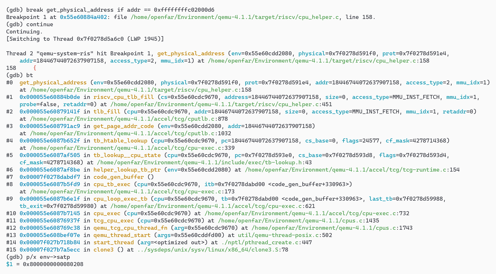
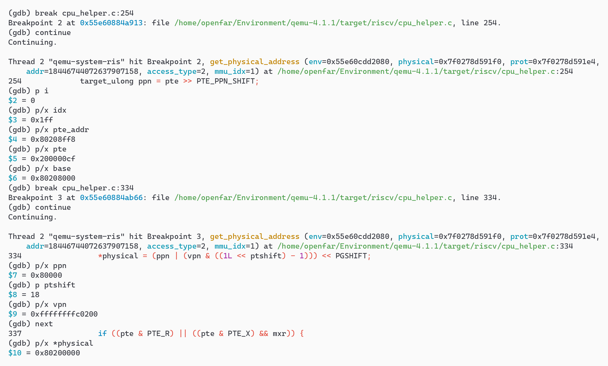
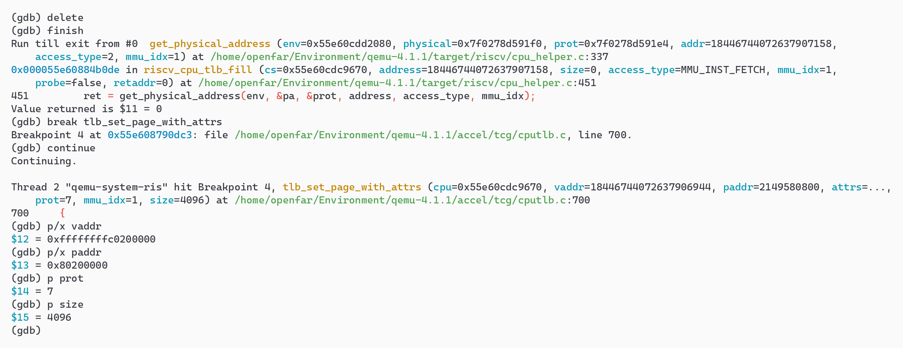
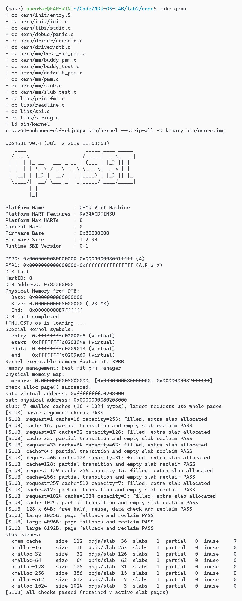
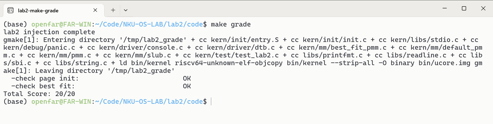

# <center>操作系统lab_实验报告</center>

<h5 align="center">实验名称：Lab 2: 物理内存管理  完成日期：2026-10-22</h5 align="center">
<h5 align="center">小组成员：2411264-张远、2414099-李云鹏、2413074-刘昀皓</h5 align="center">


# 小组分工

| 成员 | 负责的练习/模块/代码/报告 |
|------|----------------|
| 2411264-张远 | 环境与框架（统一 QEMU 4.1.1、分配器切换开关）、功能模块一（page_init）、Buddy System 独立测试、Challenge：SLUB 实现、分支任务（调用路径与页表遍历）、实验整体逻辑分析、报告集成 |
| 2414099-李云鹏 | 功能模块二任务二（Best-Fit）、任务三（Buddy System 实现）、Challenge：SLUB 测试、分支任务（TLB）、对操作系统的理解 |
| 2413074-刘昀皓 | 功能模块二任务一（First-Fit 分析）、Challenge：物理内存范围获取、实验目的、实验环境、测试与验证、AI 协作开发的经验 |


# 一、实验目的

本实验在 lab1 最小内核的基础上，为 ucore 建立物理内存管理：从设备树探测物理内存，为每个物理页建立描述符，再在其上实现多种页分配算法，并在页分配之上实现任意大小对象的分配。主要目的有：

1. **理解页表的建立和使用方法**：理解 entry.S 在进入 `kern_init` 之前如何用一个 1 GiB 大页建立 Sv39 启动页表，使内核运行在高地址（`KERNBASE = 0xFFFFFFFFC0200000`），以及内核虚拟地址与物理地址之间为什么只差一个固定偏移 `va_pa_offset`。通过分支任务，用 GDB 调试 QEMU 源码，观察一次访存的虚拟地址如何经过 TLB 和页表遍历被翻译成物理地址。

2. **理解物理内存的管理方法**：理解内核如何从设备树获得物理内存的范围，如何用 `struct Page` 数组描述每个物理页，如何把 OpenSBI、内核镜像和描述符数组本身排除在外，只把空闲页交给分配器（`page_init`）；理解 `pmm_manager` 接口如何把分配算法与内核其余部分隔开。

3. **理解页面分配算法**：理解 First-Fit 的分配、分裂与合并过程，实现 Best-Fit 和 Buddy System，比较它们在查找开销和碎片上的差异；在页分配器之上实现 SLUB，理解小对象分配为什么需要单独的一层。

4. **练习用 AI 完成内核开发**：按四段式模板（`[PROMPT]` / `[RELY]` / `[GUARANTEE]` / `[SPECIFICATION]`）编写提示词，由 AI 生成代码，再通过编译、`make grade` 和自行设计的测试检验生成的代码，记录出现的问题和修正过程。


# 二、实验环境

## 软件环境

lab1 中三人的 QEMU 版本各不相同（8.2.2、6.2.0、7.0.0），而 lab2 框架的 `Makefile` 和 `tools/grade.sh` 都用 `-device loader,file=bin/ucore.img,addr=0x80200000` 加载内核。这种方式依赖旧版 OpenSBI 的 fw_jump 固件固定跳转到 0x80200000；lab1 已经实测，在 QEMU 8.2（OpenSBI v1.3，fw_dynamic）上内核根本不会运行。为了让 `make grade` 的结果在三人之间可比，lab2 起全组统一使用指导书推荐的 **QEMU 4.1.1**：从源码编译，带调试信息（`--enable-debug`，分支任务调试 QEMU 源码时也用它），不执行 `make install`，通过环境变量 `QEMU` 交给 Makefile 使用。

| 成员 | 宿主系统 | QEMU（自带 OpenSBI） | 交叉工具链 |
| :--- | :--- | :--- | :--- |
| 2411264-张远 | WSL2 Ubuntu 24.04 | 4.1.1（OpenSBI v0.4） | riscv64-unknown-elf-gcc 15.1.0 |
| 2414099-李云鹏 | WSL2 Ubuntu 22.04 | 4.1.1（OpenSBI v0.4） | SiFive riscv64-unknown-elf-gcc 10.2.0 |
| 2413074-刘昀皓 | WSL2 Ubuntu 24.04 | 4.1.1（OpenSBI v0.4） | riscv64-unknown-elf-gcc 12.2.0 |

调试器均为工具链自带的 `riscv64-unknown-elf-gdb`；分支任务中调试 QEMU 进程本身用的是宿主机的 `gdb`。

## AI 工具

| 成员 | AI 编程工具 | 底层模型 | 备注 |
| :--- | :--- | :--- | :--- |
| 2411264-张远 | Claude Code（终端 Agent） | Claude Opus 5.5 | 在 Windows 上运行，通过 WSL 编译和调试 |
| 2414099-李云鹏 | Codex（终端 Agent） | gpt-6.1-sol | |
| 2413074-刘昀皓 | Antigravity CLI / Antigravity IDE | Gemini 3.8 Flash (High) / Claude Opus 4.5 / Claude 3.7 Sonnet | |

**说明：**
- **AI 编程工具**：指具体使用的终端工具、编辑器插件、桌面应用或浏览器界面。
- **底层模型**：指该工具使用的大语言模型及版本。


# 三、实验整体逻辑分析

## 3.1 逻辑主线

Lab2 的主题是**物理内存管理**。lab1 结束时，内核只知道自己从哪里开始执行，对机器上有多少内存、哪些内存可以使用一无所知，也没有任何分配内存的手段。本章要解决的问题是：**内核怎样发现物理内存，怎样记录每一页的状态，又怎样把内存按需要分配出去、再收回来？**

我们认为本章可以概括成一句话：**一层一层地把内存“组织”起来，每一层都只依赖下一层提供的接口。**从下到上依次是：

```
  任意大小的对象     kmalloc / kfree                         SLUB（Challenge）
        ▲               按大小分到 7 个缓存，一个 slab 占一页
  连续的物理页       alloc_pages / free_pages                pmm_manager：First-Fit / Best-Fit / Buddy
        ▲               空闲块怎样组织、怎样挑选
  每一页的描述       struct Page pages[]                      page_init
        ▲               哪些页保留、哪些页空闲
  物理内存的范围     get_memory_base / get_memory_size        dtb_init（框架）
        ▲               设备树告诉内核内存从哪里开始、有多大
  地址怎样被访问     启动页表 boot_page_table_sv39            entry.S（框架）；分支任务观察 QEMU 如何查表
```

指导书给出的实现链 `pmm_init() → init_pmm_manager() → page_init() → init_memmap() → alloc_pages()/free_pages()` 正好对应中间三层。SLUB 搭在页分配器之上，分支任务则回到最底层，看“硬件”（QEMU）怎样使用 `entry.S` 建立的页表。

贯穿全章的还有一条副线：**区分虚拟地址、物理地址、物理页号和 `Page` 描述符的地址。**`entry.S` 打开 Sv39 后，内核运行在 `0xFFFFFFFFC0200000` 开始的高地址上，虚拟地址与物理地址相差固定的 `va_pa_offset`；而设备树给出的内存范围、页表项里的页号都是物理的，`pages` 数组又按物理页号编号（`pages[0]` 对应物理页号 `nbase = 0x80000`）。`page_init` 中最容易出错的地方，就是把这几种量混在一起比较（见功能模块一的迭代过程）。

## 3.2 功能的逐步实现

| 顺序 | 功能 | 主要代码 | 报告中的位置 |
| :---: | :--- | :--- | :--- |
| 0 | 启动页表与高地址运行（框架已完成） | `kern/init/entry.S` | 分支任务 |
| 1 | 物理内存探测与页描述符初始化 | `kern/mm/pmm.c` 的 `page_init` | 功能模块一 任务一 |
| 2 | 理解 First-Fit | `kern/mm/default_pmm.c` | 功能模块二 任务一 |
| 3 | 实现 Best-Fit 并设为默认分配器 | `kern/mm/best_fit_pmm.c` | 功能模块二 任务二 |
| 4 | 实现 Buddy System，通过编译开关接入 | `kern/mm/buddy_pmm.c` | 功能模块二 任务三 |
| 5 | 在页分配器之上实现 SLUB | `kern/mm/slub.c` | Challenge：SLUB |
| 6 | 用 GDB 调试 QEMU，观察地址翻译 | QEMU 4.1.1 源码 | 分支任务 |

0. **起点是框架已经完成的启动页表。**`entry.S` 在跳进 C 代码之前，用一个 1 GiB 的大页把虚拟地址 `0xFFFFFFFFC0000000` 起的 1 GiB 映射到物理地址 `0x80000000`，写入 `satp` 并执行 `sfence.vma`，然后跳到高地址的 `kern_init`。从这一刻起，内核里所有的指针都是虚拟地址。这一步排在最前面，因为后面的 `page_init` 必须在“内核用虚拟地址、设备用物理地址”的前提下工作。
1. **然后是 `page_init`，它是所有分配器的输入。**分配器只负责“怎样分”，“有什么可分”要由 `page_init` 告诉它：根据设备树确定物理内存的上界，在内核镜像之后为每个物理页放一个 `struct Page` 描述符，先把所有页标成保留页，再把 OpenSBI、内核镜像和描述符数组之后的那段完整空闲区交给 `init_memmap`。没有这一步，任何分配算法都没有可管理的内存，所以它排在分配算法之前。
2. **接着读懂 First-Fit。**框架自带的 `default_pmm.c` 是一个完整的分配器，读懂它就读懂了 `pmm_manager` 的六个接口各自承担什么职责，以及空闲块怎样按地址挂在链表上、分配时怎样分裂、释放时怎样与前后的块合并。我们在阅读中还发现了它释放时插入链表的一个缺陷（见功能模块二 任务一）。后面的 Best-Fit 和 Buddy 都是在这套接口下替换算法，所以先理解它。
3. **再实现 Best-Fit。**它和 First-Fit 用同样的链表结构，只改变“挑哪一块”：遍历全部空闲块，选能满足请求的最小块。改动范围小，适合用来验证我们对接口的理解；`make grade` 也要求默认分配器是 Best-Fit。
4. **然后实现 Buddy System。**这一步换掉的是空闲块的**组织方式**：从一条按地址排序的链表，变成 16 条按块大小（2 的幂）分开的链表，按物理页号对齐，靠“页号异或块长”找伙伴。它和 Best-Fit 实现的是同一个 `pmm_manager` 接口，只需在 `init_pmm_manager` 中切换指针（通过 `make PMM=buddy`）就能整体替换，内核其他部分不受影响。这说明了接口隔离的价值。
5. **最后在页分配器之上实现 SLUB。**前面的分配器都以页为单位，而内核中大量的对象只有几十字节，按页分配会浪费大量空间。SLUB 从页分配器申请整页作为 slab，把一页切成等大的对象再分出去；超过 1024 字节的请求则直接转交页分配器。它必须排在最后，因为它的第一层就是前面实现的 `alloc_pages`/`free_pages`。
6. **分支任务回到第 0 步。**前面几步都是软件在“管理”内存。分支任务用两个 GDB 同时调试 ucore 和 QEMU，观察一次访存怎样经过 QEMU 模拟的 TLB 和 `entry.S` 建立的页表，最终被翻译成物理地址。它与前面的任务互不依赖，放在最后，作为对“页表怎样被使用”的验证。

## 3.3 各功能的核心函数

**所有页分配器都实现同一个接口 `struct pmm_manager`**，内核其余部分只通过 `pmm.c` 中的 `alloc_pages`/`free_pages`/`nr_free_pages` 调用当前的分配器：

| 接口 | 职责 | 何时调用 |
| :--- | :--- | :--- |
| `init` | 初始化分配器自己的数据结构（空闲链表、计数） | `init_pmm_manager` |
| `init_memmap(base, n)` | 把 `page_init` 交来的一段连续空闲页登记为空闲块 | `page_init` 末尾 |
| `alloc_pages(n)` | 返回 n 个连续页的首页，失败返回 NULL | 内核任意位置 |
| `free_pages(base, n)` | 归还连续页，并尝试与相邻的空闲块合并 | 内核任意位置 |
| `nr_free_pages()` | 返回当前空闲页数 | 测试与统计 |
| `check()` | 分配器的自检 | `check_alloc_page` |

各功能的核心函数及我们的理解：

- **`page_init`（功能模块一）**：核心是“三个边界”。上界取设备树给出的内存末尾与 `PHYSICAL_MEMORY_END`（`0x88000000`）中较小的一个，`npage` 是上界对应的页号；`pages` 数组从内核镜像末尾 `end` 向上按页对齐的位置开始；空闲区从描述符数组的末尾（按页向上取整）开始，到上界为止（按页向下取整）。先把所有描述符都标成保留页，再只对空闲区调用 `init_memmap`，于是内核镜像和描述符数组本身永远不会被分配出去。
- **First-Fit 的 `default_alloc_pages` / `default_free_pages`（功能模块二 任务一）**：空闲块按地址顺序挂在一条链表上，只有块首页的 `property` 记录块长。分配时从头找到第一个 `property >= n` 的块，从低地址切下 n 页，剩下的部分作为新块留在原位置；释放时按地址插回链表，再检查前后两块是否与它首尾相接，相接就合并。
- **Best-Fit 的 `best_fit_alloc_pages`（功能模块二 任务二）**：遍历整条链表，记下 `property >= n` 中最小的块（大小相同时取地址最低的），分裂和释放合并的方式与 First-Fit 相同。它以完整遍历换取更小的剩余碎片。
- **Buddy 的 `buddy_insert_block` / `buddy_alloc_pages`（功能模块二 任务三）**：`buddy_insert_block` 是初始化和释放共用的核心，用 `伙伴页号 = 本块页号 XOR 块长` 定位伙伴，只有伙伴空闲且同阶时才合并，然后继续向上一阶尝试；`buddy_alloc_pages` 把请求取整到 2 的幂，从目标阶向上找第一个非空链表，逐级对半分裂，左半块继续分，右半块挂回对应的阶。
- **SLUB 的 `kmem_cache_alloc` / `kmem_cache_free` / `kmalloc`（Challenge）**：每个缓存只管一种对象大小。一个 slab 占一页，页首放 slab 头，其余空间切成对象，空闲对象用对象内部的指针串成链表。分配时优先从当前活动 slab 取，用完后从 partial 链表取，再不够才向页分配器申请新页；释放时根据对象地址向下取整到页首就能找到 slab 头。`kmalloc` 按请求大小选择 16～1024 字节中最合适的缓存，更大的请求直接按页分配。
- **QEMU 的 `get_physical_address`（分支任务）**：它是 QEMU 用软件实现的 Sv39 页表遍历，每一轮从虚拟地址中取 9 位索引，按物理地址读出页表项，根据 V、R、W、X 位判断是继续下一级还是已经到达叶子。在 lab2 中，它在第一级就遇到 `entry.S` 设置的 1 GiB 大页叶子，直接得到物理地址。

**同一个 `struct Page` 被不同的分配器用不同的方式解释**，这是对比几个分配器时最直观的体会：

| 字段 | First-Fit / Best-Fit | Buddy | SLUB |
| :--- | :--- | :--- | :--- |
| `PG_reserved` | 保留页（不参与分配） | 同左 | 不使用 |
| `PG_property` | 空闲块的首页 | 空闲块的首页 | 不使用 |
| `property` | 空闲块首页上记录块长；分配出去后不再有意义（Best-Fit 清零，First-Fit 留着旧值，只靠清掉 `PG_property` 表示已分配） | 空闲块和**已分配块**的首页都记录块长（2 的幂），释放时用它校验 | 不使用（slab 的元数据放在页内的 slab 头里） |
| `page_link` | 把空闲块首页挂进唯一的空闲链表 | 挂进对应阶的空闲链表 | 不使用（slab 头里有自己的链表节点） |

描述符的格式不变，只要求每个分配器内部对它的解释前后一致。所以几个分配器可以在同一个 `pages` 数组上互相替换，测试也可以只通过公开字段检查分配器的行为。


# 四、实验内容与实现

## 功能模块一：物理内存初始化功能

**负责人：** 2411264-张远

### 模块功能描述

**需要实现/修改的函数：**

```c
static void page_init(void);   // kern/mm/pmm.c
```

**功能说明：**

`page_init()` 是物理内存管理的起点。`pmm_init()` 先用 `init_pmm_manager()` 选定分配器，再调用 `page_init()` 告诉分配器“有哪些物理页可以分”，之后的 `alloc_pages()` / `free_pages()` 都建立在它准备好的状态上。它要完成四件事：

1. **确定地址换算关系**。entry.S 在进入 `kern_init` 之前已经开启 Sv39，启动页表用一个 1 GiB 大页把虚拟地址 0xffffffffc0000000 映射到物理地址 0x80000000，所以内核里的虚拟地址减去固定偏移 `va_pa_offset = 0xFFFFFFFF40000000` 就是物理地址。`PADDR` 宏依赖这个变量，必须最先设置。
2. **确定要管理多少物理页**。物理内存范围来自设备树（`get_memory_base()` / `get_memory_size()`），不再像旧版框架那样写死。可管理上界还要受内核映射范围的限制，最多到 `KERNTOP` 对应的物理地址 0x88000000。`npage` 是上界的物理页号。
3. **建立 Page 描述符数组**。数组放在内核镜像结束处 `end` 之后第一个页对齐的位置。物理内存从 `DRAM_BASE`（物理页号 `nbase = 0x80000`）开始，所以数组共 `npage - nbase` 项，`pages[i]` 描述物理页号 `nbase + i`，`pa2page()` 正是按这个约定做的换算。
4. **划出空闲区**。先把所有页标成保留，再把描述符数组之后、上界之前的完整页通过 `init_memmap()` 交给分配器。OpenSBI、内核镜像、描述符数组本身都在空闲区之前，自然保持保留状态。

默认 128 MiB 内存下，实测的物理内存布局如下：

| 物理地址范围 | 内容 | 页数 | 状态 |
| :--- | :--- | ---: | :--- |
| 0x80000000～0x801FFFFF | OpenSBI | 512 | 保留 |
| 0x80200000～0x80206FFF | 内核镜像（`end` = 0x80206078，向上对齐到 0x80207000） | 7 | 保留 |
| 0x80207000～0x80346FFF | Page 描述符数组（32768 项 × 40 字节 = 0x140000） | 320 | 保留 |
| 0x80347000～0x87FFFFFF | 空闲区，交给 `init_memmap()` | 31929 | 空闲 |

512 + 7 + 320 + 31929 = 32768 页，正好是 128 MiB。

需要区分的四种“地址”：`end`、`pages` 是**虚拟地址**；经 `PADDR` 减去偏移得到**物理地址**；物理地址右移 12 位是**物理页号**；物理页号减去 `nbase` 作为下标，得到 **Page 描述符的地址** `&pages[PPN(pa) - nbase]`。

### 最终提示词

以下是经过迭代优化后，最终成功实现该功能的提示词：

````markdown
[PROMPT]

**任务**：在 `code/kern/mm/pmm.c` 中实现 `static void page_init(void)`：根据设备树探测到的物理内存范围，在内核镜像之后建立覆盖全部可管理物理页的 `struct Page` 描述符数组，把除 OpenSBI、内核镜像和描述符数组自身之外的完整空闲页交给当前的 `pmm_manager`，为后续的页面分配提供正确的初始状态。

**操作要求**：你必须在项目中直接修改实际文件，而不是只展示代码片段。把函数写在 `pmm.c` 中注释 `//lab2 function1 YOUR CODE` 的下方、`pmm_init()` 之前（`pmm_init()` 直接调用它，没有前置声明），并把注释中的 `YOUR CODE` 替换为学号 `2411264`，保留 `lab2 function1`。不要修改 `pmm_init()`、`init_pmm_manager()` 等现有函数和任何头文件。关键步骤写简短的中文注释。

**输出要求**：直接进行文件操作，使用下面 [RELY]、[GUARANTEE]、[SPECIFICATION] 中提供的信息，以工程中的真实代码为准。

[RELY]

```c
// code/kern/mm/memlayout.h（省略注释）
#define KERNBASE            0xFFFFFFFFC0200000
#define KMEMSIZE            0x7E00000
#define KERNTOP             (KERNBASE + KMEMSIZE)

#define PHYSICAL_MEMORY_END         0x88000000
#define PHYSICAL_MEMORY_OFFSET      0xFFFFFFFF40000000
#define KERNEL_BEGIN_PADDR          0x80200000
#define KERNEL_BEGIN_VADDR          0xFFFFFFFFC0200000

struct Page {
    int ref;                        // page frame's reference counter
    uint64_t flags;                 // array of flags that describe the status of the page frame
    unsigned int property;          // the num of free block, used in first fit pm manager
    list_entry_t page_link;         // free list link
};

#define SetPageReserved(page)       ((page)->flags |= (1UL << PG_reserved))
#define PageReserved(page)          (((page)->flags >> PG_reserved) & 1)
```

```c
// code/kern/mm/pmm.h（省略注释）
#define PADDR(kva)                                                 \
    ({                                                             \
        uintptr_t __m_kva = (uintptr_t)(kva);                      \
        if (__m_kva < KERNBASE) {                                  \
            panic("PADDR called with invalid kva %08lx", __m_kva); \
        }                                                          \
        __m_kva - va_pa_offset;                                    \
    })

extern struct Page *pages;
extern size_t npage;
extern const size_t nbase;
extern uint64_t va_pa_offset;

static inline struct Page *pa2page(uintptr_t pa) {
    if (PPN(pa) >= npage) {
        panic("pa2page called with invalid pa");
    }
    return &pages[PPN(pa) - nbase];
}
```

```c
// code/kern/mm/pmm.c（省略注释）
struct Page *pages;
size_t npage = 0;
uint64_t va_pa_offset;
const size_t nbase = DRAM_BASE / PGSIZE;

static void init_memmap(struct Page *base, size_t n) {
    pmm_manager->init_memmap(base, n);
}

void pmm_init(void) {
    init_pmm_manager();
    page_init();
    check_alloc_page();
    ...
}
```

```c
// code/kern/driver/dtb.h
uint64_t get_memory_base(void);
uint64_t get_memory_size(void);

// code/kern/mm/mmu.h
#define PGSIZE          4096                    // bytes mapped by a page
#define PPN(la) (((uintptr_t)(la)) >> PGSHIFT)

// code/libs/riscv.h
#define DRAM_BASE          0x80000000

// code/libs/defs.h：ROUNDDOWN(a, n)、ROUNDUP(a, n) 按 n 对齐，返回值类型与 a 相同
```

```asm
# code/kern/init/entry.S：进入 kern_init 前已开启 Sv39，启动页表用一个 1 GiB 大页
# 把 VA 0xffffffffc0000000 映射到 PA 0x80000000
    li      t1, 0xffffffffc0000000 - 0x80000000
```

- 链接脚本提供符号 `end`（内核镜像结束处的虚拟地址），用 `extern char end[];` 声明。
- `panic(fmt, ...)` 打印信息后停机，会自动换行；`cprintf` 与 printf 用法相同。
- QEMU virt 默认 128 MiB 内存：设备树报告 base = 0x80000000，size = 0x8000000。0x80000000～0x80200000 是 OpenSBI。

[GUARANTEE]

```c
static void page_init(void);   // code/kern/mm/pmm.c，由 pmm_init() 调用
```

[SPECIFICATION]

## page_init

**Pre-Condition**:
- 已开启 Sv39 分页，内核运行在高地址；`dtb_init()` 已解析设备树，`get_memory_base()` / `get_memory_size()` 返回物理内存的起始地址和大小（解析失败时为 0）。
- `init_pmm_manager()` 已调用，`pmm_manager` 的空闲区为空。

**Post-Condition**:
- `va_pa_offset` 等于启动页表使用的虚拟/物理地址偏移 `PHYSICAL_MEMORY_OFFSET`。
- 输出探测到的物理内存范围，格式为：
  ```
  physical memory map:
    memory: 0x<大小>, [0x<起始>, 0x<结束-1>].
  ```
- `npage` 是可管理物理内存上界对应的物理页号；`pages` 指向内核 `end` 之后第一个页对齐处，数组共 `npage - nbase` 项，`pages[i]` 描述物理页号 `nbase + i`。
- 所有描述符先标为保留；OpenSBI、内核镜像、描述符数组本身所在的页保持保留，不进入空闲区。
- 描述符数组之后、上界之前的完整物理页恰好被 `init_memmap()` 注册一次，`nr_free_pages()` 返回这些页的数量。

  **Case 1**（默认 128 MiB）:
  - 上界为 0x88000000，`npage = 0x88000`，空闲区从描述符数组末尾向上对齐的页开始，到 0x88000000 结束。

  **Case 2**（物理内存超过可管理上界，例如 `-m 256M`）:
  - 只管理到 `KERNTOP` 对应的物理地址。注意 `KERNTOP` 是虚拟地址，必须换算成物理地址（即 `PHYSICAL_MEMORY_END`）再与物理地址比较。

  **Case 3**（设备树信息无效：大小为 0、起始地址低于 `DRAM_BASE` 或范围溢出）:
  - 调用 `panic` 终止初始化，信息中给出 base 和 size。

  **Case 4**（对齐后没有完整的空闲页）:
  - 不调用 `init_memmap()`。

**Requirements**:
- 严格区分虚拟地址（`end`、`pages`）、物理地址、物理页号和 Page 描述符地址：虚拟地址经 `PADDR` 转为物理地址，物理地址经 `pa2page` 转为描述符。
- 空闲区起点向上、终点向下对齐到页，只交出完整的页。
- 运行 `make grade` 时，`[Test 1] Page Init` 的检查项全部通过：`va_pa_offset`、`npage`、`pages` 对齐且位于 `end` 之后、空闲页数合理、内核末页和描述符数组所在页为保留状态、`pa2page(page2pa(p)) == p`。
````

### 实现迭代过程

本模块的实现经历了 2 次迭代，过程如下：

#### 第一次迭代

**遇到的问题：**

- 问题 1：参考的实现（前辈代码和常见的 ucore 写法）这样截断上界：`if (maxpa > KERNTOP) maxpa = KERNTOP;`。但 `KERNTOP = KERNBASE + KMEMSIZE = 0xFFFFFFFFC8000000` 是**虚拟地址**，物理地址 `maxpa` 永远不会超过它，这个判断从不生效。用 `-m 256M` 启动时，设备树报告 256 MiB，按这种写法会把 0x88000000 以上的内存也交给分配器，超出了 `KMEMSIZE` 约定的管理范围。
- 问题 2：在框架原样的状态下，`best_fit_pmm.c` 编译不过（`error: 'nr_free' undeclared`），因为 Best-Fit 还没有实现，所以没法直接 `make grade` 验证 page_init。

**问题解决策略：**

- 针对问题 1：在提示词的 [SPECIFICATION] 中加入 Case 2，明确“`KERNTOP` 是虚拟地址，必须换算成物理地址 `PHYSICAL_MEMORY_END` 再比较”；[RELY] 中给出 entry.S 的映射关系，让 AI 知道偏移是固定的。
- 针对问题 2：验证时在临时副本中把 `default_pmm.c` 复制成 `best_fit_pmm.c`，并把其中的 `default_pmm_manager` 改名为 `best_fit_pmm_manager`，让框架先能编译。这样可以单独检查 `[Test 1] Page Init`，仓库中的代码不受影响。

#### 第二次迭代

**遇到的问题：**

- 问题 1：自查时发现，两处 `panic` 的格式串末尾写了 `\n`。但 `panic()`（kern/debug/panic.c）在打印完信息后自己会调用 `cprintf("\n")`，结果会多出一个空行。

**问题解决策略：**

- 针对问题 1：删除格式串末尾的 `\n`；在 [RELY] 中注明“`panic` 会自动换行”。

**最终结果：**

经过 2 次迭代，该模块最终：

- ✅ 编译通过
- ✅ `make grade` 中 `check page init: OK`（另一项 `check best fit` 依赖 T2 的 Best-Fit）
- ✅ 功能符合预期：在临时副本中打印 `npage` 和空闲页数，三种内存大小下的结果都与手算一致

| QEMU 内存 | 设备树报告的范围 | npage | 空闲页数 | 说明 |
| :--- | :--- | :--- | ---: | :--- |
| `-m 64M` | [0x80000000, 0x83ffffff] | 0x84000 | 15705 | 描述符数组变为 160 页 |
| 默认 128M | [0x80000000, 0x87ffffff] | 0x88000 | 31929 | 与上表一致 |
| `-m 256M` | [0x80000000, 0x8fffffff] | 0x88000 | 31929 | 上界被截断到 0x88000000 |

**关键改进点总结：**

1. 在 [SPECIFICATION] 中明确可管理上界要用物理地址比较，避开 `KERNTOP` 虚实混用的陷阱。
2. 在 [SPECIFICATION] 中补充设备树信息无效（Case 3）、没有完整空闲页（Case 4）这两种边界情况的处理要求。
3. 在 [Requirements] 中列出 `[Test 1]` 的检查项，让生成的代码直接对齐评测标准。


## Challenge：物理内存范围获取思考题

**负责人：** 2413074-刘昀皓

### 1. 问题背景与技术挑战

在传统操作系统设计中，物理内存范围若由内核硬编码（如预设起始地址为 `0x80000000`，大小为 `128 MiB`），将导致系统丧失移植性与动态扩展能力：
1. **硬件异构性与动态插拔**：不同板卡搭载的物理 DRAM 容量各异；在现代服务器平台中，内存支持热插拔（Memory Hotplug）。
2. **虚拟化与模拟器环境**：在 QEMU 等虚拟化平台中，用户可通过启动参数（如 `-m 1G`、`-m 512M`）任意调整分配给虚拟机的内存大小。
3. **地址空间非连续性（Memory Holes & MMIO）**：物理地址空间并非全部映射为可用 RAM，中间通常包含 PCI/PCIe MMIO 映射区、APIC 控制器寄存器、固件保留区（如 OpenSBI、BIOS SMM 空间）等物理孔洞。

若操作系统无法提前获知可用物理内存范围，必须依赖由外至内、多层次的动态探测与感知手段。

---

### 2. 物理内存范围获取的四种主流技术方案

#### 2.1 方案一：Bootloader 与固件设备树传递机制（Device Tree / FDT）

在现代 RISC-V 和 ARM 嵌入式架构中，基于设备树（Device Tree）的动态配置已成为事实上的工业标准。

```
[ Bootloader / OpenSBI (M-Mode) ]
              |
              | 1. 初始化平台硬件，探测 RAM
              | 2. 将硬件拓扑编码为 DTB 二进制
              | 3. 将 DTB 物理地址写入 a1 寄存器
              v
[ ucore 内核入口 (S-Mode) ]
              |
              | 读取 a1 寄存器，获取 DTB 基地址
              v
[ DTB 解析模块 (dtb.c) ]
              |
              | 遍历 "/memory" 节点，读取 "reg" 属性
              v
得到可用物理内存区间：[mem_begin, mem_begin + mem_size]
```

**实现机制与调用链：**
1. **约定传参**：根据 RISC-V SBI 规范，在固件完成硬件初始化并跳转至内核入口时，将通用寄存器 `a0` 存入当前 CPU 的 Hart ID，将寄存器 `a1` 存入设备树二进制文件（Device Tree Blob, DTB）在物理内存中的基地址指针。
2. **内核解析**：内核在早期引导阶段（如 `code/kern/mm/pmm.c:page_init`）调用 `get_memory_base()` 和 `get_memory_size()`。
3. **节点检索**：底层驱动解析 FDT 格式数据，遍历根路径下的 `/memory` 节点，提取其中的 `reg` 属性。该属性包含一组或多组 `(base, size)` 元组，精确声明了物理 RAM 的起始基地址和有效长度。
4. **范围截断与过滤**：内核读取后与虚拟映射范围上限（如 `PHYSICAL_MEMORY_END = 0x88000000`）取交集，并剔除自身镜像与固件占据的区间。

#### 2.2 方案二：固件标准化服务接口与内存映射表（BIOS E820 / UEFI）

在 x86 体系结构中，固件通过标准化的系统服务调用向内核提交详细的物理内存布局表：

1. **Legacy BIOS (INT 0x15, AX=0xE820)**：
   - 引导加载程序（Bootloader）在实模式下循环触发软中断 `INT 0x15`（输入 `EAX=0xE820`），由 BIOS 返回一系列 `AddressRangeDescriptor` 结构体。
   - 每个结构体包含 64 位基地址、64 位长度以及类型标识（如 `1: AddressRangeMemory` 代表可用 RAM，`2: AddressRangeReserved` 代表系统保留，`3: ACPI Reclaim Memory` 代表 ACPI 表区）。
   - Bootloader 将该内存映射表封装进 `multiboot_info` 数据结构后传递给内核。

2. **UEFI (Unified Extensible Firmware Interface)**：
   - 内核在尚未退出 UEFI 引导服务（Boot Services）之前，调用 `GetMemoryMap()` API。
   - 固件返回一组 `EFI_MEMORY_DESCRIPTOR` 数组，清晰划分物理地址、虚拟地址、页数以及内存属性（如 `EfiConventionalMemory` 代表操作系统可自由分配的物理内存，`EfiBootServicesCode` 在内核接管后可被回收释放）。

#### 2.3 方案三：硬件芯片组与总线直接探测（Hardware Register Probing）

在无固件支持或操作系统作为一级引导器的特殊裸机体系中，内核可直接与主板芯片组及内存控制器硬件通信：

1. **内存控制器寄存器读取**：
   - 北桥或 SoC 内部的内存控制器（Memory Controller Hub）通常包含专门的寄存器（如 DRAM Rank Configuration Register），记录了每个插槽（Channel/DIMM）中内存芯片的行地址、列地址宽度以及芯片排数（Rank）。
   - 内核直接读取这些映射在 MMIO 或配置空间的硬件寄存器，通过公式计算出实际连接的 DRAM 容量：
     $$\text{Capacity} = 2^{(\text{Row} + \text{Column})} \times \text{Bank} \times \text{DataWidth} \times \text{Ranks}$$
2. **I2C / SMBus 上的 SPD (Serial Presence Detect) 查询**：
   - 内存条上的 EEPROM 芯片通过 SMBus 串行总线与主板相连，固化了 JEDEC 标准定义的 SPD 数据。
   - 内核驱动可通过主板 SMBus 控制器直接发送 I2C 读指令，逐字节读取 SPD 内容，获取物理内存条的制造规范、容量与时序信息。

#### 2.4 方案四：裸机极限探测（Manual Probing）与 Trap 异常截断机制

在完全缺乏固件传参、无设备树、也无法直接读取内存控制器的极端裸机环境下，内核必须采用“主动内存探测算法”。该方案必须兼顾**破坏性规避**、**地址回卷防护**以及**总线硬件异常截断**：

```
                   [ 开始裸机探测循环 ]
                             |
                   probe_pa = DRAM_BASE (0x80000000)
                   step = 1 MiB (或 4 KiB)
                             |
             +-------------->+
             |               |
             |     [ 安装临时 Trap 向量表 ] (捕获 Load/Store Fault)
             |               |
             |     1. 保存原内存值: old_val = *probe_pa
             |     2. 写入测试魔数: *probe_pa = 0xAA55AA55
             |     3. 强制内存屏障: fence / mb()
             |     4. 回读并校验:   read_val = *probe_pa
             |               |
        发生硬件异常? -------+----是----> [ 触发 Trap: 达到物理内存边界 ]
             | 否                                        |
      read_val == 魔数?                                  |
        /          \                                     |
      否            是                                   |
      /              \                                   v
[ 探测终止 ]    5. 写入反转测试魔数: 0x55AA55AA        记录有效内存上界
(检测到非RAM)   6. 回读校验防地址回卷 (Aliasing)       max_pa = probe_pa
                     |                                   |
                7. 恢复原数据: *probe_pa = old_val       v
                     |                             [ 恢复正常系统异常表 ]
                probe_pa += step                         |
                     |                             [ 探测完成，进入分配器初始化 ]
                     +-----------------------------------+
```

##### 详细技术实现流程与关键陷阱防御

1. **写-读-恢复（Write-Read-Restore）测试**：
   - **操作步骤**：探测代码以物理页（`4 KiB`）或块（`1 MiB`）为步长递增探测指针 `probe_pa`。对每个地址，先读取并暂存原内容 `old_val`；写入特定特征魔数（如 `0xAA55AA55`）；执行内存屏障指令（RISC-V 的 `fence`，x86 的 `mfence`），确保写操作提交至物理总线；随后回读。若回读值等于魔数，再写入反转特征值（如 `0x55AA55AA`）二次检验。全部校验成功后，将 `old_val` 还原写回。
2. **总线地址回卷（Address Aliasing / Wrap-around）检测**：
   - **风险场景**：若硬件系统仅具备 32 MiB 物理内存（对应 25 根物理地址线 $A_0 \sim A_{24}$），当探测地址递增至 32 MiB 以上（$A_{25}$ 悬空或未连接）时，地址总线的高位被硬件忽略，对 32 MiB 处的写入实际上会篡改并回卷到 0 MiB 处的内存单元。
   - **防护机制**：在检测新地址 `probe_pa` 时，同时回读已知低地址基准点（如 `DRAM_BASE`），确保低地址处预置的内容未被意外覆盖；若发现低地址发生同步改变，说明地址线已发生回卷，立即终止探测。
3. **硬件 Trap / 异常捕获截断（Fault Interception）**：
   - **风险场景**：在具备现代系统总线（如 AXI / TileLink）的硬件平台上，向未挂载任何物理设备的空白地址区间发起读取或写入时，总线仲裁器无法获取从机应答（Slave Acknowledge），会向 CPU 核心上报硬件总线错误（Bus Error）。在 RISC-V 体系下将立即触发 **Store Access Fault（异常编号 7）** 或 **Load Access Fault（异常编号 5）**；若无保护将导致内核直接 Panic 崩溃。
   - **异常接管实现机制**：
     - 内核在进入探测循环前，临时重定向 `stvec` 寄存器至探测专用的异常处理入口（`probe_trap_entry`）。
     - 探测代码使用类似 C 语言 `setjmp/longjmp` 的跳转上下文机制。
     - 一旦触发 Access Fault，CPU 硬件自动打断执行流，保存现场并跳转至 `probe_trap_entry`。
     - 异常处理程序识别出当前处于物理内存探测阶段，主动修改 Trap 上下文中的 `sepc`，跳出探测循环，并将当前 `probe_pa` 认定为硬件物理内存的不可跨越边界。
     - 探测结束后，恢复内核常规的中断/异常向量表 `stvec`。

---

### 3. 四种探测机制的维度对比

| 探测方式 | 依赖环境 | 实现复杂度 | 健壮性与安全性 | 典型应用平台 |
| :--- | :--- | :--- | :--- | :--- |
| **设备树 (Device Tree)** | 依赖 Bootloader / 固件传入 DTB | 低（调用树解析库即可） | 极高（由固件保证准确性） | 现代 RISC-V、ARM64 Linux / ucore |
| **固件表 (E820 / UEFI)** | 依赖 x86 BIOS 或 UEFI 运行时 | 中等（需解析描述符数组） | 极高（工业界成熟规范） | 现代 PC、x86 服务器 |
| **硬件控制器探测** | 依赖特定 SoC / 芯片组驱动 | 高（需了解内存控制器寄存器规范） | 高（硬件精确数据） | 深度定制嵌入式系统、BIOS/固件早期阶段 |
| **裸机写-读-恢复探测** | 无任何外部依赖（纯裸机） | 高（需编写异常处理与防回卷算法） | 较低（易触碰不可预知的总线异常或破坏保留数据） | 教学微内核、古老硬件或极简引导系统 |


## 练习：First-Fit 内存分配算法分析

**负责人：** 2413074-刘昀皓

### 1. 核心数据结构与状态标志

ucore 的物理内存分配以物理页帧为基本单元（大小为 4096 字节，即 `PGSIZE`）。First-Fit（首次适应）物理内存分配器在 `code/kern/mm/default_pmm.c` 中实现，其状态维护依赖 `code/kern/mm/memlayout.h` 中定义的两个核心数据结构：`struct Page` 与 `free_area_t`。

#### 1.1 数据结构定义与关键字段说明

```c
struct Page {
    int ref;                        // 物理页的引用计数
    uint64_t flags;                 // 描述物理页状态的标志位集合
    unsigned int property;          // 连续空闲物理页块的页数（仅在连续空闲块的首页有效）
    list_entry_t page_link;         // 双向链表节点，用于串联空闲物理页块
};

typedef struct {
    list_entry_t free_list;         // 双向循环空闲链表的哨兵头节点
    unsigned int nr_free;           // 当前可用空闲物理页的总数量（以页为单位）
} free_area_t;
```

在 First-Fit 算法中，相关字段和标志位的严格语义约定如下：

| 结构体 / 字段 / 宏 | 类型 / 掩码 | 语义与生命周期约定 |
| :--- | :--- | :--- |
| `free_area_t.free_list` | `list_entry_t` | 双向循环链表头。**链表中仅链接每个连续空闲物理块的首页（Head Page）的 `page_link`**，且所有空闲块严格按物理地址升序排列。 |
| `free_area_t.nr_free` | `unsigned int` | 记录全局可用空闲物理页总数。在分配时扣减，在释放及初始化时累加。 |
| `PG_reserved` | `flags` 第 0 位 | 保留页标志。若为 1，表示该页保留给内核静态代码段、数据段、OpenSBI 固件或 Page 数组本身，不可用于动态分配与释放。 |
| `PG_property` | `flags` 第 1 位 | 连续空闲块首页标志。**若且仅若该 Page 是某个连续空闲物理块的首个页面时，该位置为 1**；块内部后续页面以及已被分配的页面该位必须保持为 0。 |
| `struct Page.property` | `unsigned int` | 记录以当前 Page 为首的连续空闲页块所包含的页面总数 $N$。该字段仅在 `PG_property` 为 1 的首页有效；块内其余 $N-1$ 个页面的 `property` 均重置为 0。 |
| `struct Page.page_link` | `list_entry_t` | 双向链表连接件。通过宏 `le2page(le, page_link)` 使用 `to_struct` 计算出宿主 `struct Page` 的起始地址。 |

#### 1.2 空闲链表组织结构图解

空闲物理内存块在逻辑上表现为由多个物理地址连续的 `Page` 构成的集合，链表仅跟踪每个集合的首节点：

```
free_area.free_list (哨兵节点)
  |
  +---> [ Page A (Head) ] <==> [ Page B (Head) ] <==> [ Page C (Head) ] <---+
  |     - property = 4         - property = 2         - property = 8         |
  |     - PG_property = 1      - PG_property = 1      - PG_property = 1      |
  |     - 物理地址 PA_A        - 物理地址 PA_B        - 物理地址 PA_C        |
  |     (物理页帧 A ~ A+3)     (物理页帧 B ~ B+1)     (物理页帧 C ~ C+7)     |
  +-------------------------------------------------------------------------+
  注：PA_A < PA_B < PA_C（按物理地址严格升序）
```

---

### 2. 四个核心函数执行流程剖析

First-Fit 分配器的完整生命周期由 `code/kern/mm/default_pmm.c` 中的四个函数驱动，具体执行流如下：

#### 2.1 default_init

`default_init` 负责分配器私有状态的初态构建：

```c
static void default_init(void) {
    list_init(&free_list);
    nr_free = 0;
}
```

1. 调用 `list_init(&free_list)` 将空闲双向循环链表头节点的前驱和后继指针均指向自身，形成空双向链表。
2. 将全局空闲页总计数器 `nr_free` 清零。

#### 2.2 default_init_memmap

`default_init_memmap` 在系统启动探测到物理内存区间后，由 `page_init` 调用，将基地址为 `base`、长度为 $n$ 的连续可用物理页初始化为空闲块并接入管理：

```c
static void default_init_memmap(struct Page *base, size_t n) {
    assert(n > 0);
    struct Page *p = base;
    for (; p != base + n; p ++) {
        assert(PageReserved(p));
        p->flags = p->property = 0;
        set_page_ref(p, 0);
    }
    base->property = n;
    SetPageProperty(base);
    nr_free += n;
    if (list_empty(&free_list)) {
        list_add(&free_list, &(base->page_link));
    } else {
        list_entry_t* le = &free_list;
        while ((le = list_next(le)) != &free_list) {
            struct Page* page = le2page(le, page_link);
            if (base < page) {
                list_add_before(le, &(base->page_link));
                break;
            } else if (list_next(le) == &free_list) {
                list_add(le, &(base->page_link));
            }
        }
    }
}
```

**执行流与关键操作：**
1. **前置条件断言与单页状态重置**：验证 $n > 0$；遍历 `[base, base + n)` 内的每一个 Page，断言其处于 `PageReserved` 状态。将每个页面的 `flags` 和 `property` 置为 0，引用计数 `ref` 清零。
2. **首页属性建立**：仅将首页面 `base->property` 赋值为 $n$，并通过 `SetPageProperty(base)` 将其 `flags` 的 `PG_property` 置 1。
3. **全局计数累加**：执行 `nr_free += n`。
4. **按物理地址升序插入链表**：
   - 若 `free_list` 为空，直接调用 `list_add(&free_list, &(base->page_link))` 将块加入；
   - 若非空，沿链表顺序后移查找首个物理地址大于 `base`（即 `base < page`）的空闲块节点，调用 `list_add_before` 将其插入其前；
   - 若遍历至链表尾部仍未找到更大地址，则调用 `list_add` 追加到最后一个节点之后。
5. **内核启动首次调用实测案例**：在内核 `page_init()` 中，系统在默认 128 MiB 物理内存下首次调用该函数注册空闲区时，传入参数为 `base = pa2page(0x80347000)`，`n = 31929`。即剔除 OpenSBI（512 页）、内核镜像（7 页）和 Page 描述符数组（320 页）后，将剩余全部连续空闲物理空间作为初始单个连续大块挂载入 `free_list`，建立起操作系统运行时的物理内存初始状态池。

#### 2.3 default_alloc_pages

`default_alloc_pages` 实现连续物理页的首次适应查找与切分分配：

```c
static struct Page * default_alloc_pages(size_t n) {
    assert(n > 0);
    if (n > nr_free) {
        return NULL;
    }
    struct Page *page = NULL;
    list_entry_t *le = &free_list;
    while ((le = list_next(le)) != &free_list) {
        struct Page *p = le2page(le, page_link);
        if (p->property >= n) {
            page = p;
            break;
        }
    }
    if (page != NULL) {
        list_entry_t* prev = list_prev(&(page->page_link));
        list_del(&(page->page_link));
        if (page->property > n) {
            struct Page *p = page + n;
            p->property = page->property - n;
            SetPageProperty(p);
            list_add(prev, &(p->page_link));
        }
        nr_free -= n;
        ClearPageProperty(page);
    }
    return page;
}
```

**执行流与关键操作：**
1. **容量边界防御**：断言 $n > 0$；若请求页数 $n > nr\_free$，说明系统物理空闲总额不足，立即返回 `NULL`。
2. **First-Fit 线性检索**：从 `free_list` 头部开始沿 `list_next` 顺序遍历，通过 `le2page` 取出每个空闲块首页指针 `p`。**一旦发现首个满足 `p->property >= n` 的块，立即命中**，记录 `page = p` 并终止扫描循环。
3. **节点拆除与分裂（Splitting）**：
   - 记录命中节点的前驱指针 `prev = list_prev(&(page->page_link))`。
   - 调用 `list_del(&(page->page_link))` 将原空闲块首页从 `free_list` 中剔除。
   - 若 `page->property > n`，说明该空闲块大于请求容量，需要切分：新空闲块的起始页为 `p = page + n`，设置其 `p->property = page->property - n`，置位 `SetPageProperty(p)`，并将 `p` 插入到 `prev` 之后（`list_add(prev, &(p->page_link))`），从而保持链表物理地址升序排列不变。
4. **状态结算**：更新全局剩余空闲页 `nr_free -= n`；调用 `ClearPageProperty(page)` 清除被分配块首页的空闲标记，返回基页指针 `page`。

#### 2.4 default_free_pages

`default_free_pages` 负责将一段连续物理内存块归还给分配器，并自动完成与前后相邻物理空闲块的双向合并：

```c
static void default_free_pages(struct Page *base, size_t n) {
    assert(n > 0);
    struct Page *p = base;
    for (; p != base + n; p ++) {
        assert(!PageReserved(p) && !PageProperty(p));
        p->flags = 0;
        set_page_ref(p, 0);
    }
    base->property = n;
    SetPageProperty(base);
    nr_free += n;

    if (list_empty(&free_list)) {
        list_add(&free_list, &(base->page_link));
    } else {
        list_entry_t* le = &free_list;
        while ((le = list_next(le)) != &free_list) {
            struct Page* page = le2page(le, page_link);
            if (base < page) {
                list_add_before(le, &(base->page_link));
                break;
            } else if (list_next(le) == &free_list) {
                list_add(le, &(base->page_link));
            }
        }
    }

    list_entry_t* le = list_prev(&(base->page_link));
    if (le != &free_list) {
        p = le2page(le, page_link);
        if (p + p->property == base) {
            p->property += base->property;
            ClearPageProperty(base);
            list_del(&(base->page_link));
            base = p;
        }
    }

    le = list_next(&(base->page_link));
    if (le != &free_list) {
        p = le2page(le, page_link);
        if (base + base->property == p) {
            base->property += p->property;
            ClearPageProperty(p);
            list_del(&(p->page_link));
        }
    }
}
```

**执行流与关键操作：**
1. **归还页状态检查与清空**：断言 $n > 0$；遍历 `[base, base + n)`，断言每个页面既不是保留页（`!PageReserved`）也不是已标记的空闲头（`!PageProperty`），将其 `flags` 与 `ref` 清零。
2. **初始化归还块元数据**：设置 `base->property = n`，`SetPageProperty(base)`，累加 `nr_free += n`。
3. **有序插入链表**：遍历 `free_list`，按照物理地址升序将 `base->page_link` 插入到合适的位置（与 `default_init_memmap` 插入逻辑一致）。
4. **双向相邻合并（Coalescing）**：
   - **向前合并**：检查 `base` 的前驱节点 `le = list_prev(&(base->page_link))`。若前驱非哨兵头，将其转为 `Page *p`。若物理地址满足连续性条件 `p + p->property == base`，说明前驱空闲块的尾部与当前块紧邻。执行合并：前驱块大小扩充 `p->property += base->property`，清除 `base` 的属性位 `ClearPageProperty(base)`，将 `base` 从链表删除，并令指针 `base = p`。
   - **向后合并**：检查合并后（或未向前合并）的 `base` 的后继节点 `le = list_next(&(base->page_link))`。若后继非哨兵头且满足连续性条件 `base + base->property == p`，说明当前块尾部与后继块首部紧邻。执行合并：`base->property += p->property`，清除后继块 `ClearPageProperty(p)`，并将后继块节点从链表中删除。

---

### 3. First-Fit 算法的局限性与改进空间分析

虽然 First-Fit 算法逻辑紧凑直观，但在生产级操作系统内核中存在明显的性能与空间瓶颈：

#### 3.1 现存瓶颈分析

1. **时间复杂度瓶颈**：
   - **分配开销**：分配时需从表头顺序遍历，时间复杂度为 $O(N)$（$N$ 为空闲块数量）。在频繁分配释放后，空闲块数量激增，分配开销线性上升。
   - **释放开销**：释放时将块按地址插入链表需要 $O(N)$ 遍历，导致释放操作同样耗时。
2. **低地址碎裂与聚集效应**：
   - First-Fit 始终优先利用低地址空间，导致低地址区域频繁切分，累积大量微小的物理碎片。
   - 后续的大块分配每次都必须遍历跳过链表前端的大量碎片，进一步加剧分配延迟。
3. **缺乏尾部边界标记导致的前向合并复杂度**：
   - 当前合并依赖将节点插入链表后，通过 `list_prev` 和 `list_next` 校验邻接性。若脱离有序链表，向前合并无法在 $O(1)$ 时间内知道前一个物理页是否空闲以及其所属块的大小。
4. **尾插分支的正确性缺陷**（李云鹏在实现 Best-Fit 时发现，张远实测确认）：
   - `default_init_memmap` 和 `default_free_pages` 的插入循环中，`else if (list_next(le) == &free_list)` 分支执行 `list_add(le, &(base->page_link))` 后**没有 `break`**。新块被追加到表尾后，循环的下一轮 `le` 正好指向新块自己，条件 `list_next(le) == &free_list` 再次成立，于是执行 `list_add(base, base)`，把 `base->page_link.prev` 改成了指向自己。
   - 后果：紧接着的“向前合并”取到的前驱是 `base` 自己，`p + p->property == base` 不成立，**与前一个空闲块的合并被漏掉**；而且链表的 `prev` 指针已经损坏，之后再对这个节点 `list_del` 会让前驱的 `next` 悬空。
   - 实测：在临时副本中切换到 `default_pmm_manager`，先取走全部空闲页，再依次释放 `[arena, arena+4)` 和紧邻其后的 `[arena+4, arena+8)`。正确结果应是合并成一个 8 页的块，实际输出为 `blocks=2 first.property=4`，且第二个块的 `prev` 指向自身。
   - 内核启动时链表为空或只插入一次，`default_check()` 也没有覆盖“紧邻表尾块的释放”，所以这个缺陷不会在 `make qemu` 中暴露。修复方法很简单：在 `list_add` 之后加 `break`，或者像 Best-Fit 的实现那样先定位后继、再在循环外插入一次。

#### 3.2 优化与改进方案

1. **数据结构树形化（红黑树 / AVL 树索引）**：
   - 维护两棵平衡二叉搜索树：一棵以“空闲块大小”为键（用于 $O(\log N)$ 快速检索满足大小的块），另一棵以“物理基地址”为键（用于释放时 $O(\log N)$ 查找前驱与后继进行合并）。
2. **循环首次适应（Next-Fit）**：
   - 维护一个全局游标指针指向最近一次分配命中的位置，下次查找从该游标继续向后扫描。
   - 优点：将小碎片均匀分散到整个物理地址空间，消除低地址热点；
   - 缺点：可能将原本连续的大空闲块在循环扫描中被无差别切碎，降低大块内存分配成功率。
3. **伙伴系统（Buddy System）**：
   - 将所有物理内存按 2 的幂次方大小分级组织（$2^0, 2^1, \dots, 2^K$ 页），每个阶维护独立的空闲双向链表。
   - 分配与释放均在对应阶链表头部操作，通过位运算 `buddy = base ^ (1 << order)` 在 $O(1)$ 时间内定位伙伴块完成拆分与合并，分配与释放时间复杂度均降至 $O(1)$ 或 $O(K)$。
4. **尾部边界标记法（Boundary Tag）**：
   - 在每个连续空闲块的尾部最后一个 Page 也记录 `property` 与 `PG_property`。
   - 释放基地址为 `base` 的块时，直接读取物理相邻的前一个页 `base - 1`：若其 `PG_property` 为 1（通过尾标记），可直接获知前驱块大小并计算前驱块首地址，无需遍历链表即可在 $O(1)$ 时间内完成相邻判定。

#### 3.3 算法复杂度对比总结

| 分配算法 / 改进方案 | 分配时间复杂度 | 释放与合并复杂度 | 空间额外开销 | 外部碎片控制能力 |
| :--- | :--- | :--- | :--- | :--- |
| **标准 First-Fit (链表实现)** | $O(N)$ 线性扫描 | $O(N)$ 插入查找 | 极低（复用 Page 结构体） | 差（低地址碎片堆积严重） |
| **Next-Fit (循环首次适应)** | $O(N)$（平均较低） | $O(N)$ | 极低（仅增一个游标指针） | 中等（碎片均匀分散） |
| **Best-Fit (最佳适应链表)** | $O(N)$ 遍历全链表 | $O(N)$ 插入查找 | 极低 | 差（产生极多不可用微碎片） |
| **红黑树索引分配器** | $O(\log N)$ | $O(\log N)$ | 中等（每个块需维护红黑树指针） | 较好 |
| **Buddy System (伙伴系统)** | $O(K) \approx O(1)$ | $O(K) \approx O(1)$ | 较低（按阶链表数组） | 较好（只有互为伙伴的块才能合并，仍会产生外部碎片；请求向上取整到 2 的幂，内部碎片较大） |

---


## 功能模块二·任务二：Best-Fit 连续物理内存分配

**负责人：** 2414099-李云鹏

### 模块功能描述

**需要实现/修改的函数：**

```c
static void best_fit_init(void);
static void best_fit_init_memmap(struct Page *base, size_t n);
static struct Page *best_fit_alloc_pages(size_t n);
static void best_fit_free_pages(struct Page *base, size_t n);
static size_t best_fit_nr_free_pages(void);
static void best_fit_insert_block(struct Page *base, size_t n); // 内部辅助
static void init_pmm_manager(void);                           // pmm.c
```

**功能说明：**

Best-Fit 从所有足够大的空闲块中选出最小者。实现复用 `free_area_t` 和 `Page`：空闲链表按地址递增，只有块首页设置 `PG_property` 并通过 `property` 记录页数，`nr_free` 统计空闲页总数。

| 操作 | 实现要点 |
| --- | --- |
| 初始化 | `best_fit_init()` 清空链表；`best_fit_init_memmap()` 将保留页转为空闲页并登记 |
| 分配 | 扫描最小适合块，同大小选低地址；精确匹配时提前结束，否则从块首切出 n 页，余块留在原链表位置 |
| 释放 | 清理页状态，按地址插入；先与前驱合并，再与后继合并，页数仅增加实际释放的 n 页 |
| 接入 | 定义 `best_fit_pmm_manager` 的六个接口，`.check` 使用原有 `best_fit_check()`；`pmm.c` 默认选择该管理器 |

例如按地址依次有 8、4、6、4 页空闲块，申请 3 页会选择第一个 4 页块并留下 1 页，而非选择前面的 8 页块。初始化和释放共用插入/合并函数，以保持相同的不变量。

### 最终提示词

````markdown
[PROMPT]

**任务**：参考 `code/kern/mm/default_pmm.c`，直接在 `code/kern/mm/best_fit_pmm.c` 实现完整 Best-Fit 分配器，并将 `pmm.c:init_pmm_manager()` 切换为 `best_fit_pmm_manager`。

**操作要求**：保留现有代码、学习注释以及 `basic_check()`、`best_fit_check()` 的原文；保留 `lab2 function2-2` 标记，将 `YOUR CODE` 替换为 `2414099`。不要修改评测脚本、测试函数或 `struct Page`。关键步骤写简短中文注释。

**输出要求**：修改真实文件，验证编译、QEMU 4.1.1 启动及 `make grade`，报告真实结果。补充检查最小块选择、分裂、失败不改变状态、前后合并和初始化状态恢复；新增检查独立运行，不改框架测试。不执行 git commit 或 push。

[RELY]

以下来自框架导入提交 `84603fb`，省略注释；管理器各接口的完整声明以该提交的 `code/kern/mm/pmm.h` 为准。

```c
// code/kern/mm/memlayout.h
struct Page {
    int ref;
    uint64_t flags;
    unsigned int property;
    list_entry_t page_link;
};

#define PG_reserved                 0
#define PG_property                 1
#define SetPageReserved(page)       ((page)->flags |= (1UL << PG_reserved))
#define PageReserved(page)          (((page)->flags >> PG_reserved) & 1)
#define SetPageProperty(page)       ((page)->flags |= (1UL << PG_property))
#define ClearPageProperty(page)     ((page)->flags &= ~(1UL << PG_property))
#define PageProperty(page)          (((page)->flags >> PG_property) & 1)
#define le2page(le, member)                 \
    to_struct((le), struct Page, member)

typedef struct {
    list_entry_t free_list;
    unsigned int nr_free;
} free_area_t;
```

```c
// code/kern/mm/pmm.h
struct pmm_manager {
    const char *name;
    void (*init)(
        void);
    void (*init_memmap)(
        struct Page *base,
        size_t n);
    struct Page *(*alloc_pages)(
        size_t n);
    void (*free_pages)(struct Page *base, size_t n);
    size_t (*nr_free_pages)(void);
    void (*check)(void);
};

struct Page *alloc_pages(size_t n);
void free_pages(struct Page *base, size_t n);
size_t nr_free_pages(void);
#define alloc_page() alloc_pages(1)
#define free_page(page) free_pages(page, 1)
static inline void set_page_ref(struct Page *page, int val) { page->ref = val; }

// code/kern/mm/best_fit_pmm.h
extern const struct pmm_manager best_fit_pmm_manager;
```

- `code/libs/list.h` 提供双向循环链表：`list_init`、`list_next`、`list_prev`、`list_add`（插在节点后）、`list_add_before`、`list_del`。
- `default_pmm.c` 展示空闲块首页记录长度、分裂与按地址合并的约定，但不能直接照搬其尾插循环：应先定位后继，再在循环外插入一次。
- `best_fit_pmm.c` 已有 `static void basic_check(void)` 和 `static void best_fit_check(void)`。它们直接访问 `free_list`、`nr_free`，还会暂存并替换二者以隔离测试；新增状态必须与此兼容。
- 调用链为 `pmm_init()` → `init_pmm_manager()` → `page_init()` → `init_memmap()` → `check_alloc_page()`；后续分配、释放与计数均经 `pmm_manager` 转发。

[GUARANTEE]

```c
static void best_fit_init(void);
static void best_fit_init_memmap(struct Page *base, size_t n);
static struct Page *best_fit_alloc_pages(size_t n);
static void best_fit_free_pages(struct Page *base, size_t n);
static size_t best_fit_nr_free_pages(void);
static void best_fit_check(void);  // 框架已有，原文保留
extern const struct pmm_manager best_fit_pmm_manager;
```

只修改 `pmm.c:init_pmm_manager()` 的管理器选择，使其默认指向 Best-Fit。

[SPECIFICATION]

### best_fit_init
- **Pre-Condition**：尚未注册空闲内存。
- **Post-Condition**：`free_list` 是空的双向循环链表，`nr_free == 0`。

### best_fit_init_memmap
- **Pre-Condition**：`n > 0`；`[base, base+n)` 是合法、连续、尚未注册且均标为保留的页。
- **Post-Condition**：清除保留状态、引用计数和旧长度，注册全部 n 页并更新计数；链表按地址严格递增，只在空闲块首页设置 `PG_property` 和有效长度，相邻空闲块合并。
- **Case**：支持分段乱序注册；覆盖空链表、头插、尾插及桥接两个空闲块。

### best_fit_alloc_pages
- **Pre-Condition**：`n > 0`，链表和计数一致。
- **Post-Condition**：返回满足请求的最小空闲块的首页，只分配 n 页；同大小选地址较低者。剩余块保留原地址次序；已分配首页清除 `PG_property` 和旧长度；`nr_free` 减 n。
- **Case 1**：精确匹配可提前结束搜索；否则必须继续寻找更小的适合块。
- **Case 2**：总空闲页不足，或虽足够却没有连续 n 页，均返回 `NULL`，状态不变。

### best_fit_free_pages
- **Pre-Condition**：`n > 0`；区间合法、连续、已分配，既非保留页，也不与现有空闲块重叠。
- **Post-Condition**：逐页清除旧状态和引用计数，按地址插入，与相邻前驱、后继合并；失去首页身份的页清除标志及长度，`nr_free` 仅增加 n。
- **Case**：覆盖无合并、仅前合并、仅后合并、同时合并前后块，尤其检验尾插。
- **Requirements**：可复用内部插入/合并函数；无需改变框架元数据格式或实现任意非法指针检测。

### best_fit_nr_free_pages
- **Pre-Condition**：管理器已初始化。
- **Post-Condition**：返回全部空闲页总数，不修改状态。

### best_fit_check 与管理器注册
- **Pre-Condition**：`page_init()` 已注册可用内存。
- **Post-Condition**：`.check` 指向原有 `best_fit_check`，六个接口全部注册；框架自检后空闲块及页数恢复，`make grade` 两项均通过。
````

### 实现迭代过程

本模块的实现经历了 2 次迭代，过程如下：

#### 第一次迭代

**遇到的问题：**

- 问题 1：原框架的 `free_list`、`nr_free` 未定义，编译报 `error: 'free_list' undeclared` 等错误。
- 问题 2：阅读参考 First-Fit 时发现，其尾插分支执行 `list_add` 后缺少 `break`，下一轮循环会把新节点再插入到自身之后，破坏链表（实测见练习“First-Fit 分析”中的说明）。

**问题解决策略：**

- 针对问题 1：补齐状态、分配/释放接口和注册结构后编译通过。`basic_check()`、`best_fit_check()` 均保持原文，没有通过修改测试规避问题。
- 针对问题 2：在最终提示词中明确“先定位后继，再在循环外插入一次”，不照搬 First-Fit 的尾插循环。

#### 第二次迭代

**遇到的问题：**

- 问题 1：官方 `[Test 2]` 只检查管理器指针，不能单独证明 Best-Fit 的选择和合并正确。

**问题解决策略：**

- 针对问题 1：除原有自检外，增加独立回归内核，检查最小块、同大小选择、分裂、碎片导致分配失败、前后合并及分段初始化。补充检查仅在临时副本中接入。

**最终结果：**

经过 2 次迭代，该模块最终：

- ✅ 编译通过
- ✅ `make grade` 20/20，补充回归三组全部 PASS
- ✅ 功能符合预期

### 测试与验证

在 WSL Ubuntu 22.04、RISC-V GCC 10.2.0、QEMU 4.1.1（OpenSBI v0.4）下验证：

| 检查 | 结果 |
| --- | --- |
| `make` / `make qemu` | 编译通过；输出 `memory management: best_fit_pmm_manager` 和 `check_alloc_page() succeeded!`，随后 SLUB 正常初始化 |
| `make grade` | `check page init: OK`、`check best fit: OK`，总分 **20/20** |
| `bash tests/run_best_fit.sh` | 三组补充检查全部 PASS，测试后恢复 31929 个空闲页 |

补充检查使用 `code/tests/best_fit_regression.c`；运行脚本复制当前源码到临时目录，在临时内核中接入检查，退出时清理。运行前将交叉工具链加入 `PATH`，并将 `QEMU` 设置为 4.1.1 的可执行文件。内核测试后空转，由脚本超时退出属于正常现象。

原始输出保存在 `temp/T2-make.log`、`temp/T2-qemu.log`、`temp/T2-grade.log`、`temp/T2-regression.log`，供整体验证章节使用。

### 是否有进一步的改进空间？

有。当前分配和空闲块插入最坏均为 O(B)，B 为空闲块数；定位完成后，相邻块合并为 O(1)。可增加按大小组织的平衡树，将最小适合块查询降到 O(log B)，同时保留地址索引用于合并，代价是更多元数据与双索引维护。

Best-Fit 只保证本次剩余块最小，仍可能积累难以利用的小碎片；立即合并可回收相邻空闲区，但无法跨过已分配页。小对象可交由页分配器之上的 SLUB 管理。它们分别改善搜索开销和小对象用页效率，不能保证消除外部碎片。


## 功能模块二·任务三：Buddy System 伙伴分配算法

**负责人：** 2414099-李云鹏（实现、提示词一），2411264-张远（独立测试、提示词二）

### 模块功能描述

```c
static void buddy_init(void);
static void buddy_init_memmap(struct Page *base, size_t n);
static struct Page *buddy_alloc_pages(size_t n);
static void buddy_free_pages(struct Page *base, size_t n);
static size_t buddy_nr_free_pages(void);
static void buddy_check(void);
```

Buddy System 按 1、2、4、8……页管理连续物理内存。申请时把大块逐级拆小，释放时把符合条件的小块逐级合并。它与 Best-Fit 同属页分配层，上层仍通过 `alloc_pages()` / `free_pages()` 使用；`make PMM=buddy` 启用本模块，默认保留 Best-Fit 以满足评分要求。

### 设计思路

本实现用 16 条双向链表管理 0～15 阶空闲块，**第 k 阶的块包含 2^k 页，起始物理页号必须是 2^k 的整数倍**。每个空闲块只把首页的 `page_link` 挂入对应链表，首页的 `property` 记录块页数，`PG_property` 标记它是空闲块首页。已分配块的首页保留块页数，但清除该标记；块内其余页的 `property` 为 0。这样可以直接复用 `struct Page`，无需额外分配元数据。

分配器的工作分为三步：

1. **初始化空闲区。** 从区间起点开始，每次选取既满足物理页号对齐、又不超过剩余页数的最大块，加入对应链表，再处理后续页面。区间长度不必是 2 的幂，尾部不足大块的页面也会作为小块保留。插入时尝试与已有伙伴合并。
2. **分配与分裂。** 将请求 n 页向上取整为 S = 2^k 页，从第 k 阶向上找第一个非空链表。若取到的块较大，就逐级二分：保留左半块继续拆分，右半块放回对应链表，直到得到 S 页。空闲页数减 S；没有合适的块时返回 NULL。
3. **释放与合并。** 校验分配起点、块长和页状态，清理实际占用的 S 页并恢复计数，再用 `伙伴页号 = 本块物理页号 XOR S` 定位伙伴。只有伙伴在管理范围内、空闲且大小同为 S，才摘下伙伴并合成 2S 页块，以较低页号为新起点继续尝试。最后把合并后的块放回链表；地址相邻本身不足以触发合并。

例如，申请 3 页时若取到一个 8 页块，就将它拆成两个 4 页块，交付左半块、保留右半块。释放左半块时，若右半块仍空闲，两者可重新合成 8 页。调用 `free_pages(base, 3)` 会归还实际占用的 4 页，也可传实际页数 4，但不能部分释放。首页记录的块长用于校验，因此也能兼容 SLUB 按原请求页数释放的方式。

这种组织方式免去了逐块扫描，但会产生内部碎片：3 页请求占用 4 页，9 页请求占用 16 页。设最大块为 N 页，查找、分裂和伙伴合并最多经过 O(log N) 个阶；本实现释放时还要逐页清理 S 页状态，因此分配为 O(log N)，释放为 O(S + log N)。

### 提示词一：实现并接入

````markdown
[PROMPT]

**任务**：直接创建 `code/kern/mm/buddy_pmm.h`、`buddy_pmm.c`，实现按阶空闲链表组织的伙伴分配器，并在 `pmm.c`、`Makefile` 接入。复用现有 Page 描述符和链表，不另建大树数组，不依赖尚未启动的动态内存分配器。

**操作要求**：保留现有代码、用户学习注释及框架测试，禁止修改评分脚本、`struct Page`、page_init。默认仍用 Best-Fit；`make PMM=buddy` 选择 Buddy，切换前后无需手工 clean。新增代码写简短中文注释，标明 `lab2 function2-3 2414099`；不 commit / push。

**输出要求**：实现真实文件，附必要启动自检、简洁报告和验证输出；QEMU 使用 4.1.1。报告参照 `T4-slub.md` 的组织方式，说明按阶链表、初始化、分裂与合并，用一个例子解释整块分配/释放；复杂度须计入释放时的逐页清理。迭代过程只写实际问题与调整，验证部分简述 Buddy 启动、自检和默认功能回归，不安排 SLUB 冒烟测试。独立测试和提示词二按分工交给 openfar，不能把本轮实现自检写成已经完成的独立测试。

[RELY]

以下代码摘自框架导入提交 `84603fb`，省略注释。

```c
// code/kern/mm/memlayout.h
struct Page {
    int ref;
    uint64_t flags;
    unsigned int property;
    list_entry_t page_link;
};
#define PG_reserved                 0
#define PG_property                 1
#define SetPageReserved(page)       ((page)->flags |= (1UL << PG_reserved))
#define PageReserved(page)          (((page)->flags >> PG_reserved) & 1)
#define SetPageProperty(page)       ((page)->flags |= (1UL << PG_property))
#define ClearPageProperty(page)     ((page)->flags &= ~(1UL << PG_property))
#define PageProperty(page)          (((page)->flags >> PG_property) & 1)
#define le2page(le, member)                 \
    to_struct((le), struct Page, member)
#define PHYSICAL_MEMORY_END         0x88000000
```

```c
// code/kern/mm/pmm.h
struct pmm_manager {
    const char *name;
    void (*init)(
        void);
    void (*init_memmap)(
        struct Page *base,
        size_t n);
    struct Page *(*alloc_pages)(
        size_t n);
    void (*free_pages)(struct Page *base, size_t n);
    size_t (*nr_free_pages)(void);
    void (*check)(void);
};
extern const struct pmm_manager *pmm_manager;
extern struct Page *pages;
extern size_t npage;
extern const size_t nbase;
extern uint64_t va_pa_offset;
struct Page *alloc_pages(size_t n);
void free_pages(struct Page *base, size_t n);
size_t nr_free_pages(void);
static inline ppn_t page2ppn(struct Page *page) { return page - pages + nbase; }
static inline uintptr_t page2pa(struct Page *page) {
    return page2ppn(page) << PGSHIFT;
}
static inline void set_page_ref(struct Page *page, int val) { page->ref = val; }
```

- `Page` 数组覆盖物理页号 `[nbase,npage)`；页大小为 4096 字节。启动空闲区包含非 2 的幂大小、不按高阶块对齐的区间，且保留页不得分配。
- `code/libs/list.h` 提供双向循环链表、`list_init`、`list_next`、`list_add`、`list_del`、`list_empty`。
- 页分配接口允许返回至少 n 页；Buddy 可以占用向上取整后的整块。现有 SLUB 的大对象路径按原请求页数记录并调用 `free_pages(base,n)`，需与该调用兼容。
- `init_pmm_manager()` 选管理器并调用 `.init`；page_init 通过 `.init_memmap` 注册可用区；`check_alloc_page()` 调用 `.check`。
- 默认管理器在 T2 后为 Best-Fit；评分测试明确检查其指针。Makefile 自动编译 `kern/mm/*.c`，现有通用规则不跟踪命令行编译选项变化。

[GUARANTEE]

```c
static void buddy_init(void);
static void buddy_init_memmap(struct Page *base, size_t n);
static struct Page *buddy_alloc_pages(size_t n);
static void buddy_free_pages(struct Page *base, size_t n);
static size_t buddy_nr_free_pages(void);
static void buddy_check(void);
extern const struct pmm_manager buddy_pmm_manager;
```

头文件公开 `BUDDY_MAX_ORDER` 和分配/释放约定；`init_pmm_manager()` 支持 `PMM_buddy` 宏，Makefile 的 `PMM` 只允许 `best_fit`、`buddy`。

[SPECIFICATION]

### buddy_init
- **Pre-Condition**：尚未注册可用物理页。
- **Post-Condition**：0～15 阶链表均为空，空闲页计数为 0；15 阶对应 32768 页，覆盖当前 128 MiB 上限。

### buddy_init_memmap
- **Pre-Condition**：n > 0，区间在描述符数组内、页均保留，且与已注册区间不重叠。
- **Post-Condition**：清除保留状态、旧长度与引用计数；按物理页号对齐和剩余长度分解为 2 的幂块，注册全部 n 页；同阶伙伴尽量合并，计数增加 n。
- **Case**：非幂长度、未按大块对齐的起点、单页尾部、分段及乱序注册均不能丢页；不得跨越保留页或数组边界。

### buddy_alloc_pages
- **Pre-Condition**：n > 0，空闲链表与计数一致。
- **Post-Condition**：将 n 向上取整为 S=2^k，从首个非空的 k 阶或更高阶取块，逐级二分；返回按物理页号对齐的连续 S 页，计数减 S。返回首页 `property=S` 且 `PG_property=0`，非首页长度为 0。
- **Case**：没有合适块时返回 NULL，状态不变；超大 n 在取整溢出前失败。

### buddy_free_pages
- **Pre-Condition**：base 是本管理器返回的未释放整块起点；传入原请求 n 或实际页数 S，禁止部分释放。
- **Post-Condition**：校验取整后的阶、块长、物理对齐、范围及页状态；清零实际 S 页的旧状态和引用计数，计数加 S；按 `PFN XOR S` 计算伙伴，仅在伙伴空闲且同阶时递归合并。
- **Requirements**：只有空闲首页设置 PG_property，首页 property 记录整块实际页数；边界判断先于伙伴描述符访问。无需承诺检测所有错误调用，但禁止把块内非首页当成独立分配释放。

### buddy_nr_free_pages
- **Pre-Condition**：管理器已初始化。
- **Post-Condition**：返回实际空闲页数，不改变状态；内部碎片同样属于已分配块，不计为空闲。

### buddy_check 与接入
- **Pre-Condition**：启动内存已注册，当前管理器为 Buddy，足以完成少量冒烟分配。
- **Post-Condition**：检查各阶块大小、对齐、链表、页状态、计数和充分合并；验证 1/3/9 页请求、超大请求失败及连续可写；释放后总页数和各阶块数恢复。
- **Requirements**：注册六个接口。验证 Buddy 启动与自检；不 clean 切回默认后运行 Best-Fit，`make grade` 保持基线 20/20。独立测试仍由 openfar 完成。
````

### 实现迭代过程

首次编译和 Buddy 启动自检均通过，主要调整来自实现前检查与代码自查：

| 发现的问题 | 调整方式 |
| --- | --- |
| 参考资料的树数组最多管理 2048 页，小于当前约 31929 页的空闲区 | 提示词改为按阶链表方案，要求完整登记空闲区，不截断尾部页面 |
| SLUB 按原请求页数释放，与 Buddy 实际占用的页数可能不同 | 明确“分配向上取整、释放归还整块”的约定，首页保存实际块长用于校验 |
| Makefile 不跟踪编译选项变化，切换 `PMM` 可能复用旧管理器 | 增加模式标记依赖，使切换时重新编译 `pmm.c`，无需手动 clean |

### 实现方验证

在 QEMU 4.1.1（OpenSBI v0.4）下完成以下验证：

- 编译与启动：`make PMM=buddy`、`make PMM=buddy qemu` 均通过，输出 `buddy: check passed (31929 free pages)`。
- 启动自检：1/3/9 页请求分别占用 1/4/16 页，读写正常，超大请求返回 NULL；释放后各阶块数与总页数恢复，链表、对齐和页状态检查通过。
- 默认功能回归：不 clean 切换管理器正常，默认 `make grade` 保持 **20/20**。该评分验证默认功能未退化，不覆盖 Buddy 算法。

自检主要检查分配、释放后的状态是否一致，用于发现漏页、错误分裂或合并不完整。原始输出见 `temp/T3-buddy-qemu.log`、`temp/T3-grade.log`。

### 提示词二与独立测试

````markdown
[PROMPT]

**任务**：为提示词一生成的 Buddy System 分配器编写独立的启动测试。新建 `code/kern/mm/buddy_test.c`，提供 `buddy_test()`，在 `buddy_pmm.h` 中声明；由 `kern_init()` 在 `slub_check()` 之后、仅当 `pmm_manager == &buddy_pmm_manager` 时调用。测试负责人为 2411264-张远。

**操作要求**：直接修改真实文件，保留现有代码和学习注释。只通过 `pmm_manager` 的公开回调、`alloc_pages`/`free_pages`/`nr_free_pages` 和 `struct Page` 的公开字段检验行为，**不读写 `buddy_pmm.c` 的私有链表和计数，也不修改被测实现**；不修改评分脚本、Best-Fit 测试和 `struct Page`。判断当前管理器用运行时比较，不用 `PMM_buddy` 宏（Makefile 切换 PMM 时只重编 `pmm.c`）。新增代码用 `lab2 2411264` 标明，写简短中文注释。

**输出要求**：测试代码、每组测试的覆盖说明、实测输出。另外做一次变异测试：在临时副本中向 `buddy_pmm.c` 注入典型错误（关闭实现方自检和 SLUB 自测，只考察本测试），列出每种错误是否被发现、在哪条断言被发现。使用 QEMU 4.1.1，在 128 MiB 和 64 MiB 下各运行一次，默认 `make grade` 仍须为 20/20。

[RELY]

框架接口摘自导入提交 `84603fb`，省略注释；被测模块的接口摘自提示词一生成的 `buddy_pmm.h`。

```c
// code/kern/mm/memlayout.h
struct Page {
    int ref;
    uint64_t flags;
    unsigned int property;
    list_entry_t page_link;
};
#define SetPageReserved(page)       ((page)->flags |= (1UL << PG_reserved))
#define PageReserved(page)          (((page)->flags >> PG_reserved) & 1)
#define PageProperty(page)          (((page)->flags >> PG_property) & 1)
#define le2page(le, member)                 \
    to_struct((le), struct Page, member)
```

```c
// code/kern/mm/pmm.h
struct pmm_manager {
    const char *name;
    void (*init)(
        void);
    void (*init_memmap)(
        struct Page *base,
        size_t n);
    struct Page *(*alloc_pages)(
        size_t n);
    void (*free_pages)(struct Page *base, size_t n);
    size_t (*nr_free_pages)(void);
    void (*check)(void);
};
extern const struct pmm_manager *pmm_manager;
struct Page *alloc_pages(size_t n);
void free_pages(struct Page *base, size_t n);
size_t nr_free_pages(void);
extern uint64_t va_pa_offset;
static inline ppn_t page2ppn(struct Page *page) { return page - pages + nbase; }
```

```c
// code/kern/mm/buddy_pmm.h（被测模块）
#define BUDDY_MAX_ORDER 15
extern const struct pmm_manager buddy_pmm_manager;
```

被测实现的约定（来自提示词一及 `buddy_pmm.h` 的注释）：

- 第 k 阶块有 2^k 页，起始物理页号是 2^k 的倍数；伙伴页号 = 本块页号 XOR 块页数，只有空闲且同阶的伙伴才合并。
- `alloc_pages(n)` 占用 2^⌈log2 n⌉ 页，从目标阶向上找第一个非空链表，分裂时保留左半块、右半块挂回链表；失败返回 NULL，空闲计数不变。
- 已分配块首页的 `property` 为实际块长，`PG_property` 只标记空闲块首页。`free_pages` 可以传原请求页数或实际块长，不支持部分释放。
- `init_memmap` 要求区间内的页都是保留页；它把区间贪心拆成“不越界且按页号对齐的最大块”，并与已有伙伴合并。
- 已分配页的 `page_link` 分配器不使用，测试可以借用它串起暂存的块。
- 可用 `assert`、`cprintf`。panic 会停机，所以只测不会 panic 的正常与边界路径。

[GUARANTEE]

```c
void buddy_test(void);                          // 入口，buddy_pmm.h 中声明
static struct Page *expect_alloc(size_t n, struct Page *expect);
static void expect_free(struct Page *p, size_t n);
static void drain(size_t before);               // 借出全部空闲页
static void restore(void);                      // 归还借出的页
static void check_split_merge(void);
static void check_round_and_data(void);
static void check_not_buddy(void);
static void check_unaligned_init(void);
```

[SPECIFICATION]

### buddy_test

**Pre-Condition**：`pmm_init()` 完成且当前管理器是 Buddy；单核，测试期间没有其他分配。

**Post-Condition**：

- 先 `alloc_pages(64)` 取得按 64 页对齐的测试区 R，再调用 `drain` 借出其余全部空闲页。此后分配器中只剩测试区，每次分配返回的地址都可以精确预测；测试区的伙伴也不会在区外意外合并。
- 依次执行四组测试，最后归还测试区和借出的全部块，`nr_free_pages()` 恢复为测试前的值，打印 `[BUDDY] all tests passed`。

**Requirements**：封装两个辅助函数，每一步都用它们检查。

- `expect_alloc(n, expect)`：返回值等于 `expect`（`expect` 为 NULL 时表示应当失败，且空闲计数不变）；成功时首页 `property` 等于向上取整后的块长，首页不带 `PG_property` 也不是保留页，起始页号按块长对齐，空闲计数正好减少块长。
- `expect_free(p, n)`：空闲计数正好增加实际块长。

### drain / restore

**Post-Condition**：

- `drain` 从第 15 阶到第 0 阶，每阶反复分配直到失败，把块用首页的 `page_link` 串入暂存链表。借出总页数必须等于调用前的空闲计数，此时空闲计数为 0。这一步本身检验“空闲计数与链表中的块一致”。
- `restore` 逐个摘下暂存块，按首页 `property` 释放。

### check_split_merge

**Pre-Condition**：测试区的 64 页由测试持有。

**Post-Condition**：把测试区标为保留页后调用 `init_memmap(R, 64)`，空闲计数为 64。

**Case 1**：`alloc(1)` 返回 R。之后剩下的块恰好是 R+1(1)、R+2(2)、R+4(4)、R+8(8)、R+16(16)、R+32(32)，依次分配应分别返回这些地址；空闲计数为 0 时 `alloc(1)` 返回 NULL。

**Case 2**：先释放 R 和 R+1，两者应合并成 2 页块：此时 `alloc(1)` 仍返回 R，释放后 `alloc(2)` 返回 R。

**Case 3**：以打乱的顺序（32、8、2、16、4）释放其余块，最终 `alloc(64)` 返回 R。

### check_round_and_data

**Case 1**：`alloc(3)`、`alloc(5)`、`alloc(9)` 分别返回 R、R+8、R+16，块长分别为 4、8、16。5 页请求不能落在 R+4 处只有 4 页的块上。

**Case 2**：三个块分别写满不同的字节值，读回时互不覆盖。

**Case 3**：`alloc(65)`、`alloc(64)`（此时空闲 36 页，但没有 64 页的块）、`alloc((size_t)-1)` 都返回 NULL，空闲计数不变。

**Case 4**：分别按原请求页数（3、9）和实际块长（8）释放，都归还整块；最终 `alloc(64)` 返回 R。

### check_not_buddy

**Case 1**：四次 `alloc(16)` 返回 R、R+16、R+32、R+48。释放 R+16 和 R+32：两块相邻且大小相同，但不是伙伴，空闲 32 页时 `alloc(32)` 必须返回 NULL。

**Case 2**：释放 R 后它与 R+16 合并，`alloc(32)` 返回 R；释放后再释放 R+48，最终合并回 64 页块。

### check_unaligned_init

**Case 1**：测试区重新标为保留页，`init_memmap(R+3, 13)` 后空闲 13 页。`alloc(16)` 失败；`alloc(8)`、`alloc(4)`、`alloc(1)` 分别返回 R+8、R+4、R+3，之后 `alloc(1)` 失败。这说明区间被拆成了按页号对齐的 1+4+8。

**Case 2**：释放后分段注册剩余部分：`init_memmap(R, 3)` 后 `alloc(16)` 返回 R；再 `init_memmap(R+16, 48)`，`alloc(64)` 返回 R。这说明分段注册的块能跨段逐级合并。
````

#### 测试设计

测试入口是 `buddy_test()`（`code/kern/mm/buddy_test.c`）。`kern_init()` 在 `slub_check()` 之后，仅当当前管理器是 Buddy 时调用它，所以 `make PMM=buddy qemu` 一次启动就能完成全部测试，默认的 Best-Fit 不受影响。这里按运行时的 `pmm_manager` 判断，没有用 `PMM_buddy` 宏，因为 Makefile 切换 PMM 时只会重编 `pmm.c`。

只看“分配返回了非空指针”判断不了伙伴系统是否正确：分裂时取左半还是右半、合并有没有找对伙伴，都不会反映在返回值是否为 NULL 上。因此测试先构造一个**可预测**的环境：

1. 申请一个 64 页、按 64 页对齐的块作为测试区 R；
2. 从第 15 阶到第 0 阶反复分配，借出系统中其余全部空闲页，用已分配页的 `page_link` 串起来暂存。

此后分配器里只剩测试区，每次分配应当返回哪一页都可以写成精确的断言；测试区的伙伴也不会和区外的空闲块意外合并。借出的总页数必须正好等于此前的空闲计数，这一步本身就检查了空闲计数与链表一致。测试只用 `pmm_manager` 的公开回调和 `struct Page` 的公开字段，不读 `buddy_pmm.c` 的私有链表。

每次分配和释放都经过两个辅助函数：`expect_alloc` 检查返回地址、首页 `property` 等于向上取整后的块长、首页不带空闲标记、起始页号按块长对齐、空闲计数正好减少块长；`expect_free` 检查空闲计数正好增加实际块长。

| 测试函数 | 覆盖的核心行为与边界 | 为什么能检出错误 |
| :--- | :--- | :--- |
| `check_split_merge` | 64 页整块注册；申请 1 页逐级分裂出 1+1+2+4+8+16+32；耗尽后分配失败；1 页伙伴先合并；以打乱的顺序释放后整块恢复 | 每个块的地址都事先确定，取错半块、漏挂右半块都会让地址断言失败；最后能拿回 64 页，说明合并逐级做完且与释放顺序无关 |
| `check_round_and_data` | 3/5/9 页请求取整为 4/8/16；5 页请求不能落在只有 4 页的块上；三块写满不同字节后互不覆盖；`alloc(65)`、`alloc(64)`（空闲 36 页但没有 64 页块）、`alloc(SIZE_MAX)` 返回 NULL；按原请求页数和实际块长两种方式释放 | 取整错误会使块长或计数断言失败；写入后读回能发现重叠分配；极大请求检验取整时不溢出 |
| `check_not_buddy` | R+16 与 R+32 相邻且同为 16 页，但不是伙伴，空闲 32 页时 `alloc(32)` 必须失败；真正的伙伴释放后才合并 | 直接针对“按相邻地址合并”这一常见错误；同时覆盖“总空闲页够、但没有足够大的块”的碎片情形 |
| `check_unaligned_init` | `init_memmap(R+3, 13)` 应拆成按页号对齐的 1+4+8；再分段注册 `[R, R+3)` 和 `[R+16, R+64)`，最终合并回 64 页块 | 验证非 2 的幂长度、未对齐起点的初始化，以及分段注册的块能跨段逐级合并 |

最后归还测试区和借出的全部块，检查空闲页数恢复为测试前的值。没有覆盖的部分：重复释放、释放未分配的块这类负向用例会触发实现中的 `assert` 使内核停机，本测试不包含；Buddy 只在单核下使用，也不涉及并发。

#### 测试的有效性：变异测试

为了确认这些断言确实能发现实现错误，在临时副本中向 `buddy_pmm.c` 逐个注入下列错误，并关闭实现方自检 `buddy_check()` 和 SLUB 自测（它们在本测试之前运行，会先发现部分错误），只看 `buddy_test()` 能否发现：

| 编号 | 注入的错误 | 结果 | 在哪里被发现 |
| :--- | :--- | :--- | :--- |
| M1 | 伙伴页号用 `本块 + 块长` 代替 `本块 XOR 块长`（按相邻地址合并） | 发现 | `check_split_merge` 的地址断言 |
| M2 | 释放时完全不合并 | 发现 | `check_split_merge` 的地址断言 |
| M3 | 阶数向下取整（不向上取整） | 发现 | `check_round_and_data` 的块长断言 |
| M4 | `init_memmap` 不考虑页号对齐 | 发现 | 测试开始时测试区 R 就没有按 64 页对齐 |
| M5 | 空闲计数按请求页数而不是实际块长扣减 | 发现 | `check_round_and_data` 的计数断言（前一组请求都是 2 的幂，所以没有暴露） |
| M6 | 合并只做一级，不继续向上 | 发现 | `check_split_merge` 的地址断言 |
| M7 | 分裂时丢掉右半块（不挂回链表） | 发现 | `drain` 的总数核对：借出的页数少于空闲计数 |
| M8 | 合并时不检查伙伴块长是否相同 | 发现 | `check_split_merge` 的地址断言 |

8 种错误全部被发现，原始输出见 `temp/T3-buddy-mutation.log`。

#### 实现迭代过程

| 发现的问题 | 调整方式 |
| --- | --- |
| 设计时发现测试区的伙伴可能是区外的空闲块，测试中合并出的块会越出测试区，地址也无法预测 | 测试开始时先借出系统中所有其余空闲页，使分配器只剩测试区；借出的总数顺便用于核对空闲计数 |
| 初版写内存用的是 `KADDR`，但框架导入时 `pmm.h` 中这个宏是注释掉的，提示词的 [RELY] 无法只依赖框架接口 | 改用框架提供的 `page2pa(p) + va_pa_offset` |
| 第一次变异测试中，M5 先被 SLUB 自测的断言拦下，M7 在进入本测试之前就停住了，没有任何 `[BUDDY]` 输出，看不出本测试能否发现它们 | 变异测试时同时关闭 SLUB 自测，重新运行后两者都被本测试发现 |

测试代码首次编译运行即全部通过，没有出现测试本身的失败轮次。

#### 实测结果

在 QEMU 4.1.1（OpenSBI v0.4）下：

- `make PMM=buddy qemu`（128 MiB）：四组测试依次输出 PASS，最后输出 `[BUDDY] all tests passed (31919 free pages restored)`。
- 64 MiB 启动：同样全部通过，最后一行为 `[BUDDY] all tests passed (15695 free pages restored)`。
- 默认 `make qemu` 使用 Best-Fit，不运行本测试；`make grade` 仍为 **20/20**。

完整串口输出见 `temp/T3-buddy-test.log`，128 MiB 下的关键输出如下：

```
memory management: buddy_pmm_manager
buddy: check passed (31927 free pages)
[SLUB] all checks passed (retained 7 active slab pages)
[BUDDY] split 64 -> 1 and merge back: PASS
[BUDDY] round up 3/5/9 -> 4/8/16, data isolation, oversize NULL: PASS
[BUDDY] adjacent non-buddies stay apart, fragmentation fails: PASS
[BUDDY] unaligned/odd-length and segmented init_memmap: PASS
[BUDDY] all tests passed (31919 free pages restored)
```


## Challenge：任意大小内存单元的 SLUB 分配算法

**负责人：** 2411264-张远（实现与接入，提示词一）、2414099-李云鹏（测试，提示词二）

### 设计思路

页分配器（First-Fit / Best-Fit / Buddy）的最小单位是 4 KB 的页。内核里大量的对象只有几十字节（链表节点、进程控制块、文件描述符……），如果每个都占一页，内部碎片极大。SLUB 在页分配器之上再加一层：向页分配器要一整页（称为一个 slab），把它切成等长的小对象，按对象大小分别管理。

本实现的两层结构：

| 层次 | 接口 | 实现 |
| :--- | :--- | :--- |
| 第一层：页级分配 | `alloc_pages()` / `free_pages()` | 直接使用当前 `pmm_manager`（默认 Best-Fit），SLUB 不关心底层用的是哪种算法 |
| 第二层：对象分配 | `kmem_cache_create/alloc/free/destroy`、`kmalloc/kfree/ksize` | slab 切分、freelist、partial 链表 |

SLUB **没有**注册成一个新的 `pmm_manager`，而是作为独立模块接在 `pmm_init()` 之后（`kern_init` 中调用 `slub_init()`）。原因有两点：一是两层本来就是上下级关系，不是并列的页分配算法；二是 `make grade` 要求当前 `pmm_manager` 必须是 `best_fit_pmm_manager`，把 SLUB 注册成管理器会让 Best-Fit 的检查失败。


<p align="center">图 1　slab 页的布局与 kmem_cache 的组织</p>

**slab 页的布局**（图 1(a)）：页首是 48 字节的 `struct slab` 头，记录魔数、已分配对象数、所属缓存和 freelist；后面是等长的对象。空闲对象的前 8 字节存放下一个空闲对象的地址，freelist 就“嵌”在空闲对象里，不需要额外的空间。释放时，把对象地址向下对齐到 4 KB 就能找到 slab 头，从而知道它属于哪个缓存。

**缓存的组织**（图 1(b)）：每种对象大小对应一个 `struct kmem_cache`，它持有三类 slab：

- **活动 slab**（`cpu_slab`）：分配时优先从它的 freelist 头部弹出对象，这是最快的路径。Linux 中每个 CPU 有一个活动 slab，这里是单核，所以只有一个。
- **部分空闲 slab**：挂在 `partial` 双向链表上。活动 slab 用完时，从这里取一个作为新的活动 slab；链表也为空时，才向页分配器申请新页。
- **满 slab**：不挂在任何链表上。满了就没有可分配的对象，SLUB 不需要找到它；等它的某个对象被释放时，再根据对象地址找回 slab，把它重新挂回 `partial`。

非活动 slab 的对象全部释放后，整页立即还给页分配器。活动 slab 变空时保留，避免在同一页上反复申请和释放。

**kmalloc**：`slub_init()` 先用一个静态的 `kmem_cache`（存放 `struct kmem_cache` 本身，称为 cache_cache）完成自举，再建立 16、32、64、128、256、512、1024 字节共 7 个通用缓存。`kmalloc(size)` 选用能容纳 `size` 的最小缓存；超过 1024 字节时直接按页分配，在首页页首写一个带不同魔数的头，记录页数。`kfree` 读取页首的魔数，就能区分这两类内存。

为什么上限取 1024 而不是 2048：slab 头放在页首，一页放下头部后，只能再容纳一个 2048 字节的对象，和直接按页分配没有区别。

**与 Linux SLUB 的对应和简化**：

| 方面 | Linux SLUB | 本实现 |
| :--- | :--- | :--- |
| freelist | 嵌在空闲对象中 | 相同 |
| 链表 | 只维护 partial，不跟踪满 slab | 相同 |
| 活动 slab | 每个 CPU 一个 | 单核，每个缓存一个 |
| slab 元数据 | 存放在 `struct page` 中 | ucore 的 `struct Page` 没有空余字段，改放在页首（代价是每页少放一些对象，例如 kmalloc-1024 每页只能放 3 个） |
| slab 大小 | 可以是多页（高阶） | 固定一页 |
| 其他 | per-node 链表、min_partial、调试毒化、对象合并 | 不实现；只保留重复释放和非法指针的检查 |

### 提示词一：实现并接入内核

````markdown
[PROMPT]

**任务**：在 ucore lab2 中从零实现一个简化的 SLUB 内存对象分配器，新建 `code/kern/mm/slub.h` 和 `code/kern/mm/slub.c`，并接入内核。它采用两层结构：第一层以页为单位，直接调用现有的 `alloc_pages()` / `free_pages()`（由当前 `pmm_manager` 实现，默认是 Best-Fit）；第二层在页之上实现任意大小的对象分配，对外提供 `kmem_cache_*` 系列接口和通用的 `kmalloc()` / `kfree()`。实现要体现 SLUB 的主体思想：freelist 嵌在空闲对象内部、每个缓存有一个活动 slab、只维护部分空闲（partial）链表而不跟踪满 slab、slab 变空后把页还给页分配器。

**操作要求**：你必须在项目中直接修改实际文件，而不是只展示代码片段。新建上述两个文件；在 `code/kern/init/init.c` 中 `#include <slub.h>`，并在 `pmm_init();` 之后调用 `slub_init();`。**不要**把 SLUB 注册成 `pmm_manager`，不要修改 `pmm_init()`、`init_pmm_manager()`、任何已有分配器和评测脚本：`make grade` 会检查当前 `pmm_manager` 是否为 `best_fit_pmm_manager`，测试代码也插在 `pmm_init()` 末尾。Makefile 会自动编译 `kern/mm/` 下的所有 `.c` 文件，不需要修改。用中文注释说明设计，以及与 Linux SLUB 的对应关系和简化之处。

**输出要求**：直接进行文件操作，使用下面 [RELY]、[GUARANTEE]、[SPECIFICATION] 中提供的信息，以工程中的真实代码为准。本提示词只要求实现和接入，测试函数由另一份提示词生成，这里不要编写测试。

[RELY]

```c
// code/kern/mm/pmm.h（省略注释）
struct Page *alloc_pages(size_t n);
void free_pages(struct Page *base, size_t n);
size_t nr_free_pages(void); // number of free pages

#define alloc_page() alloc_pages(1)
#define free_page(page) free_pages(page, 1)

extern struct Page *pages;
extern size_t npage;
extern const size_t nbase;
extern uint64_t va_pa_offset;

static inline uintptr_t page2pa(struct Page *page) {
    return page2ppn(page) << PGSHIFT;
}

static inline struct Page *pa2page(uintptr_t pa) {
    if (PPN(pa) >= npage) {
        panic("pa2page called with invalid pa");
    }
    return &pages[PPN(pa) - nbase];
}
```

- `PADDR(kva)` 把内核虚拟地址换算成物理地址（`kva - va_pa_offset`）。pmm.h 中的 `KADDR` 被注释掉了，**不能使用**，物理地址转虚拟地址要自己写成 `pa + va_pa_offset`。
- 内核运行在 Sv39 分页下，所有物理内存都按固定偏移映射；`alloc_pages()` 返回的是 `struct Page *` 描述符，不是可以直接读写的地址。
- `struct Page` 只有 `ref`、`flags`、`property`、`page_link` 四个字段，都已被页分配器使用，**不要在里面存 SLUB 的元数据，也不要修改 `struct Page`**（改了会影响 page_init 的内存布局）。

```c
// code/libs/list.h（省略注释）
struct list_entry {
    struct list_entry *prev, *next;
};

typedef struct list_entry list_entry_t;

static inline void list_init(list_entry_t *elm) __attribute__((always_inline));
static inline void list_add(list_entry_t *listelm, list_entry_t *elm) __attribute__((always_inline));
static inline void list_add_before(list_entry_t *listelm, list_entry_t *elm) __attribute__((always_inline));
static inline void list_del(list_entry_t *listelm) __attribute__((always_inline));
static inline bool list_empty(list_entry_t *list) __attribute__((always_inline));
static inline list_entry_t *list_next(list_entry_t *listelm) __attribute__((always_inline));
```

```c
// code/libs/defs.h
#define to_struct(ptr, type, member)                               \
    ((type *)((char *)(ptr) - offsetof(type, member)))
// 另有 ROUNDUP(a, n)、ROUNDDOWN(a, n)，按 n 对齐，返回值类型与 a 相同

// code/kern/mm/mmu.h
#define PGSIZE          4096                    // bytes mapped by a page

// code/libs/error.h
#define E_INVAL             3   // Invalid parameter
#define E_NO_MEM            4   // Request failed due to memory shortage
```

```c
// code/kern/init/init.c（框架原始版本，修改前）
int kern_init(void) {
    extern char edata[], end[];
    memset(edata, 0, end - edata);
    dtb_init();
    cons_init();  // init the console
    const char *message = "(THU.CST) os is loading ...\0";
    //cprintf("%s\n\n", message);
    cputs(message);

    print_kerninfo();

    // grade_backtrace();
    pmm_init();  // init physical memory management

    /* do nothing */
    while (1)
        ;
}
```

- 可用 `cprintf`（支持 `%lu`、`%p`、`%-14s` 等）、`panic(fmt, ...)`（不返回，会自动换行）、`assert(x)`、`memset`。
- 默认 128 MiB 内存下，`pmm_init()` 之后约有 31900 个空闲页。

[GUARANTEE]

```c
// code/kern/mm/slub.h
struct slab;          // 每个 slab 页页首的管理头，字段自行设计，需在头文件中给出完整定义
struct kmem_cache;    // 一种对象大小的缓存，字段自行设计，需在头文件中给出完整定义（测试要读统计字段）

void slub_init(void);

struct kmem_cache *kmem_cache_create(const char *name, size_t size, size_t align);
int kmem_cache_destroy(struct kmem_cache *cache);
void *kmem_cache_alloc(struct kmem_cache *cache);
void kmem_cache_free(struct kmem_cache *cache, void *obj);

void *kmalloc(size_t size);
void kfree(void *ptr);
size_t ksize(const void *ptr);

struct kmem_cache *kmalloc_cache(size_t size);  // kmalloc 处理 size 时使用的缓存；走页级分配时返回 NULL
void slub_print_stats(void);
```

`struct kmem_cache` 至少要公开以下统计字段，供测试读取：`size`（实际对象步长）、`objs_per_slab`、`nr_slabs`（当前持有的 slab 页数）、`nr_partial`（partial 链表长度）、`nr_inuse`（已分配出去的对象数）。

[SPECIFICATION]

## slub_init

**Pre-Condition**:
- `pmm_init()` 已完成，`alloc_pages()` 可用。

**Post-Condition**:
- 用一个静态分配的“缓存的缓存”（cache_cache，存放 `struct kmem_cache` 本身）自举，再用 `kmem_cache_create` 建立 kmalloc 通用缓存 16、32、64、128、256、512、1024 字节，共 7 个；打印一行初始化信息。

## kmem_cache_create / kmem_cache_destroy

**Post-Condition**:
- create：`align` 小于 8 时按 8 处理，且必须是 2 的幂；对象步长为 `size` 向上对齐到 `align`；slab 头之后的第一个对象也要满足对齐。成功时返回新缓存并挂入全局缓存链表。
- destroy：缓存中没有在用对象时，释放它持有的所有 slab 页，并把 `struct kmem_cache` 还给 cache_cache，返回 0。

  **Case 1**：`size == 0`、`align` 不是 2 的幂，或一页放不下一个对象 → create 返回 NULL。对齐计算之前先限定 `size <= PGSIZE`、归一化后的 `align < PGSIZE`，避免极大输入导致 `ROUNDUP` 或 `offset + stride` 溢出（lyp 独立测试后补充）。
  **Case 2**：destroy 时还有对象未释放，或者要销毁的是 cache_cache 或 kmalloc 通用缓存 → 返回 `-E_INVAL`，不做任何改动。

## kmem_cache_alloc

**Post-Condition**:
- 优先从活动 slab 的 freelist 头部取对象（快速路径）。活动 slab 已满时，它不挂在任何链表上；先从 partial 链表取一个 slab 作为新的活动 slab，partial 为空时再申请一页新建 slab。
- 新 slab 的页首放 slab 头，其后的对象依次串成 freelist：每个空闲对象的前 8 字节保存下一个空闲对象的地址。

  **Case 1**：页分配失败 → 返回 NULL，缓存状态不变。

## kmem_cache_free

**Post-Condition**:
- 对象地址向下对齐到页，就得到它所在的 slab 头。对象压回该 slab 的 freelist 头部。
- 若该 slab 原来是满的（不在链表上），释放后挂回 partial 链表。
- 若该 slab 不是活动 slab 且变为全空，则从链表摘下，把整页还给页分配器；活动 slab 即使变空也保留。

  **Case 1**：`obj == NULL` → 直接返回。
  **Case 2**：`obj` 不属于该缓存、不在对象边界上，或已在 freelist 上（重复释放）→ `panic`，信息中给出地址和缓存名。
  **Case 3**：每个 slab 只能放一个对象时，slab 会从满直接变空：这时它不在 partial 链表上，不能对它做 `list_del`。

## kmalloc / kfree / ksize

**Post-Condition**:
- kmalloc：`size` 不超过 1024 时，交给能容纳它的最小通用缓存；更大时直接 `alloc_pages(ROUNDUP(size + 头部, PGSIZE) / PGSIZE)`，在首页页首写入一个带不同魔数的头（记录页数），返回头部之后的地址。返回地址至少 8 字节对齐。
- kfree：读取所在页页首的魔数，区分 slab 对象和页级大块，分别归还。
- ksize：返回指针实际可用的字节数（slab 对象为缓存步长，大块为页数 × PGSIZE 减去头部）。

  **Case 1**：`kmalloc(0)` → NULL；请求超过物理内存总量 → NULL，不能因加法溢出而分配出过小的块。
  **Case 2**：`kfree(NULL)` → 直接返回；魔数不对或大块指针不是头部之后的地址 → `panic`。

**Requirements**:
- slab 元数据放在页首，不使用、不修改 `struct Page`；slab 页被释放前要清掉魔数，防止页被重新使用后仍被当成 slab。
- 每个 slab 固定占一页。单核环境下每个缓存只有一个活动 slab，不实现 per-node 链表和 min_partial。
- 接入后 `make qemu` 正常启动，`make grade` 的结果不受影响。
````

### 实现迭代过程

本模块的实现经历了 2 次迭代，过程如下：

#### 第一次迭代

**遇到的问题：**

- 问题 1：前辈的实现把 SLUB 注册成一个 `pmm_manager`，内部再调用 Buddy。照这样做，当前管理器就不再是 `best_fit_pmm_manager`，`make grade` 的 `[Test 2] Best-Fit` 会失败。
- 问题 2：slab 元数据放在哪里。Linux 放在 `struct page` 里，但 ucore 的 `struct Page` 只有 `ref`、`flags`、`property`、`page_link` 四个字段，而且页分配器都在使用；如果扩充 `struct Page`，描述符数组会变大，page_init 的内存布局也会跟着改变。
- 问题 3：`pmm.h` 中的 `KADDR` 宏被注释掉了。`alloc_pages()` 返回的是描述符，不是可以直接读写的地址。

**问题解决策略：**

- 针对问题 1：在提示词中明确“不要注册成 `pmm_manager`”，第一层直接调用 `alloc_pages()` / `free_pages()`，并说明 `make grade` 的检查方式。
- 针对问题 2：在 [RELY] 中说明 `struct Page` 没有空余字段、不能修改，在 [Requirements] 中规定元数据放在页首。kmalloc 的上限相应定为 1024 字节。
- 针对问题 3：在 [RELY] 中注明 `KADDR` 不可用，物理地址转虚拟地址要写成 `pa + va_pa_offset`。

#### 第二次迭代

**遇到的问题：**

- 问题 1：编写释放路径时注意到一个边界情况：如果某个缓存每个 slab 只能放一个对象（例如对象大小接近一页的自定义缓存），slab 会在一次释放中从“满”直接变成“空”。满 slab 不在 partial 链表上，这时如果按“变空就从链表摘下”的逻辑执行 `list_del`，就会破坏链表。

**问题解决策略：**

- 针对问题 1：释放时先记下 slab 原来是否是满的，只有原来不满（在链表上）时才 `list_del`。这条作为 Case 3 写进提示词中 `kmem_cache_free` 的 [SPECIFICATION]。

**最终结果：**

经过 2 次迭代，该模块最终：

- ✅ 编译通过，`make qemu` 正常启动，输出 `slub: 7 kmalloc caches (16 ~ 1024 bytes), larger requests use whole pages`
- ✅ 当时 `make grade` 的 page init 检查通过；Best-Fit 尚待 T2 完成。本节末尾的正式回归已在当前 Best-Fit 下取得 20/20。
- ✅ 冒烟验证通过（见下）。正式测试由提示词二生成。

正式测试完成之前，我在临时副本中做了一次冒烟验证（First-Fit 冒充 Best-Fit，测试代码不进仓库）：

| 检查内容 | 结果 |
| :--- | :--- |
| `kmalloc` 1、8、16、17、33、100、255、500、1000、1024 字节 | 分别落在 16、16、16、32、64、128、256、512、1024、1024 字节缓存，地址 8 字节对齐 |
| `kmalloc` 1025、4000、4097、20000 字节 | 按页分配 1、1、2、5 页，`ksize` 分别为 4048、4048、8144、20432 |
| 连续分配 600 个 64 字节对象并写入编号 | 占用 10 个 slab（每个 63 个对象），逐字节校验全部正确 |
| 释放偶数号对象 | 9 个 slab 进入 partial，1 个为活动 slab |
| 全部释放 | 只剩活动 slab 1 个，另外 9 页还给页分配器 |
| 自定义缓存 40 字节、16 对齐 | 步长 48，对象 16 字节对齐；有对象未释放时拒绝销毁，释放后销毁成功 |
| `kmem_cache_create("too-big", 4096, 8)` | 返回 NULL |
| 重复释放同一个 32 字节对象 | `kernel panic at kern/mm/slub.c:200: slub: double free of 0xffffffffc034b030 in cache kmalloc-32` |

页数核对：冒烟测试开始时有 31926 个空闲页，结束时 31919 个，相差的 7 页正好是 7 个 kmalloc 缓存各自保留的活动 slab。

**关键改进点总结：**

1. 明确 SLUB 是页分配器之上的独立一层，不注册成 `pmm_manager`，与 `make grade` 的要求兼容。
2. 在 [RELY] 中写明 `struct Page` 不可扩充、`KADDR` 不可用这两个框架限制。
3. 在 [SPECIFICATION] 中补充单对象 slab 从满直接变空的边界情况。

### 提示词二：测试函数

````markdown
[PROMPT]

**任务**：为 openfar 已实现的 SLUB 编写简洁的启动自测。参考前辈报告中“各大小缓存分配与释放、填满后扩展、批量复用、大对象页级回退”的测试思路，针对本项目的真实接口独立设计断言，不复制前辈代码。测试负责人为 2414099-李云鹏。

**操作要求**：直接修改 `code/kern/mm/slub_test.c`，提供 `slub_check()`，由 `kern_init()` 在 `slub_init()` 之后调用。保留现有实现和学习注释，不修改评分脚本、Best-Fit 原始测试及 `struct Page`。全部测试在一次正常 `make qemu` 中完成，采用 `assert` 和简短输出，不引入额外运行脚本。

**输出要求**：交付测试函数、覆盖说明和实际编译/启动/评分结果。使用 QEMU 4.1.1，默认 Best-Fit 环境即可。

[RELY]

页管理接口来自导入框架的提交 `84603fb`；SLUB 接口是提示词一已生成的被测模块，省略注释。

```c
// code/kern/mm/pmm.h
size_t nr_free_pages(void);
// code/kern/mm/mmu.h
#define PGSIZE          4096

// code/kern/mm/slub.h
#define SLUB_MIN_ALIGN      sizeof(void *)
#define SLUB_MAX_SIZE       1024
#define KMALLOC_NR_CACHES   7
struct kmem_cache *kmem_cache_create(const char *name, size_t size, size_t align);
void *kmalloc(size_t size);
void kfree(void *ptr);
size_t ksize(const void *ptr);
struct kmem_cache *kmalloc_cache(size_t size);
void slub_print_stats(void);
```

- 读取现有 `slub.h` 中 `struct kmem_cache` 的 `size`、`objs_per_slab`、`nr_slabs`、`nr_partial`、`nr_inuse`，不修改这些字段。
- 七种缓存为 16～1024 字节；每个 slab 占一页。活动 slab 不在 partial 链上，变空保留；非活动满 slab 释放首个对象后进入 partial，变空则归还整页。
- 请求超过 1024 字节由 `kmalloc` 直接申请连续页，`kfree` 根据头部归还，`ksize` 返回可用容量。
- 可使用 `assert`、`cprintf`、`memset`、`ROUNDDOWN`；panic 会停机。

[GUARANTEE]

```c
void slub_check(void);
static void check_cache(size_t request, size_t expected);
static void check_reuse(void);
static void check_large(void);
```

[SPECIFICATION]

### slub_check

**Pre-Condition**：`pmm_init()`、`slub_init()` 已完成；单核，无并发分配；七个通用缓存尚未分配对象页。

**Post-Condition**：依次执行参数、各大小缓存、批量复用和大对象测试，全部成功后打印统计和完成标记。所有对象已释放，底层只比测试前少七个通用缓存保留的活动页。

**Case 1**：`kmalloc(0)` 返回 NULL，`kfree(NULL)` 可安全返回。

**Case 2**：`kmem_cache_create("overflow", (size_t)-1, 8)` 返回 NULL，保留此前已修复溢出的回归。

### check_cache

**Pre-Condition**：请求与期望缓存对应：1/17/33/65/129/257/1024 字节分别选择 16/32/64/128/256/512/1024 字节缓存；该缓存无在用对象、最多保留一个空活动页。

**Post-Condition**：按 `objs_per_slab` 填满一页，核对地址对齐、同页关系、`ksize`、在用数；额外申请一个对象，必须位于另一页。向每个对象写入不同的字节值并逐字节校验。释放非活动页第一个对象时出现 partial，释放剩余对象后整页回收；最后释放额外对象，只保留一个空活动页。

### check_reuse

**Pre-Condition**：64 字节缓存已预热且无在用对象。

**Post-Condition**：分配 128 个对象，释放偶数号对象，再补齐；在用数依次为 128、64、128，补齐时不增加 slab 或消耗新页。重新校验所有对象内容，全部释放后页数恢复至本测试开始时。

**Requirements**：指针表放 BSS，避免批量对象地址占满内核栈。

### check_large

**Pre-Condition**：页分配器正常工作。

**Post-Condition**：分别申请 1025、4096、8192 字节，覆盖小对象上限之外、恰好一页的请求和多页请求；检查返回地址、可用容量，写满请求范围并读回，释放后空闲页数恢复。页首还有管理头，不把 4096 字节请求误认为只需一页。
````

### 测试设计与覆盖

测试入口是 `slub_check()`（`code/kern/mm/slub_test.c`），在 `slub_init()` 后运行。执行一次 `make qemu`，即可依次检查七种小对象缓存、跨页复用、大对象分配与释放，以及基本边界情况。测试同时核对返回地址、对象内容和缓存统计，避免只凭“能分配成功”判断实现正确。

#### 1. 各大小缓存的分配与释放

分别请求 1、17、33、65、129、257、1024 字节，预期落入 16、32、64、128、256、512、1024 字节缓存。这覆盖了全部七种大小类，也检验了非 2 的幂的请求是否被向上归入正确的缓存。

对每种缓存，先按 `objs_per_slab` 分配足以填满一页的对象，核对地址对齐、`ksize`、对象是否同页，以及 `nr_inuse`。此时再申请一个对象，必须启用第二个 slab；若仍返回第一页的地址，就说明满页判断有误。测试还给每个对象写入不同的字节值并读回，以发现重复分配或对象间覆盖。

接着释放第一页的首个对象：该页应从满页变为 partial，`nr_partial` 增加。释放该页的其余对象后，整页应归还；最后释放第二页的对象，该缓存只保留一个空活动 slab。这样同时检验了“满页 → partial → 空页回收”和活动 slab 的保留策略。

| 请求大小 / B | 目标缓存 / B | 每页可容纳对象数 |
| :--- | :--- | :--- |
| 1 | 16 | 253 |
| 17 | 32 | 126 |
| 33 | 64 | 63 |
| 65 | 128 | 31 |
| 129 | 256 | 15 |
| 257 | 512 | 7 |
| 1024 | 1024 | 3 |

实现中没有 full 链表，因此测试用每页容量、`nr_inuse` 和 `nr_slabs` 判断 slab 是否已满；活动 slab 不计入 `nr_partial`。

#### 2. 批量分配与复用

连续分配 128 个 64 字节对象，使分配跨越多个 slab；释放偶数号对象，再申请相同数量。`nr_inuse` 应依次为 128、64、128。补齐时 `nr_slabs` 和空闲页数不变，说明分配器复用了已释放的位置，没有额外取页。

补齐后逐字节核对对象内容，尤其确认一直保留的奇数号对象未被覆盖。全部释放后，空闲页数应回到本项测试开始时。计数和内容一起检查，可以区分“复用了空位”与“错误地重复使用了仍在占用的地址”。

#### 3. 大对象页级回退

分别申请 1025、4096、8192 字节，覆盖刚超过小对象上限、请求大小恰好为一页、请求大小超过一页的情况。这些请求应走页分配路径，而非七种小对象缓存。每次核对返回地址和 `ksize`，写满请求范围并读回，再检查释放后空闲页数是否恢复，以发现容量计算错误或漏还页面。

大块分配的首页还存放管理头，因此“请求 4096 字节”并不等于“只需一页”：当前实现中它需要两页，8192 字节请求需要三页。

#### 4. 基本边界与页面核对

入口检查 `kmalloc(0)` 返回空指针、`kfree(NULL)` 可以安全调用，并确认过大的缓存尺寸会被拒绝，以防先前的整数溢出问题复发。

全部测试结束后，七个通用缓存各应满足 `nr_inuse = 0`、`nr_partial = 0`、`nr_slabs = 1`；总空闲页数比测试开始时少七页，恰好对应七个缓存各自保留的一个空活动 slab。这一总账能发现单项测试遗漏释放对象或错误回收活动页。

### 测试迭代与验证

上一版测试发现，`kmem_cache_create("overflow", (size_t)-1, 8)` 没有被拒绝：尺寸对齐时发生整数回绕，结果变成 0。随后在 `cache_setup()` 对齐运算前限制了单页输入范围；当前测试保留了对应断言，防止该问题再次出现。

上一版还测试了内存耗尽、批量缓存描述符、多种 PMM 和内存配置，并通过额外的 Python 脚本启动 panic 场景。为突出本任务的核心行为，当前版本保留上述三组功能测试和基本边界检查，移除了额外运行器及旧过程日志。简化后的首次编译、启动均通过，没有新增代码修复轮次。

2026-10-22，在默认 Best-Fit、QEMU 4.1.1/OpenSBI v0.4 环境下重新验证：

- `make`（`temp/T4-make.log`）：编译通过。
- `make qemu`（`temp/T4-qemu.log`）：SLUB 测试全部通过，末尾输出 `[SLUB] all checks passed (retained 7 active slab pages)`；这是本节测试的直接结果。
- `make grade`（`temp/T4-grade.log`）：原有 page init 与 Best-Fit 测试均为 OK，总分 **20/20**，与修改前一致。该分数用于确认页分配功能未退化，不直接评定 SLUB。

复现时，在已配置交叉工具链的 Linux/WSL 登录 shell 中，从仓库根目录执行：

```bash
export QEMU="$HOME/Environment/qemu-4.1.1/riscv64-softmmu/qemu-system-riscv64"
cd code
make
make qemu
# 看到 all checks passed 后，Ctrl+A 再按 X 退出。
make grade
```


## 分支任务：GDB 调试 QEMU 的页表查询过程

**负责人：** 2411264-张远（调用路径与页表遍历），2414099-李云鹏（TLB）

本节以下内容由张远完成，对应调试要求 1、2，以及各自要写的 5、6 两项。调试使用带调试信息编译（`--enable-debug`）的 QEMU 4.1.1，下文的地址和输出都来自 lab2 分支最终版本的内核。

### 调试环境与流程

这次调试同时用到两个 GDB：

- **宿主机的 `gdb`** attach 到 QEMU 进程，调试的是 QEMU 的 C 源码，断点打在 `get_physical_address` 这类 QEMU 函数上；
- **`riscv64-unknown-elf-gdb`** 通过 QEMU 内置的 gdbstub（1234 端口）调试 ucore，用法与 lab1 相同。

两者是嵌套关系：宿主机 gdb 停在断点上时，整个 QEMU 进程都暂停了，ucore 一侧的 gdb 也会跟着卡住。所以操作顺序是：终端 1 执行 `make debug`；终端 2 用 `gdb -p <QEMU 的 PID>` attach，执行 `handle SIGPIPE nostop noprint`，设好断点后 `continue`；最后才在终端 3 执行 `make gdb`。如果在终端 2 执行 `continue` 之前就执行 `make gdb`，gdbstub 处于冻结状态，会一直连不上。在 WSL2 中同一个用户就可以 attach，不需要指导书中的 `sudo`。

QEMU 并不是逐条解释 RISC-V 指令。它把一小段指令（一个翻译块，TB）翻译成 x86 代码放进 `code_gen_buffer` 后直接执行，遇到难以直接生成代码的操作（例如访存时 TLB 没有命中），才从生成的代码调用 QEMU 中的 C 函数。我们的断点都打在这些 C 函数上。

### 关键调用路径与分支语句

指导书「思考」一节提示，可以选一个一定会被访问的地址，直接在 QEMU 的翻译函数上打条件断点。`entry.S` 打开 Sv39 之后，最后一条指令 `jr t0` 跳到 `kern_init`（`0xffffffffc02000d6`），所以开启分页后的第一次取指一定访问这个地址：

```gdb
(gdb) break get_physical_address if addr == 0xffffffffc02000d6
(gdb) continue          # 然后在终端 3 执行 make gdb，并在 ucore 的 gdb 中 continue
(gdb) bt
(gdb) p/x env->satp
```



<p align="center">图 2　开启分页后第一次取指 0xffffffffc02000d6 时的调用栈</p>

此时终端 3 中 ucore 的 gdb 停在 `Continuing.`，因为整个 QEMU 进程都被终端 2 暂停了。gdb 用十进制显示地址，`18446744072637907158` 就是 `0xffffffffc02000d6`。`access_type=2` 表示取指，`mmu_idx=1` 表示 S 态。从下往上读这条调用栈：

| 层 | 函数 | 作用 |
| :--- | :--- | :--- |
| #12～#8 | `qemu_tcg_cpu_thread_fn` → `cpu_exec` → `cpu_tb_exec` | 模拟 CPU 的线程在主循环里逐个执行翻译块 |
| #7 | `code_gen_buffer` | 正在执行上一个翻译块生成的 x86 代码，它的最后一条指令是 `jr t0` |
| #6～#4 | `helper_lookup_tb_ptr` → `tb_htable_lookup` | `jr t0` 的目标要到运行时才知道，于是查找下一个翻译块。翻译块按**物理地址**缓存，所以要先把目标 pc 翻译成物理地址 |
| #3 | `get_page_addr_code` | 取指方向查 QEMU 的软件 TLB。刚开启分页，`0xffffffffc0200000` 这一页没有被访问过，未命中 |
| #2 | `tlb_fill` | 与体系结构无关的通用代码，通过函数指针转调 RISC-V 的填充函数 |
| #1 | `riscv_cpu_tlb_fill` | 调用翻译函数，成功就写 TLB，失败就向客户机抛缺页异常 |
| #0 | `get_physical_address` | 按 RISC-V 规范遍历页表 |

数据访存走的是另一个入口。在 ucore 一侧把断点设在 `kern_init` 中的 `sd ra,8(sp)`（`0xffffffffc02000ec`，写入地址为 `sp + 8 = 0xffffffffc0207ff8`），QEMU 一侧在 `riscv_cpu_tlb_fill` 上按这个地址设条件断点，ucore 一侧 `si` 之后得到的调用栈是：

```
#0  riscv_cpu_tlb_fill (... address=18446744072637939704, size=8, access_type=MMU_DATA_STORE, mmu_idx=1, ...) at target/riscv/cpu_helper.c:438
#1  tlb_fill (...) at accel/tcg/cputlb.c:878
#2  store_helper (big_endian=false, size=8, ..., val=2147486210, addr=18446744072637939704, ...) at accel/tcg/cputlb.c:1522
#3  helper_le_stq_mmu (...) at accel/tcg/cputlb.c:1672
#4  code_gen_buffer ()
```

这里是**翻译后的代码直接调用 `helper_le_stq_mmu`**，再进入 `store_helper`。`val=2147486210`（`0x80000a02`）正是 ucore 一侧 `p/x $ra` 看到的值。生成的代码会先用内联的 x86 指令查 TLB，只有未命中才调用这个 helper；这部分属于 TLB 的内容，见李云鹏负责的部分。

路径上决定访存走向的关键分支：

| 位置 | 分支语句 | 含义 |
| :--- | :--- | :--- |
| `cputlb.c:1030` | `if (unlikely(!tlb_hit(entry->addr_code, addr)))` | 取指时主 TLB 是否命中 |
| `cputlb.c:1031` | `if (!VICTIM_TLB_HIT(addr_code, addr))` | 主 TLB 未命中时再查 victim TLB，仍未命中才调用 `tlb_fill`（数据访存在 `store_helper`/`load_helper` 中有同样的两层判断） |
| `cpu_helper.c:165` | `if (mode == PRV_M && access_type != MMU_INST_FETCH)` | M 态的数据访存，若设置了 `mstatus.MPRV`，就按 `MPP` 指定的特权级翻译 |
| `cpu_helper.c:171` | `if (mode == PRV_M \|\| !riscv_feature(env, RISCV_FEATURE_MMU))` | M 态不翻译，物理地址等于虚拟地址（OpenSBI 的访存都走这里） |
| `cpu_helper.c:187` | `switch (vm)` | 按 `satp.MODE` 选择页表级数：Sv39 为 3 级；Bare 模式直接返回物理地址等于虚拟地址 |
| `cpu_helper.c:227` | `if (masked_msbs != 0 && masked_msbs != mask)` | Sv39 要求第 63～39 位与第 38 位相同，否则直接失败 |
| `cpu_helper.c:256` 起 | `if (!(pte & PTE_V))` 及之后的 `else if` | 判断页表项无效、非叶子、保留组合、权限不符等情况（见下一节） |
| `cpu_helper.c:471` | `if (ret == TRANSLATE_SUCCESS)` | 成功则 `tlb_set_page` 写 TLB；否则 `raise_mmu_exception` 抛缺页异常 |

### 单步调试页表翻译

`get_physical_address` 的核心是一个 `for` 循环（`cpu_helper.c:237`），每轮查一级页表。循环之前，`base` 是根页表的物理地址（来自 `satp`），Sv39 下 `levels = 3`、`ptidxbits = 9`、`ptesize = 8`，`ptshift` 初值为 `(3 - 1) × 9 = 18`。循环体的关键几行是：

```c
target_ulong idx = (addr >> (PGSHIFT + ptshift)) & ((1 << ptidxbits) - 1);  // 本级 9 位索引
target_ulong pte_addr = base + idx * ptesize;                              // 本级页表项的物理地址
target_ulong pte = ldq_phys(cs->as, pte_addr);                             // 按物理地址读出页表项
target_ulong ppn = pte >> PTE_PPN_SHIFT;                                   // 取出物理页号
```

读出页表项后，一串 `if / else if` 决定下一步：V 为 0 就失败；R、W、X 全为 0 表示非叶子，令 `base = ppn << PGSHIFT` 进入下一级；否则是叶子，依次检查保留组合、U 位与当前特权级、大页对齐、读写执行权限，全部通过后设置 A/D 位并计算物理地址。

在第 254 行（`ppn = pte >> PTE_PPN_SHIFT`，此时页表项刚读出）设断点查看各变量，再在计算物理地址的第 334 行停下，单步执行这一行，结果如图 3 所示：

```gdb
(gdb) break cpu_helper.c:254
(gdb) continue
(gdb) p i
(gdb) p/x idx
(gdb) p/x pte_addr
(gdb) p/x pte
(gdb) p/x base
(gdb) break cpu_helper.c:334
(gdb) continue
(gdb) p/x ppn
(gdb) p ptshift
(gdb) p/x vpn
(gdb) next
(gdb) p/x *physical
```



<p align="center">图 3　第 254 行与第 334 行处的变量值</p>

第 254 行处的变量：

| 变量 | 值 | 含义 |
| :--- | :--- | :--- |
| `i` | 0 | 正在查第一级（根页表） |
| `base` | `0x80208000` | 根页表的物理地址，即 `satp` 中的 `0x80208` 左移 12 位 |
| `idx` | `0x1ff`（511） | `0xffffffffc02000d6` 的第 38～30 位 |
| `pte_addr` | `0x80208ff8` | `0x80208000 + 511 × 8`，根页表的最后一项 |
| `pte` | `0x200000cf` | 与 `entry.S` 中的 `.quad (0x80000 << 10) \| 0xcf` 一致 |

`pte` 的低 8 位 `0xcf` 依次是 D=1、A=1、G=0、U=0、X=1、W=1、R=1、V=1：页表项有效，并且 R、W、X 不全为 0，所以**第一级就是叶子**，这是一个 1 GiB 的大页，循环只执行这一轮。在第 334 行处，`ppn = 0x80000`，`ptshift = 18`，`vpn = 0xffffffffc0200`，单步之后 `*physical = 0x80200000`。

大页的页表项只给出了高位的物理页号 `0x80000`，虚拟页号中还有 18 位（30 − 12）没有被页表“用掉”，要原样搬到物理地址里：`vpn & ((1 << 18) - 1) = 0x200`，与 `ppn` 拼接得到 `0x80200`，左移 12 位就是 `0x80200000`。源码注释称之为 “make a fake leaf PTE for the TLB's benefit”：QEMU 的 TLB 每一项只管 4 KiB，所以即使命中的是 1 GiB 大页，也只把当前访问的这一个 4 KiB 页写进 TLB，与下一节 `size=4096` 一致。另外，`0xcf` 中的 A、D 位已经为 1，第 295 行起更新 A/D 位的分支没有执行写操作。

lab2 只建立了这一个大页映射，所以看不到三级页表都走一遍的情况。如果 `entry.S` 把这一项写成只有 V 位的 `0xc1`，它就会被当成非叶子，`base` 变成 `0x80000000`，QEMU 会把 OpenSBI 的代码当作第二级页表来读。

### 演示：一个虚拟地址被翻译成物理地址的结果

页表遍历结束后，删除前面的断点，用 `finish` 执行完翻译函数，再在写 TLB 的函数处停下（图 4）。结合图 2 末尾打印的 `satp`：

```gdb
(gdb) delete
(gdb) finish
(gdb) break tlb_set_page_with_attrs
(gdb) continue
(gdb) p/x vaddr
(gdb) p/x paddr
(gdb) p prot
(gdb) p size
```



<p align="center">图 4　get_physical_address 的返回值与 tlb_set_page_with_attrs 的参数</p>

- `satp` 的最高 4 位为 8，表示 Sv39；低 44 位 `0x80208` 是根页表的物理页号，即 `boot_page_table_sv39` 所在的物理地址 `0x80208000`。
- 返回值 0 是 `TRANSLATE_SUCCESS`。
- 写进 TLB 的是虚拟页 `0xffffffffc0200000` → 物理页 `0x80200000`，权限 `prot=7`（可读、可写、可执行），粒度为 4096 字节。

所以虚拟地址 `0xffffffffc02000d6` 被翻译为物理地址 `0x802000d6`：虚拟页号换成物理页号，页内偏移 `0xd6` 不变。

### 调试中的有趣细节（张远）

1. **写 `satp` 并不会清空 QEMU 的 TLB。**我们在 `riscv_cpu_tlb_fill` 上设置“打印后继续”的断点，记录了 ucore 启动时每一次 S 态的 TLB 填充：

   ```
   tlb_fill addr=0x80200000 type=2 satp=0
   tlb_fill addr=0x80209000 type=1 satp=0
     -> get_physical_address addr=0x80209000 satp=0
   sfence.vma: helper_tlb_flush pc=0x80200038
   tlb_fill addr=0xffffffffc02000d6 type=2 satp=0x8000000000080208
   tlb_fill addr=0xffffffffc0207ff8 type=1 satp=0x8000000000080208
   ```

   `csrw satp` 会结束当前翻译块，下一个翻译块从物理地址 `0x80200038` 开始。这时 `satp` 已经是 Sv39，而启动页表只映射了 `0xffffffffc0000000` 开始的 1 GiB，`0x80200038` 并没有映射，取指本应缺页，可是输出中根本没有这个地址的 `tlb_fill`。查源码发现，`target/riscv/csr.c` 的 `write_satp` 只在 ASID 改变时才调用 `tlb_flush`。我们在 `get_page_addr_code` 上设条件断点验证：`addr == 0x80200038` 时 `tlb_hit(entry->addr_code, addr)` 为 `true`，命中的 `addr_code` 是 `0x80200000`，而此时 `satp` 已经是 `0x8000000000080208`。也就是说，这次取指命中了开启分页之前留下的旧表项。随后的 `sfence.vma` 才清空 TLB；但它不结束翻译块，同一块中已经翻译好的 `lui sp`、`lui t0`、`addi`、`jr t0` 照样执行，直到跳到高地址。RISC-V 规范允许硬件在执行 `sfence.vma` 之前继续使用旧的翻译，但并不保证；在 QEMU 中，这段代码是靠“旧 TLB 表项加上已经翻译好的翻译块”跑通的。
2. **未开启分页时，访存同样经过翻译函数。**上面第二、三行是 `entry.S` 开头写 `boot_hartid` 的 `sd`，此时 `satp` 为 0，它照样走了 `store_helper → tlb_fill → riscv_cpu_tlb_fill → get_physical_address`，只是在 `switch (vm)` 的 Bare 分支直接返回。
3. **gdbstub 读内存也会调用翻译函数。**在 ucore 一侧执行 `x/i $pc`、`b *地址` 时，QEMU 一侧 `riscv_cpu_get_phys_page_debug` 上的断点会被触发，调用栈为 `target_memory_rw_debug`（gdbstub.c）→ `cpu_memory_rw_debug` → `riscv_cpu_get_phys_page_debug` → `get_physical_address`；设置断点时还会经过 `cpu_breakpoint_insert` → `breakpoint_invalidate`。所以在 `get_physical_address` 上打不带条件的断点时，有一部分命中其实来自 gdb 自己读内存，看调用栈才能区分。这条路径不经过、也不写 TLB。
4. **`riscv_cpu_tlb_fill` 里看到的 `env->pc` 不一定准确。**源码注释也提到了这一点：pc 只在翻译块的边界更新。在没有 ucore 断点的情况下，`sd ra,8(sp)` 触发的 `tlb_fill` 中，`env->pc` 是这条指令所在翻译块的起点 `0xffffffffc02000d6`，而不是指令本身的地址 `0xffffffffc02000ec`。

### 借助大模型解决的问题（张远）

1. **从零搭建双重调试流程。**指导书给出了三个终端的步骤，但我们对“两个 gdb 分别调试谁、谁先谁后”并不清楚。我们让 Claude Code 先用脚本把整个流程跑通：在 WSL 中后台启动 `make debug`，用 `gdb -p` attach 并以批处理方式执行断点命令，再启动 ucore 一侧的 gdb。它在这个过程中确认了三点：在 WSL2 中 attach 不需要 `sudo`；终端 2 必须先 `continue`，否则终端 3 连不上；以及应该在哪些函数上打条件断点。之后我们再按照它整理的教程手动操作。
2. **看不懂第一版教程。**第一版教程按函数和行号罗列，对没读过 QEMU 源码、也基本没用过 gdb 的人来说很难看懂。我们直接告诉大模型这两点，它把教程重写为“背景知识（翻译块、软件 TLB、一次访存经过的函数）→ gdb 速成 → 每一步写明目的、输入、输出和解释”的结构。我们照着第二版完成了调试。
3. **理解软件 TLB。**调试时我们追问了几个问题：软件 TLB 是什么？我们的 RISC-V 系统里的 TLB 在哪里？它是否把客户机虚拟地址直接映射到宿主机虚拟地址？大模型的解释是：QEMU 用一个 C 数组模拟硬件 TLB，表项中的 `addend` 让“客户机虚拟地址 + `addend`”直接得到宿主机指针，客户机物理地址只在填表时计算一次。我们把这段解释整理进了教程。
4. **一键启动三个窗口。**每次调试都要按顺序开三个终端，很容易出错。我们让大模型写了 `dual-gdb.cmd` 和 `dual-gdb.sh`：双击后打开 Windows Terminal，ucore 一侧的窗格会等 QEMU 一侧执行 `continue` 之后再自动连接（通过检查 QEMU 进程是否处于被跟踪的停止状态来判断）。写的过程中遇到 Windows Terminal 的窗格只有在进程退出码为 0 时才会自动关闭的问题，于是退出脚本先发 SIGTERM，窗格内的脚本收到后以 0 退出。
5. **大模型自己的一次失误。**第一版教程中的地址是在 WSL 里一份过时的代码副本上测出来的：同步脚本应当在 WSL 中运行，大模型却在 Git Bash 中执行了它，同步失败却没有报错。后来在审核其他成员的提交时，它发现编译列表中缺少新加入的 `buddy_pmm.c`，才意识到这个问题。修复的方式是给同步脚本加上运行环境检查，并在新代码上把全部实验重新跑了一遍。这件事提醒我们：大模型给出的“实测结果”也要核对它是在什么代码上测的。


> **【待补】分支任务：QEMU 的软件 TLB（T5，lyp）** <!-- fill:T5-tlb*.md -->


# 五、测试与验证

以下结果均在统一环境（QEMU 4.1.1 / OpenSBI v0.4）下，对 lab2 分支已提交的代码运行得到。

## make qemu



<p align="center">图 5　make qemu 的运行结果</p>

输出依次对应启动过程的各个阶段：

- `OpenSBI v0.4`：QEMU 4.1.1 自带的固件，完成 M 态初始化后跳转到 0x80200000 的内核入口。
- `DTB Init` … `DTB init completed`：`dtb_init()` 从 OpenSBI 传来的设备树（地址 0x82200000）中读出物理内存：起始 0x80000000，大小 128 MB。
- `Special kernel symbols`：内核各段的结束地址都是 `0xffffffffc02…` 开头的高地址，说明 entry.S 已经开启 Sv39，内核运行在虚拟地址上；`end = 0xffffffffc0209a60` 对应物理地址 0x80209a60。
- `memory management: best_fit_pmm_manager`：当前的页分配器是 Best-Fit（练习“Best-Fit”）。
- `physical memory map` 一行由 `page_init()` 打印，范围与设备树一致（功能模块一）。
- `check_alloc_page() succeeded!`：Best-Fit 自带的 `best_fit_check()` 通过，包括分配、释放、分裂与合并的基本检查。
- `satp virtual/physical address`：启动页表 `boot_page_table_sv39` 的虚拟地址与物理地址，两者正好相差 `va_pa_offset = 0xFFFFFFFF40000000`。
- `slub: 7 kmalloc caches ...` 由 `slub_init()` 打印，SLUB 的 7 个通用缓存建立完成；其后的 `[SLUB] ...` 各行是 `slub_check()` 的启动自测：逐个缓存填满一个 slab 并触发新 slab 分配、检查 partial 状态转换和空 slab 回收、批量分配后释放一半再复用，以及超过 1024 字节时退回整页分配。最后打印各缓存的统计并以 `[SLUB] all checks passed` 结束（Challenge：SLUB）。

## make grade



<p align="center">图 6　make grade 的运行结果</p>

`make grade` 把代码复制到 `/tmp/lab2_grade`，由 `tools/inject.py` 在 `pmm_init()` 末尾插入 `test_page_init()` 和 `test_best_fit()` 两个测试函数，再运行内核、检查输出。两项都通过，总分 **20/20**。两项分别检查：

| 检查项 | 实际检查的内容 |
| :--- | :--- |
| check page init | `va_pa_offset` 等于 `PHYSICAL_MEMORY_OFFSET`；`npage` 等于设备树内存上界的页号；`pages` 页对齐且位于内核 `end` 之后；空闲页数大于 0 且不超过总页数；内核末页和描述符数组所在页是保留页；`pa2page(page2pa(p)) == p` |
| check best fit | 只检查当前 `pmm_manager` 是否为 `best_fit_pmm_manager` |

可以看出，`check best fit` 并不检查 Best-Fit 的选择和合并是否正确，这部分由 `best_fit_check()`（`make qemu` 中的 `check_alloc_page() succeeded!`）和各模块自己的测试负责。

## 各模块的补充测试

| 模块 | 测试方式 | 结果 |
| :--- | :--- | :--- |
| page_init | 用 `-m 64M`、默认 128M、`-m 256M` 启动，打印 `npage` 和空闲页数 | 空闲页 15705、31929、31929，与手算一致；256M 时上界被截断到 0x88000000 |
| Best-Fit | `code/tests/run_best_fit.sh`：在临时副本中接入 `best_fit_regression.c`，检查最小块选择、同大小选低地址、分裂、碎片导致分配失败、前后合并 | 三组检查全部 PASS，测试后空闲页恢复为 31929 |
| Buddy System | 由提示词二生成的测试函数 | 待补（T3 完成后填写） |
| SLUB | 由提示词二生成的测试函数 | 待补（T4 测试部分完成后填写） |


# 六、实验总结与收获

> **【待补】对操作系统的理解（T6，lyp）** <!-- fill:T6-knowledge*.md -->


## AI 协作开发的经验

本组的工作方式是：代码和报告的初稿主要由各自的 AI Agent 完成，成员负责审阅、理解和学习，openfar 负责审核和集成；共享状态放在仓库的 `.handoff/` 目录，各成员的 Agent 都按同一份 `AGENTS.md` 规范工作。lab2 中比较有体会的几点：

1. **先统一环境，再比较结果。** lab1 时三人的 QEMU 版本不同，同一份代码在一台机器上能启动、在另一台上不能。lab2 开工时先由 Agent 写好编译 QEMU 4.1.1 的脚本，全组统一版本，之后 `make grade` 的结果才可以互相比较、互相复现。

2. **不要轻信参考代码，也不要轻信框架。** Agent 对照前辈代码实现 `page_init` 时发现，常见写法 `if (maxpa > KERNTOP)` 把物理地址和虚拟地址放在一起比较，条件永远不成立；李云鹏的 Agent 在参考 First-Fit 实现 Best-Fit 时发现，框架的尾插循环少了一个 `break`，会破坏链表。两处都先由 Agent 指出，再用实验确认（分别用 `-m 256M` 启动、构造“释放紧邻表尾的块”的场景），最后写进提示词的约束里，避免生成的代码照搬错误。

3. **官方测试通过不等于实现正确。** `make grade` 的 Best-Fit 检查只看当前管理器是不是 `best_fit_pmm_manager`。所以每个模块都另外设计了测试：Best-Fit 的回归脚本、page_init 在不同内存大小下的核对、SLUB 的冒烟测试，Buddy 和 SLUB 还按指导书要求单独用一份提示词生成测试函数。

4. **AI 写的说明文字要逐项核对。** 代码有编译器和测试把关，说明文字没有。本组报告初稿中，测试章节出现过与真实输出不一致的字符串（如把 `check_alloc_page()` 写成 `check_alloc_pages()`），对 `[Test 2]` 的描述也夸大了它的检查范围，环境和协作方式的描述也有与事实不符之处。审核时逐项对照真实运行结果和仓库记录改正。之后的做法是：报告中引用的输出一律从实际运行结果复制，截图在统一环境中实拍。

5. **提示词按实际工作反推，并用脚本校验。** 提示词在每个子目标完成后由 Agent 根据真实代码整理，`[RELY]` 中引用的代码用脚本 `check-rely.py` 逐行核对，确保与框架代码一致。成员加入学习注释后改动了代码格式，于是 `[RELY]` 统一引用导入时的框架原始代码，脚本也改为同时对照该版本。

6. **学习注释不能改变行为。** 成员在阅读代码时会加入大量注释，甚至调整格式。每次提交前都把加注释前后的代码分别编译，比较各段大小和指令序列，确认只是注释变化。

（本节为初稿，各成员可补充自己的体会。）
