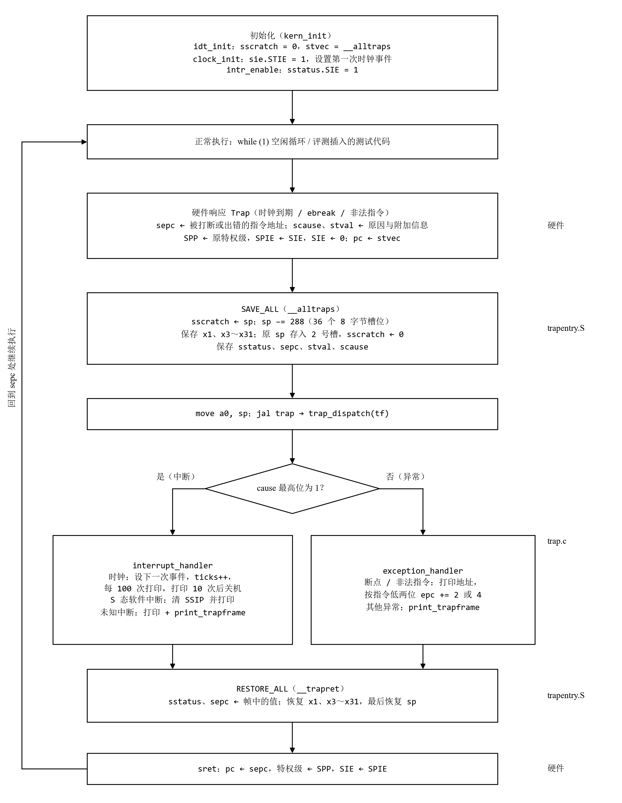
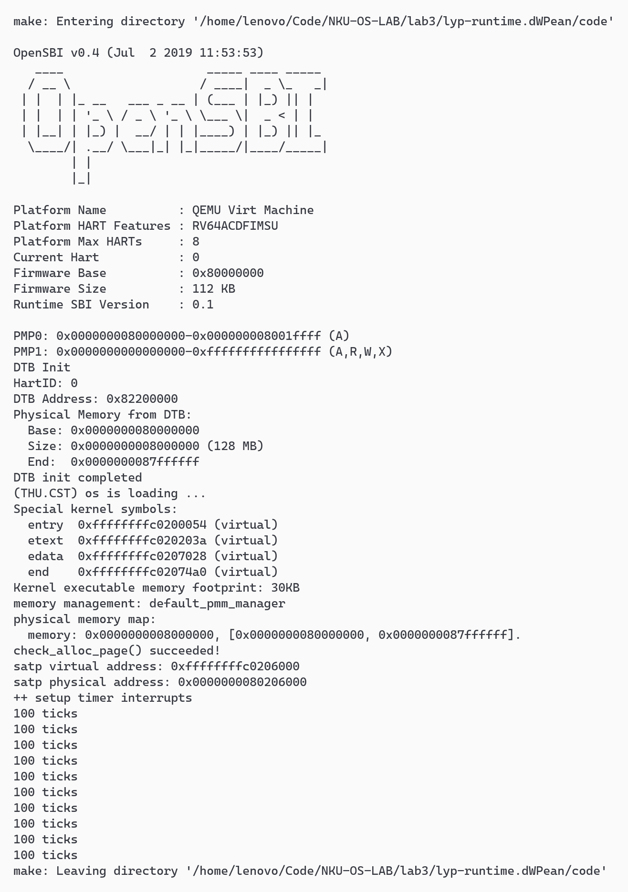
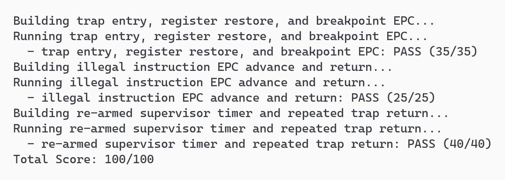
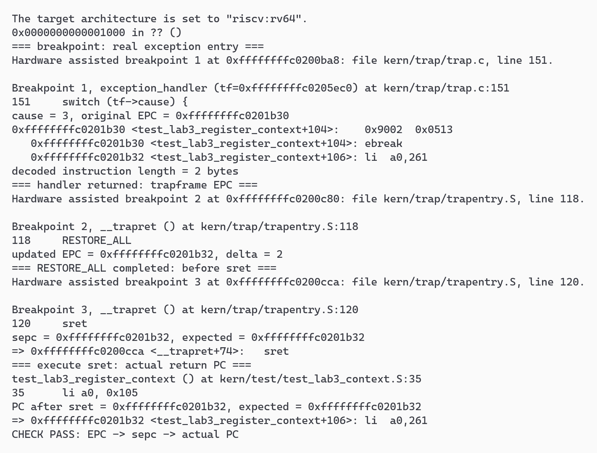
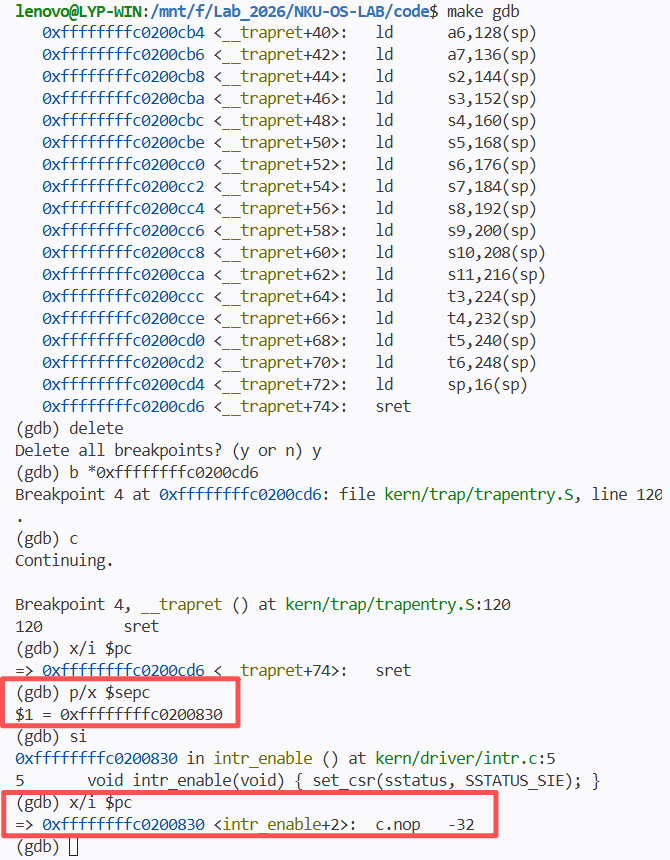
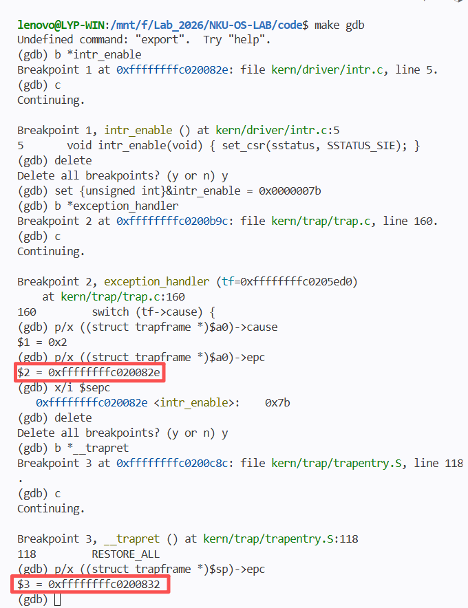
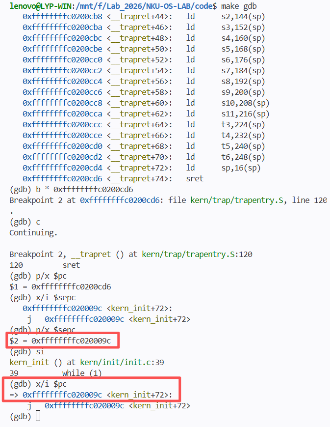
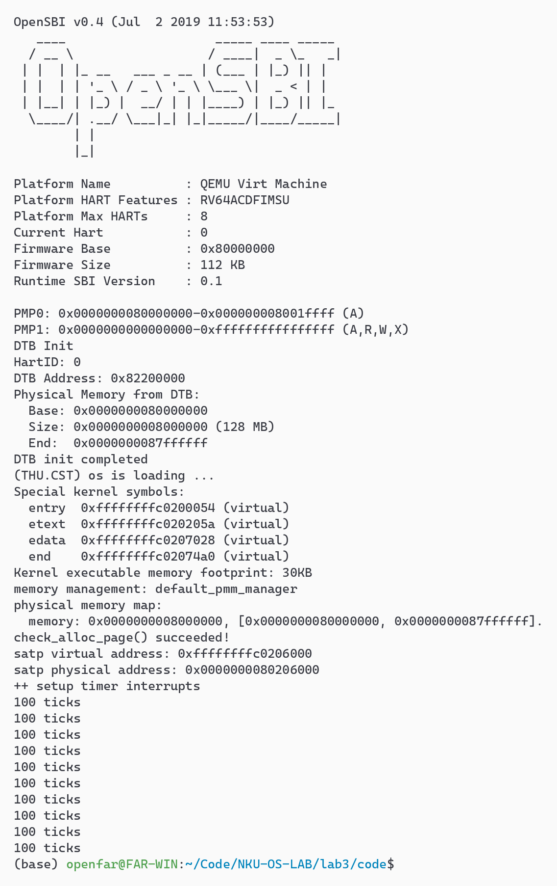
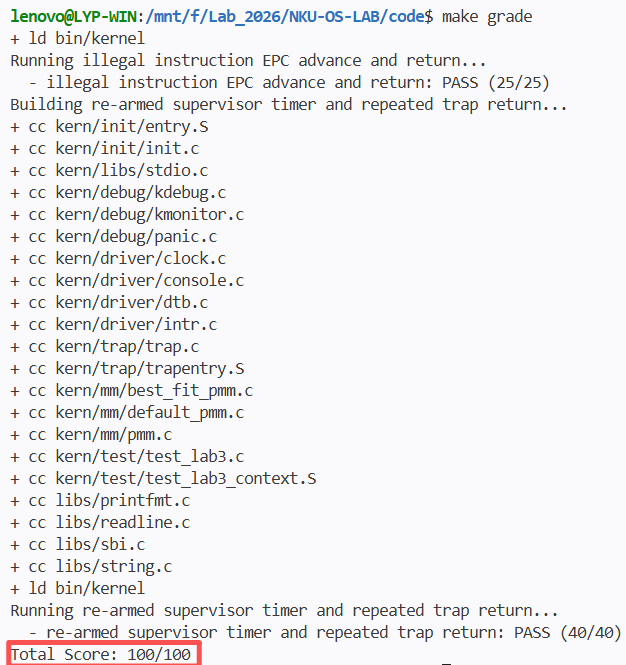

# <center>操作系统 lab3 实验报告</center>

<h5 align="center">实验名称：中断与异常处理  完成日期：2026-11-05</h5 align="center">
<h5 align="center">小组成员：2411264-张远、2414099-李云鹏、2413074-刘昀皓</h5 align="center">


# 小组分工

| 成员 | 负责的练习/模块/代码/报告 |
|------|----------------|
| 2411264-张远 | 功能模块一（RESTORE_ALL 与 `__alltraps`）、实验整体逻辑分析、报告集成与最终评测 |
| 2414099-李云鹏 | 功能模块二（interrupt_handler 与 exception_handler）、对操作系统的理解 |
| 2413074-刘昀皓 | 练习：指导书思考题、实验目的、实验环境、测试与验证、AI 协作开发的经验 |


# 一、实验目的

1. **深入理解 RISC-V 陷阱（Trap）机制与特权级架构**：
   - 理解异常（Exception）与中断（Interrupt）在触发源、同步性与处理方式上的核心差异；
   - 掌握 RISC-V 特权级架构下陷阱处理的核心控制与状态寄存器（CSR：`sstatus`、`stvec`、`sepc`、`scause`、`stval`、`sie`）的功能定义与协作关系；
2. **掌握操作系统内核的中断上下文保存与恢复机制**：
   - 理解并掌握在 `trapentry.S` 中通过 `__alltraps` 汇编例程构建中断上下文的完整流程，理解通过 `SAVE_ALL` 在内核栈上分配空间并按 `struct trapframe` 结构保存全部 32 个通用寄存器和关键 CSR 的底层实现；
   - 深入掌握 `RESTORE_ALL` 恢复现场的精细约束（如栈指针 `sp` 的恢复顺序、`sstatus` 与 `sepc` 的写回逻辑），理解 `sret` 指令安全返回原执行流的完整闭环。
3. **掌握操作系统内核的中断与异常分发处理机制**：
   - 掌握在 `trap.c` 中根据 `scause` 寄存器的最高位（Interrupt 标志位）区分中断与异常的双路分发架构；
   - 掌握时钟中断（Timer Interrupt）的响应与处理逻辑，通过 SBI 调用周期性设置下一次定时器事件，维护全局时钟滴答计数（`ticks`），为后续 Lab 的进程时间片调度奠定基础；
   - 掌握断点异常（`ebreak`）与非法指令异常的捕获与响应流程，掌握在软件层面推进 `tf->epc` 返回地址以跨越触发异常指令的核心方法。


# 二、实验环境

## 软件与运行环境

本实验统一使用指导书推荐的 **QEMU 4.1.1**（内置 OpenSBI v0.4）。

| 成员 | 宿主系统 | QEMU 版本 | 交叉编译工具链 | 调试器版本 |
| :--- | :--- | :--- | :--- | :--- |
| 2411264-张远 | WSL2 Ubuntu 24.04 | 4.1.1（OpenSBI v0.4） | riscv64-unknown-elf-gcc 15.1.0 | riscv64-unknown-elf-gdb 16.3 |
| 2414099-李云鹏 | WSL2 Ubuntu 22.04 | 4.1.1（OpenSBI v0.4） | SiFive riscv64-unknown-elf-gcc 10.2.0 | riscv64-unknown-elf-gdb 10.1 |
| 2413074-刘昀皓 | WSL2 Ubuntu 24.04 | 4.1.1（OpenSBI v0.4） | riscv64-unknown-elf-gcc 15.1.0 | riscv64-unknown-elf-gdb 16.3 |

## AI 工具与底层模型

全组采用多工具、多模型的异构 Agent 协作模式，各成员分工与所用工具链配置如下：

| 成员 | 负责模块 | AI 编程工具 | 底层模型 |
| :--- | :--- | :--- | :--- |
| 2411264-张远 | T0, T1, T3, T5 | Claude Code（终端 Agent） | Claude Opus 5.5 |
| 2414099-李云鹏 | T2, T3 | Codex（终端 Agent） | gpt-6.1-sol |
| 2413074-刘昀皓 | T4 | Antigravity（终端 Agent） | Gemini 4 Argon / Claude Opus 5.5 |


# 三、实验整体逻辑分析

**负责人：** 2411264-张远

## 3.1 逻辑主线

Lab3 的主题是**中断与异常**。lab2 结束时，内核能管理物理内存，但执行流完全是线性的：从 `kern_init` 一路执行到 `while (1)`，CPU 只要遇到异常就无处可去，外部事件（例如时钟到期）也没有办法通知内核。本章要解决的问题是：**当 CPU 的正常执行流被打断时，怎样让控制权安全地交给内核，处理完之后再原样交还回去。**

我们把本章概括为一句话：**围绕一次 Trap 的“进入—处理—返回”，把硬件做的、汇编做的和 C 做的三段工作接成一个闭环。**




<p align="center">图 1　lab3 中一次 Trap 的完整处理流程</p>

三段工作的分工很清楚：

- **硬件**只做最少的事：记下“从哪里来”（`sepc`）和“为什么来”（`scause`、`stval`），在 `sstatus` 中记下原特权级并关中断，然后跳到 `stvec`。它**不会**替内核保存任何通用寄存器。
- **汇编（`trapentry.S`）**负责通用寄存器和 CSR 的保存与恢复，把现场整理成 C 能直接访问的 `struct trapframe`，返回时再按同一布局写回，用 `sret` 回到 `sepc`。
- **C（`trap.c`）**只看 Trap frame：根据 `cause` 区分中断和异常，再按具体原因处理；需要改变返回位置时只改 `tf->epc`。

## 3.2 功能的逐步实现

| 顺序 | 功能 | 主要代码 | 报告中的位置 |
| :---: | :--- | :--- | :--- |
| 0 | 补齐 lab2 代码，统一评测环境 | `kern/mm/pmm.c`、`best_fit_pmm.c`、`Makefile` | 二、实验环境 |
| 1 | 建立 Trap 入口：`stvec` 指向 `__alltraps`（框架已给出） | `kern/trap/trap.c` 的 `idt_init` | 本章 |
| 2 | 保存与恢复现场：`SAVE_ALL`（框架已给出）与 `RESTORE_ALL` | `kern/trap/trapentry.S` | 功能模块一 |
| 3 | 连接汇编与 C：`__alltraps` 调用 `trap(tf)`，返回后 `sret` | `kern/trap/trapentry.S` | 功能模块一 |
| 4 | 处理异常：断点、非法指令，按指令长度推进 `epc` | `trap.c` 的 `exception_handler` | 功能模块二 |
| 5 | 处理中断：时钟中断的周期性重装、计数与关机，其他中断分类输出 | `trap.c` 的 `interrupt_handler`、`kern/driver/clock.c` | 功能模块二 |
| 6 | 理解中断带来的并发问题：`stvec` 模式编码、关中断保护临界区 | `kern/sync/sync.h`、`pmm.c` | 练习：指导书思考题 |

1. **让 Trap 有地方可去。**`idt_init()` 把 `sscratch` 清零（约定 0 表示 Trap 来自内核态），再把 `stvec` 设为 `__alltraps`。`__alltraps` 用 `.align(2)` 保证 4 字节对齐，`stvec` 的低两位为 0，即 Direct 模式，所有 Trap 进入同一个入口。
2. **接着实现现场的保存与恢复。**硬件不保存通用寄存器，而 C 函数会随意使用调用者保存寄存器，所以进入 C 之前必须把全部现场存下来，返回前再原样恢复，被打断的代码才感觉不到 Trap 发生过。
3. **再把汇编和 C 接起来。**`SAVE_ALL` 结束时 `sp` 恰好指向 Trap frame，按调用约定 `move a0, sp` 后 `jal trap`，C 就拿到了 `struct trapframe *tf`；`trap()` 返回后顺序落入 `__trapret`，执行 `RESTORE_ALL` 和 `sret`。至此“进入—返回”的骨架已经完整，剩下的只是 C 函数里填什么。
4. **然后处理异常。**异常是当前指令同步引起的，返回位置要由内核决定：断点和非法指令如果原样返回，会再次执行同一条指令，陷入死循环，所以要把 `tf->epc` 推进到下一条指令。评测中的 `ebreak` 可能被汇编成 2 字节的 `c.ebreak`，非法指令则是 4 字节，因此要看指令最低两位。
5. **最后处理中断，尤其是时钟中断。**中断是异步的，`sepc` 指向尚未执行的那条指令，处理后原样返回即可。时钟中断要注意两点：OpenSBI 的定时器是一次性的，每次中断都要调用 `clock_set_next_event()` 重新设定。时钟中断依赖 `clock_init()` 打开 `sie.STIE` 和 `intr_enable()` 打开 `sstatus.SIE`。

## 3.3 各功能的核心函数

| 函数 / 宏 | 文件 | 作用 | 由谁完成 |
| :--- | :--- | :--- | :--- |
| `idt_init` | `trap.c` | `sscratch = 0`，`stvec = __alltraps` | 框架 |
| `SAVE_ALL` | `trapentry.S` | 在栈上开辟 288 字节，保存 32 个通用寄存器和 4 个 CSR | 框架 |
| `RESTORE_ALL` | `trapentry.S` | 写回 `sstatus`、`sepc`，恢复通用寄存器，最后恢复 `sp` | 功能模块一 |
| `__alltraps` | `trapentry.S` | `SAVE_ALL` → `move a0, sp` → `jal trap`，之后落入 `__trapret` | 功能模块一 |
| `trap` / `trap_dispatch` | `trap.c` | 按 `cause` 的符号位分派到中断或异常处理函数 | 框架 |
| `interrupt_handler` | `trap.c` | 时钟中断重装定时器、计数、打印、关机；其他中断分类输出 | 功能模块二 |
| `exception_handler` | `trap.c` | 断点、非法指令打印地址并推进 `epc`；其他异常打印 Trap frame | 功能模块二 |
| `clock_init` / `clock_set_next_event` | `clock.c` | 打开时钟中断，经 `sbi_set_timer` 设定下一次事件 | 框架 |
| `intr_enable` / `local_intr_save` | `intr.c`、`sync.h` | 打开全局中断；在临界区前后关闭和恢复中断 | 框架 |


# 四、实验内容与实现

## 功能模块一：Trap 上下文恢复与 Trap 入口功能

**负责人：** 2411264-张远

### 模块功能描述

**需要实现/修改的函数：**

```asm
    .macro RESTORE_ALL     # kern/trap/trapentry.S：按 Trap frame 恢复处理器状态
__alltraps:                # kern/trap/trapentry.S：Trap 入口，SAVE_ALL 之后调用 trap(tf)
```

**功能说明：**

`idt_init()` 把 `stvec` 设成 `__alltraps`，于是不论是时钟中断还是 ebreak、非法指令这类异常，处理器都会跳到同一个入口。这段汇编夹在“硬件响应 Trap”和“C 语言处理 Trap”之间，负责三件事：

1. **保存现场**（框架已给出的 SAVE_ALL）。在当前栈上开辟 36 × 8 = 288 字节的 Trap frame，存入 32 个通用寄存器和 4 个 CSR（sstatus、sepc、stval、scause），布局与 `struct trapframe` 一一对应。
2. **调用 C 函数**（`__alltraps` 中补的部分）。SAVE_ALL 结束时 `sp` 恰好指向 Trap frame，按调用约定把它放进 `a0`，再 `jal trap`，C 代码就能以 `struct trapframe *tf` 的形式读写现场。`sp` 是被调用者保存寄存器，`trap()` 返回后 `sp` 仍指向这个帧，顺序执行进入 `__trapret`。
3. **恢复现场并返回**（RESTORE_ALL）。把帧里的内容写回寄存器，最后由 `sret` 回到 `sepc` 所指的位置继续执行。

RESTORE_ALL 不能写成 SAVE_ALL 的简单逆序，需要注意三点：

- **sp 要单独处理，而且必须最后恢复。** SAVE_ALL 并没有直接保存 x2：它先 `csrw sscratch, sp` 把原 sp 暂存起来，`sp` 下移开辟帧之后，再用 `csrrw s0, sscratch, x0` 取回原 sp 存进 2 号槽位，同时把 `sscratch` 清零（约定 `sscratch == 0` 表示 Trap 来自内核态）。所以帧里的 2 号槽位是 Trap 前的 sp，而当前 `sp` 是帧的基址，其余寄存器都要经 `sp` 从帧中取出。一旦先恢复了 sp，后面的加载就全部读错了地址。
- **CSR 先写回，中转寄存器后恢复。** `csrw` 只能从通用寄存器取值，所以先用 s1、s2 取出 status、epc 写回 `sstatus`、`sepc`，再从帧里恢复 s1、s2 本身。
- **只写回 sret 需要的 CSR。** `sepc` 决定返回地址，`sstatus` 的 SPP、SPIE 决定返回后的特权级和中断使能；`stval`、`scause` 只是给 `trap()` 看的现场记录，`sret` 不读它们，不需要写回。

`sepc` 必须从帧里写回，而不是沿用 CSR 的当前值，因为 `exception_handler()` 处理 ebreak 和非法指令时会把 `tf->epc` 推进到下一条指令，只有写回 `sepc`，这个修改才会生效。

### 最终提示词

以下是经过迭代优化后，最终成功实现该功能的提示词：

````markdown
[PROMPT]

**任务**：在 `code/kern/trap/trapentry.S` 中补全宏 `RESTORE_ALL` 和入口 `__alltraps` 的缺失部分，使内核形成“Trap 进入 → SAVE_ALL 保存上下文 → 调用 C 函数 `trap()` → RESTORE_ALL 恢复上下文 → `sret` 返回原执行流”的完整闭环。`RESTORE_ALL` 根据当前 Trap frame 恢复被打断程序的处理器状态；`__alltraps` 把 SAVE_ALL 建好的 Trap frame 按 RISC-V 调用约定传给 `trap(struct trapframe *tf)`。

**操作要求**：你必须在项目中直接修改实际文件，而不是只展示代码片段。只在文件中两处 `#lab3 function1 YOUR CODE` 注释的下方写代码，并把这两处注释中的 `YOUR CODE` 替换为学号 `2411264`，保留 `lab3 function1`。不要修改 SAVE_ALL、`__trapret` 标号和其后的 `sret`、`struct trapframe`、`trap()` 的签名以及其他任何文件。关键步骤写简短的中文注释。

**输出要求**：直接进行文件操作，使用下面 [RELY]、[GUARANTEE]、[SPECIFICATION] 中提供的信息，以工程中的真实代码为准。

[RELY]

```asm
# code/kern/trap/trapentry.S（框架原样，省略部分重复行）
#include <riscv.h>

    .macro SAVE_ALL

    csrw sscratch, sp

    addi sp, sp, -36 * REGBYTES
    # save x registers
    STORE x0, 0*REGBYTES(sp)
    STORE x1, 1*REGBYTES(sp)
    STORE x3, 3*REGBYTES(sp)
    STORE x4, 4*REGBYTES(sp)
    ...                          # x5 ~ x30 同样依次存到 n*REGBYTES(sp)
    STORE x31, 31*REGBYTES(sp)

    # get sr, epc, badvaddr, cause
    # Set sscratch register to 0, so that if a recursive exception
    # occurs, the exception vector knows it came from the kernel
    csrrw s0, sscratch, x0
    csrr s1, sstatus
    csrr s2, sepc
    csrr s3, sbadaddr
    csrr s4, scause

    STORE s0, 2*REGBYTES(sp)
    STORE s1, 32*REGBYTES(sp)
    STORE s2, 33*REGBYTES(sp)
    STORE s3, 34*REGBYTES(sp)
    STORE s4, 35*REGBYTES(sp)
    .endm

    .macro RESTORE_ALL

    #lab3 function1 YOUR CODE

    .endm

    .globl __alltraps
    .align(2)
__alltraps:
    SAVE_ALL

    #lab3 function1 YOUR CODE
    # sp should be the same as before "jal trap"

    .globl __trapret
__trapret:
    RESTORE_ALL
    # return from supervisor call
    sret
```

```c
// code/libs/riscv.h（RV64 部分）
#if __riscv_xlen == 64
# define STORE    sd
# define LOAD     ld
# define LOG_REGBYTES 3
#endif
#define REGBYTES (1 << LOG_REGBYTES)
```

```c
// code/kern/trap/trap.h
struct pushregs {
    uintptr_t zero;  // Hard-wired zero
    uintptr_t ra;    // Return address
    uintptr_t sp;    // Stack pointer
    uintptr_t gp;    // Global pointer
    uintptr_t tp;    // Thread pointer
    uintptr_t t0;    // Temporary
    ...              // t1, t2, s0, s1, a0 ~ a7, s2 ~ s11, t3 ~ t6，即 x6 ~ x31 依次排列
    uintptr_t t6;    // Temporary
};

struct trapframe {
    struct pushregs gpr;
    uintptr_t status;
    uintptr_t epc;
    uintptr_t badvaddr;
    uintptr_t cause;
};

void trap(struct trapframe *tf);
```

```c
// code/kern/trap/trap.c
void idt_init(void) {
    extern void __alltraps(void);
    /* Set sup0 scratch register to 0, indicating to exception vector
       that we are presently executing in the kernel */
    write_csr(sscratch, 0);
    /* Set the exception vector address */
    write_csr(stvec, &__alltraps);
}
```

- RISC-V 调用约定：第一个参数通过 `a0` 传递；`sp` 是被调用者保存寄存器，`trap()` 返回时 `sp` 与调用前相同；`jal` 会改写 `ra`。
- 处理器进入 S 态 Trap 时，硬件把被打断指令的地址写入 `sepc`，把 `sstatus.SIE` 保存到 `SPIE` 后清零，并把原特权级记入 `SPP`。`sret` 跳转到 `sepc`，并按 `SPP`、`SPIE` 恢复特权级和中断使能，不读取 `stval`（即 `sbadaddr`）和 `scause`。
- `trap()` 可能修改 Trap frame 中的字段，例如异常处理会推进 `tf->epc`。

[GUARANTEE]

```asm
    .macro RESTORE_ALL     # 输入：sp 指向 Trap frame；输出：恢复后的处理器执行状态
    ...
    .endm

__alltraps:                # SAVE_ALL 之后：把 Trap frame 作为 struct trapframe * 传给 trap()
    SAVE_ALL
    ...
__trapret:                 # trap() 返回后顺序执行到这里
    RESTORE_ALL
    sret
```

[SPECIFICATION]

## RESTORE_ALL

**Pre-Condition**:
- `sp` 指向 SAVE_ALL 建立的 Trap frame（共 36 × `REGBYTES` 字节），帧中第 n 个通用寄存器槽位存 xn，32～35 号槽位依次是 status、epc、badvaddr、cause。
- `trap()` 已返回，帧内容可能已被修改（例如 `epc`）。

**Post-Condition**:
- `sstatus`、`sepc` 等于帧中的 status、epc，随后的 `sret` 依据它们返回。
- x1、x3～x31 等于帧中对应槽位的值；x0 不需要恢复。
- `sp` 等于 Trap 发生前的值（帧中 2 号槽位）。

  **Case 1**（x2/sp 的特殊处理）:
  - SAVE_ALL 没有直接保存 x2：它先把原 sp 暂存到 `sscratch`，`sp` 下移开辟 Trap frame 后，再通过 `csrrw s0, sscratch, x0` 取出原 sp 存进 2 号槽位，同时把 `sscratch` 清零。所以 2 号槽位是 Trap 前的 sp，而当前 `sp` 是帧的基址。
  - 所有数据都要通过 `sp` 从帧中取，sp 必须最后恢复；提前恢复 sp 会让后续的加载全部读错地址。

  **Case 2**（CSR 的恢复顺序）:
  - 写 CSR 需要借用通用寄存器作中转。先用中转寄存器取出 status、epc 写回 `sstatus`、`sepc`，再恢复这些中转寄存器本身，不能让它们最后保留 CSR 的值。

  **Case 3**（不需要写回的字段）:
  - badvaddr、cause 只是提供给 `trap()` 的现场记录，`sret` 不使用它们，不需要写回 CSR。

**Requirements**:
- 恢复的布局与 SAVE_ALL 保存时完全一致，使用 `LOAD` 和 `n*REGBYTES(sp)` 的写法，不自行假设其他布局。

## __alltraps

**Pre-Condition**:
- `stvec` 指向 `__alltraps`（由 `idt_init()` 设置），Trap 发生后处理器跳到这里，SAVE_ALL 执行完时 `sp` 指向 Trap frame。

**Post-Condition**:
- 调用 `trap(tf)` 时 `a0` 等于 Trap frame 的地址。
- `trap()` 返回后顺序进入 `__trapret`，此时 `sp` 仍指向同一个 Trap frame。

**Requirements**:
- 不能在调用 `trap()` 前改动 `sp`，也不能在 `trap()` 返回后插入跳转，`__trapret` 紧跟在调用之后。
- 运行 `make grade` 时，Test 1“trap entry, register restore, and breakpoint EPC”（ebreak 前后 t0～t6、s0～s11、a1～a7 全部保持不变）、Test 2（非法指令返回）、Test 3（持续的时钟中断）都依赖本模块。
````

### 实现迭代过程

本模块的实现经历了 2 次迭代，过程如下：

#### 第一次迭代

**遇到的问题：**

- 问题 1：第一次编译 trapentry.S 就报错 `kern/trap/trapentry.S:47: Error: unknown CSR 'sbadaddr'`。出错的是框架给出的 SAVE_ALL（`csrr s3, sbadaddr`），不是新写的代码。`sbadaddr` 是 1.10 版特权级规范之前对 `stval` 的叫法，本机的 binutils 2.45 已经不再识别这个旧名字，而指导书 lab0 安装的旧版工具链仍然支持。
- 问题 2：框架原样无法链接验证。`trap.c` 调用的 `interrupt_handler()` / `exception_handler()` 属于功能模块二，尚未实现，编译报 `implicit declaration of function 'interrupt_handler'`。

**问题解决策略：**

- 针对问题 1：要求不能修改 SAVE_ALL，所以在 `libs/riscv.h`（trapentry.S 第一行就包含它）中只对汇编文件定义 `#define sbadaddr stval`，两者是同一个 CSR（0x143），反汇编确认生成的是 `csrr s3,stval`。新旧工具链都能编译。提示词不受影响：[RELY] 中照原样引用 SAVE_ALL。
- 针对问题 2：验证时在 WSL 的临时副本中给 trap.c 放一个最简单的处理函数（时钟中断重设下一次事件，ebreak 和非法指令按指令长度推进 epc），仓库中的代码不受影响。这样 `make grade` 的三项测试都能跑，用来检查本模块。

#### 第二次迭代

第一次迭代后，按提示词生成的代码一次通过：`make grade` 100/100，`make qemu` 每秒打印一次 `100 ticks`。为了确认 [SPECIFICATION] 中强调的两个约束确实必要，而不是多余的描述，我们在临时副本中构造了两个反例：

**遇到的问题：**

- 问题 1（违反 Case 1，最先恢复 sp）：把 `LOAD x2, 2*REGBYTES(sp)` 挪到最前面。`make qemu` **看起来完全正常**，仍然每秒打印 `100 ticks`，但 `make grade` 只有 25/100，Test 1（寄存器上下文）和 Test 3（持续时钟中断）失败。原因是恢复 sp 之后，其余寄存器都从“原 sp + 偏移”这个错误的地址加载；空闲循环 `while (1)` 不使用任何寄存器，所以表面上看不出问题，只有在 ebreak 前后逐个比较寄存器的测试才能暴露。
- 问题 2（违反 Case 2 和 Post-Condition，不写回 sepc）：去掉 `csrw sepc, s2`，得分 40/100。时钟中断不修改 epc，CSR 里残留的 `sepc` 恰好正确，所以 Test 3 仍然通过；但 ebreak 和非法指令的处理函数推进的 `tf->epc` 没有写回，`sret` 回到原来那条指令，再次触发异常，形成死循环，Test 1、Test 2 失败。

**问题解决策略：**

- 针对问题 1：在 [SPECIFICATION] 的 Case 1 中写明 SAVE_ALL 对 x2 的处理路径（sscratch 中转、2 号槽位、当前 sp 是帧基址），并明确要求“sp 必须最后恢复”。在 [Requirements] 中列出 `make grade` 的三项测试，不能只凭 `make qemu` 的输出判断正确与否。
- 针对问题 2：在 [RELY] 中注明“`trap()` 可能修改 Trap frame 中的字段，例如异常处理会推进 `tf->epc`”，在 Post-Condition 中要求 `sepc` 等于帧中的 epc，在 Case 3 中说明哪些 CSR 不需要写回，避免 AI 把四个 CSR 全部写回或全部省略。

**最终结果：**

经过 2 次迭代，该模块最终：

- ✅ 编译通过
- ✅ `make grade` 100/100（处理函数使用临时实现；正式结果以功能模块二合入后为准）
- ✅ 功能符合预期：GDB 跟踪确认 Trap frame 的布局、传给 `trap()` 的参数以及 `sret` 前后的 pc、sp 都正确

**关键改进点总结：**

1. 在 [SPECIFICATION] 中写明 SAVE_ALL 对 sp 的特殊保存方式，并要求 sp 最后恢复。
2. 明确 CSR 的恢复顺序，以及只有 `sstatus`、`sepc` 需要写回的原因。
3. 在 [RELY] 中说明 `trap()` 会修改 `tf->epc`，把“写回 sepc”和异常处理关联起来；在 [Requirements] 中用 `make grade` 的三项测试作为验收标准。


## 功能模块二：中断与异常处理

**负责人：** 2414099-李云鹏

### 模块功能描述

本模块补充 `kern/trap/trap.c` 中的两个接口：

```c
void interrupt_handler(struct trapframe *tf);
void exception_handler(struct trapframe *tf);
```

汇编入口将寄存器现场保存为 `struct trapframe`，`trap_dispatch()` 根据 `cause` 最高位分派到中断或异常处理函数。处理完成后，功能模块一的 `RESTORE_ALL` 从帧中恢复 `sstatus`、`sepc` 和通用寄存器，再执行 `sret`。本模块通过修改 `tf->epc` 调整异常返回位置。

#### 1. 中断处理

`interrupt_handler()` 先清除 `cause` 的最高位，得到中断编号。采用位掩码而非减去固定高位，是因为评测还会直接传入不带中断标志的编号 15；两种输入都应得到相同的编号。

管理态时钟中断按以下顺序处理：

1. 调用 `clock_set_next_event()` 设置下一次事件；
2. 令全局 `ticks` 增加一；
3. `ticks` 为 `TICK_NUM=100` 的整数倍时调用 `print_ticks()`；
4. 用函数内静态变量累计打印次数，达到 `SHUTDOWN_AFTER=10` 时调用 `sbi_shutdown()`。

`ticks` 一直累计，不在打印时清零。阈值选为十次，是为了让评测等待的 200 ticks 能先返回到测试主流程，输出测试完成信息；若在第 200 次中断中就关机，计数虽然达标，主流程却没有机会继续执行。框架每次把定时器设为当前时间加 100000，在 QEMU 10 MHz 时基下约每秒打印一次。

管理态软件中断通过 `clear_csr(sip, SIP_SSIP)` 清除挂起位，并打印 `Supervisor software interrupt`。其余框架已定义的软件、时钟、外部、协处理器及宿主中断分别输出类型提示。未知中断打印 `Unknown interrupt: cause <编号>` 后调用 `print_trapframe()`。这些诊断分支不是完整的设备驱动；例如外部中断还没有 PLIC 的 claim/complete 流程。

异步中断不是一条需要跳过的故障指令，返回后应从硬件记录的继续执行位置恢复。

#### 2. 异常处理与指令长度

`exception_handler()` 对非法指令和断点分别打印 `Illegal instruction at`、`Breakpoint at` 及推进前的地址，随后读取故障地址处的首个 16 位半字：

```c
uint16_t instruction = *(const volatile uint16_t *)tf->epc;
tf->epc += (instruction & 0x3) == 0x3 ? 4 : 2;
```

| 本实验中的指令 | 编码 | 首半字低两位 | EPC 增量 |
|---|---|---|---|
| 压缩断点 `c.ebreak` | `0x9002` | `10` | 2 字节 |
| 普通断点 `ebreak` | `0x00100073` | `11` | 4 字节 |
| 评测非法指令 | `.word 0x0000007b` | `11` | 4 字节 |

EPC 的增量取决于指令编码：普通指令推进 4 字节，压缩指令推进 2 字节。先读取半字，也能适应压缩指令的 2 字节对齐地址。这一判断只适用于本实验的 16/32 位指令，不包含 RISC-V 长指令的完整解码。

这里直接读取 EPC，要求故障指令位于可读的内核代码中；处理用户地址还需要安全取指和二次异常处理。其他异常调用 `print_trapframe()` 后返回，不跳过指令。若异常条件仍存在，返回后可能再次陷入，因此这些分支目前只提供诊断。

### 最终提示词

````markdown
[PROMPT]
任务：实现 Lab3 `code/kern/trap/trap.c` 的中断与异常处理模块。
操作要求：直接修改真实文件，仅在 `//lab3 function2 YOUR CODE` 区域补充必要头文件、常量及两个处理函数，保留 `lab3 function2` 标记并把 `YOUR CODE` 替换为 `2414099`。不改变已有函数、函数签名、初始化流程、汇编入口或评测文件。
输出要求：提供实现、实际编译与运行结果；说明断点/非法指令的返回地址更新和时钟自动关机边界。未运行的验证明确标为未验证。

[RELY]
以下是导入框架提交 `8cc0679` 中已有的接口与定义。宏仅节选本功能所需内容；省略无关代码，不把待实现的函数当作现成依赖。

`kern/trap/trap.h`：
```c
struct trapframe {
    struct pushregs gpr;
    uintptr_t status;
    uintptr_t epc;
    uintptr_t badvaddr;
    uintptr_t cause;
};

void print_trapframe(struct trapframe *tf);
```
其中 `struct pushregs` 是框架中按寄存器编号排列、含全部 32 个通用寄存器槽位的结构，不改变其定义。

`libs/riscv.h`：
```c
#define IRQ_U_SOFT   0
#define IRQ_S_SOFT   1
#define IRQ_H_SOFT   2
#define IRQ_M_SOFT   3
#define IRQ_U_TIMER  4
#define IRQ_S_TIMER  5
#define IRQ_H_TIMER  6
#define IRQ_M_TIMER  7
#define IRQ_U_EXT    8
#define IRQ_S_EXT    9
#define IRQ_H_EXT    10
#define IRQ_M_EXT    11
#define IRQ_COP      12
#define IRQ_HOST     13
#define CAUSE_ILLEGAL_INSTRUCTION 0x2
#define CAUSE_BREAKPOINT 0x3
#define SIP_SSIP MIP_SSIP
```
还可调用框架的 `clear_csr(reg, bit)` 宏清除 CSR 中相应位。

`kern/driver/clock.h`：
```c
extern volatile size_t ticks;

void clock_init(void);
void clock_set_next_event(void);
```

`libs/sbi.h`：
```c
void sbi_shutdown(void);
```

`kern/trap/trap.c`：
```c
#define TICK_NUM 100

static void print_ticks() {
    cprintf("%d ticks\n", TICK_NUM);
#ifdef DEBUG_GRADE
    cprintf("End of Test.\n");
    panic("EOT: kernel seems ok.");
#endif
}
```
已有 `trap_dispatch()` 依据 `(intptr_t)tf->cause < 0` 区分中断和异常；异常返回路径会把 `tf->epc` 写回 `sepc`，再执行 `sret`。不要直接写 `sepc` 来代替修改帧。

[GUARANTEE]
必须实现接口：
```c
void interrupt_handler(struct trapframe *tf);
void exception_handler(struct trapframe *tf);
```
必须交付：两个接口的实现；与实际结果一致的验证记录；在统一环境中以 GDB 观察断点及非法指令的原始 EPC、编码、更新后的 EPC 和 `sret` 后的 PC，并保存真实取证图片。

[SPECIFICATION]
1. `interrupt_handler(struct trapframe *tf)`
   - Pre-Condition：`tf` 指向有效 Trap 帧；实际执行环境为 RV64 S 态。真实中断的 `cause` 最高位置位，测试也可能直接传入不带该位的中断编号。
   - Post-Condition：清除中断标志位后按编号分派，不改变 `tf->epc`。管理态时钟中断先调用 `clock_set_next_event()`，再令 `ticks` 加一；每达 `TICK_NUM` 整数倍调用 `print_ticks()`，累计输出 `SHUTDOWN_AFTER=10` 次后调用 `sbi_shutdown()`。不清零或取模覆盖 `ticks`。
   - Case 1：管理态软件中断清除 `sip.SSIP`，输出 `Supervisor software interrupt`，防止 pending 位一直保留造成重复触发。
   - Case 2：其余框架已定义的中断编号输出对应类型的提示；这里只作分类诊断，不宣称已实现完整设备驱动。
   - Case 3：未知编号先输出 `Unknown interrupt: cause <编号>`，再调用 `print_trapframe(tf)`。直接传入编号 15 时也必须正确输出 15。
   - Requirements：关机次数必须大于 2，让等待 `ticks >= 200` 的评测主流程能在中断返回后继续执行；不额外定义 `DEBUG_GRADE`，避免第一次打印即 panic。

2. `exception_handler(struct trapframe *tf)`
   - Pre-Condition：`tf` 指向有效异常帧；对断点及非法指令，本实验保证故障指令地址可按半字读取，待跳过的指令为 16 位或 32 位。不将此假设推广到任意用户地址、取指故障或长指令扩展。
   - Post-Condition：非法指令输出 `Illegal instruction at` 和原始 EPC，断点输出 `Breakpoint at` 和原始 EPC；随后读取 EPC 处的 `uint16_t` 首半字，低两位为 `11` 时推进 4 字节，否则推进 2 字节。保留帧中其他字段。
   - Case 1：`c.ebreak` 编码 `0x9002`，返回地址增加 2。
   - Case 2：32 位 `ebreak` 编码 `0x00100073`，返回地址增加 4；不能把断点一律当作压缩指令。
   - Case 3：`.word 0x0000007b` 触发非法指令，返回地址增加 4。
   - Case 4：其他异常调用 `print_trapframe(tf)`，不擅自修改 EPC。诊断输出不等同于已恢复未知异常。
   - Requirements：从实际指令编码判断长度，不按异常类型硬编码，不依赖 `badvaddr` 一定包含指令编码；先读半字，避免在仅 2 字节对齐地址进行 32 位读取。

3. 验证要求
   - 保留原评测与初始化锚点；在隔离副本中验证，明确测试对象为提交版基线叠加当前 `trap.c`。有多个 WSL 发行版时，先用 `wsl --list --verbose` 核对，并选择安装 QEMU 4.1.1 的发行版；本机为 `Ubuntu-22.04-OS`，工具链在 `/opt/riscv/bin`。
   - 编译采用原选项；日常运行应周期打印 `100 ticks` 并在第十次打印后关机。统一 QEMU 4.1.1 下的原始 `make grade` 目标为 100/100。
   - GDB 使用硬件断点观察真实异常，不修改 EPC 来制造成功返回；核对 `sret` 后 PC 等于原始 EPC 加实际长度。没有运行证据时，不生成或引用伪造截图。
   - 补测软件中断时区分“直接调用处理函数”和“CPU 递交真实中断”：真实触发需要局部 `sie.SSIE`、全局 `sstatus.SIE` 及挂起 `sip.SSIP` 的条件均满足；核对处理后 SSIP 清零，且实际返回 PC 等于未推进的原始 EPC。调试期的触发与临时指令恢复仅作用于专用来宾实例，不修改仓库或评测源码。
````

### 实现迭代过程

#### 第一阶段：核对框架约束并实现处理函数

实现前检查了任务说明、`clock.c`、Trap 返回汇编和原评测的触发方式，确认了以下约束：

- 框架未提供 `SHUTDOWN_AFTER`，且测试需要等到 200 ticks 后继续运行；在功能区域定义阈值为 10，不修改评测。
- 测试既有真实异常，也有直接调用处理函数的合成帧；中断原因码使用清位操作，未知原因保留 Trap 帧诊断。
- `ebreak` 可能被汇编成压缩形式；返回地址从实际编码判断，不从异常种类推断长度。

使用提交 `b95765a` 的 `code/` 归档叠加当前 `trap.c`，在独立目录编译。首次在默认 WSL 的 GCC 15.1.0 下编译通过；后续正式验收改在 OS 专用发行版的 GCC 10.2.0 下重新构建，同样保留原有 `-Wall -Werror -O2 -std=gnu99`，编译、链接均通过。没有发生需要修复处理函数的编译错误。

#### 第二阶段：在 WSL 环境中运行

正式验收采用：

| 项目 | 实际环境 |
|---|---|
| WSL 发行版 | `Ubuntu-22.04-OS` |
| 交叉编译器 | `/opt/riscv/bin/riscv64-unknown-elf-gcc`，SiFive GCC 10.2.0 |
| 调试器 | `/opt/riscv/bin/riscv64-unknown-elf-gdb`，SiFive GDB 10.1 |
| 模拟器 | `~/Environment/qemu-4.1.1/riscv64-softmmu/qemu-system-riscv64` |
| 固件 | QEMU 自带 OpenSBI v0.4 |

进入该发行版后设置环境变量：

```bash
# Windows 终端先执行：wsl -d Ubuntu-22.04-OS
export PATH=/opt/riscv/bin:$PATH
export QEMU=$HOME/Environment/qemu-4.1.1/riscv64-softmmu/qemu-system-riscv64
"$QEMU" --version
make -j4
make qemu
make grade
```

`make qemu` 的实际输出中出现 OpenSBI v0.4、内存检查成功和时钟初始化提示，随后共打印十次 `100 ticks`。进程在第十次输出后正常退出，未触发外层 25 秒超时，退出码为 0。



<p align="center">图 2　统一环境运行：十次时钟输出后正常关机</p>

原始评分的三项结果分别为 35/35、25/25、40/40，总分 100/100。



<p align="center">图 3　make grade 评分结果摘录：100/100</p>

#### 第三阶段：GDB 核对异常返回地址

用 `make debug` 启动等待调试的 QEMU，在另一终端执行 `make gdb`。两类异常都在 `intr_enable()` 入口触发：先用 `b *intr_enable`、`c` 停在入口，删除断点，再临时改写该地址的指令。压缩断点写入 16 位的 `0x9002`，非法指令写入 32 位的 `0x0000007b`。这些改写只作用于 QEMU 来宾内存，不修改源码或镜像文件；两类测试分别运行。

两组调试都先用 `b *exception_handler` 停在处理函数的第一条指令，此时 `$a0` 就是传入的 Trap frame 指针，可以读取 `cause` 和原始 `epc`。处理函数返回后，再用 `b *__trapret` 停在 `RESTORE_ALL` 之前，通过 `$sp` 读取帧中更新后的 `epc`。最后从反汇编中找到 `sret`，检查写回的 `$sepc` 并单步观察 `$pc`。

**1. 压缩断点异常**

在 `intr_enable` 入口执行 `set {unsigned short}&intr_enable = 0x9002`，然后继续运行，触发压缩断点异常。



<p align="center">图 4　压缩断点：进入处理函数与帧 EPC 更新</p>

- 进入 `exception_handler` 时，`cause = 0x3`，对应断点异常。帧中的 `epc` 和 `$sepc` 都是 `0xffffffffc020082e`，`x/i $sepc` 显示该地址的指令为 `ebreak`。虽然反汇编使用这个名字，写入的编码 `0x9002` 表明它实际是 2 字节的 `c.ebreak`。
- 停在 `__trapret` 时，`RESTORE_ALL` 尚未执行，`sp` 仍指向 Trap frame。用 `p/x ((struct trapframe *)$sp)->epc` 读到 `0xffffffffc0200830`，比原始地址增加 2 字节，说明处理函数已按压缩指令长度更新了帧中的返回地址。



<p align="center">图 5　压缩断点：sepc 写回与 sret 返回</p>

- 反汇编中，`sret` 位于 `0xffffffffc0200cd6`（`__trapret+74`）。停在这里时，`RESTORE_ALL` 已执行完，`$sepc = 0xffffffffc0200830`，与帧中更新后的 EPC 相同。
- 执行 `si` 后，`$pc` 回到 `0xffffffffc0200830`（`intr_enable+2`），`x/i $pc` 显示 `c.nop -32`。处理器跳过了原来的 2 字节断点指令，没有再次回到 `0xffffffffc020082e` 触发同一个异常。

**2. 非法指令异常**

重新运行后，在同一入口执行 `set {unsigned int}&intr_enable = 0x0000007b`，继续运行，触发非法指令异常。



<p align="center">图 6　非法指令：原因码与 EPC 增加 4 字节</p>

- 进入 `exception_handler` 时，`cause = 0x2`，对应非法指令异常。原始 `epc = 0xffffffffc020082e`，`x/i $sepc` 显示该地址的编码为 `0x7b`，与临时写入的指令一致。
- `0x0000007b` 的低两位是 `11`，本实验中按 4 字节指令处理。停在 `__trapret` 时，帧中 `epc = 0xffffffffc0200832`，恰好是原地址加 4，说明处理函数已跳过这条非法指令。



<p align="center">图 7　非法指令测试后续运行：Trap 返回到内核空闲循环</p>

- 这张图停在同一条 `sret`，但此时 `$sepc = 0xffffffffc020009c`（`kern_init+72`），指向 `while (1)` 编译成的自跳转指令 `j`。单步执行 `sret` 后，`$pc` 也等于这个地址，程序回到空闲循环。
- 这里记录的是后续 Trap 的返回过程；非法指令的帧 EPC 更新由图 6 验证。

两组结果说明：异常处理函数负责按指令长度推进帧中的 EPC，`RESTORE_ALL` 再把它写回 `sepc`，由 `sret` 使用这个地址返回。压缩断点的截图完整记录了这条路径，非法指令的截图记录了帧 EPC 增加 4 字节以及后续程序继续运行的情况。

### 验证结论

本模块完成以下验证：

| 项目 | 结果 |
|---|---|
| GCC 10.2.0、原编译选项构建 | 通过 |
| QEMU 4.1.1 / OpenSBI v0.4 日常运行 | 十次输出后正常关机，退出码 0 |
| 原始 `make grade` | 100/100 |
| 压缩断点 GDB 验证 | 帧 EPC、sepc、返回 PC 均为 `0xffffffffc0200830`，比原地址增加 2 字节 |
| 非法指令 GDB 验证 | 帧 EPC 从 `0xffffffffc020082e` 增至 `0xffffffffc0200832`（增加 4 字节）；后续 Trap 返回到内核空闲循环 |


## 练习：指导书思考题

**负责人：** 2413074-刘昀皓

---

### 思考题 1：stvec 寄存器模式编码的向后兼容性

**题目描述：**

> 「中断与中断处理流程」一节：stvec 最低两位的模式编码是 1.10 版才加入的，这个改动如何保证与旧版本兼容？

#### 1. 背景与规范演进

在 RISC-V 特权级架构（Privileged Architecture）的发展历程中，陷阱向量基地址寄存器 `stvec`（Supervisor Trap-Vector Base-Address Register）的定义经历了一次重要演进：

1. **1.10 版之前的规范（如 v1.9 / v1.9.1）**：
   `stvec` 是一个 SXLEN 位的可读写寄存器，全部位段用于保存 Supervisor 态陷阱处理程序的基地址（Trap Handler Base Address）。规范明确规定：**写入 `stvec` 的基地址必须是 4 字节对齐的（4-byte aligned）**。在硬件实现中，其最低两位（bit[1:0]）被保留并固定绑定为零（hardwired to 0），软件向最低两位写入任何值都会被忽略。
2. **1.10 版及后续正式规范**：
   规范正式将 `stvec` 划分为两个独立字段：
   - **`BASE[XLEN-1:2]`（高 XLEN-2 位）**：保存 4 字节对齐的中断/异常处理程序向量基地址。
   - **`MODE[1:0]`（最低 2 位）**：向量模式选择字段，编码定义如下：
     - `00`（0 - **Direct 模式**）：所有进入 S 态的 Trap（包含异步中断和同步异常），PC 均统一跳转到 `BASE` 地址处。
     - `01`（1 - **Vectored 模式**）：同步异常跳转到 `BASE`；异步中断则根据原因码跳转到 `BASE + 4 × cause`（即基地址处存放一条条跳转指令构成的跳转向量表）。
     - `≥2`（2, 3 - **Reserved**）：保留供未来规范扩展使用。

#### 2. 向后兼容性保障机制分析

1.10 版特权级规范在引入 `MODE` 字段时，通过极具前瞻性的编码映射与硬件语义设计，保证了**向后兼容**：按旧规范编写的软件在新硬件上无需修改即可正确运行。需要注意兼容是单向的：使用 `MODE = 1`（Vectored）的新软件依赖新硬件的向量跳转，放到旧硬件上并不能工作。具体体现在以下四个方面：

##### （1）编码对齐与数值天然兼容（Encoding Compatibility）
在 1.10 版之前的旧版本操作系统中，由于规范硬性要求陷阱基地址必须 4 字节对齐，所有遵循旧规范编写的代码（例如旧版内核启动阶段的 `csrw stvec, t0`）向 `stvec` 写入的目标函数入口地址，其二进制最低两位必然恒为 `00`（因为地址满足 `addr % 4 == 0`）。
当旧版软件运行在支持 1.10 规范的新硬件上时，硬件将接收到的低两位 `00` 直接识别为 `MODE = 0`（Direct 模式）。旧软件无需修改一行代码、无需添加任何模式掩码，其写入的值天然且精确地匹配了 Direct 模式的编码。

##### （2）跳转目标地址的绝对恒等（Address Invariance）
在 Direct 模式下，硬件发生 Trap 时计算目标 PC 的规则为：将高位的 `BASE[XLEN-1:2]` 取出并在低位补零恢复为完整地址。
对于旧软件写入的 4 字节对齐地址 $A$：
$$A = \text{BASE} \ll 2$$
新硬件计算出的目标地址为：
$$\text{Target PC} = \text{BASE} \times 4 = A$$
跳转目标地址与旧软件预期的处理入口地址在二进制层面上分毫不差，不存在任何地址偏移或截断误差。

##### （3）控制流语义的无缝承接（Semantic Consistency）
在旧版规范中，处理器采用“单入口统一分发”模型：硬件在捕获中断或异常后，无差别地跳转到 `stvec` 指向的唯一起始点，由操作系统内核的通用汇编例程（如 `__alltraps`）读取 `scause` 寄存器后在软件层面进行二次分发。
1.10 规范将 `MODE = 0` 赋予 Direct 模式，保留的正是这一套经典的“单入口集中分发”控制流模型；而将 `BASE + 4 × cause` 的向量化跳转定义为可选的扩展模式（`MODE = 1`）。这使得依赖单入口软件分发的既有操作系统代码逻辑无需做出任何架构级重构。

##### （4）极简硬件实现的优雅回退（Hardware Fallback）
规范同时允许低成本、极简嵌入式核或者不需要向量中断特性的硬件实现，将 `stvec[1:0]` 在硬件电路层面直接硬连（Hardwired）为常量 `0`（只读 0）。这样既完全符合 1.10 规范中“仅支持 Direct 模式”的合规子集，也与旧软件的行为一致。

---

### 思考题 2：宏封装与内存分配关中断保护

**题目描述：**

> 「断亦有断」一节：`sync.h` 中 `local_intr_save` 宏用 `do { } while (0)` 包起来有什么作用？结合 `pmm.c` 的 `alloc_pages` / `free_pages` 说明为什么要先关中断再操作。

#### 1. `local_intr_save` 宏使用 `do { } while (0)` 封装的作用

在 `code/kern/sync/sync.h` 中，中断保存宏定义如下：

```c
#define local_intr_save(x) \
    do {                   \
        x = __intr_save(); \
    } while (0)
```

使用 `do { ... } while (0)` 进行宏包装是 C/C++ 系统级编程中经典的防御性设计，其核心目的与工程收益如下：

##### （1）消除语法歧义，杜绝 `if-else` 分支中的“分号陷阱”（Semicolon Hazard）
在 C 语言中，宏调用通常以语句形式出现，调用者在书写时习惯在末尾添加分号，如 `local_intr_save(flag);`。
- **反例分析 1（单纯花括号封装）**：若定义为普通复合语句块：
  ```c
  #define local_intr_save(x) { x = __intr_save(); }
  ```
  当该宏置于无花括号的单行 `if-else` 结构中时：
  ```c
  if (condition)
      local_intr_save(flag);
  else
      do_other();
  ```
  经 C 预处理器展开后将变成：
  ```c
  if (condition)
      { flag = __intr_save(); }; // 注意此处的末尾分号！
  else
      do_other();
  ```
  复合语句块后紧跟的分号 `;` 被编译器解析为一条独立的**空语句（Null Statement）**。编译器会认为 `if` 语句已经闭合，随后的 `else` 关键字失去了与之配对的 `if`，进而抛出致命编译错误：
  `error: 'else' without a previous 'if'`。
- **反例分析 2（无花括号平铺）**：若宏内部包含多条语句且不使用代码块包裹，在 `if` 之后展开会导致只有第一条语句受条件保护，其余语句无条件执行，破坏逻辑语义。

- **`do { ... } while (0)` 的解法**：
  在 C 语言文法中，`do-while` 属于标准的**迭代语句（Iteration Statement）**，其语法规则严格要求末尾必须附带一个分号 `;`。
  因此展开后为：
  ```c
  if (condition)
      do { flag = __intr_save(); } while (0);
  else
      do_other();
  ```
  `do ... while (0);` 连同末尾的分号恰好构成一条完整的语句，`else` 能正确地与 `if` 配对。因此无论宏用在 `if`、`while`、`for` 的单语句分支中还是普通位置，展开后都与一次函数调用的写法一致。

##### （2）构造独立的作用域（Scope Isolation）
若宏未来扩展需要定义内部临时变量、中转寄存器变量或进行多步计算，`do { ... }` 构成的块作用域能够有效隔离局部变量名，防止宏内部的变量与外部调用上下文中的变量发生重名冲突或变量遮蔽（Shadowing）。

##### （3）零运行时开销（Zero Runtime Overhead）
`while (0)` 的条件在编译期就是常量假，GCC/Clang 不会为它生成比较和跳转指令；本框架以 `-O2` 编译，宏展开后与直接写 `x = __intr_save();` 生成的代码相同，不引入额外开销。

---

#### 2. 结合 `pmm.c` 分析内存分配与释放前关中断的必要性

在 `code/kern/mm/pmm.c` 中，物理内存分配与释放接口均被关中断逻辑严格包裹：

```c
struct Page *alloc_pages(size_t n) {
    struct Page *page = NULL;
    bool intr_flag;
    local_intr_save(intr_flag);
    {
        page = pmm_manager->alloc_pages(n);
    }
    local_intr_restore(intr_flag);
    return page;
}

void free_pages(struct Page *base, size_t n) {
    bool intr_flag;
    local_intr_save(intr_flag);
    {
        pmm_manager->free_pages(base, n);
    }
    local_intr_restore(intr_flag);
}
```

结合操作系统的底层机制与物理内存管理器的实现原理，先关中断再操作具有至关重要的系统安全性原因：

##### （1）临界资源保护与数据结构的非原子性（Critical Section & Non-Atomicity）
物理内存管理器 `pmm_manager` 维护着操作系统核心的全局共享状态，主要包括：
1. **全局空闲页双向链表 `free_list`**（用于跟踪当前所有未分配的物理内存块）；
2. **全局空闲页总计数 `nr_free`**；
3. **物理页描述符数组 `pages` 中各个 `struct Page` 的状态位**（如 `flags` 的 `PG_property`、`PG_reserved`，以及连续块大小 `property` 和引用计数 `ref`）。

无论在 First-Fit 还是 Best-Fit 分配算法中，分配页（`alloc_pages`）涉及：遍历链表查找满足条件的空闲块、将空闲块从链表中摘除（`list_del`）、切割（Split）剩余空闲页、重新插入链表（`list_add`）、重新标记页属性以及减少 `nr_free`。释放页（`free_pages`）同样涉及将页插回链表、扫描相邻物理页并进行前后向合并（Merge）、更新属性及增加 `nr_free`。
这些复杂的链表指针操作和状态更新需要执行几十甚至上百条 CPU 指令，**在硬件层面上绝非原子操作**。数据结构在操作中途必然会经历指针未闭合、计数未对齐的“中间不一致状态”（Inconsistent State）。

##### （2）异步中断打断与重入（Reentrancy）导致的毁灭性破坏
在单核 CPU 环境下，内核执行流被并发打断的唯一来源就是**异步硬件中断**（如周期性到来的 RISC-V 时钟中断、外部设备中断）：
- **重入破坏场景**：假定在未关中断的情况下，内核线程正在执行 `alloc_pages`，刚刚执行完 `list_del` 将一个节点摘出，正在准备切割剩余页面并修改双向链表指针；此时时钟中断或外部中断突然到来，CPU 立即保存现场并跳转执行 Trap Handler。
- **链表损坏与死锁/Panic**：如果中断服务程序（ISR）本身、或者中断触发的底半部、驱动程序、软中断也需要分配动态内存（例如为网络数据包或设备通信分配缓冲区），它将再次调用 `alloc_pages`。此时由于前一次操作被硬性打断，`free_list` 链表的前驱后继指针处于破损或自环状态。重入的分配函数在遍历链表时，将引发**死循环、解引用无效地址产生内核页异常（Page Fault in Kernel Mode），或者将同一块物理内存重复分配给两个不同模块（Double Allocation）**。一旦发生，将直接造成操作系统整体崩溃（Kernel Panic）或严重的数据破坏。
- **任务调度并发隐患**：本实验的时钟中断只计数，还没有调度器；但后续实验引入进程后，即便 ISR 不显式申请内存，时钟中断的处理例程也会递增时间片并可能触发**进程上下文切换（Context Switch）**。如果被抢占的内核线程正处于分配内存的中间状态，被换入的新进程若也调用内存接口，同样会发生上述并发竞态。

因此，`alloc_pages` 与 `free_pages` 的内部逻辑构成了操作系统最典型的**临界区（Critical Section）**。在单核处理器上，**屏蔽中断（Disable Interrupts）是切断一切并发交错与上下文抢占的最高效且最彻底的互斥手段**，它从硬件根源上保证了临界区操作的原子性（Atomicity）与互斥性（Mutual Exclusion）。

##### （3）状态保存与嵌套安全性（Nesting Safety via State Preservation）
`local_intr_save` 并没有简单粗暴地执行 `intr_disable()`，而是设计为：
```c
static inline bool __intr_save(void) {
    if (read_csr(sstatus) & SSTATUS_SIE) {
        intr_disable();
        return 1;
    }
    return 0;
}
```
它先读取 `sstatus` 寄存器的全局中断使能位（`SIE`），记录下原本的中断状态（开启返回 1，原本即关闭返回 0），然后再关中断；退出时 `local_intr_restore(intr_flag)` 依据保存的原始状态恢复。
这种“检查-保存-恢复”机制确保了**临界区调用的嵌套安全性**：
- 如果调用 `alloc_pages` 前中断原本是开着的，操作结束后会正常恢复开中断；
- 如果调用 `alloc_pages` 的上下文原本就已经处于关中断状态（例如外层已经持有了更高级别的内核锁，或者直接运行在关中断的中断处理程序上下文中），退出时不会破坏外层的屏蔽状态，避免错误地提前开启中断引发竞态。


# 五、测试与验证

### 测试执行截图

#### （1）日常运行输出（`make qemu`）

```bash
make qemu
```

内核启动后完成设备树解析和物理内存初始化，设置时钟中断后每 100 个 tick 输出一次 `100 ticks`，输出 10 次后调用 `sbi_shutdown()` 关机，QEMU 随之退出，回到 shell 提示符：



<p align="center">图 8　make qemu 的运行结果（最终代码，QEMU 4.1.1）</p>

#### （2）自动化评测输出（`make grade`）

```bash
make grade
```

在统一的 QEMU 4.1.1 环境下，三项测试全部通过，总分 100/100（截图中省略了每项测试重新编译时的 `+ cc` 行）：



<p align="center">图 9　make grade 的评测结果（最终代码）</p>


# 六、实验总结与收获

## 对操作系统的理解

**负责人：** 2414099-李云鹏

### 1. 本实验的重要知识点及其与 OS 原理的对应

#### （1）中断与异常的返回策略

OS 原理中，中断通常由外部事件异步触发，异常则由当前指令执行同步产生。两者都需要保存现场、转入处理程序，但返回策略取决于原因。

本实验用同一 `__alltraps` 入口接收 Trap，再根据 `scause` 最高位区分中断与异常。时钟中断处理后保留 `tf->epc`，继续原有执行流；断点和非法指令按实验要求跳过触发指令，因而需要更新 EPC。

不同异常的返回方式并不相同。缺页异常通常在修复映射后重试原指令，系统调用则有自己的入口、返回值和返回位置约定。本实验只对断点和非法指令采用跳过策略，其他异常仅打印现场，尚未实现通用的异常恢复。

#### （2）硬件 Trap 现场与软件上下文保存

OS 原理中的上下文是恢复执行所需的状态，包括寄存器、程序计数器及处理器状态等。硬件进入 Trap 时，不会自动替内核把所有通用寄存器压入栈中。

在本实验的 S 态 Trap 路径中，硬件记录 `sepc`、`scause`、`stval`，更新 `sstatus` 的相关位，并跳到 `stvec` 指定入口。`SAVE_ALL` 再在内核栈上分配 36 个 RV64 槽位，即 288 字节，保存通用寄存器以及四项 CSR 现场，形成 `struct trapframe`。`RESTORE_ALL` 按同一布局恢复状态，最后恢复栈指针。

上下文保存由硬件和软件共同完成，但它与进程上下文切换是两回事。本实验处理完 Trap 后恢复原执行流，没有选择另一进程运行或切换地址空间，也未实现调度器。

#### （3）特权级、异常委托与内核控制权

OS 原理中的双模式机制通过限制普通程序执行特权操作，保护内核和设备。RISC-V 用 U/S/M 等特权级具体实现这种隔离，Trap 是否进入 S 态还与高特权级的委托配置有关。

本实验内核运行在 S 态，OpenSBI 运行在 M 态。`stvec` 给出 S 态处理入口，`sstatus.SPP` 记录进入 S 态 Trap 前的特权级，`SIE`、`SPIE` 配合 Trap 进入与 `sret` 管理中断使能状态。内核通过 SBI 请求设置时钟或关机，而不是直接操作所有机器态资源。

本实验只运行内核态代码，尚未建立完整的用户程序环境，因而没有验证用户与内核之间的隔离。当前 `sscratch` 主要用于保存原栈指针，完整的用户栈、内核栈切换还未实现。

#### （4）时钟中断与软件计时

OS 原理中，周期性时钟事件支持时间统计、超时唤醒和抢占式调度。计时器到期只提供一次事件，操作系统还需要维护软件计数，并决定后续动作。

本实验的 `clock_set_next_event()` 把下一次事件设为当前时间加固定间隔。时钟处理函数每次重新设置事件并增加 `ticks`，每 100 次输出一次提示。软件计数记录已经发生的事件，重新设定时钟则保证后续事件能够继续触发。

当前尚无就绪队列、进程状态和时间片轮转，`ticks` 记录的是时钟事件次数，而非运行进程数。按打印次数关机只是实验的终止条件。固定相对间隔还可能受处理延迟影响，因此这一计数也不能直接用作高精度墙钟。

#### （5）异常恢复策略必须结合指令集

OS 原理常用“保存 PC、处理异常、恢复执行”概括返回过程，但“恢复到哪里”需要结合处理器的异常语义和操作系统策略判断。

本实验的断点可能是 16 位 `c.ebreak`，也可能是 32 位 `ebreak`；评测非法指令则为 32 位编码。处理函数读取首半字，根据低两位判断本实验范围内的长度，再更新 `tf->epc`。汇编返回路径随后把该值写入 `sepc`，`sret` 才真正改变执行位置。

验证时除了检查 C 结构体中的 EPC，还需要用 GDB 核对 `sret` 后的实际 PC。本实现按低两位区分 16/32 位指令，不包含 RISC-V 长指令的完整解码；读取指令也要求地址可读，否则需要安全取指机制。

#### （6）中断挂起、使能与应答是不同环节

中断能否递交，取决于设备或控制器的挂起状态、局部中断使能和处理器的全局使能。进入处理程序后，还需要应答中断源。

本实验中，`sie` 控制相应中断的局部使能，`sstatus.SIE` 控制 S 态中断递交的全局条件。管理态软件中断的 `sip.SSIP` 表示挂起，处理时需要清除；时钟事件则通过设置未来的比较时间解除当前到期条件并安排下一次事件。它们不是相同的应答操作。

当前外部中断分支仅分类输出，还没有中断控制器和具体设备的完整应答流程。实现设备驱动时，需要结合处理器、控制器和设备各自的状态完成处理，不能只打印中断消息。

### 2. OS 原理中重要、但本实验尚未覆盖的知识点

| 知识点 | OS 原理中的作用 | 本实验尚缺少的内容 |
|---|---|---|
| 进程、线程与调度 | 在多个执行实体之间分配 CPU，维护就绪、运行、阻塞等状态 | 没有进程控制块、就绪队列、上下文切换和时间片策略；时钟计数只是基础设施 |
| 用户态与系统调用 | 为用户程序提供受控进入内核的服务接口 | 未实现用户程序装载、用户栈到内核栈切换、系统调用号分派、参数校验和返回值约定；S 态内核调用 SBI 是另一层接口 |
| 按需分页与异常恢复 | 根据访问异常建立映射、调入页面，恢复或终止进程 | 继承了前序实验的内存管理基础，但本模块没有页故障恢复、换页或写时复制 |
| 同步互斥与多核并发 | 保护共享数据，处理竞态、内存可见性与锁依赖 | 当前没有验证多核并发和中断嵌套；`volatile ticks` 只约束编译器访问，不使 `ticks++` 变为原子操作 |
| 完整 I/O 与设备驱动 | 完成中断源识别、数据搬运、缓冲和阻塞唤醒 | 没有 PLIC claim/complete、DMA、设备请求队列及对应的进程唤醒流程 |
| 文件系统与持久化 | 提供命名、目录、文件接口和持久化一致性 | 未涉及 VFS、磁盘缓存、日志或崩溃恢复 |
| 故障隔离与内核健壮性 | 区分可恢复和不可恢复错误，限制错误传播 | 未知异常目前仅输出现场；尚无用户进程终止、安全取指、递归异常保护等完整策略 |

通过本实验，我们可以沿着实际执行路径检查中断处理过程：硬件记录哪些状态，汇编保存哪些寄存器，C 函数如何处理原因码，以及 CPU 最后从哪里继续执行。进程调度、系统调用和故障恢复等机制还需要在这一入口与返回路径上继续实现。


## AI 协作开发的经验

在本次 Lab 3（中断与异常处理）的开发与实验过程中，小组深度践行了以 AI Agent 为核心的协同开发范式，获得了以下几点深刻的工程感悟：

### 1. 四段式契约化 Prompt 对底层系统软件开发的决定性意义
与普通应用软件开发不同，操作系统内核的汇编与中断现场处理处于“软硬件交界处”，对内存布局、ABI 寄存器调用约定和硬件隐式行为有着近乎苛刻的要求。例如：
- 在恢复通用寄存器时，栈指针 `sp` 必须严格最后恢复，否则后续所有 `LOAD` 指令都将发生基址错位；
- 异常返回时，`tf->epc` 的修改必须显式写回 `sepc` 寄存器，否则 `sret` 之后会原地重复触发异常导致死循环；
- 汇编中的 CSR 别名随着工具链演进而变化（如旧版本工具链使用的 `sbadaddr` 与现代 binutils 要求的 `stval`）。

如果向 AI 提出泛化的自然语言需求，大语言模型极易产生由于忽视底层约束而编写出“看似逻辑正确却导致系统 Hard Panic”的代码。而通过严格遵守 **[PROMPT] - [RELY] - [GUARANTEE] - [SPECIFICATION]** 四段式模板，我们在 `[RELY]` 中原汁原味地提供底层结构体定义和依赖代码，在 `[SPECIFICATION]` 中明确前置条件、后置条件和反例边界（Case 1/2/3），明显减少了模型在这些细节上出错的机会。但提示词本身也是迭代出来的：功能模块一中，我们故意构造了“最先恢复 sp”“不写回 sepc”两个反例，发现前者 `make qemu` 看起来完全正常、只有 `make grade` 才能发现，于是把这两条约束和验收标准明确写进了 [SPECIFICATION]。

### 2. 状态解耦与轻量级协作看板（`.handoff/` 机制）的协同效能
在多人多 Agent 协作流中，三位成员分别使用不同的 Agent 客户端（Claude Code、Codex、Antigravity），各 Agent 拥有独立的记忆上下文与操作节奏。通过在 Git 仓库内引入统一的 `.handoff/` 协作状态目录：
- `STATUS.md` 作为全组唯一的公共看板，仅反映核心集成状态与全组须知，杜绝流水账；
- 每个成员拥有独立的任务文档（如 `T1-*.md`、`T4-*.md`），在各自的工作区内闭环记录进度、技术决策、验证结果与迭代素材；
- 严格遵循 Git 门槛与提交规范，在每次更新后同步推送，使得不同成员与不同的 AI Agent 在跨时间和异步交互中始终保持对全局架构和上下游接口的高度共识，避免了代码冲突与上下文污染。
