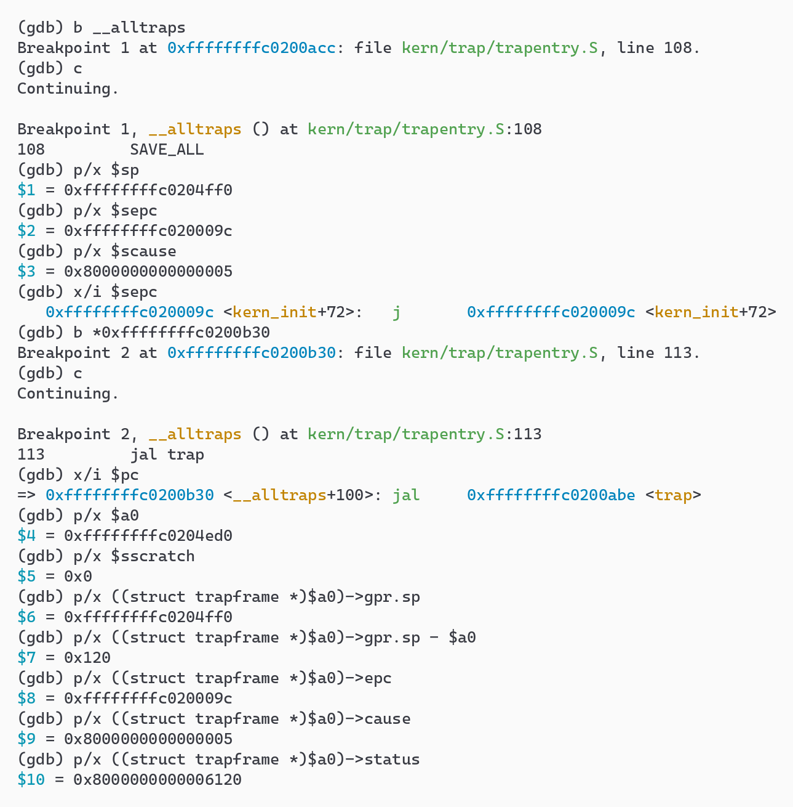
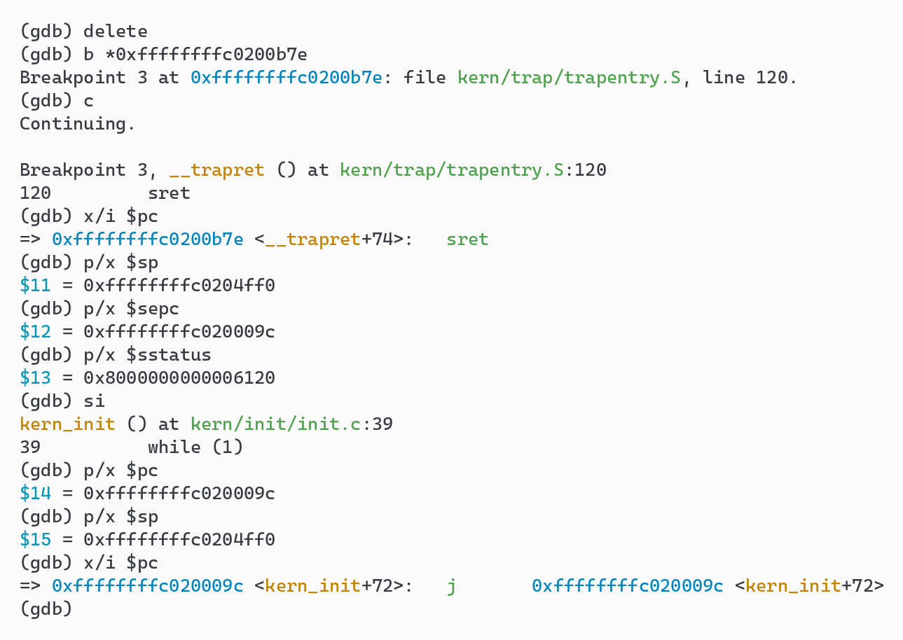

## 功能模块一：Trap 上下文恢复与 Trap 入口功能

**负责人：** 2411264-张远

### 模块功能描述

**需要实现/修改的函数：**

```asm
    .macro RESTORE_ALL     # kern/trap/trapentry.S：按 Trap frame 恢复处理器状态
__alltraps:                # kern/trap/trapentry.S：Trap 入口，SAVE_ALL 之后调用 trap(tf)
```

**功能说明：**

`idt_init()` 把 `stvec` 设成 `__alltraps`，于是不论是时钟中断还是 ebreak、非法指令这类异常，处理器都会跳到同一个入口。这段汇编夹在“硬件响应 Trap”和“C 语言处理 Trap”之间，负责三件事：

1. **保存现场**（框架已给出的 SAVE_ALL）。在当前栈上开辟 36 × 8 = 288 字节的 Trap frame，存入 32 个通用寄存器和 4 个 CSR（sstatus、sepc、stval、scause），布局与 `struct trapframe` 一一对应。
2. **调用 C 函数**（`__alltraps` 中补的部分）。SAVE_ALL 结束时 `sp` 恰好指向 Trap frame，按调用约定把它放进 `a0`，再 `jal trap`，C 代码就能以 `struct trapframe *tf` 的形式读写现场。`sp` 是被调用者保存寄存器，`trap()` 返回后 `sp` 仍指向这个帧，顺序执行进入 `__trapret`。
3. **恢复现场并返回**（RESTORE_ALL）。把帧里的内容写回寄存器，最后由 `sret` 回到 `sepc` 所指的位置继续执行。

RESTORE_ALL 不能写成 SAVE_ALL 的简单逆序，需要注意三点：

- **sp 要单独处理，而且必须最后恢复。** SAVE_ALL 并没有直接保存 x2：它先 `csrw sscratch, sp` 把原 sp 暂存起来，`sp` 下移开辟帧之后，再用 `csrrw s0, sscratch, x0` 取回原 sp 存进 2 号槽位，同时把 `sscratch` 清零（约定 `sscratch == 0` 表示 Trap 来自内核态）。所以帧里的 2 号槽位是 Trap 前的 sp，而当前 `sp` 是帧的基址，其余寄存器都要经 `sp` 从帧中取出。一旦先恢复了 sp，后面的加载就全部读错了地址。
- **CSR 先写回，中转寄存器后恢复。** `csrw` 只能从通用寄存器取值，所以先用 s1、s2 取出 status、epc 写回 `sstatus`、`sepc`，再从帧里恢复 s1、s2 本身。
- **只写回 sret 需要的 CSR。** `sepc` 决定返回地址，`sstatus` 的 SPP、SPIE 决定返回后的特权级和中断使能；`stval`、`scause` 只是给 `trap()` 看的现场记录，`sret` 不读它们，不需要写回。

`sepc` 必须从帧里写回，而不是沿用 CSR 的当前值，因为 `exception_handler()` 处理 ebreak 和非法指令时会把 `tf->epc` 推进到下一条指令，只有写回 `sepc`，这个修改才会生效。

### GDB 验证

在 `__alltraps`、`jal trap` 和 `sret` 三处下断点，跟踪 `intr_enable()` 之后的第一次时钟中断（实验时 trap.c 中临时放了一个只重设时钟的处理函数，正式的处理函数见功能模块二）。

<p align="center"></p>
<p align="center">图 1-1　Trap 进入：SAVE_ALL 前后的 sp 与 Trap frame 内容</p>

- 进入 `__alltraps` 时，`scause = 0x8000000000000005`：最高位为 1 表示中断，原因码 5 是 S 态时钟中断。`sepc` 指向 `kern_init` 末尾 `while (1)` 编译成的自跳转指令 `j`，也就是被打断的那条指令。
- 执行到 `jal trap` 时，`a0 = 0xffffffffc0204ed0` 就是 Trap frame 的地址，比 Trap 前的 sp（`0xffffffffc0204ff0`）低 `0x120` = 288 字节，正是 36 个 8 字节槽位。帧中 `gpr.sp` 存的是 Trap 前的 sp，`sscratch` 已被清零，与上面对 SAVE_ALL 的分析一致。
- 帧中的 `status = 0x8000000000006120`：SPP（第 8 位）为 1 表示 Trap 来自 S 态，SPIE（第 5 位）为 1 表示 Trap 前中断是打开的。

<p align="center"></p>
<p align="center">图 1-2　Trap 返回：RESTORE_ALL 之后执行 sret</p>

- 停在 `sret` 时，RESTORE_ALL 已经执行完：`sp` 回到 `0xffffffffc0204ff0`，`sepc`、`sstatus` 与帧中的值相同。
- 单步执行 `sret` 后，`pc` 回到 `kern_init+72` 的 `j` 指令，`sp` 不变，被打断的程序从原处继续运行。时钟中断不修改 `epc`，所以返回的正是被打断、尚未执行的那条指令。

### 最终提示词

以下是经过迭代优化后，最终成功实现该功能的提示词：

<!-- include:T1-trapentry.prompt.md -->

### 实现迭代过程

本模块的实现经历了 2 次迭代，过程如下：

#### 第一次迭代

**遇到的问题：**

- 问题 1：第一次编译 trapentry.S 就报错 `kern/trap/trapentry.S:47: Error: unknown CSR 'sbadaddr'`。出错的是框架给出的 SAVE_ALL（`csrr s3, sbadaddr`），不是新写的代码。`sbadaddr` 是 1.10 版特权级规范之前对 `stval` 的叫法，本机的 binutils 2.45 已经不再识别这个旧名字，而指导书 lab0 安装的旧版工具链仍然支持。
- 问题 2：框架原样无法链接验证。`trap.c` 调用的 `interrupt_handler()` / `exception_handler()` 属于功能模块二，尚未实现，编译报 `implicit declaration of function 'interrupt_handler'`。

**问题解决策略：**

- 针对问题 1：要求不能修改 SAVE_ALL，所以在 `libs/riscv.h`（trapentry.S 第一行就包含它）中只对汇编文件定义 `#define sbadaddr stval`，两者是同一个 CSR（0x143），反汇编确认生成的是 `csrr s3,stval`。新旧工具链都能编译。提示词不受影响：[RELY] 中照原样引用 SAVE_ALL。
- 针对问题 2：验证时在 WSL 的临时副本中给 trap.c 放一个最简单的处理函数（时钟中断重设下一次事件，ebreak 和非法指令按指令长度推进 epc），仓库中的代码不受影响。这样 `make grade` 的三项测试都能跑，用来检查本模块。

#### 第二次迭代

第一次迭代后，按提示词生成的代码一次通过：`make grade` 100/100，`make qemu` 每秒打印一次 `100 ticks`。为了确认 [SPECIFICATION] 中强调的两个约束确实必要，而不是多余的描述，我们在临时副本中构造了两个反例：

**遇到的问题：**

- 问题 1（违反 Case 1，最先恢复 sp）：把 `LOAD x2, 2*REGBYTES(sp)` 挪到最前面。`make qemu` **看起来完全正常**，仍然每秒打印 `100 ticks`，但 `make grade` 只有 25/100，Test 1（寄存器上下文）和 Test 3（持续时钟中断）失败。原因是恢复 sp 之后，其余寄存器都从“原 sp + 偏移”这个错误的地址加载；空闲循环 `while (1)` 不使用任何寄存器，所以表面上看不出问题，只有在 ebreak 前后逐个比较寄存器的测试才能暴露。
- 问题 2（违反 Case 2 和 Post-Condition，不写回 sepc）：去掉 `csrw sepc, s2`，得分 40/100。时钟中断不修改 epc，CSR 里残留的 `sepc` 恰好正确，所以 Test 3 仍然通过；但 ebreak 和非法指令的处理函数推进的 `tf->epc` 没有写回，`sret` 回到原来那条指令，再次触发异常，形成死循环，Test 1、Test 2 失败。

**问题解决策略：**

- 针对问题 1：在 [SPECIFICATION] 的 Case 1 中写明 SAVE_ALL 对 x2 的处理路径（sscratch 中转、2 号槽位、当前 sp 是帧基址），并明确要求“sp 必须最后恢复”。在 [Requirements] 中列出 `make grade` 的三项测试，不能只凭 `make qemu` 的输出判断正确与否。
- 针对问题 2：在 [RELY] 中注明“`trap()` 可能修改 Trap frame 中的字段，例如异常处理会推进 `tf->epc`”，在 Post-Condition 中要求 `sepc` 等于帧中的 epc，在 Case 3 中说明哪些 CSR 不需要写回，避免 AI 把四个 CSR 全部写回或全部省略。

**最终结果：**

经过 2 次迭代，该模块最终：

- ✅ 编译通过
- ✅ `make grade` 100/100（处理函数使用临时实现；正式结果以功能模块二合入后为准）
- ✅ 功能符合预期：GDB 跟踪确认 Trap frame 的布局、传给 `trap()` 的参数以及 `sret` 前后的 pc、sp 都正确

**关键改进点总结：**

1. 在 [SPECIFICATION] 中写明 SAVE_ALL 对 sp 的特殊保存方式，并要求 sp 最后恢复。
2. 明确 CSR 的恢复顺序，以及只有 `sstatus`、`sepc` 需要写回的原因。
3. 在 [RELY] 中说明 `trap()` 会修改 `tf->epc`，把“写回 sepc”和异常处理关联起来；在 [Requirements] 中用 `make grade` 的三项测试作为验收标准。
