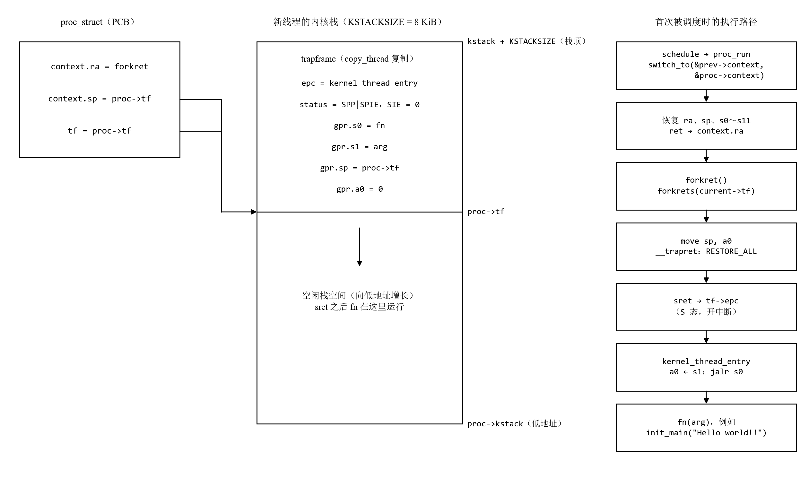

## 功能模块二：进程创建及初始化

**负责人：** 2411264-张远（openfar）

### 模块功能描述

**需要实现的函数：**

```c
static struct proc_struct *alloc_proc(void);
void proc_init(void);
int kernel_thread(int (*fn)(void *), void *arg, uint32_t clone_flags);
int do_fork(uint32_t clone_flags, uintptr_t stack, struct trapframe *tf);
static void copy_thread(struct proc_struct *proc, uintptr_t esp, struct trapframe *tf);
static int copy_mm(uint32_t clone_flags, struct proc_struct *proc);
```

**功能说明：**

本模块位于 `kern/process/proc.c`，在 `kern_init` 调用 `proc_init` 时执行。执行结束后，系统中有两个内核线程：一个是 pid 为 0 的 `idleproc`，即当前正在运行的启动现场；另一个是 pid 为 1 的 `initproc`，它已经准备好运行 `init_main`，等待调度。真正把 CPU 交给 `initproc` 的是功能模块三，本模块负责把它准备到“一被切换过去就能正确运行”的状态。

`alloc_proc` 用 `kmalloc` 分配一个进程控制块，并逐个初始化所有字段：`state` 为 `PROC_UNINIT`，`pid` 为 -1，表示还没有分配身份；`pgdir` 设为内核页表的物理地址 `boot_pgdir_pa`，因为内核线程共用内核地址空间；其余字段（包括 `context` 和 `name`）全部清零，两个链表节点初始化为自指。`kmalloc` 不会清零返回的内存，如果有字段没有初始化，后面的调度代码或评测就可能读到旧数据。

`proc_init` 先初始化 `proc_list` 和 1024 个哈希桶，再创建两个线程：

1. **`idleproc`**：它不经过 `do_fork`，而是把从 `kern_init` 一路执行到这里的当前现场直接认作第 0 个线程。`pid` 设为 0，状态设为 `PROC_RUNNABLE`；内核栈直接使用 entry.S 中的启动栈 `bootstack`，不另外分配；`need_resched` 置 1，这样 `kern_init` 最后进入 `cpu_idle` 时会立即调度；最后令 `current = idleproc`。它的 `context` 保持全 0，第一次从它切走时，`switch_to` 会把真实的寄存器值保存进去。`idleproc` 不挂入 `proc_list`，所以调度器遍历链表时不会选中它，只有在没有其他可运行线程时才回到它。
2. **`initproc`**：调用 `kernel_thread(init_main, "Hello world!!", 0)` 创建，再用 `find_proc` 按返回的 pid 取得 PCB，命名为 `"init"`。

`kernel_thread` 在局部变量中构造一个 trapframe，作为新线程第一次运行时要恢复的寄存器现场：

| 字段 | 取值 | 作用 |
|---|---|---|
| `gpr.s0` / `gpr.s1` | `fn` / `arg` | `kernel_thread_entry` 执行 `move a0, s1` 和 `jalr s0`，即调用 `fn(arg)` |
| `epc` | `kernel_thread_entry` | `sret` 跳转到这里 |
| `status` | 当前 `sstatus` 置 `SPP`、`SPIE`，清 `SIE` | `SPP=1`：`sret` 后仍在 S 态；`SPIE=1`：`sret` 后开中断；`SIE=0`：`__trapret` 恢复寄存器期间不响应中断 |

随后它调用 `do_fork(clone_flags, 0, &tf)`。这个 trapframe 只是模板，`copy_thread` 会把它复制到新线程自己的内核栈上，所以 `kernel_thread` 返回后局部变量失效也没有影响。

`do_fork` 按以下顺序组装新线程，任何一步失败都返回负错误码，并按分配的逆序释放已经分配的资源：

| 步骤 | 操作 | 失败时 |
|---|---|---|
| 0 | 检查 `nr_process < MAX_PROCESS` | 返回 `-E_NO_FREE_PROC` |
| 1 | `alloc_proc`，并设 `parent = current` | 返回 `-E_NO_MEM` |
| 2 | `setup_kstack` 分配 2 页（8 KiB）内核栈 | `kfree` 释放 PCB，返回 `-E_NO_MEM` |
| 3 | `copy_mm`（本实验为空操作） | 释放内核栈和 PCB |
| 4 | `copy_thread` 设置 trapframe 和 context | — |
| 5 | 关中断：`get_pid`、`hash_proc`、挂入 `proc_list`、`nr_process++` | — |
| 6 | `wakeup_proc` 把状态设为 `PROC_RUNNABLE` | — |
| 7 | 返回子线程的 pid | — |

第 5 步关中断，是因为 `get_pid` 要扫描 `proc_list` 来找空闲 pid，这次扫描和随后的挂链表、计数必须一起完成，中间不能被打断。第 6 步放在最后，是为了保证调度器能看到这个线程时，它的资源都已经准备好了。

`copy_thread` 把 trapframe 放在新内核栈的最顶端，即 `kstack + KSTACKSIZE - sizeof(struct trapframe)`，并让 `proc->tf` 指向它。复制完成后，它把 `gpr.a0` 设为 0，表示子线程从 fork 返回 0；`esp` 为 0 时，把 `gpr.sp` 设为 `proc->tf`，即内核线程在 `sret` 之后就在 trapframe 下方继续使用这块内核栈。最后设置 `context.ra = forkret`、`context.sp = proc->tf`。这样，功能模块三的 `switch_to` 恢复这个 context 并执行 `ret` 时，就会进入 `forkret`，再经 `forkrets`、`__trapret` 按 trapframe 恢复全部寄存器，最后 `sret` 到 `kernel_thread_entry`，调用 `fn(arg)`。图 2-1 画出了新线程的内核栈布局和这条首次运行链路。

<p align="center"></p>
<p align="center">图 2-1　新线程的内核栈布局与首次运行链路</p>

这条链路让新线程的第一次运行与“从中断返回”复用同一段 `__trapret` 代码，不需要为新线程单独写一套启动代码。

`copy_mm` 用于复制或共享用户地址空间。本实验只有内核线程，`current->mm` 一定是 NULL，所以它只断言这一点并返回 0，保留函数形态，lab5 引入用户进程后再实现。

评测在 `proc_init` 末尾插入 `test_lab4_process_create()`，检查 `current == idleproc`，`idleproc` 的 pid、状态、内核栈和各个保持为 0 的字段，以及 `initproc` 的 pid、状态、父进程和 `context.ra`、`context.sp` 是否非 0。

### 最终提示词

<!-- include:T2-proc-create.prompt.md -->

### 实现迭代过程

本模块的实现经过一轮生成和两轮自查，代码逻辑在生成后没有再修改。

#### 第一次迭代：生成前核对框架

**遇到的问题：**
- 参考的 ucore 原版 `kernel_thread` 调用 `do_fork(clone_flags | CLONE_VM, 0, &tf)`。核对本框架时发现 `CLONE_VM` 在任何头文件中都没有定义，照搬会编译失败。
- 本框架的函数标记位置是固定的：功能模块二的六个函数都写在 `//LAB4 function2` 下，且 `alloc_proc`、`copy_mm`、`copy_thread` 都是 `static`，没有前向声明。

**问题解决策略：**
- 在提示词的 [RELY] 中写明“框架中没有定义 `CLONE_VM`”，`kernel_thread` 直接传入 `clone_flags`。本实验的 `copy_mm` 不读取 `clone_flags`，所以这样做不影响行为。
- 在 [GUARANTEE] 中规定六个函数按“被调用者在前”的顺序排列，避免出现隐式声明。

#### 第二次迭代：在功能模块三完成前验证

**遇到的问题：**
- 生成代码后 `make` 只剩一个链接错误：`undefined reference to 'cpu_idle'`。它属于功能模块三，尚未实现，所以无法直接运行内核和评测。

**问题解决策略：**
- 不改动提示词。在 WSL 中导出的独立副本里临时补上 `cpu_idle`、`proc_run`、`schedule` 三个空桩函数（未提交），只用来验证本模块。

**最终结果：**

在使用临时桩的副本中：

- ✅ 编译通过，`make qemu` 中 `check_pgdir()`、`check_boot_pgdir()`、`check_vmm()` 等原有自检全部通过；
- ✅ `make grade` 中 PMM 与 Process Create 两项通过（20/30），Schedule 一项依赖功能模块三；
- ✅ `idleproc` 与 `initproc` 的字段符合评测要求。

**关键改进点总结：**
1. [RELY] 中写明框架与原版 ucore 的差异（没有 `CLONE_VM`），避免 AI 按记忆照搬原版代码。
2. [SPECIFICATION] 逐条列出 `idleproc` 应保持为 0 的字段和 `do_fork` 的失败清理顺序，与评测的检查项一一对应。
