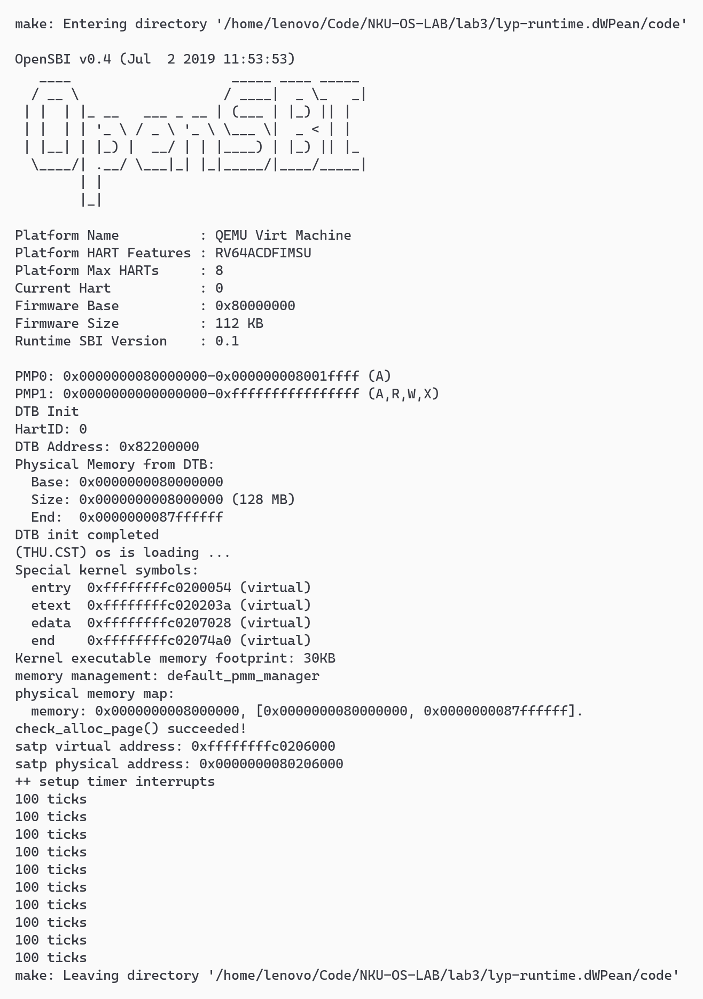
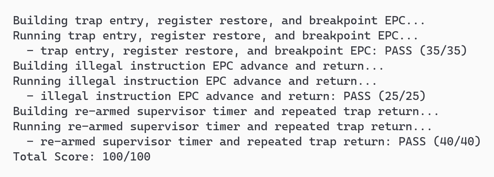
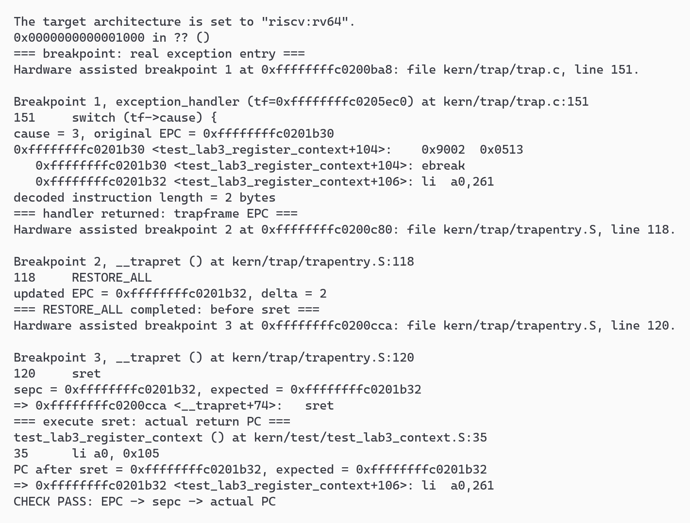
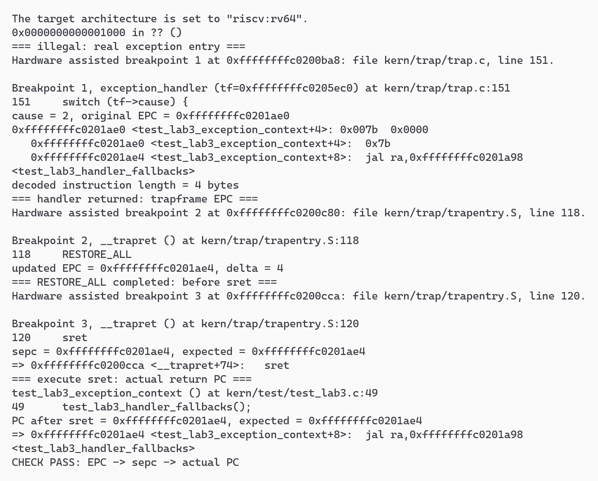
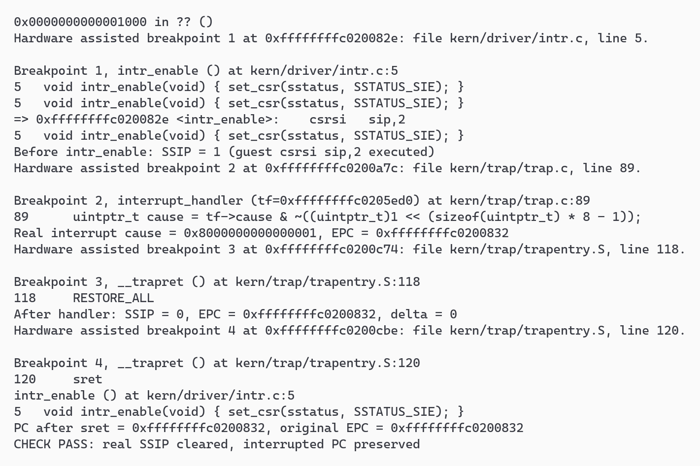

## 功能模块二：中断与异常处理

**负责人：** 2414099-李云鹏

### 模块功能描述

本模块补充 `kern/trap/trap.c` 中的两个接口：

```c
void interrupt_handler(struct trapframe *tf);
void exception_handler(struct trapframe *tf);
```

汇编入口将寄存器现场保存为 `struct trapframe`，`trap_dispatch()` 根据 `cause` 最高位分派到中断或异常处理函数。处理完成后，功能模块一的 `RESTORE_ALL` 从帧中恢复 `sstatus`、`sepc` 和通用寄存器，再执行 `sret`。本模块通过修改 `tf->epc` 调整异常返回位置。

#### 1. 中断处理

`interrupt_handler()` 先清除 `cause` 的最高位，得到中断编号。采用位掩码而非减去固定高位，是因为评测还会直接传入不带中断标志的编号 15；两种输入都应得到相同的编号。

管理态时钟中断按以下顺序处理：

1. 调用 `clock_set_next_event()` 设置下一次事件；
2. 令全局 `ticks` 增加一；
3. `ticks` 为 `TICK_NUM=100` 的整数倍时调用 `print_ticks()`；
4. 用函数内静态变量累计打印次数，达到 `SHUTDOWN_AFTER=10` 时调用 `sbi_shutdown()`。

`ticks` 一直累计，不在打印时清零。阈值选为十次，是为了让评测等待的 200 ticks 能先返回到测试主流程，输出测试完成信息；若在第 200 次中断中就关机，计数虽然达标，主流程却没有机会继续执行。框架每次把定时器设为当前时间加 100000，在 QEMU 10 MHz 时基下约每秒打印一次，但这不是严格的实时保证。

管理态软件中断通过 `clear_csr(sip, SIP_SSIP)` 清除挂起位，并打印 `Supervisor software interrupt`。其余框架已定义的软件、时钟、外部、协处理器及宿主中断分别输出类型提示。未知中断打印 `Unknown interrupt: cause <编号>` 后调用 `print_trapframe()`。这些诊断分支不是完整的设备驱动；例如外部中断还没有 PLIC 的 claim/complete 流程。

中断不统一增加 EPC：异步中断不是一条需要跳过的故障指令，返回后应从硬件记录的继续执行位置恢复。

#### 2. 异常处理与指令长度

`exception_handler()` 对非法指令和断点分别打印 `Illegal instruction at`、`Breakpoint at` 及推进前的地址，随后读取故障地址处的首个 16 位半字：

```c
uint16_t instruction = *(const volatile uint16_t *)tf->epc;
tf->epc += (instruction & 0x3) == 0x3 ? 4 : 2;
```

| 本实验中的指令 | 编码 | 首半字低两位 | EPC 增量 |
|---|---|---|---|
| 压缩断点 `c.ebreak` | `0x9002` | `10` | 2 字节 |
| 普通断点 `ebreak` | `0x00100073` | `11` | 4 字节 |
| 评测非法指令 | `.word 0x0000007b` | `11` | 4 字节 |

EPC 的增量取决于指令编码：普通指令推进 4 字节，压缩指令推进 2 字节。先读取半字，也能适应压缩指令的 2 字节对齐地址。这一判断只适用于本实验的 16/32 位指令，不包含 RISC-V 长指令的完整解码。本次 GDB 实测覆盖了压缩断点和非法指令；普通 32 位断点仅列作编码对照。

这里直接读取 EPC，要求故障指令位于可读的内核代码中；处理用户地址还需要安全取指和二次异常处理。其他异常调用 `print_trapframe()` 后返回，不跳过指令。若异常条件仍存在，返回后可能再次陷入，因此这些分支目前只提供诊断。

### 最终提示词

<!-- include:T2-trap-handler.prompt.md -->

### 实现迭代过程

#### 第一阶段：核对框架约束并实现处理函数

实现前检查了任务说明、`clock.c`、Trap 返回汇编和原评测的触发方式，确认了以下约束：

- 框架未提供 `SHUTDOWN_AFTER`，且测试需要等到 200 ticks 后继续运行；在功能区域定义阈值为 10，不修改评测。
- 测试既有真实异常，也有直接调用处理函数的合成帧；中断原因码使用清位操作，未知原因保留 Trap 帧诊断。
- `ebreak` 可能被汇编成压缩形式；返回地址从实际编码判断，不从异常种类推断长度。

以上约束在编码前已确认，未经历相应的测试失败。随后一次补齐两个函数，保留 `lab3 function2` 标记并填写学号 `2414099`。`sbi.h` 的包含和关机常量也放在指定的修改区域内，其他已有函数未改。

使用提交 `b95765a` 的 `code/` 归档叠加当前 `trap.c`，在独立目录编译。首次在默认 WSL 的 GCC 15.1.0 下编译通过；后续正式验收改在 OS 专用发行版的 GCC 10.2.0 下重新构建，同样保留原有 `-Wall -Werror -O2 -std=gnu99`，编译、链接均通过。没有发生需要修复处理函数的编译错误。

工作区文件与两个环境中的验证副本具有相同的 SHA-256：

```text
a881001c91fd8c5f140c9aeb94a5140ed7d69131826d521ca72e2688ad37878c
```

#### 第二阶段：纠正 WSL 环境选择并完成运行验收

最初只检查了默认发行版 `Ubuntu-22.04-Compiler`，其中 QEMU 为 7.0.0，便把运行验证记为环境阻塞。后来通过 `wsl --list --verbose` 发现还有 `Ubuntu-22.04-OS`，指定该发行版后，原有 QEMU 4.1.1 路径可以正常执行。问题是选错了发行版，而不是本机没有统一环境。

正式验收采用：

| 项目 | 实际环境 |
|---|---|
| WSL 发行版 | `Ubuntu-22.04-OS` |
| 交叉编译器 | `/opt/riscv/bin/riscv64-unknown-elf-gcc`，SiFive GCC 10.2.0 |
| 调试器 | `/opt/riscv/bin/riscv64-unknown-elf-gdb`，SiFive GDB 10.1 |
| 模拟器 | `~/Environment/qemu-4.1.1/riscv64-softmmu/qemu-system-riscv64` |
| 固件 | QEMU 自带 OpenSBI v0.4 |

进入该发行版后设置环境变量：

```bash
# Windows 终端先执行：wsl -d Ubuntu-22.04-OS
export PATH=/opt/riscv/bin:$PATH
export QEMU=$HOME/Environment/qemu-4.1.1/riscv64-softmmu/qemu-system-riscv64
"$QEMU" --version
make -j4
make qemu
make grade
```

共享同步脚本的源路径指向另一处仓库，且只导出已提交内容。本次改为从当前仓库归档基线，叠加待测的 `trap.c` 后核对哈希。运行、评分和调试均使用独立副本，保留初始化锚点和评测源码；通过 Makefile 已有的 `GRADE_TMP` 变量指定评分临时目录，避免与其他实验会话冲突。

`make qemu` 的实际输出中出现 OpenSBI v0.4、内存检查成功和时钟初始化提示，随后共打印十次 `100 ticks`。进程在第十次输出后正常退出，未触发外层 25 秒超时，退出码为 0。


<p align="center">图 2-1　统一环境运行：十次时钟输出后正常关机</p>

原始评分的三项结果分别为 35/35、25/25、40/40，总分 100/100。


<p align="center">图 2-2　make grade 评分结果摘录：100/100</p>

#### 第三阶段：GDB 核对异常返回地址

为观察真实异常，在两个干净构建副本中使用原有 `tools/inject.py`，分别以 `GRADE_LAB3_CONTEXT`、`GRADE_LAB3_ILLEGAL` 构建。调试时保持镜像、符号文件和编译宏一致，使用独立的 QEMU 实例与调试端口。待测指令处不设软件断点，帧中的 EPC 由处理函数更新。

每个实例都观察四个位置：

1. 在 `exception_handler` 机器码入口下硬件断点，从入口 `$a0` 保存 `struct trapframe *`，读取原因、原始 EPC 和半字编码。
2. 在 `__trapret` 处检查处理函数更新后的帧 EPC。
3. 从本次反汇编中找到实际 `sret`，在执行前核对 `$sepc`。
4. 单步执行 `sret`，检查 CPU 实际 `$pc`。

**压缩断点：** 原始 EPC 为 `0xffffffffc0201b30`，首半字为 `0x9002`，原因码为 3。虽然 GDB 反汇编显示别名 `ebreak`，实际编码表明它是 2 字节的压缩断点。处理后帧 EPC、`sepc` 和返回 PC 都是 `0xffffffffc0201b32`，增量为 2。


<p align="center">图 2-3　压缩断点：EPC 增加 2 字节，sret 返回到下一条指令</p>

**非法指令：** 原始 EPC 为 `0xffffffffc0201ae0`，两个半字为 `0x007b`、`0x0000`，组合为 `.word 0x0000007b`，原因码为 2。处理后帧 EPC、`sepc` 和返回 PC 都是 `0xffffffffc0201ae4`，增量为 4，并指向后续调用指令。


<p align="center">图 2-4　非法指令：EPC 增加 4 字节，sret 返回到后续调用位置</p>

两组调试均核对了执行 `sret` 后的实际 PC。上述地址对应这两次构建，重新构建后应以反汇编为准。

#### 第四阶段：补测真实软件中断的清挂起行为

原评测通过合成 Trap 帧直接调用软件中断分支，没有触发真实中断源。为检查清挂起行为，另外启动普通内核镜像，在全局开中断前使能 `sie.SSIE` 并设置 `sip.SSIP`，触发真实的软件中断。

这项补测遇到两处调试问题：

- 直接用旧版 GDB 写 CSR 时，调试器进程异常退出，返回值为 -6。改为在来宾内存中临时放入 `csrsi` 指令并单步执行，随后恢复原指令与测试入口；未改仓库源码，也未修改 Trap 帧中的原因和 EPC。
- 初次只设置 SSIP，没有打开 SSIE，捕获到的仍是原因码 5 的时钟中断。核对 `sie` 后发现遗漏了局部使能条件，补齐后才进入原因码 `0x8000000000000001` 的真实软件中断。

成功取证时，进入处理函数前 `SSIP=1`；处理后 `SSIP=0`，帧 EPC 仍为 `0xffffffffc0200832`，增量为 0。单步执行 `sret` 后，实际 PC 也等于该地址。这同时验证了清除挂起位和保留中断继续执行位置的行为。


<p align="center">图 2-5　真实软件中断：SSIP 清零，返回地址保持不变</p>

### 验证结论

截至 2026-11-03，本模块完成以下验证：

| 项目 | 结果 |
|---|---|
| GCC 10.2.0、原编译选项构建 | 通过 |
| QEMU 4.1.1 / OpenSBI v0.4 日常运行 | 十次输出后正常关机，退出码 0 |
| 原始 `make grade` | 100/100 |
| 压缩断点 GDB 验证 | EPC、sepc、返回 PC 均为原始地址加 2 |
| 非法指令 GDB 验证 | EPC、sepc、返回 PC 均为原始地址加 4 |
| 真实软件中断补测 | SSIP 从 1 清为 0，返回地址不变 |

本次没有为通过验证而修改处理函数或评测代码；需要调整的是 WSL 发行版选择和补测时的调试方法、局部使能条件。
