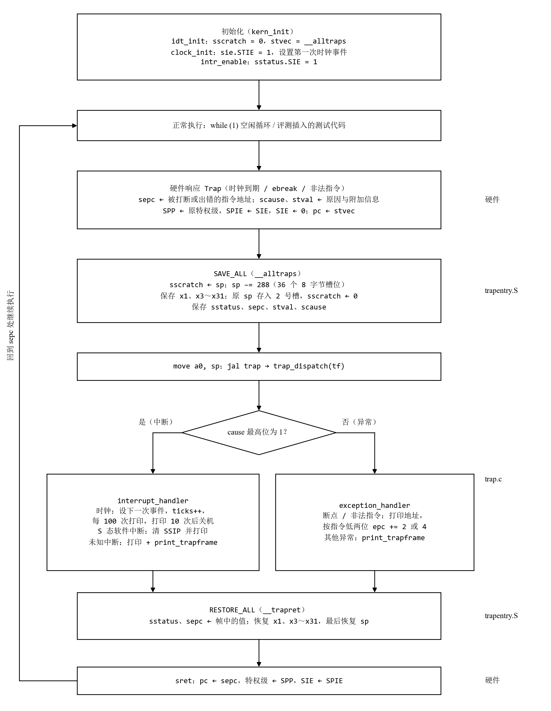

**负责人：** 2411264-张远

## 3.1 逻辑主线

Lab3 的主题是**中断与异常**。lab2 结束时，内核能管理物理内存，但执行流完全是线性的：从 `kern_init` 一路执行到 `while (1)`，CPU 只要遇到异常就无处可去，外部事件（例如时钟到期）也没有办法通知内核。本章要解决的问题是：**当 CPU 的正常执行流被打断时，怎样让控制权安全地交给内核，处理完之后再原样交还回去。**

我们把本章概括为一句话：**围绕一次 Trap 的“进入—处理—返回”，把硬件做的、汇编做的和 C 做的三段工作接成一个闭环。**图 3-1 是这个闭环的全貌：

图 3-1　lab3 中一次 Trap 的完整处理流程

三段工作的分工很清楚：

- **硬件**只做最少的事：记下“从哪里来”（`sepc`）和“为什么来”（`scause`、`stval`），在 `sstatus` 中记下原特权级并关中断，然后跳到 `stvec`。它**不会**替内核保存任何通用寄存器。
- **汇编（`trapentry.S`）**负责通用寄存器和 CSR 的保存与恢复，把现场整理成 C 能直接访问的 `struct trapframe`，返回时再按同一布局写回，用 `sret` 回到 `sepc`。
- **C（`trap.c`）**只看 Trap frame：根据 `cause` 区分中断和异常，再按具体原因处理；需要改变返回位置时只改 `tf->epc`。

贯穿全章的还有一条副线：**Trap frame 是汇编和 C 之间唯一的契约。**`SAVE_ALL` 写入的槽位顺序必须与 `struct trapframe` 的字段一一对应，`RESTORE_ALL` 必须按同一布局读回；C 代码对帧的修改（例如推进 `epc`）只有经 `RESTORE_ALL` 写回 CSR 才会生效。功能模块一和功能模块二分别站在这个契约的两侧，T1 的反例实验（不写回 `sepc` 时断点和非法指令死循环）就是契约被破坏的样子。

## 3.2 功能的逐步实现

| 顺序 | 功能 | 主要代码 | 报告中的位置 |
| :---: | :--- | :--- | :--- |
| 0 | 补齐 lab2 代码，统一评测环境 | `kern/mm/pmm.c`、`best_fit_pmm.c`、`Makefile` | 二、实验环境 |
| 1 | 建立 Trap 入口：`stvec` 指向 `__alltraps`（框架已给出） | `kern/trap/trap.c` 的 `idt_init` | 本章 |
| 2 | 保存与恢复现场：`SAVE_ALL`（框架已给出）与 `RESTORE_ALL` | `kern/trap/trapentry.S` | 功能模块一 |
| 3 | 连接汇编与 C：`__alltraps` 调用 `trap(tf)`，返回后 `sret` | `kern/trap/trapentry.S` | 功能模块一 |
| 4 | 处理异常：断点、非法指令，按指令长度推进 `epc` | `trap.c` 的 `exception_handler` | 功能模块二 |
| 5 | 处理中断：时钟中断的周期性重装、计数与关机，其他中断分类输出 | `trap.c` 的 `interrupt_handler`、`kern/driver/clock.c` | 功能模块二 |
| 6 | 理解中断带来的并发问题：`stvec` 模式编码、关中断保护临界区 | `kern/sync/sync.h`、`pmm.c` | 练习：指导书思考题 |

0. **先补齐 lab2 的代码。**lab3 的 `kern_init` 在开中断之前仍要调用 `pmm_init()`，所以物理内存管理必须先能工作。lab3 框架中没有 lab2 的 `PHYSICAL_MEMORY_END`，`page_init` 改用 `KERNTOP - va_pa_offset` 作为上界；另外新版 binutils 不认识 `SAVE_ALL` 中的旧 CSR 名 `sbadaddr`，我们在 `riscv.h` 中只对汇编文件把它定义为 `stval`，保证 `SAVE_ALL` 原样不改也能编译。
1. **然后让 Trap 有地方可去。**`idt_init()` 把 `sscratch` 清零（约定 0 表示 Trap 来自内核态），再把 `stvec` 设为 `__alltraps`。`__alltraps` 用 `.align(2)` 保证 4 字节对齐，`stvec` 的低两位为 0，即 Direct 模式，所有 Trap 进入同一个入口。这一步排在最前面，是因为在它之前发生的任何 Trap 都会跳到不可预期的地址。`kern_init` 中 `idt_init()` 被调用了两次，两次效果相同：第一次在 `pmm_init()` 之前，评测则以第二次作为插入断点测试的锚点。
2. **接着实现现场的保存与恢复。**硬件不保存通用寄存器，而 C 函数会随意使用调用者保存寄存器，所以进入 C 之前必须把全部现场存下来，返回前再原样恢复，被打断的代码才感觉不到 Trap 发生过。`SAVE_ALL` 由框架给出，我们补的 `RESTORE_ALL` 难点在于 `sp`：它在帧中保存的是 Trap 前的值，而当前 `sp` 是帧的基址，所以必须最后恢复。它排在处理函数之前，因为没有正确的保存与恢复，任何处理逻辑都无法验证：T1 的实验表明，`sp` 恢复顺序错了，`make qemu` 照样每秒打印 `100 ticks`，只有寄存器比对测试能发现问题。
3. **再把汇编和 C 接起来。**`SAVE_ALL` 结束时 `sp` 恰好指向 Trap frame，按调用约定 `move a0, sp` 后 `jal trap`，C 就拿到了 `struct trapframe *tf`；`trap()` 返回后顺序落入 `__trapret`，执行 `RESTORE_ALL` 和 `sret`。至此“进入—返回”的骨架已经完整，剩下的只是 C 函数里填什么。
4. **然后处理异常。**异常是当前指令同步引起的，返回位置要由内核决定：断点和非法指令如果原样返回，会再次执行同一条指令，陷入死循环，所以要把 `tf->epc` 推进到下一条指令。推进多少字节不能写死：评测中的 `ebreak` 可能被汇编成 2 字节的 `c.ebreak`，非法指令则是 4 字节，因此要看指令最低两位。异常先于中断实现，是因为它可以随时用一条指令确定地触发，便于先验证“修改 `epc` → 写回 `sepc` → 返回到新位置”这条路径。
5. **最后处理中断，尤其是时钟中断。**中断是异步的，`sepc` 指向尚未执行的那条指令，处理后原样返回即可。时钟中断要注意两点：OpenSBI 的定时器是一次性的，每次中断都要调用 `clock_set_next_event()` 重新设定，否则只会来一次；计数到一定次数后调用 `sbi_shutdown()` 关机，而关机阈值要大于评测等待的 200 ticks，否则测试主流程来不及输出结果。时钟中断依赖 `clock_init()` 打开 `sie.STIE` 和 `intr_enable()` 打开 `sstatus.SIE`，它把前面所有环节都串了起来：只有入口、现场保存、分派和返回都正确，内核才能每秒稳定地打印一次 `100 ticks`。
6. **思考题回到“中断打断了谁”。**开中断之后，任何代码都可能在两条指令之间被打断，并在处理函数中被重入。`pmm.c` 的 `alloc_pages`/`free_pages` 用 `local_intr_save`/`local_intr_restore` 包住对空闲链表的操作，就是为了防止链表修改到一半时被中断处理程序再次访问。这部分是对前面几步的反思，所以放在最后。

## 3.3 各功能的核心函数

| 函数 / 宏 | 文件 | 作用 | 由谁完成 |
| :--- | :--- | :--- | :--- |
| `idt_init` | `trap.c` | `sscratch = 0`，`stvec = __alltraps` | 框架 |
| `SAVE_ALL` | `trapentry.S` | 在栈上开辟 288 字节，保存 32 个通用寄存器和 4 个 CSR | 框架 |
| `RESTORE_ALL` | `trapentry.S` | 写回 `sstatus`、`sepc`，恢复通用寄存器，最后恢复 `sp` | 功能模块一 |
| `__alltraps` | `trapentry.S` | `SAVE_ALL` → `move a0, sp` → `jal trap`，之后落入 `__trapret` | 功能模块一 |
| `trap` / `trap_dispatch` | `trap.c` | 按 `cause` 的符号位分派到中断或异常处理函数 | 框架 |
| `interrupt_handler` | `trap.c` | 时钟中断重装定时器、计数、打印、关机；其他中断分类输出 | 功能模块二 |
| `exception_handler` | `trap.c` | 断点、非法指令打印地址并推进 `epc`；其他异常打印 Trap frame | 功能模块二 |
| `clock_init` / `clock_set_next_event` | `clock.c` | 打开时钟中断，经 `sbi_set_timer` 设定下一次事件 | 框架 |
| `intr_enable` / `local_intr_save` | `intr.c`、`sync.h` | 打开全局中断；在临界区前后关闭和恢复中断 | 框架 |

需要我们实现的只有表中标注“功能模块”的三处，但它们分别位于 Trap 闭环的“返回”“衔接”和“处理”三个位置，任何一处出错都会让整个闭环失效。这也是我们验证时坚持以 `make grade` 的三项测试为准、并用 GDB 核对 `sret` 前后实际 `pc` 的原因。
