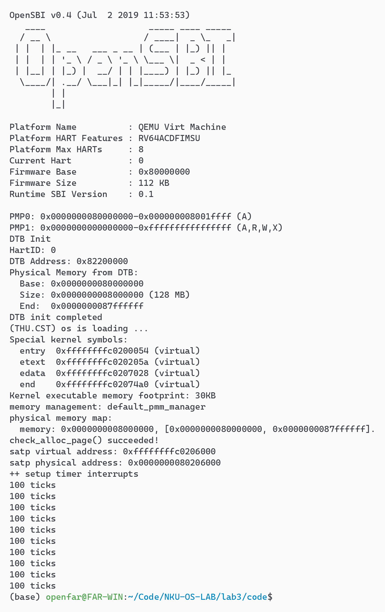
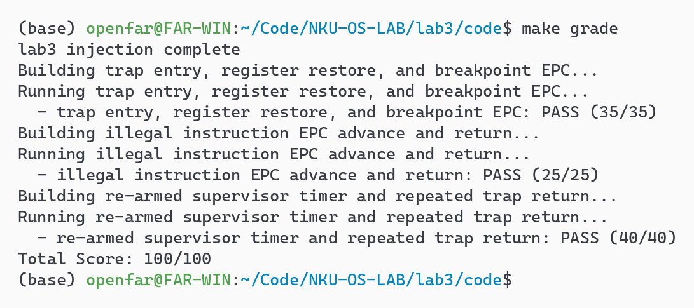

# 一、实验目的

1. **深入理解 RISC-V 陷阱（Trap）机制与特权级架构**：
   - 理解异常（Exception）与中断（Interrupt）在触发源、同步性与处理方式上的核心差异；
   - 掌握 RISC-V 特权级架构下陷阱处理的核心控制与状态寄存器（CSR：`sstatus`、`stvec`、`sepc`、`scause`、`stval`、`sie`、`sip`）的功能定义与协作关系；
   - 掌握当 Trap 发生时与执行 `sret` 返回时，RISC-V 处理器硬件自动完成的原子操作序列（特权级切换、PC 保护与恢复、中断使能位状态翻转）。

2. **掌握操作系统内核的中断上下文保存与恢复机制**：
   - 理解并掌握在 `trapentry.S` 中通过 `__alltraps` 汇编例程构建中断上下文的完整流程，理解通过 `SAVE_ALL` 在内核栈上分配空间并按 `struct trapframe` 结构保存全部 32 个通用寄存器和关键 CSR 的底层实现；
   - 深入掌握 `RESTORE_ALL` 恢复现场的精细约束（如栈指针 `sp` 的恢复顺序、`sstatus` 与 `sepc` 的写回逻辑），理解 `sret` 指令安全返回原执行流的完整闭环。

3. **掌握操作系统内核的中断与异常分发处理机制**：
   - 掌握在 `trap.c` 中根据 `scause` 寄存器的最高位（Interrupt 标志位）区分中断与异常的双路分发架构；
   - 掌握时钟中断（Timer Interrupt）的响应与处理逻辑，通过 SBI 调用周期性设置下一次定时器事件，维护全局时钟滴答计数（`ticks`），为后续 Lab 的进程时间片调度奠定基础；
   - 掌握断点异常（`ebreak`）与非法指令异常的捕获与响应流程，掌握在软件层面推进 `tf->epc` 返回地址以跨越触发异常指令的核心方法。

4. **实践工程化与规范化的 AI 协同内核开发**：
   - 实践采用结构化的四段式提示词（[PROMPT], [RELY], [GUARANTEE], [SPECIFICATION]）精准约束与引导大语言模型生成高质量的底层系统汇编与 C 代码；
   - 在多成员、多 Agent 工具（Claude Code、Codex、Antigravity）并行协作的场景下，通过 `.handoff/` 状态看板实现任务解耦、接口契约明确与异步高效交付。

---

# 二、实验环境

## 软件与运行环境

本实验严格统一使用指导书推荐的 **QEMU 4.1.1**（内置 OpenSBI v0.4），该版本对于基于 `-device loader` 加载内核到 `0x80200000` 的启动方式具有确定性支持，排除了新版 QEMU/OpenSBI 因固件动态重定向导致内核无法启动的兼容性问题。

| 成员 | 宿主系统 | QEMU 版本 | 交叉编译工具链 | 调试器版本 |
| :--- | :--- | :--- | :--- | :--- |
| 2411264-张远 | WSL2 Ubuntu 24.04 | 4.1.1（OpenSBI v0.4） | riscv64-unknown-elf-gcc 15.1.0 | riscv64-unknown-elf-gdb 16.3 |
| 2414099-李云鹏 | WSL2 Ubuntu 22.04 | 4.1.1（OpenSBI v0.4） | SiFive riscv64-unknown-elf-gcc 10.2.0 | riscv64-unknown-elf-gdb 10.1 |
| 2413074-刘昀皓 | WSL2 Ubuntu 24.04 | 4.1.1（OpenSBI v0.4） | riscv64-unknown-elf-gcc 15.1.0 | riscv64-unknown-elf-gdb 16.3 |

全组成员统一在本地设置 `export QEMU=$HOME/Environment/qemu-4.1.1/riscv64-softmmu/qemu-system-riscv64`：`make qemu` 直接使用它，`make grade` 也会把它所在的目录放到 `tools/grade.sh` 的 PATH 最前面，保证两者用的是同一个模拟器。

## AI 工具与底层模型

全组采用多工具、多模型的异构 Agent 协作模式，各成员分工与所用工具链配置如下：

| 成员 | 负责模块 | AI 编程工具 | 底层模型 | 备注 / 特殊配置 |
| :--- | :--- | :--- | :--- | :--- |
| 2411264-张远 | T0, T1, T3, T5 | Claude Code（终端 Agent） | Claude Opus 5.5 | 负责环境兼容性适配、功能模块一（trapentry.S）、整体逻辑分析与报告集成 |
| 2414099-李云鹏 | T2, T3 | Codex（终端 Agent） | gpt-6.1-sol | 负责功能模块二（trap.c 异常/中断分发）与 OS 原理对照分析 |
| 2413074-刘昀皓 | T4 | Antigravity（终端 Agent） | Gemini 4 Argon / Claude Opus 5.5 | 负责正文思考题深度剖析、公共章节初稿撰写与测试集成验证 |

---

# 五、测试与验证

### 1. 测试设计与评测原理

`make grade` 先把整个 `code/` 复制到临时目录，由 `tools/inject.py` 把 `tools/test_lab3.c` 和 `tools/test_lab3_context.S` 加入内核，并在 `kern_init()` 中插入三处测试调用：第二个 `idt_init()` 之后、`clock_init()` 之后、`intr_enable()` 之后。随后 `tools/grade.sh` 分别以 `GRADE_LAB3_CONTEXT`、`GRADE_LAB3_ILLEGAL`、`GRADE_LAB3_TIMER` 三个宏重新编译，各启动一次 QEMU，用 `grep -F` 在串口输出中查找固定字符串（不是正则匹配）：

| 测试 | 分值 | 触发方式与检查内容 | 必须出现的字符串 |
| :--- | :---: | :--- | :--- |
| Test 1：Trap 入口、寄存器恢复与断点返回 | 35 | `test_lab3_context.S` 先给 t0～t2、s0～s1、a1～a7、s2～s11、t3～t6 写入不同的已知值，执行 `ebreak`，返回后逐个比对（不比对 ra、sp、gp、tp 和用作比较临时寄存器的 a0） | `[Test 1] Trap entry and breakpoint return: PASS`、`Breakpoint at` |
| Test 2：非法指令返回与处理函数兜底 | 25 | 执行 4 字节的 `.word 0x0000007b`（目标平台上未定义的自定义操作码），返回后继续运行；再直接调用处理函数，传入 S 态软件中断、无最高位的原因码 15 和异常原因码 20 三个构造的 Trap frame，检查各兜底分支 | `[Test 2] Illegal instruction return: PASS`、`Illegal instruction at`、`Supervisor software interrupt`、`Unknown interrupt: cause 15`、`cause    0x00000014` |
| Test 3：时钟中断的重装与重复返回 | 40 | `clock_init()` 之后检查 `ticks` 仍为 0；`intr_enable()` 之后循环等待 `ticks` 达到 200 | `[Test 3] Sustained supervisor timer: PASS`、`100 ticks`、`ticks=200` |

Test 1 只有在 `RESTORE_ALL` 正确恢复全部寄存器、并且 `sepc` 被推进到 `ebreak` 之后时才会通过；Test 3 要求时钟中断每次都重新设定下一次事件，而且关机阈值要大于 200 ticks，否则测试来不及输出结果。

### 2. 测试执行截图

#### （1）日常运行输出（`make qemu`）

```bash
make qemu
```

内核启动后完成设备树解析和物理内存初始化，设置时钟中断后每 100 个 tick 输出一次 `100 ticks`，输出 10 次后调用 `sbi_shutdown()` 关机，QEMU 随之退出，回到 shell 提示符：



<p align="center">图 5-1　make qemu 的运行结果（最终代码，QEMU 4.1.1）</p>

#### （2）自动化评测输出（`make grade`）

```bash
make grade
```

在统一的 QEMU 4.1.1 环境下，三项测试全部通过，总分 100/100（截图中省略了每项测试重新编译时的 `+ cc` 行）：



<p align="center">图 5-2　make grade 的评测结果（最终代码）</p>

---

# 六、实验总结与收获

## AI 协作开发的经验

在本次 Lab 3（中断与异常处理）的开发与实验过程中，小组深度践行了以 AI Agent 为核心的协同开发范式，获得了以下几点深刻的工程感悟：

### 1. 四段式契约化 Prompt 对底层系统软件开发的决定性意义
与普通应用软件开发不同，操作系统内核的汇编与中断现场处理处于“软硬件交界处”，对内存布局、ABI 寄存器调用约定和硬件隐式行为有着近乎苛刻的要求。例如：
- 在恢复通用寄存器时，栈指针 `sp` 必须严格最后恢复，否则后续所有 `LOAD` 指令都将发生基址错位；
- 异常返回时，`tf->epc` 的修改必须显式写回 `sepc` 寄存器，否则 `sret` 之后会原地重复触发异常导致死循环；
- 汇编中的 CSR 别名随着工具链演进而变化（如旧版本工具链使用的 `sbadaddr` 与现代 binutils 要求的 `stval`）。

如果向 AI 提出泛化的自然语言需求，大语言模型极易产生由于忽视底层约束而编写出“看似逻辑正确却导致系统 Hard Panic”的代码。而通过严格遵守 **[PROMPT] - [RELY] - [GUARANTEE] - [SPECIFICATION]** 四段式模板，我们在 `[RELY]` 中原汁原味地提供底层结构体定义和依赖代码，在 `[SPECIFICATION]` 中明确前置条件、后置条件和反例边界（Case 1/2/3），明显减少了模型在这些细节上出错的机会。但提示词本身也是迭代出来的：功能模块一中，我们故意构造了“最先恢复 sp”“不写回 sepc”两个反例，发现前者 `make qemu` 看起来完全正常、只有 `make grade` 才能发现，于是把这两条约束和验收标准明确写进了 [SPECIFICATION]。

### 2. 状态解耦与轻量级协作看板（`.handoff/` 机制）的协同效能
在多人多 Agent 协作流中，三位成员分别使用不同的 Agent 客户端（Claude Code、Codex、Antigravity），各 Agent 拥有独立的记忆上下文与操作节奏。通过在 Git 仓库内引入统一的 `.handoff/` 协作状态目录：
- `STATUS.md` 作为全组唯一的公共看板，仅反映核心集成状态与全组须知，杜绝流水账；
- 每个成员拥有独立的任务文档（如 `T1-*.md`、`T4-*.md`），在各自的工作区内闭环记录进度、技术决策、验证结果与迭代素材；
- 严格遵循 Git 门槛与提交规范，在每次更新后同步推送，使得不同成员与不同的 AI Agent 在跨时间和异步交互中始终保持对全局架构和上下游接口的高度共识，避免了代码冲突与上下文污染。

### 3. 工程师主导的“GDB 实证闭环”与 AI 的深度互补
AI 在概念解析、框架搭建与规范化代码生成上具备极高效率，但其无法直接代替真实的硬件执行与动态调试。在开发过程中，工程师通过 GDB 在 QEMU 中设置断点、单步跟踪 Trap 进入与返回时的寄存器变化（`sepc`、`sstatus.SPP`、`sstatus.SPIE`、`sp` 偏移量），并将真实的调试输出作为反馈输入给 AI。AI 进而依据精确的机器现场协助推断硬件状态迁移，二者形成了“规范输入 → 模型生成 → GDB 实证 → 迭代优化”的高效工程闭环。
