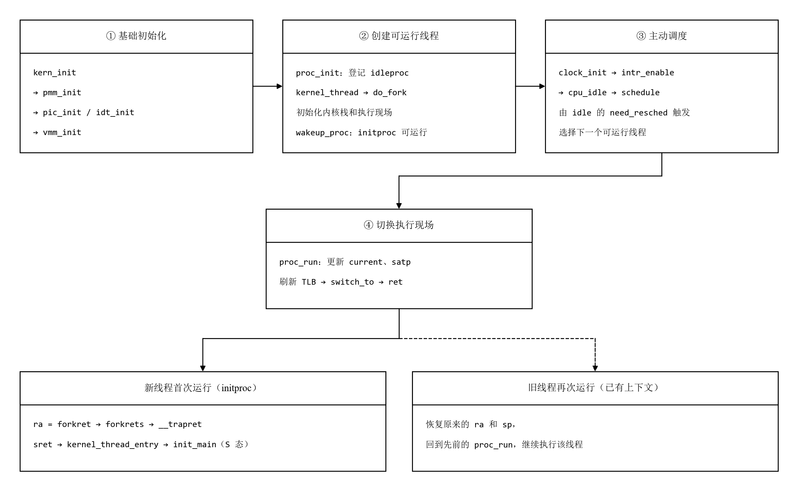

# 三、实验整体逻辑分析

## 2.1 本章节的逻辑主线

**Lab4 的核心任务**是建立内核线程的调度基础：将启动栈上的初始执行流封装为 `idleproc`，创建首个新线程 `initproc`，并完成 CPU 使用权的移交。三大模块分别落实了**页表映射维护**、**可运行实体构造**与**执行现场切换**。其中，线程创建仅代表其进入就绪队列、获得调度资格；直至调度器将其选中并完成栈与入口的切换，线程方才真正开始执行。

图 3-1　Lab4 启动、线程创建与首次调度流程

## 2.2 功能的逐步实现

1. **先建立内存和中断基础**。`kern_entry` 已装入启动页表，进入 `kern_init()` 后，`pmm_init()` 初始化物理页管理，并通过自检函数验证页表的增删逻辑。模块一的 `page_insert()` 与 `page_remove()` 负责更新 PTE、维护物理页引用计数并使旧的地址翻译失效。`pic_init()` 在本版本中为空实现，中断向量由 `idt_init()` 将 `stvec` 指向 `__alltraps`；随后 `vmm_init()` 执行 VMA 自检。新线程通过物理页分配器申请内核栈，并沿用既有的内核映射，并非为每个线程通过 `page_insert()` 单独新建栈映射或独立页表。
2. **准备执行现场，使线程具备调度资格**。`proc_init()` 将当前执行流登记为使用启动栈的 PID 0（`idleproc`），使 `current` 指向它并设置 `need_resched` 标志。接着通过 `kernel_thread(init_main, ...)` 构造初始 `trapframe`，将函数入口与参数分别放入 `s0` 与 `s1`，并令 `epc` 指向 `kernel_thread_entry`。`do_fork()` 分配 PCB 与内核栈，本实验中的 `copy_mm()` 暂不复制地址空间；`copy_thread()` 将 `trapframe` 放置于新栈顶，并将 `context.ra` 和 `context.sp` 分别设为 `forkret` 及其对应的栈帧地址。在完成 PID 分配、链表与哈希表登记后，通过 `wakeup_proc()` 将新线程置为 `PROC_RUNNABLE`，随后 `proc_init()` 将其登记为 `initproc`（PID 1）。
3. **择优运行并执行上下文切换**。`proc_init()` 返回后，`kern_init()` 依次调用 `clock_init()`、`intr_enable()`，随后进入 `cpu_idle()`。首次 `schedule()` 由 `idleproc` 初始化时设置的 `need_resched` 触发，而非等待时钟中断到来。`schedule()` 清除当前线程的调度请求，从环形链表 `proc_list` 中搜寻下一个可运行线程；从 `idle` 出发时从表头哨兵之后开始检索，若未找到则回退至 `idle` 兜底。仅当选中的线程与 `current` 不同时才调用 `proc_run()`；后者在关中断的临界区内更新 `current`、写入 `satp` 寄存器、刷新 TLB，并调用 `switch_to()` 保存旧线程的 `ra`、`sp` 及 `s0`～`s11` 寄存器，同时恢复新线程对应的寄存器上下文。
4. **新线程首次启动与旧线程恢复分流**。`switch_to()` 的 `ret` 指令跳转至恢复出的 `ra`。对于首次运行的 `initproc`，其执行流为 `forkret` $\rightarrow$ `forkrets` $\rightarrow$ `__trapret`，最终通过 `sret` 返回至 `kernel_thread_entry`，并在 S 态下执行 `init_main(arg)`。而对于经历过切换并再次被调度的老线程，其 `ra` 为此前调用 `switch_to()` 时的返回地址，因此会直接从自身的 `proc_run()` 后续代码继续执行，不再经过 `forkret` 路径。`init_main()` 返回后将进入 `do_exit()`，不过在 Lab4 中 `do_exit()` 仍为 `panic` 占位，尚未实现完整的正常退出与资源回收逻辑。
