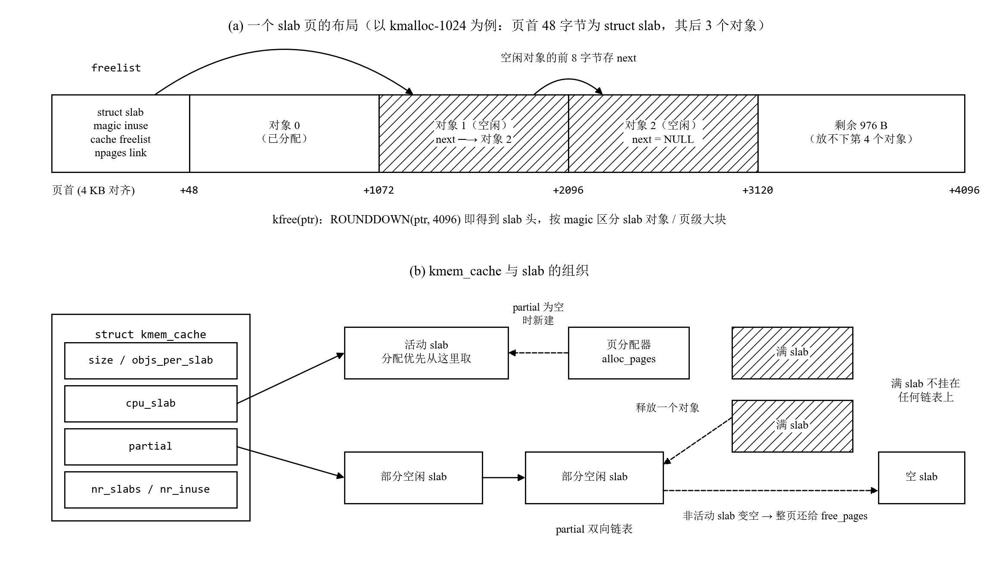

## Challenge：任意大小内存单元的 SLUB 分配算法

**负责人：** 2411264-张远（实现与接入，提示词一）、2414099-李云鹏（测试，提示词二）

### 设计思路

页分配器（First-Fit / Best-Fit / Buddy）的最小单位是 4 KB 的页。内核里大量的对象只有几十字节（链表节点、进程控制块、文件描述符……），如果每个都占一页，内部碎片极大。SLUB 在页分配器之上再加一层：向页分配器要一整页（称为一个 slab），把它切成等长的小对象，按对象大小分别管理。

本实现的两层结构：

| 层次 | 接口 | 实现 |
| :--- | :--- | :--- |
| 第一层：页级分配 | `alloc_pages()` / `free_pages()` | 直接使用当前 `pmm_manager`（默认 Best-Fit），SLUB 不关心底层用的是哪种算法 |
| 第二层：对象分配 | `kmem_cache_create/alloc/free/destroy`、`kmalloc/kfree/ksize` | slab 切分、freelist、partial 链表 |

SLUB **没有**注册成一个新的 `pmm_manager`，而是作为独立模块接在 `pmm_init()` 之后（`kern_init` 中调用 `slub_init()`）。原因有两点：一是两层本来就是上下级关系，不是并列的页分配算法；二是 `make grade` 要求当前 `pmm_manager` 必须是 `best_fit_pmm_manager`，把 SLUB 注册成管理器会让 Best-Fit 的检查失败。



<p align="center">图 T4-1　slab 页的布局与 kmem_cache 的组织</p>

**slab 页的布局**（图 T4-1(a)）：页首是 48 字节的 `struct slab` 头，记录魔数、已分配对象数、所属缓存和 freelist；后面是等长的对象。空闲对象的前 8 字节存放下一个空闲对象的地址，freelist 就“嵌”在空闲对象里，不需要额外的空间。释放时，把对象地址向下对齐到 4 KB 就能找到 slab 头，从而知道它属于哪个缓存。

**缓存的组织**（图 T4-1(b)）：每种对象大小对应一个 `struct kmem_cache`，它持有三类 slab：

- **活动 slab**（`cpu_slab`）：分配时优先从它的 freelist 头部弹出对象，这是最快的路径。Linux 中每个 CPU 有一个活动 slab，这里是单核，所以只有一个。
- **部分空闲 slab**：挂在 `partial` 双向链表上。活动 slab 用完时，从这里取一个作为新的活动 slab；链表也为空时，才向页分配器申请新页。
- **满 slab**：不挂在任何链表上。满了就没有可分配的对象，SLUB 不需要找到它；等它的某个对象被释放时，再根据对象地址找回 slab，把它重新挂回 `partial`。

非活动 slab 的对象全部释放后，整页立即还给页分配器。活动 slab 变空时保留，避免在同一页上反复申请和释放。

**kmalloc**：`slub_init()` 先用一个静态的 `kmem_cache`（存放 `struct kmem_cache` 本身，称为 cache_cache）完成自举，再建立 16、32、64、128、256、512、1024 字节共 7 个通用缓存。`kmalloc(size)` 选用能容纳 `size` 的最小缓存；超过 1024 字节时直接按页分配，在首页页首写一个带不同魔数的头，记录页数。`kfree` 读取页首的魔数，就能区分这两类内存。

为什么上限取 1024 而不是 2048：slab 头放在页首，一页放下头部后，只能再容纳一个 2048 字节的对象，和直接按页分配没有区别。

**与 Linux SLUB 的对应和简化**：

| 方面 | Linux SLUB | 本实现 |
| :--- | :--- | :--- |
| freelist | 嵌在空闲对象中 | 相同 |
| 链表 | 只维护 partial，不跟踪满 slab | 相同 |
| 活动 slab | 每个 CPU 一个 | 单核，每个缓存一个 |
| slab 元数据 | 存放在 `struct page` 中 | ucore 的 `struct Page` 没有空余字段，改放在页首（代价是每页少放一些对象，例如 kmalloc-1024 每页只能放 3 个） |
| slab 大小 | 可以是多页（高阶） | 固定一页 |
| 其他 | per-node 链表、min_partial、调试毒化、对象合并 | 不实现；只保留重复释放和非法指针的检查 |

### 提示词一：实现并接入内核

<!-- include:T4-slub.prompt.md -->

### 实现迭代过程

本模块的实现经历了 2 次迭代，过程如下：

#### 第一次迭代

**遇到的问题：**

- 问题 1：前辈的实现把 SLUB 注册成一个 `pmm_manager`，内部再调用 Buddy。照这样做，当前管理器就不再是 `best_fit_pmm_manager`，`make grade` 的 `[Test 2] Best-Fit` 会失败。
- 问题 2：slab 元数据放在哪里。Linux 放在 `struct page` 里，但 ucore 的 `struct Page` 只有 `ref`、`flags`、`property`、`page_link` 四个字段，而且页分配器都在使用；如果扩充 `struct Page`，描述符数组会变大，page_init 的内存布局也会跟着改变。
- 问题 3：`pmm.h` 中的 `KADDR` 宏被注释掉了。`alloc_pages()` 返回的是描述符，不是可以直接读写的地址。

**问题解决策略：**

- 针对问题 1：在提示词中明确“不要注册成 `pmm_manager`”，第一层直接调用 `alloc_pages()` / `free_pages()`，并说明 `make grade` 的检查方式。
- 针对问题 2：在 [RELY] 中说明 `struct Page` 没有空余字段、不能修改，在 [Requirements] 中规定元数据放在页首。kmalloc 的上限相应定为 1024 字节。
- 针对问题 3：在 [RELY] 中注明 `KADDR` 不可用，物理地址转虚拟地址要写成 `pa + va_pa_offset`。

#### 第二次迭代

**遇到的问题：**

- 问题 1：编写释放路径时注意到一个边界情况：如果某个缓存每个 slab 只能放一个对象（例如对象大小接近一页的自定义缓存），slab 会在一次释放中从“满”直接变成“空”。满 slab 不在 partial 链表上，这时如果按“变空就从链表摘下”的逻辑执行 `list_del`，就会破坏链表。

**问题解决策略：**

- 针对问题 1：释放时先记下 slab 原来是否是满的，只有原来不满（在链表上）时才 `list_del`。这条作为 Case 3 写进提示词中 `kmem_cache_free` 的 [SPECIFICATION]。

**最终结果：**

经过 2 次迭代，该模块最终：

- ✅ 编译通过，`make qemu` 正常启动，输出 `slub: 7 kmalloc caches (16 ~ 1024 bytes), larger requests use whole pages`
- ✅ 当时 `make grade` 的 page init 检查通过；Best-Fit 尚待 T2 完成。本节末尾的正式回归已在当前 Best-Fit 下取得 20/20。
- ✅ 冒烟验证通过（见下）。正式测试由提示词二生成。

正式测试完成之前，我在临时副本中做了一次冒烟验证（First-Fit 冒充 Best-Fit，测试代码不进仓库）：

| 检查内容 | 结果 |
| :--- | :--- |
| `kmalloc` 1、8、16、17、33、100、255、500、1000、1024 字节 | 分别落在 16、16、16、32、64、128、256、512、1024、1024 字节缓存，地址 8 字节对齐 |
| `kmalloc` 1025、4000、4097、20000 字节 | 按页分配 1、1、2、5 页，`ksize` 分别为 4048、4048、8144、20432 |
| 连续分配 600 个 64 字节对象并写入编号 | 占用 10 个 slab（每个 63 个对象），逐字节校验全部正确 |
| 释放偶数号对象 | 9 个 slab 进入 partial，1 个为活动 slab |
| 全部释放 | 只剩活动 slab 1 个，另外 9 页还给页分配器 |
| 自定义缓存 40 字节、16 对齐 | 步长 48，对象 16 字节对齐；有对象未释放时拒绝销毁，释放后销毁成功 |
| `kmem_cache_create("too-big", 4096, 8)` | 返回 NULL |
| 重复释放同一个 32 字节对象 | `kernel panic at kern/mm/slub.c:200: slub: double free of 0xffffffffc034b030 in cache kmalloc-32` |

页数核对：冒烟测试开始时有 31926 个空闲页，结束时 31919 个，相差的 7 页正好是 7 个 kmalloc 缓存各自保留的活动 slab。

**关键改进点总结：**

1. 明确 SLUB 是页分配器之上的独立一层，不注册成 `pmm_manager`，与 `make grade` 的要求兼容。
2. 在 [RELY] 中写明 `struct Page` 不可扩充、`KADDR` 不可用这两个框架限制。
3. 在 [SPECIFICATION] 中补充单对象 slab 从满直接变空的边界情况。

### 提示词二：测试函数

<!-- include:T4-slub-test.prompt.md -->

### 测试设计与覆盖

测试入口为 `slub_check()`（`code/kern/mm/slub_test.c`），在 `slub_init()` 后运行。执行 `make qemu`，依次检查七种小对象缓存、跨页复用、大对象分配与释放及基本边界情况。测试同时核对返回地址、对象内容和缓存统计，检查分配结果是否正确。

#### 1. 各大小缓存的分配与释放

分别请求 1、17、33、65、129、257、1024 字节，预期使用 16、32、64、128、256、512、1024 字节缓存，覆盖全部七种大小类，并检查非 2 的幂的请求能否向上归入正确的缓存。

对每种缓存，先按 `objs_per_slab` 分配足以填满一页的对象，检查地址对齐、`ksize`、对象是否位于同一页及 `nr_inuse`。再申请一个对象时，应启用第二个 slab；若仍返回第一页内的地址，则满页判断有误。给各对象写入不同的字节值并读回，检查是否存在重复分配或对象间覆盖。

随后释放第一页的首个对象，该页应从满页变为 partial，`nr_partial` 增加。释放该页的其余对象后，整页应归还；最后释放第二页的对象，该缓存应只保留一个空活动 slab。此过程检查了“满页 → partial → 空页回收”的状态转换及活动 slab 的保留策略。

| 请求大小 / B | 目标缓存 / B | 每页可容纳对象数 |
| :--- | :--- | :--- |
| 1 | 16 | 253 |
| 17 | 32 | 126 |
| 33 | 64 | 63 |
| 65 | 128 | 31 |
| 129 | 256 | 15 |
| 257 | 512 | 7 |
| 1024 | 1024 | 3 |

实现中没有 full 链表，因此测试用每页容量、`nr_inuse` 和 `nr_slabs` 判断 slab 是否已满；活动 slab 不计入 `nr_partial`。

#### 2. 批量分配与复用

连续分配 128 个 64 字节对象，使分配跨越多个 slab；释放偶数号对象，再申请相同数量。`nr_inuse` 应依次为 128、64、128。重新分配时，`nr_slabs` 和空闲页数应保持不变，表明分配器复用了已释放的位置，没有额外申请页面。

重新分配后逐字节核对对象内容，重点检查始终保留的奇数号对象是否被覆盖。全部释放后，空闲页数应恢复到本项测试开始时的值。结合计数与内容检查，可判断分配器是否正确复用空闲位置，而未重复分配仍在使用的地址。

#### 3. 大对象页级回退

分别申请 1025、4096、8192 字节，覆盖请求大小刚超过小对象上限、恰好为一页及超过一页的情况。这些请求应采用页分配路径，不使用七种小对象缓存。每次核对返回地址和 `ksize`，写满请求范围并读回，再检查释放后空闲页数是否恢复，以检查容量计算和页面回收是否正确。

大块分配的首页还需存放管理头，因此当前实现中，4096 字节请求需要两页，8192 字节请求需要三页。

#### 4. 基本边界与页面核对

测试入口处检查 `kmalloc(0)` 是否返回空指针、`kfree(NULL)` 能否安全调用，以及过大的缓存尺寸是否被拒绝，防止先前的整数溢出问题再次出现。

全部测试结束后，七个通用缓存各应满足 `nr_inuse = 0`、`nr_partial = 0`、`nr_slabs = 1`；总空闲页数比测试开始时少七页，对应七个缓存各自保留的一个空活动 slab。汇总核对缓存统计和空闲页数，可发现单项测试中未释放的对象或被错误回收的活动页。

### 测试迭代与验证

上一版测试发现，`kmem_cache_create("overflow", (size_t)-1, 8)` 未被拒绝，原因是尺寸对齐时发生整数回绕，结果变为 0。随后在 `cache_setup()` 的对齐运算前增加了单页输入范围限制。当前测试保留对应断言，防止该问题再次出现。

上一版还测试了内存耗尽、批量缓存描述符、多种 PMM 和内存配置，并通过额外的 Python 脚本启动 panic 场景。当前版本聚焦于上述三组功能测试和基本边界检查，移除了额外运行器及旧过程日志。简化后首次编译和启动均通过，未新增代码修复轮次。

2026-10-22，在默认 Best-Fit、QEMU 4.1.1/OpenSBI v0.4 环境下重新验证：

- `make`（`temp/T4-make.log`）：编译通过。
- `make qemu`（`temp/T4-qemu.log`）：SLUB 测试全部通过，末尾输出 `[SLUB] all checks passed (retained 7 active slab pages)`；这是本节测试的直接结果。
- `make grade`（`temp/T4-grade.log`）：原有 page init 与 Best-Fit 测试均为 OK，总分 **20/20**，与修改前一致。该分数用于确认页分配功能未退化，不直接评定 SLUB。

复现时，在已配置交叉工具链的 Linux/WSL 登录 shell 中，从仓库根目录执行：

```bash
export QEMU="$HOME/Environment/qemu-4.1.1/riscv64-softmmu/qemu-system-riscv64"
cd code
make
make qemu
# 看到 all checks passed 后，Ctrl+A 再按 X 退出。
make grade
```
