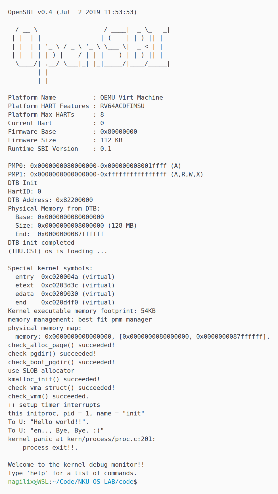
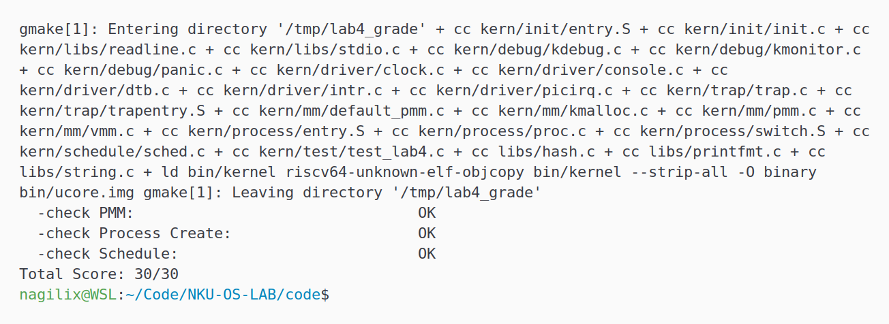

# 一、实验目的

结合 Lab 4（进程管理）实验指导书与核心内核模块设计，本实验的主要目的是：

1. **理解并掌握虚拟内存管理的组织方式与多级页表维护机制**：
   - 理解在 Sv39 三级页表框架下，`page_insert()` 与 `page_remove()` 如何联动维护页表项内容、物理页引用计数（`struct Page.ref`）与 TLB 状态（`sfence.vma` / `tlb_invalidate()`）三者的一致性；
   - 理解虚拟内存描述结构（`mm_struct`、`vma_struct`）与多级页表按需建立、权限更新和幂等撤销的基本组织方式。

2. **掌握内核线程的创建、初始化与生命周期管理过程**：
   - 理解进程控制块 `struct proc_struct` 的关键字段（状态 `state`、`pid`、内核栈 `kstack`、上下文 `context`、中断帧 `tf`、页目录基址 `pgdir` 及链表/哈希表挂接关系）；
   - 掌握 0 号空闲线程 `idleproc` 复用启动现场的初始化过程，以及通过 `kernel_thread()`、`do_fork()`、`copy_thread()`、`setup_kstack()` 创建 1 号内核线程 `initproc` 并构造首次运行链路的完整机理。

3. **掌握内核线程的上下文切换与基本调度过程**：
   - 理解 `cpu_idle()` 主动让出 CPU、`schedule()` 在 `proc_list` 中按 FIFO/轮转策略选取 `PROC_RUNNABLE` 线程、`proc_run()` 在关中断临界区内切换 `current` 与 `satp` 页表的完整协调流程；
   - 深入理解 `switch_to()` 保存与恢复被调用者保存寄存器（`ra`、`sp`、`s0`-`s11`）以及经由 `forkret -> forkrets -> __trapret` 跳转至 `kernel_thread_entry` 启动新线程的底层控制流转换。

4. **持续深化契约化 AI 协同内核工程实践**：
   - 继续实践“四段式提示词 + `.handoff/` 异步看板 + 端到端评测注入”的团队协作范式，在功能拆分、边界约束与跨成员模块集成中提升代码正确率与文档可追溯性。

---

# 二、实验环境

## 软件与运行环境

本实验全组继续严格统一使用 **QEMU 4.1.1**（内置 OpenSBI v0.4），保证与 Lab 2/Lab 3 完全一致的 `-device loader` 内核加载行为；同时在 `code/Makefile` 中针对 gcc 14 及以上版本增加 `-Wno-error=int-conversion -Wno-error=incompatible-pointer-types` 编译选项以兼容框架与评测测试代码。

| 成员 | 宿主系统 | QEMU 版本 | 交叉编译工具链 | 调试器版本 |
| :--- | :--- | :--- | :--- | :--- |
| 2411264-张远 | WSL2 Ubuntu 24.04 | 4.1.1（OpenSBI v0.4） | riscv64-unknown-elf-gcc 15.1.0 | riscv64-unknown-elf-gdb 16.3 |
| 2414099-李云鹏 | WSL2 Ubuntu 22.04 | 4.1.1（OpenSBI v0.4） | SiFive riscv64-unknown-elf-gcc 10.2.0 | riscv64-unknown-elf-gdb 10.1 |
| 2413074-刘昀皓 | WSL2 Ubuntu 24.04 | 4.1.1（OpenSBI v0.4） | riscv64-unknown-elf-gcc 15.1.0 | riscv64-unknown-elf-gdb 16.3 |

全组成员本地仍通过 `export QEMU=$HOME/Environment/qemu-4.1.1/riscv64-softmmu/qemu-system-riscv64` 显式指定模拟器路径，使 `make qemu` 与 `make grade` 运行在同一 QEMU 4.1.1 版本上。

## AI 工具与底层模型

全组继续采用多工具、多模型的异构 Agent 协作模式，各成员分工与工具链配置如下：

| 成员 | 负责任务 | AI 编程工具 | 底层模型 | 备注 / 特殊配置 |
| :--- | :--- | :--- | :--- | :--- |
| 2411264-张远 | T0, T2, T3, T6 | Claude Code（终端 Agent） | Claude Opus 5.5 | 环境集成、进程创建与调度实现、报告集成 |
| 2414099-李云鹏 | T1, T4 | Codex（终端 Agent） | gpt-6.1-sol | 虚拟内存页操作、整体逻辑与 OS 原理对照 |
| 2413074-刘昀皓 | T5 | Antigravity（终端 Agent） | Gemini 4 Argon / Gemini 4 Neon / Gemini 4 Hydrogen | Challenge 剖析、公共章节撰写与测试验证 |

---

# 五、测试与验证

### 1. 测试设计与评测原理

Lab 4 的自动化评测由 `code/tools/grade.sh` 与 `code/tools/inject.py` 协同驱动。执行 `make grade` 时，脚本会先将当前 `code/` 复制到临时工作目录，随后由 `tools/inject.py` 把 `tools/test_lab4.c` 和 `tools/test_lab4.h` 拷贝至临时目录的 `kern/test/` 下，向 `Makefile` 的 `KINCLUDE` 与 `KSRCDIR` 追加 `kern/test`，并向核心代码注入三处测试调用钩子：

1. 在 `code/kern/mm/pmm.c` 的 `pmm_init()` 函数末尾注入 `test_lab4_pmm_basic();`；
2. 在 `code/kern/process/proc.c` 的 `proc_init()` 函数末尾注入 `test_lab4_process_create();`；
3. 在 `code/kern/process/proc.c` 的 `init_main()` 函数开头注入 `test_lab4_schedule();`。

随后 `tools/grade.sh` 编译生成带注入测试的内核镜像并在 QEMU 中运行（默认在 `readline` 处拦截或超时截断输出），使用 `grep -F` 对串口输出进行精确子串匹配。评测共分 3 个部分，每部分 10 分，总分 **30 分**：

| 测试部分 | 分值 | 注入位置与核心验证逻辑 | 必须匹配的串口输出字符串 |
| :--- | :---: | :--- | :--- |
| `check PMM` | 10 | 调用 `test_lab4_pmm_basic()`：验证 `page_insert()` 建立映射及同页重复插入仅更新权限不泄漏物理页、同地址换页使旧页 `page_ref` 归零、以及 `page_remove()` 幂等删除与 `page_ref` 归零 | `[Test PMM] PASS` |
| `check Process Create` | 10 | 调用 `test_lab4_process_create()`：校验 `current == idleproc`、`idleproc`（`pid == 0`、`PROC_RUNNABLE`、`kstack == bootstack`、`parent == NULL`、`mm == NULL`、`tf == NULL`、`runs == 0`、`flags == 0`、`context.ra == 0`）与 `initproc`（`pid == 1`、`PROC_RUNNABLE`、`parent == idleproc`、`mm == NULL`、`context.ra != 0`、`context.sp != 0`） | `[Test Process Create] PASS` |
| `check Schedule` | 10 | 在 `init_main()` 中调用 `test_lab4_schedule()` 创建两个 `test_lab4_thread` 并循环主动让出 CPU 触发 `schedule()`，确认两线程均成功运行并结合 `init_main()` 原有输出检查 | `[Test Schedule] PASS`、`this initproc, pid = 1, name = "init"`、`To U: "Hello world!!".`、`To U: "en.., Bye, Bye. :)"` |

### 2. 测试执行截图

#### （1）日常运行输出（`make qemu`）

```bash
export QEMU=$HOME/Environment/qemu-4.1.1/riscv64-softmmu/qemu-system-riscv64
make qemu
```

在统一 QEMU 4.1.1（OpenSBI v0.4）环境下启动完整内核后，系统依次通过物理内存分配自检（`check_alloc_page()`）、多级页表操作自检（`check_pgdir()`、`check_boot_pgdir()`）、SLOB 内核堆自检（`kmalloc_init()`）及虚拟内存结构自检（`check_vma_struct()`、`check_vmm()`），随后开启时钟中断并进入 `cpu_idle()` 触发首次调度。CPU 从 0 号空闲线程 `idleproc` 切换至 1 号内核线程 `initproc` 后，成功输出 `this initproc, pid = 1, name = "init"`、`To U: "Hello world!!".` 和 `To U: "en.., Bye, Bye. :)"`。

需要说明的是，末尾出现的 `kernel panic at kern/process/proc.c:201: process exit!!.` 是本实验的**预期正常行为**：`init_main()` 执行完毕返回后，汇编码 `kernel_thread_entry` 会将返回值送入 `do_exit()`，而 Lab 4 中 `do_exit()` 尚未实现完整的进程回收（留待 Lab 5 实现），因此按框架设计以 `panic("process exit!!.\n")` 结束并进入内核调试监控器。



<p align="center">图 5-1　make qemu 的运行结果（最终代码，QEMU 4.1.1）</p>

#### （2）自动化评测输出（`make grade`）

```bash
export QEMU=$HOME/Environment/qemu-4.1.1/riscv64-softmmu/qemu-system-riscv64
make grade
```

在统一 QEMU 4.1.1 环境下执行自动化评测，`tools/inject.py` 将 `kern/test/test_lab4.c` 注入临时目录 `/tmp/lab4_grade` 并重新编译运行，PMM（10 分）、Process Create（10 分）、Schedule（10 分）三项测试全部通过，总分 **30/30**（截图保留了注入目录编译汇总与评测打分结果）：



<p align="center">图 5-2　make grade 的评测结果（最终代码，30/30）</p>

---

# 六、实验总结与收获

## AI 协作开发的经验

在 Lab 4（进程管理）跨模块、多成员并行开发的过程中，全组延续并打磨了“四段式契约提示词 + `.handoff/` 异步看板 + 端到端评测验证”的异构 Agent 协同工作流，沉淀出以下四点一线实践经验：

### 1. 前置核对框架契约，防止模型照搬历史版本代码
操作系统教学代码（ucore）在网络上存在大量 x86-32 或 Sv32 历史版本，大语言模型如果不经约束极易产生“经验性幻觉”。本实验中多个关键避坑点均来自编码前对真实仓库代码的逐行核对：
- 在功能模块二中，原版 ucore 的 `kernel_thread()` 使用 `clone_flags | CLONE_VM`，但本实验框架未定义 `CLONE_VM` 宏，提前核对后在 `[RELY]` 中明确说明直接透传 `clone_flags`；
- 在功能模块三中，框架 `libs/riscv.h` 里的 `lsatp()` 是 Sv32 遗留实现（32 位参数、MODE 位于 bit 31），且 `SATP_MODE_SV39` 的值 `8` 并未预先左移，提前对照 `pmm.c` 中的 `enable_paging()` 把 Sv39 `satp` 构造规则写入 `[SPECIFICATION]` 后，模型一次生成正确；
- 在环境适配（T0）中，提前识别出 gcc 14 及以上版本将 `int-conversion` 与 `incompatible-pointer-types` 升级为默认错误（触发于框架 `kmalloc.c` 与评测注入代码 `test_lab4.c`），通过在 `Makefile` 中统一添加 `-Wno-error=` 选项解决，避免违背“不修改评测文件”的约束。

### 2. 前后端解耦与“先原理推演、后实证校准”的并行推进
在 Lab 4 任务依赖链较长（T0 -> T1/T2 -> T3 -> T4/T5 实测 -> T6 集成）的情况下，分析类与公共文档任务（T5 Challenge 及公共章节）并未消极等待上游代码全部合入才动笔。通过先依据框架中不变的 `sync.h`、`pmm.c`、`mmu.h` 与 `tools/inject.py`/`test_lab4.c` 完成底层机理剖析与评测原理骨架，并对依赖下游代码的部分显式标记占位，待 T1-T3 全部合入后迅速对照最终 `schedule()`、`proc_run()` 与 `get_pte()` 源码完成行号校准和实机截图，显著压缩了集成尾期的串行等待时间。

### 3. 独立临时副本加桩验证，守住共享分支的代码提交门槛
由于 T1（页表映射）、T2（进程创建）与 T3（调度切换）处于同一编译链接单元，在早期独立开发阶段，缺失其他模块的符号必然导致主工作区链接失败。全组在 T0、T1、T2 阶段均采用“在独立临时副本中补充最小空桩进行 `make qemu` / `make grade` 单元验证，主分支工作区严格只提交职责范围内的干净实现”的策略，既保证了每次推送的可验证性，又避免越界修改他人任务文件引发合并冲突。

### 4. 机器校验与共享文件协作规范兜底交付质量
Lab 4 的 `code/kern/mm/pmm.c` 与 `code/kern/process/proc.c` 被多个任务共同编辑，且保留了大量跨实验累积的中文学习注释。借助 `.handoff/STATUS.md` 的「全组须知」、任务文件留言区以及 `git pull --rebase` 冲突合并约定，成员间清晰传递了注释变更与接口决策；同时在每次节点提交前执行 `.claude/tools/check-rely.py` 逐行核验 `[RELY]` 代码块与仓库源码的一致性，配合 `merge-report.py` 的章节及图号约定，保障了代码、提示词与最终报告的三方严格同步。
