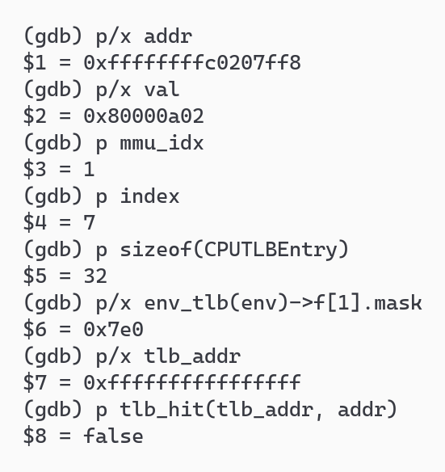
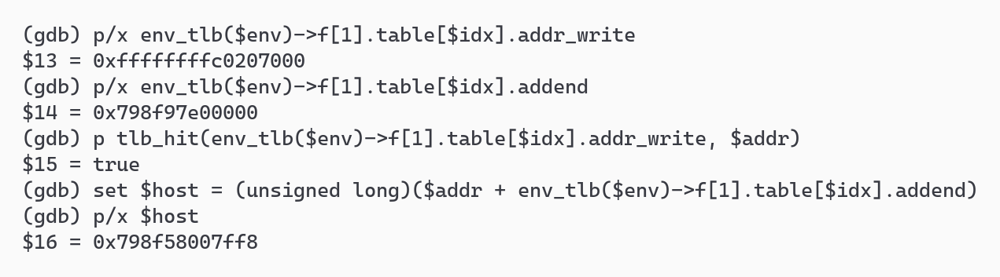
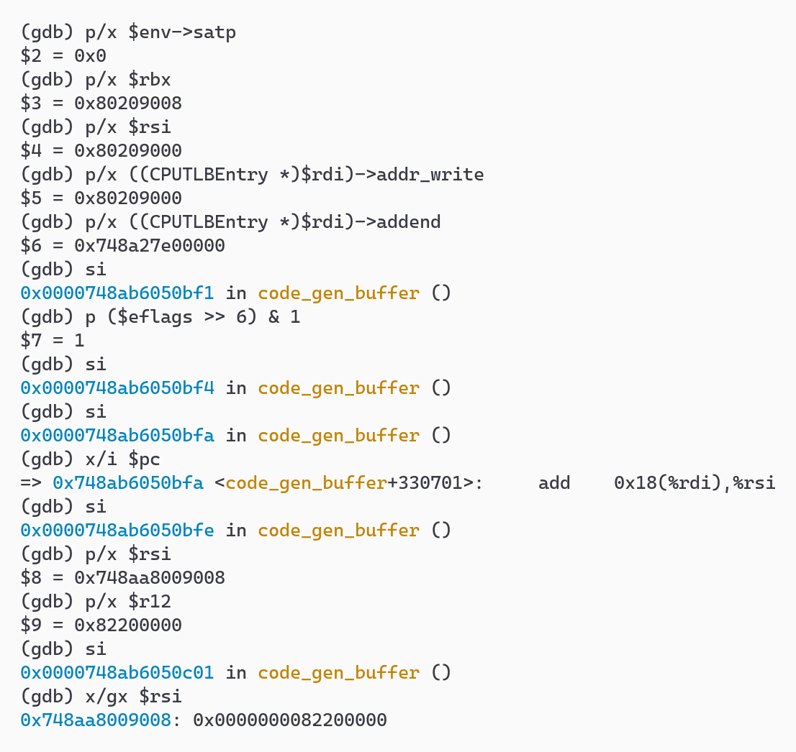
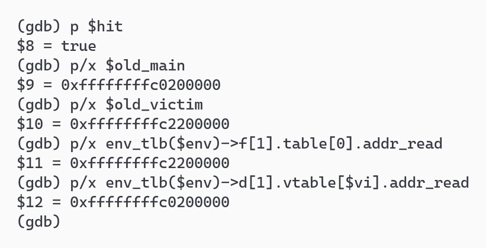
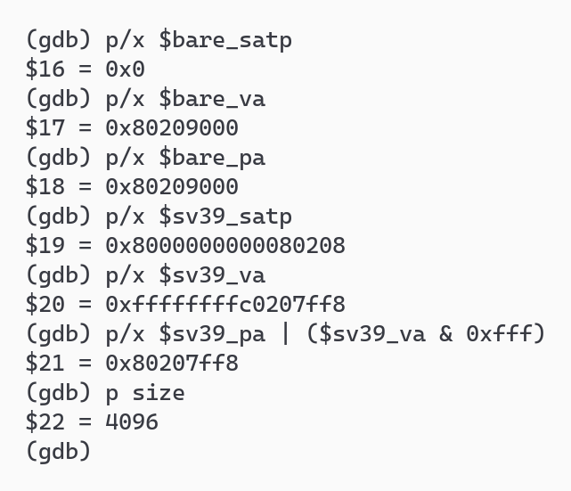

### 软件 TLB 的查找、填充与命中

**负责人：** 2414099-李云鹏

本节承接页表遍历部分，对应分支任务的调试要求 3、4，并记录调试细节与问题分析。实验分别观察主 TLB 缺失后的填充、主 TLB 快速命中和 victim TLB 命中，再比较未开启分页与开启分页时的执行路径。

#### 调试环境与观察对象

调试使用 WSL2 Ubuntu 22.04、带调试信息的 QEMU 4.1.1，以及 SiFive GCC 10.2.0。内核源码为 lab2 分支的 `c0844a7`，导出到独立目录编译，没有修改内核。宿主机 GDB 附加到 QEMU，交叉 GDB 连接 QEMU 的 gdbstub；两者与 QEMU 分别放在 tmux 的三个窗口中。与前一节一样，宿主机 GDB 要先 `continue`，交叉 GDB 才能连接。为避免占用默认端口，本次 gdbstub 使用 `127.0.0.1:12345`。

同一份 C 代码用不同工具链编译，指令布局也可能不同。我们先用 `nm` 和 `objdump` 查出了本次实际地址：

| 观察对象 | 本次地址 | 用途 |
| :--- | :--- | :--- |
| `kern_entry` 的第一条 `sd a0,0(t0)` | 指令地址 `0x80200008`，写 `0x80209000` | Bare 下第一次写 `boot_hartid` |
| 随后的 `sd a1,0(t0)` | 指令地址 `0x80200014`，写 `0x80209008` | 同一页的第二次写，用于观察快速命中 |
| `kern_init` | `0xffffffffc02000d8` | 分页后的 C 入口 |
| `kern_init` 中的 `sd ra,8(sp)` | 指令地址 `0xffffffffc02000ee`，写 `0xffffffffc0207ff8` | Sv39 下第一次写栈页 |
| `boot_page_table_sv39` | VA `0xffffffffc0208000`，PA `0x80208000` | 根页表，对应 `satp=0x8000000000080208` |
| 设备树 | VA `0xffffffffc2200000`，PA `0x82200000` | 与内核代码页发生 TLB 索引冲突 |

这里的 `kern_init` 和保存 `ra` 的指令比前一节截图中的地址多 2 字节，不能直接照搬断点。下文所有宿主机指针均以本节 tmux 实测为准；每次重启 QEMU 后，这些指针可能变化。

图片来自 `tmux capture-pane` 捕获的实际交互式 GDB 窗格，使用组内 `tmux-render.py` 渲染为浅色主题，保留 `(gdb)` 提示符和原始输出。完整窗格记录保存在 `temp/T5-{miss,fast,victim,modes}.ans`，重放方法见 `temp/T5-reproduce.md`。

#### 在源码中找到查 TLB 的位置

QEMU 的软件 TLB 是宿主机内存中的 C 数据结构。`include/exec/cpu-defs.h:110` 定义的 `CPUTLBEntry` 包含四个主要字段：

| 字段 | 在查找中起什么作用 |
| :--- | :--- |
| `addr_read` | 读访问使用的客户机虚拟页标签 |
| `addr_write` | 写访问使用的客户机虚拟页标签 |
| `addr_code` | 取指使用的客户机虚拟页标签 |
| `addend` | 对普通 RAM，客户机虚拟地址加上它就得到宿主机指针 |

前三个字段不是单纯的页号：高位是虚拟页地址，低位还可以带 `TLB_MMIO`、`TLB_NOTDIRTY`、`TLB_INVALID_MASK` 等标志。没有相应访问权限时，该标签会被设成 `-1`。读、写、取指共享同一个表项，但分别比较各自的标签。

主表按 `mmu_idx` 选择，再用虚拟页号计算数组下标。QEMU 4.1.1 的 RISC-V 实现中，`riscv_cpu_mmu_index` 返回 `env->priv`；本次 ucore 在 S 态，使用 `f[1]`。`include/exec/cpu_ldst.h:163` 的代码是：

```c
static inline uintptr_t tlb_index(CPUArchState *env, uintptr_t mmu_idx,
                                  target_ulong addr)
{
    uintptr_t size_mask = env_tlb(env)->f[mmu_idx].mask >> CPU_TLB_ENTRY_BITS;

    return (addr >> TARGET_PAGE_BITS) & size_mask;
}
```

也就是说，先去掉 12 位页内偏移，再取虚拟页号的低若干位。`mask` 存的是字节偏移掩码，要右移 `CPU_TLB_ENTRY_BITS` 才能得到索引掩码。本次实测 `sizeof(CPUTLBEntry)=32`，所以 `CPU_TLB_ENTRY_BITS=5`；`mask=0x7e0`，右移 5 位得到 `0x3f`，主表有 64 项。这是本次观察时的容量，不是固定容量：源码中的默认值是 256 项，动态调整的下限才是 64 项。

得到候选表项后，`include/exec/cpu-all.h:348–362` 判断标签是否匹配：

```c
static inline bool tlb_hit_page(target_ulong tlb_addr, target_ulong addr)
{
    return addr == (tlb_addr & (TARGET_PAGE_MASK | TLB_INVALID_MASK));
}

static inline bool tlb_hit(target_ulong tlb_addr, target_ulong addr)
{
    return tlb_hit_page(tlb_addr, addr & TARGET_PAGE_MASK);
}
```

这里保留了标签中的无效位，因此不能只比较两个地址的高位。与此同时，`tlb_hit` 会屏蔽部分特殊标志，返回 `true` 也不保证可以直接访问 RAM：后面仍要处理 MMIO、脏页跟踪等情况。

这些函数被以下路径使用：

| 位置 | 关键操作与分支 |
| :--- | :--- |
| `accel/tcg/cputlb.c:1023`，`get_page_addr_code` | TB 查找或翻译需要代码地址时，比较 `entry->addr_code`；主表和 victim 均缺失才填表 |
| `cputlb.c:1248`，`load_helper` | 数据读慢路径，选择读标签，必要时查 victim、调用 `tlb_fill` |
| `cputlb.c:1501`，`store_helper` | 数据写慢路径，第 1519 行判断 `!tlb_hit(tlb_addr, addr)`，第 1520 行查 victim，仍缺失才在第 1522 行填表 |
| `cputlb.c:976`，`victim_tlb_hit` | 遍历 8 个 victim 项；`cmp == page` 时交换主表与 victim，并返回 `true` |
| `tcg/i386/tcg-target.inc.c:1699`，`tcg_out_tlb_load` | **生成**运行时查主表的 x86 指令：算下标、比较标签、未命中跳到 helper，命中则加 `addend` |

其中，`tcg_out_tlb_load` 负责生成查表指令，并不会在每次客户机访存时被调用。普通 RAM 访问的快速命中路径在 `code_gen_buffer` 中执行，因此只在 `store_helper` 上设置断点，无法观察到所有写操作。

#### 实验一：从主表缺失到实际写入

选择 `kern_init` 中的 `sd ra,8(sp)`，它向 `0xffffffffc0207ff8` 写入返回地址 `0x80000a02`。在 QEMU 一侧按访存地址设置条件断点，再执行到标签判断的位置：

```gdb
break store_helper if addr == 0xffffffffc0207ff8
continue
until accel/tcg/cputlb.c:1519
p/x addr
p/x val
p mmu_idx
p index
p sizeof(CPUTLBEntry)
p/x env_tlb(env)->f[1].mask
p/x tlb_addr
p tlb_hit(tlb_addr, addr)
```



<p align="center">图 T5-4　栈页第一次写入时，主表第 7 项无效</p>

索引为 `(0xffffffffc0207ff8 >> 12) & 0x3f = 7`。这时 `tlb_addr=0xffffffffffffffff`，`tlb_hit` 返回 `false`。调用栈从 `code_gen_buffer` 进入 `helper_le_stq_mmu`，再进入 `store_helper`，说明生成的代码已经转入慢路径。victim 中也没有这张新访问的栈页，随后进入前一节分析的 `tlb_fill → riscv_cpu_tlb_fill → get_physical_address`。

我们在 `tlb_set_page_with_attrs` 中继续观察填充参数：

| 参数 | 实测值 | 含义 |
| :--- | :--- | :--- |
| `vaddr` | `0xffffffffc0207000` | 客户机虚拟页地址 |
| `paddr` | `0x80207000` | 页表翻译得到的客户机物理页地址 |
| `prot` | 7 | 可读、可写、可执行 |
| `size` | 4096 | 本次填入的粒度为 4 KiB |

`tlb_set_page_with_attrs` 先通过 `address_space_translate_for_iotlb` 找到客户机物理地址属于哪一块内存。对普通 RAM，用 `memory_region_get_ram_ptr(section->mr) + xlat` 取得宿主机页地址，减去客户机虚拟页地址，存入 `tn.addend`。因此，页表完成 VA 到客户机 PA 的转换，QEMU 再根据内存布局将客户机 PA 转换为宿主机指针；命中路径通过 `addend` 一次完成这两段转换。

填充返回后，保存 `env`、地址与下标，再检查表项：



<p align="center">图 T5-5　写标签已经命中，addend 可以计算出宿主机指针</p>

`addr_write` 变成 `0xffffffffc0207000`，再次调用 `tlb_hit` 返回 `true`。本轮 `addend=0x798f97e00000`，按 64 位无符号加法计算：

```text
0xffffffffc0207ff8 + 0x798f97e00000 = 0x798f58007ff8  (mod 2^64)
```

在 `cputlb.c:1607` 的 `haddr = (void *)((uintptr_t)addr + entry->addend)` 后单步，打印的 `haddr` 正是 `0x798f58007ff8`。执行完这次写入，再用 `x/gx $host` 读取该宿主机地址，内容为 `0x0000000080000a02`，与最初的 `val` 一致。这就验证了从 TLB 缺失、页表查询、表项填充到 RAM 写入的完整过程。相比之下，`tlb_hit=true` 只能说明标签匹配，不能证明写操作已经完成。

#### 实验二：直接单步快速命中的 x86 代码

为了观察不经过 helper 的快速命中路径，我们选择 `entry.S` 中相邻的两次写操作。第一条 `sd a0,0(t0)` 写 `boot_hartid`，地址为 `0x80209000`；第二条 `sd a1,0(t0)` 写 `boot_dtb`，地址为 `0x80209008`。它们同处一页，第二次可以复用第一次填入的表项，而且此时 `satp=0`，还没有开启分页。

先在第一次写的 `store_helper` 中保存 `retaddr`。这是慢路径执行后返回生成代码的位置，从那里反汇编，就能看到第二次写使用的查表指令。我们找到 `cmp` 的实际地址，在它上面设置临时断点，继续执行后单步观察。下面摘录本轮生成代码中的关键几条，左侧使用相对于 `code_gen_buffer` 的偏移：

```asm
+330688: cmp    0x8(%rdi),%rsi
+330692: mov    %rbx,%rsi
+330695: jne    <slow_path>
+330701: add    0x18(%rdi),%rsi
+330705: mov    %r12,(%rsi)
```

`rdi` 指向候选 `CPUTLBEntry`，偏移 `0x8` 是 `addr_write`，偏移 `0x18` 是 `addend`。比较前，`rbx=0x80209008` 是客户机写地址，`rsi=0x80209000` 是用于比较的页地址。前面的代码还完成了索引计算以及整次访问是否跨页的检查。



<p align="center">图 T5-6　比较相等后不跳转到慢路径，直接写宿主机内存</p>

单步执行结果如下：

1. `satp=0`，写标签和待比较页地址都是 `0x80209000`。
2. 执行 `cmp` 后，`($eflags >> 6) & 1 = 1`，即 x86 的 ZF 置位，两个操作数相等。
3. 后面的 `mov` 不改变标志位。执行 `jne` 后，PC 顺序落到 `add 0x18(%rdi),%rsi`，没有进入慢路径。
4. 加上本轮的 `addend=0x748a27e00000` 后，`rsi=0x748aa8009008`，已经是宿主机指针。
5. `r12=0x82200000`，即 OpenSBI 传入的设备树物理地址。执行 `mov %r12,(%rsi)` 后，读取 `0x748aa8009008`，内容正是 `0x0000000082200000`。

这次访问没有调用 `store_helper`，也没有重新查客户机页表。这次写操作直接由生成的几条 x86 指令完成。此处的 `addend` 与实验一不同，原因是两轮 QEMU 的宿主机内存位置不同，且本次使用 Bare 模式下的低地址。

#### 实验三：victim TLB 命中后交换什么

主 TLB 采用直接映射，不同页可能落在同一个下标。本次观察中，设备树页 `0xffffffffc2200000` 与内核代码页 `0xffffffffc0200000` 的索引都是 0。访问设备树后再取内核代码，设备树表项会被挤进 victim TLB；再次访问设备树时，就有机会从 victim 找回。

在 `victim_tlb_hit` 上按设备树页设置断点，跳过第一次访问，再在第 996 行停下：

```gdb
break victim_tlb_hit if mmu_idx == 1 && page == 0xffffffffc2200000
ignore 1 1
continue
break accel/tcg/cputlb.c:996
continue
p vidx
```

第一次访问设备树时还没有可复用的表项，因此要跳过。后一次停下时，调用者是 `load_helper`；本次是读访问，`elt_ofs=0`，对应 `addr_read`。`vidx=0`，说明在第 0 个 victim 项找到了目标。保存交换前的两个标签，再 `finish` 执行完函数，结果如下：



<p align="center">图 T5-7　victim 命中返回 true，设备树页与代码页交换位置</p>

图中的 `$old_main`、`$old_victim` 是交换前保存的读标签，`$hit` 是 `finish` 返回的布尔值。

| 位置 | 交换前 | 交换后 |
| :--- | :--- | :--- |
| 主表第 0 项 | `0xffffffffc0200000`，内核代码页 | `0xffffffffc2200000`，设备树页 |
| victim 第 0 项 | `0xffffffffc2200000`，设备树页 | `0xffffffffc0200000`，内核代码页 |

`victim_tlb_hit` 返回 `true`，调用者就跳过 `tlb_fill`，因此这一次不重新遍历页表。源码第 998–1002 行交换的是整个 `CPUTLBEntry`，包括三种访问标签和 `addend`；第 1004–1006 行还交换对应的 `CPUIOTLBEntry`。只交换标签会让标签与宿主机地址偏移失配，只交换 TLB 而不交换 IOTLB 则会留下错误的慢路径内存区域信息。

QEMU 的主表通过一次索引定位候选项，冲突时再查询较小的 victim 数组，以减少短时间内反复访问冲突页造成的页表遍历。这是软件实现中的设计选择，不代表真实处理器必然采用相同的 TLB 结构。

### 未开启分页和开启分页时的区别

#### 两次 S 态数据写的调用路径对比

为了排除特权级或访问类型不同带来的影响，我们比较的两次访存都是 S 态的 8 字节写：Bare 下写 `boot_hartid`，Sv39 下保存 `ra`。在 `get_physical_address` 上分别设置带 `access_type == 1` 的条件断点，记录 `satp` 和调用栈，再跟踪到 `tlb_set_page_with_attrs`。

两次得到相同的外层路径：

```text
生成的代码 → helper_le_stq_mmu → store_helper
           → tlb_fill → riscv_cpu_tlb_fill → get_physical_address
```

区别在 `get_physical_address` 内部。Bare 命中 `case VM_1_10_MBARE`，在 `cpu_helper.c:197` 直接执行 `*physical = addr`，不读页表。Sv39 则进入页表遍历，得到栈页物理地址。最后两次都调用 `tlb_set_page_with_attrs`，并非只有开启分页才填软件 TLB。



<p align="center">图 T5-8　同一轮启动中保存的两次访存结果</p>

图中 `$bare_*` 和 `$sv39_*` 是在相应断点处保存的值。Sv39 的翻译函数在这里返回页地址，实际字节地址还要补上原来的 `0xff8` 页内偏移。

| 项目 | Bare | Sv39 |
| :--- | :--- | :--- |
| `satp` | 0 | `0x8000000000080208` |
| 客户机有效地址 | `0x80209000` | `0xffffffffc0207ff8` |
| 实际客户机物理地址 | `0x80209000` | `0x80207ff8` |
| 是否遍历客户机页表 | 否，直接返回同值地址 | 是，命中启动页表的 1 GiB 叶子 |
| 是否填软件 TLB | 是 | 是 |
| 填入的页大小 | 4096 字节 | 4096 字节 |

#### 软件 TLB 与真实 CPU TLB 的逻辑区别

两者的主要区别在于转换的目标。真实 CPU 的地址翻译缓存用于加速架构规定的地址转换；QEMU 还需要找到客户机内存在宿主机进程中的存储位置。因此，关闭客户机分页后，QEMU 仍有地址映射开销。实验二中，Bare 模式下的第二次写操作依然执行了软件 TLB 的标签比较。

| 比较项 | 本实验的 QEMU 4.1.1 | 真实 CPU 的架构语义或常见实现 |
| :--- | :--- | :--- |
| 命中后得到什么 | 对普通 RAM，通过 `VA + addend` 得到宿主机虚拟地址 | 地址翻译缓存通常提供物理页信息及权限；没有 QEMU 的宿主机指针 |
| Bare 下怎么办 | 仍使用软件 TLB，缺失时做同值客户机地址转换，再定位宿主机内存 | Bare 的语义是客户机虚拟地址等于物理地址，不需要 Sv39 页表翻译 |
| 查找结构 | 直接映射主表，加 8 项 victim 表；容量可动态调整 | 容量、层次、相联度由微架构决定，ISA 不要求这一结构 |
| 大页 | 本次 RISC-V 填充函数传入 `TARGET_PAGE_SIZE`，1 GiB 映射按访问到的 4 KiB 页填项 | 硬件可用支持大页的缓存项覆盖更大范围，具体组织由实现决定 |
| 地址空间上下文 | 本版本按 `mmu_idx` 分表，RISC-V 中来自当前特权级；写 `satp` 的 ASID 变化会触发清空 | 需遵守 ASID、全局映射和权限语义，不能简单理解成“所有硬件都按特权级分表” |
| 特殊访问 | 标签低位可要求转入 MMIO、脏页跟踪等慢路径 | 物理内存属性和设备访问由真实硬件路径处理，不存在这套宿主机回调机制 |

Bare 的语义依据 [RISC-V 特权规范的 `satp` 说明](https://docs.riscv.org/reference/isa/v20260120/priv/supervisor.html#_supervisor_address_translation_and_protection_satp_register)。这并不要求我们断言“真实芯片在 Bare 下绝不使用任何内部缓存”：规范约束的是可观察行为，而不是每个厂商内部怎样实现。

刷新策略也应区分版本。QEMU 4.1.1 的 `helper_tlb_flush` 直接调用 `tlb_flush`；`write_satp` 在本实验使用的特权版本分支中，只在 ASID 改变时触发该清空。前一节观察到的“切换到 Sv39 后仍命中旧的 Bare 表项”属于这一旧实现的现象，不能据此推广到真实硬件。当前 [RISC-V 规范的 SFENCE.VMA 一节](https://docs.riscv.org/reference/isa/v20260120/priv/supervisor.html#_supervisor_memory_management_fence_instruction) 明确要求 Bare 与其他模式之间的切换立即生效；这与“修改页表后未执行 fence 时可能使用旧翻译”是两件不同的事。

### 调试中的有趣细节（李云鹏）

1. 同一页的两条写指令在宿主机上经过了不同的路径：第一次进入 C helper 填表，第二次直接执行生成的 x86 指令。因此，只在 C 函数上设置断点会漏掉第二次写，跟踪 `code_gen_buffer` 才能观察到完整过程。这也说明，动态翻译后的访存不必每次都经过 C helper。
2. `tlb_hit` 与快速路径的判断条件并不完全相同。C 函数会屏蔽部分标志，而生成代码还需判断能否直接完成整次访问。MMIO、脏页跟踪、跨页或非对齐访问都可能转入慢路径，因此进入 helper 不等于需要遍历页表，还需检查访问标签、victim 查找结果和后续分支。
3. 本次观察到的主表容量是 64 项，但它不是固定常量。QEMU 会动态调整容量，`tlb_fill` 可能引发扩容，因此填充后需要重新计算 `index` 并取得 `entry`，不能继续使用可能失效的旧指针。这是调试软件 TLB 时需要额外注意的问题。
4. `VA + addend` 得到的是 QEMU 进程中的宿主机虚拟地址，宿主 CPU 仍需将其转换为宿主物理地址。客户机 TLB 缺失与宿主 TLB 缺失属于不同层次的事件，本实验直接观察的是前者的软件实现。

### 调试问题与技术分析（李云鹏）

本部分借助大模型完成源码定位、断点设计与结果核对，技术问题和实际处理如下：

| 问题 | 分析与处理 | 验证 |
| :--- | :--- | :--- |
| 已有教程中的指令地址与本机二进制不一致 | 先核对源码版本，再用 `nm`、`objdump` 重取符号和访存指令地址，避免把工具链造成的布局差异误认为逻辑变化 | 本机在 `0xffffffffc02000ee` 找到保存 `ra` 的 `sd`，实际写地址仍为 `0xffffffffc0207ff8` |
| 批处理启动找不到交叉 GDB | WSL 直接执行 Python 没有加载登录 shell 的工具链 PATH，改用 `bash -lc` | 交叉 GDB 能连接 gdbstub，四组双重调试完成 |
| `until` 没有停到预期的实际写入行 | 从嵌套函数执行 `until` 时，当前函数返回也会使其停止；改用目标行条件断点，写入后用 `finish` 离开内联函数 | `haddr` 与 `VA + addend` 一致，宿主机内存中的值与 `val` 一致 |
| 只看 helper 无法证明快速命中 | 从第一次写的 `retaddr` 找到后续生成代码，对真实的 `cmp`、`jne`、`add`、`mov` 单步 | ZF=1，`jne` 未跳转，设备树地址成功写入宿主机 RAM |

本次调试先定位相关源码，再选择可控的访存地址，通过断点、变量值和实际内存内容核对执行过程。源码分析用于确定可能的分支，运行记录则用于确认本次访问实际经过的路径。

本次独立编译和默认 `make qemu` 均正常，Best-Fit 与 SLUB 自检通过，`make grade` 为 **20/20**。详细输出保存在 `temp/T5-make.log`、`temp/T5-qemu.log`、`temp/T5-grade.log`。评分用于确认所调试内核的基线；TLB 结论的证据来自上述四组调试。
