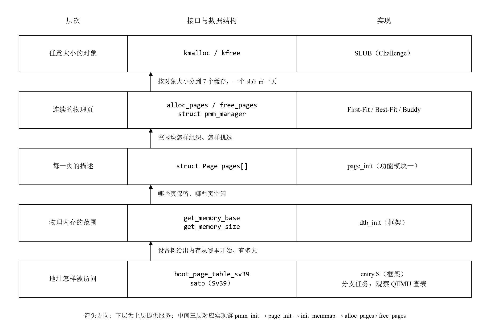

## 3.1 逻辑主线

Lab2 的主题是**物理内存管理**。lab1 结束时，内核只知道自己从哪里开始执行，对机器上有多少内存、哪些内存可以使用一无所知，也没有任何分配内存的手段。本章要解决的问题是：**内核怎样发现物理内存，怎样记录每一页的状态，又怎样把内存按需要分配出去、再收回来？**

我们认为本章可以概括成一句话：**一层一层地把内存“组织”起来，每一层都只依赖下一层提供的接口。**从下到上依次是：

图 T6-1　lab2 物理内存管理的分层结构

指导书给出的实现链 `pmm_init() → init_pmm_manager() → page_init() → init_memmap() → alloc_pages()/free_pages()` 正好对应中间三层。SLUB 搭在页分配器之上，分支任务则回到最底层，看“硬件”（QEMU）怎样使用 `entry.S` 建立的页表。

贯穿全章的还有一条副线：**区分虚拟地址、物理地址、物理页号和 `Page` 描述符的地址。**`entry.S` 打开 Sv39 后，内核运行在 `0xFFFFFFFFC0200000` 开始的高地址上，虚拟地址与物理地址相差固定的 `va_pa_offset`；而设备树给出的内存范围、页表项里的页号都是物理的，`pages` 数组又按物理页号编号（`pages[0]` 对应物理页号 `nbase = 0x80000`）。`page_init` 中最容易出错的地方，就是把这几种量混在一起比较（见功能模块一的迭代过程）。

## 3.2 功能的逐步实现

| 顺序 | 功能 | 主要代码 | 报告中的位置 |
| :---: | :--- | :--- | :--- |
| 0 | 启动页表与高地址运行（框架已完成） | `kern/init/entry.S` | 分支任务 |
| 1 | 物理内存探测与页描述符初始化 | `kern/mm/pmm.c` 的 `page_init` | 功能模块一 任务一 |
| 2 | 理解 First-Fit | `kern/mm/default_pmm.c` | 功能模块二 任务一 |
| 3 | 实现 Best-Fit 并设为默认分配器 | `kern/mm/best_fit_pmm.c` | 功能模块二 任务二 |
| 4 | 实现 Buddy System，通过编译开关接入 | `kern/mm/buddy_pmm.c` | 功能模块二 任务三 |
| 5 | 在页分配器之上实现 SLUB | `kern/mm/slub.c` | Challenge：SLUB |
| 6 | 用 GDB 调试 QEMU，观察地址翻译 | QEMU 4.1.1 源码 | 分支任务 |

0. **起点是框架已经完成的启动页表。**`entry.S` 在跳进 C 代码之前，用一个 1 GiB 的大页把虚拟地址 `0xFFFFFFFFC0000000` 起的 1 GiB 映射到物理地址 `0x80000000`，写入 `satp` 并执行 `sfence.vma`，然后跳到高地址的 `kern_init`。从这一刻起，内核里所有的指针都是虚拟地址。这一步排在最前面，因为后面的 `page_init` 必须在“内核用虚拟地址、设备用物理地址”的前提下工作。
1. **然后是 `page_init`，它是所有分配器的输入。**分配器只负责“怎样分”，“有什么可分”要由 `page_init` 告诉它：根据设备树确定物理内存的上界，在内核镜像之后为每个物理页放一个 `struct Page` 描述符，先把所有页标成保留页，再把 OpenSBI、内核镜像和描述符数组之后的那段完整空闲区交给 `init_memmap`。没有这一步，任何分配算法都没有可管理的内存，所以它排在分配算法之前。
2. **接着读懂 First-Fit。**框架自带的 `default_pmm.c` 是一个完整的分配器，读懂它就读懂了 `pmm_manager` 的六个接口各自承担什么职责，以及空闲块怎样按地址挂在链表上、分配时怎样分裂、释放时怎样与前后的块合并。我们在阅读中还发现了它释放时插入链表的一个缺陷（见功能模块二 任务一）。后面的 Best-Fit 和 Buddy 都是在这套接口下替换算法，所以先理解它。
3. **再实现 Best-Fit。**它和 First-Fit 用同样的链表结构，只改变“挑哪一块”：遍历全部空闲块，选能满足请求的最小块。改动范围小，适合用来验证我们对接口的理解；`make grade` 也要求默认分配器是 Best-Fit。
4. **然后实现 Buddy System。**这一步换掉的是空闲块的**组织方式**：从一条按地址排序的链表，变成 16 条按块大小（2 的幂）分开的链表，按物理页号对齐，靠“页号异或块长”找伙伴。它和 Best-Fit 实现的是同一个 `pmm_manager` 接口，只需在 `init_pmm_manager` 中切换指针（通过 `make PMM=buddy`）就能整体替换，内核其他部分不受影响。这说明了接口隔离的价值。
5. **最后在页分配器之上实现 SLUB。**前面的分配器都以页为单位，而内核中大量的对象只有几十字节，按页分配会浪费大量空间。SLUB 从页分配器申请整页作为 slab，把一页切成等大的对象再分出去；超过 1024 字节的请求则直接转交页分配器。它必须排在最后，因为它的第一层就是前面实现的 `alloc_pages`/`free_pages`。
6. **分支任务回到第 0 步。**前面几步都是软件在“管理”内存。分支任务用两个 GDB 同时调试 ucore 和 QEMU，观察一次访存怎样经过 QEMU 模拟的 TLB 和 `entry.S` 建立的页表，最终被翻译成物理地址。它与前面的任务互不依赖，放在最后，作为对“页表怎样被使用”的验证。

## 3.3 各功能的核心函数

**所有页分配器都实现同一个接口 `struct pmm_manager`**，内核其余部分只通过 `pmm.c` 中的 `alloc_pages`/`free_pages`/`nr_free_pages` 调用当前的分配器：

| 接口 | 职责 | 何时调用 |
| :--- | :--- | :--- |
| `init` | 初始化分配器自己的数据结构（空闲链表、计数） | `init_pmm_manager` |
| `init_memmap(base, n)` | 把 `page_init` 交来的一段连续空闲页登记为空闲块 | `page_init` 末尾 |
| `alloc_pages(n)` | 返回 n 个连续页的首页，失败返回 NULL | 内核任意位置 |
| `free_pages(base, n)` | 归还连续页，并尝试与相邻的空闲块合并 | 内核任意位置 |
| `nr_free_pages()` | 返回当前空闲页数 | 测试与统计 |
| `check()` | 分配器的自检 | `check_alloc_page` |

各功能的核心函数及我们的理解：

- **`page_init`（功能模块一）**：核心是“三个边界”。上界取设备树给出的内存末尾与 `PHYSICAL_MEMORY_END`（`0x88000000`）中较小的一个，`npage` 是上界对应的页号；`pages` 数组从内核镜像末尾 `end` 向上按页对齐的位置开始；空闲区从描述符数组的末尾（按页向上取整）开始，到上界为止（按页向下取整）。先把所有描述符都标成保留页，再只对空闲区调用 `init_memmap`，于是内核镜像和描述符数组本身永远不会被分配出去。
- **First-Fit 的 `default_alloc_pages` / `default_free_pages`（功能模块二 任务一）**：空闲块按地址顺序挂在一条链表上，只有块首页的 `property` 记录块长。分配时从头找到第一个 `property >= n` 的块，从低地址切下 n 页，剩下的部分作为新块留在原位置；释放时按地址插回链表，再检查前后两块是否与它首尾相接，相接就合并。
- **Best-Fit 的 `best_fit_alloc_pages`（功能模块二 任务二）**：遍历整条链表，记下 `property >= n` 中最小的块（大小相同时取地址最低的），分裂和释放合并的方式与 First-Fit 相同。它以完整遍历换取更小的剩余碎片。
- **Buddy 的 `buddy_insert_block` / `buddy_alloc_pages`（功能模块二 任务三）**：`buddy_insert_block` 是初始化和释放共用的核心，用 `伙伴页号 = 本块页号 XOR 块长` 定位伙伴，只有伙伴空闲且同阶时才合并，然后继续向上一阶尝试；`buddy_alloc_pages` 把请求取整到 2 的幂，从目标阶向上找第一个非空链表，逐级对半分裂，左半块继续分，右半块挂回对应的阶。
- **SLUB 的 `kmem_cache_alloc` / `kmem_cache_free` / `kmalloc`（Challenge）**：每个缓存只管一种对象大小。一个 slab 占一页，页首放 slab 头，其余空间切成对象，空闲对象用对象内部的指针串成链表。分配时优先从当前活动 slab 取，用完后从 partial 链表取，再不够才向页分配器申请新页；释放时根据对象地址向下取整到页首就能找到 slab 头。`kmalloc` 按请求大小选择 16～1024 字节中最合适的缓存，更大的请求直接按页分配。
- **QEMU 的 `get_physical_address`（分支任务）**：它是 QEMU 用软件实现的 Sv39 页表遍历，每一轮从虚拟地址中取 9 位索引，按物理地址读出页表项，根据 V、R、W、X 位判断是继续下一级还是已经到达叶子。在 lab2 中，它在第一级就遇到 `entry.S` 设置的 1 GiB 大页叶子，直接得到物理地址。

**同一个 `struct Page` 被不同的分配器用不同的方式解释**，这是对比几个分配器时最直观的体会：

| 字段 | First-Fit / Best-Fit | Buddy | SLUB |
| :--- | :--- | :--- | :--- |
| `PG_reserved` | 保留页（不参与分配） | 同左 | 不使用 |
| `PG_property` | 空闲块的首页 | 空闲块的首页 | 不使用 |
| `property` | 空闲块首页上记录块长；分配出去后不再有意义（Best-Fit 清零，First-Fit 留着旧值，只靠清掉 `PG_property` 表示已分配） | 空闲块和**已分配块**的首页都记录块长（2 的幂），释放时用它校验 | 不使用（slab 的元数据放在页内的 slab 头里） |
| `page_link` | 把空闲块首页挂进唯一的空闲链表 | 挂进对应阶的空闲链表 | 不使用（slab 头里有自己的链表节点） |

描述符的格式不变，只要求每个分配器内部对它的解释前后一致。所以几个分配器可以在同一个 `pages` 数组上互相替换，测试也可以只通过公开字段检查分配器的行为。
